# Roadmap — restaurant-hub

> **Hierarquia (ver [`PIPELINE.md`](./PIPELINE.md) §4):**
> - **Step:** entrega de negócio. Sem restrição arquitetural. Agrupa Stages.
>   Vive apenas neste documento.
> - **Stage:** unidade atômica de ciclo concept→technical→execução. 1 camada
>   do hexagonal **ou** 1 fatia vertical, 1 DoD testável, 1 bounded context,
>   complexidade ≤ M. Tem pasta `docs/stages/N.M-<slug>/` e branch
>   `feat/<num-issue>-<N-M>-<slug>` (ver `CONVENTIONS.md` §4).
> - **Task:** 1 commit. Vive no `technical.md` da Stage.
>
> **Regra de atualização:** ao marcar uma Stage como `done`, atualizar
> `updated_at` e `last_reviewed_at` no mesmo merge (ou em PR de docs
> imediato). Não opcional.
>
> **Escopo deste roadmap:** governa o **repositório backend**. O frontend
> (`restaurant-hub-frontend`) tem roadmap próprio espelhando os mesmos Steps
> de produto (ver ROADMAP-2). Um Step de produto só é `done` quando backend
> **e** frontend correspondentes entregam.

## Visão geral

```mermaid
graph LR
  subgraph Step1[Step 1 — Fundação]
    S11[1.1-bootstrap] --> S12[1.2-ci]
  end
  subgraph Step2[Step 2 — Restaurante e acesso]
    S21[2.1-identity-domain] --> S22[2.2-identity-application]
    S22 --> S23[2.3-identity-persistence]
    S23 --> S24[2.4-identity-http]
    S24 --> S25[2.5-email-invite]
  end
  subgraph Step3[Step 3 — Equipe]
    S31[3.1-staff-domain] --> S32[3.2-staff-application]
    S32 --> S33[3.3-staff-persistence]
    S33 --> S34[3.4-staff-http]
    S34 --> S35[3.5-employee-login-link]
  end
  subgraph Step4[Step 4 — Escala manual]
    S41[4.1-scheduling-domain] --> S42[4.2-validation-policies]
    S42 --> S43[4.3-scheduling-application]
    S43 --> S44[4.4-scheduling-persistence]
    S44 --> S45[4.5-scheduling-http]
    S45 --> S46[4.6-schedule-notifications]
    S45 --> S47[4.7-schedule-image]
  end
  subgraph Step5[Step 5 — Auto-preenchimento]
    S51[5.1-autofill-domain] --> S52[5.2-autofill-delivery]
  end
  subgraph Step6[Step 6 — Implantação piloto]
    S61[6.1-hosting-study] --> S62[6.2-deploy-pipeline]
    S62 --> S63[6.3-ops-baseline]
  end
  subgraph Step7[Step 7 — Ponto Control iD]
    S71[7.1-controlid-spike] --> S72[7.2-timeclock-domain]
    S72 --> S73[7.3-controlid-adapter]
    S73 --> S74[7.4-timeclock-delivery]
  end
  subgraph Step8[Step 8 — Hub v1]
    S81[8.1-hub-read-models] --> S82[8.2-hub-http]
  end
  S12 --> S21
  S25 --> S31
  S35 --> S41
  S47 --> S51
  S45 --> S61
  S12 --> S71
  S45 --> S72
  S74 --> S81
  S52 --> S81
```



## Tabela de Steps

| ID | Step | Resultado de negócio | Status | Stages |
|---|---|---|---|---|
| 1 | Fundação do repositório | Repo com scaffolding hexagonal, gates locais e CI verdes | done | 1.1 → 1.2 |
| 2 | Restaurante e acesso | Restaurante (tenant) e unidades existem no sistema; pessoas entram com papel certo (dono/gerente/RH/funcionário + admin plataforma) | done | 2.1 → 2.5 |
| 3 | Equipe da unidade | Gerente cadastra funções customizadas e funcionários com jornada (fixa/sob demanda), preferências e indisponibilidades | not_started | 3.1 → 3.5 |
| 4 | Escala manual publicável | Gerente monta, valida e publica a escala; funcionário consulta; planilha/papel aposentados | not_started | 4.1 → 4.7 |
| 5 | Auto-preenchimento | Escala se monta sozinha respeitando regras e justiça distributiva; gerente só ajusta | not_started | 5.1 → 5.2 |
| 6 | Implantação piloto | Sistema no ar para o restaurante piloto usar no dia a dia | not_started | 6.1 → 6.3 |
| 7 | Ponto (Control iD) | Previsto × realizado visível sem conferência manual | not_started | 7.1 → 7.4 |
| 8 | Hub v1 | Diretores analisam a operação (cobertura, cumprimento, extras) por unidade e na Unidade Geral | not_started | 8.1 → 8.2 |
| 9 | Estoque de insumos | Entrada por NF, baixa por fechamento × ficha técnica, alertas de reposição | not_started | a decompor |
| 10 | Integração Eyemobile | Fechamento de caixa entra sozinho no sistema | not_started | a decompor |
| 11 | Pedidos em mesa | Cliente pede por tablet na mesa ou QR code | not_started | a decompor |
| 12 | Delivery | Entregadores e rotas gerenciados | not_started | a decompor |
| 13 | Auto-cadastro e cobrança | Dono se cadastra, paga e usa sem intervenção do admin | not_started | a decompor |

**Legenda de status (Step):** `not_started`, `in_progress`, `blocked`, `done`, `deprecated`.

## Tabela de Stages

| Stage | Título | Camada-alvo | Status | Depende de |
|---|---|---|---|---|
| `1.1-bootstrap` | Bootstrap do projeto | bootstrap | done | — |
| `1.2-ci` | CI no GitHub Actions | bootstrap | done | `1.1-bootstrap` |
| `2.1-identity-domain` | Domínio de tenancy e acesso | domain | done | `1.2-ci` |
| `2.2-identity-application` | Use cases de tenancy e acesso | application | done | `2.1-identity-domain` |
| `2.3-identity-persistence` | Persistência de identity | adapters/out/postgres | done | `2.2-identity-application` |
| `2.4-identity-http` | API de tenancy, usuários e auth | adapters/in/http | done | `2.3-identity-persistence` |
| `2.5-email-invite` | Convite por e-mail | vertical (identity) | done | `2.4-identity-http` |
| `3.1-staff-domain` | Domínio de equipe | domain | draft | `2.5-email-invite` |
| `3.2-staff-application` | Use cases de equipe | application | draft | `3.1-staff-domain` |
| `3.3-staff-persistence` | Persistência de staff | adapters/out/postgres | draft | `3.2-staff-application` |
| `3.4-staff-http` | API de equipe | adapters/in/http | draft | `3.3-staff-persistence` |
| `3.5-employee-login-link` | Criar login para funcionário | vertical (staff) | draft | `3.4-staff-http` |
| `4.1-scheduling-domain` | Domínio da escala | domain | draft | `3.5-employee-login-link` |
| `4.2-validation-policies` | Políticas de validação configuráveis | domain | draft | `4.1-scheduling-domain` |
| `4.3-scheduling-application` | Use cases da escala | application | draft | `4.2-validation-policies` |
| `4.4-scheduling-persistence` | Persistência da escala + auditoria | adapters/out/postgres | draft | `4.3-scheduling-application` |
| `4.5-scheduling-http` | API do editor e consulta de escala | adapters/in/http | draft | `4.4-scheduling-persistence` |
| `4.6-schedule-notifications` | Notificação de publicação por e-mail | vertical (scheduling) | draft | `4.5-scheduling-http` |
| `4.7-schedule-image` | Imagem/tabela da escala sob demanda | vertical (scheduling) | draft | `4.5-scheduling-http` |
| `5.1-autofill-domain` | Algoritmo de auto-preenchimento | domain | draft | `4.7-schedule-image` |
| `5.2-autofill-delivery` | Preview e aplicação do auto-fill | vertical (scheduling) | draft | `5.1-autofill-domain` |
| `6.1-hosting-study` | Estudo de hospedagem (ADR) | bootstrap | draft | `4.5-scheduling-http` |
| `6.2-deploy-pipeline` | CD para development/production | bootstrap | draft | `6.1-hosting-study` |
| `6.3-ops-baseline` | Backup, healthcheck e runbook | shared/infrastructure | draft | `6.2-deploy-pipeline` |
| `7.1-controlid-spike` | Spike API Control iD (ASSUM-1) | bootstrap | draft | `1.2-ci` |
| `7.2-timeclock-domain` | Domínio de ponto e conciliação | domain | draft | `7.1-controlid-spike`, `4.5-scheduling-http` |
| `7.3-controlid-adapter` | Adapter Control iD | adapters/out/controlid | draft | `7.2-timeclock-domain` |
| `7.4-timeclock-delivery` | Relatório previsto × realizado | vertical (timeclock) | draft | `7.3-controlid-adapter` |
| `8.1-hub-read-models` | Read models do hub | application | draft | `7.4-timeclock-delivery`, `5.2-autofill-delivery` |
| `8.2-hub-http` | API dos painéis + Unidade Geral | adapters/in/http | draft | `8.1-hub-read-models` |

**Legenda de status (Stage):** `draft`, `in_progress`, `review`, `done`, `archived`.

## Tabela de Issues

Issues **avulsas** — trabalho cujo concept+technical cabem no corpo da issue (fix, docs,
chore), sem pasta de Stage. O litmus está em [`PIPELINE.md`](./PIPELINE.md) §4.5: se o corpo
vira um mini-concept, **promova a Stage**. Issue de Stage não entra aqui — vive na Tabela de
Stages, e seu número fica no `issue_id` do `technical.md`.

| Issue | Título | BC | Camada-alvo | Status | Depende de |
|---|---|---|---|---|---|
| [#2](https://github.com/MarceloSanC/restaurant-hub/issues/2) | Adaptar fluxo de Step (prompt, ADR e gates) ao restaurant-hub | shared | docs + scripts | done | — |
| [#6](https://github.com/MarceloSanC/restaurant-hub/issues/6) | Plugar `configure_logging` no boot da aplicação | shared | shared/infrastructure + bootstrap | open | — |
| [#7](https://github.com/MarceloSanC/restaurant-hub/issues/7) | Alinhar hook mirrors-mypy e prevenir drift de versão dos hooks pre-commit | shared | tooling | open | — |
| [#8](https://github.com/MarceloSanC/restaurant-hub/issues/8) | Definir política de fim de linha com `.gitattributes` e renormalizar | shared | repo | open | — |
| [#10](https://github.com/MarceloSanC/restaurant-hub/issues/10) | Ativar modo autônomo para as stages 1.2→3.5 (ADR 0.0.0004 accepted) | shared | docs | open | — |
| [#12](https://github.com/MarceloSanC/restaurant-hub/issues/12) | Padronizar placeholders de Stage que viram comando (stage_id × número) | shared | docs | open | — |
| [#16](https://github.com/MarceloSanC/restaurant-hub/issues/16) | `check_stage_issue.py` aprova issue CLOSED (busca state mas não usa) | shared | tooling | open | — |

**Legenda de status (issue):** `open`, `blocked`, `placeholder`, `done`. Vocabulário ditado pelo
consumidor desta tabela, [`PROMPT-issue-single-session.md`](./PROMPT-issue-single-session.md):
`placeholder` = marcador de backlog sem DoD (não implementar direto); `blocked` = dependência
externa não resolvida; `done` é o estado final que o prompt grava ao fechar (§DoD).

---

## Detalhamento por Step

### Step 1 — Fundação do repositório

- **Resultado de negócio:** projeto pronto para receber features com gates de qualidade automáticos (lint, types, testes, layout) locais e no GitHub.
- **Depende de:** —
- **Tamanho estimado:** S–M

#### Stage 1.1 — `1.1-bootstrap`

**Descrição humana:** validar e completar o scaffolding copiado do template no **Windows nativo**: `make setup`/`check`/`test` verdes e reprodutíveis (Makefile shell-agnostic, `uv.lock` versionado com lock-check), pre-commit ativo, import-linter refletindo LAYOUT.md, gate de cobertura ≥ 90% ativo (com suite de testes do kernel `shared/`), tree.txt gerado e docs corrigidos. Sem regra de negócio. Ver `docs/stages/1.1-bootstrap/`.

```yaml
stage_id: 1.1-bootstrap
bounded_context: shared
camada_alvo: bootstrap
arquivos_a_criar:
  - uv.lock (gerado por make setup; versionado)
  - tree.txt (gerado por scripts/regen_tree.py; gitignorado)
  - .importlinter (contratos espelhando LAYOUT §3)
  - .claude/settings.json (env compartilhado; settings.local.json sai do git)
  - scripts/clean.py (lógica do make clean, shell-agnostic)
  - tests/unit/shared/ + tests/unit/test_bootstrap.py + tests/e2e/test_app_smoke.py
  - docs/adr/1_1_0001 (ambiente Windows-nativo) e 1_1_0002 (gates de PR observacionais)
arquivos_a_modificar:
  - Makefile (receitas shell-agnostic; uv sync; test-gate com cobertura; import/lock-check)
  - pyproject.toml (dep import-linter)
  - .pre-commit-config.yaml (hook lint-imports)
  - .gitignore (settings.local.json)
  - README.md, docs/runbooks/validate-ci-gate.md, docs/LAYOUT.md (ambiente real)
  - docs/roadmap.md (este bloco) + docs/stages/1.1-bootstrap/ (artefatos do próprio ciclo)
contratos_introduzidos: []
contratos_consumidos: []
definition_of_done:
  - "`make setup && make check && make test` verdes na máquina local (Windows nativo)"
non_goals:
  - features de negócio
  - CI no GitHub (Stage 1.2)
complexidade_estimada: M
gate_mode: strict
skills_hint: [hex-arch-python, import-linter-rules]
```

> Nota (2026-07-14): bloco corrigido durante a execução da Stage (issue #1) —
> a feature-exemplo de pedidos do boilerplate, citada originalmente em
> `arquivos_a_modificar`, não existia no bootstrap (letra morta) e o escopo
> real reavaliou a complexidade de S para M.

#### Stage 1.2 — `1.2-ci`

**Descrição humana:** ativar e validar o pipeline de CI vindo do boilerplate no GitHub Actions (lint + types + testes em PR e push para main/develop), corrigindo o que quebrar; validação ponta-a-ponta com PR de teste.

```yaml
stage_id: 1.2-ci
bounded_context: shared
camada_alvo: bootstrap
arquivos_a_criar:
  - docs/adr/1_2_0001-deterministic-pr-path-gates.md
  - docs/stages/1.2-ci/ (artefatos do próprio ciclo)
arquivos_a_modificar:
  - .github/workflows/ci.yml (ajustes para o repo real)
  - docs/runbooks/validate-ci-gate.md (dever da §Maintenance do próprio runbook)
  - docs/roadmap.md (este bloco)
definition_of_done:
  - "PR de teste com erro intencional falha no CI; revertido, CI verde em <5min"
contratos_introduzidos: []
contratos_consumidos: []
non_goals:
  - deploy/CD (Step 6)
  - cache de dependências (otimização posterior)
complexidade_estimada: S
gate_mode: strict
skills_hint: [git-versioning-pointer]
```

> Nota (2026-07-16): bloco corrigido durante a execução da Stage (issue #9) —
> `arquivos_a_criar`/`arquivos_a_modificar` citavam só o `ci.yml` e omitiam os
> caminhos que a própria Stage necessariamente toca: a §Maintenance do
> `docs/runbooks/validate-ci-gate.md` obriga toda Stage que endurece o gate de CI
> a estender o runbook na mesma Stage, a Fase 3A produziu um ADR, e os artefatos
> da Stage + este bloco também são tocados (mesmo padrão declarado no bloco da
> 1.1). `contratos_introduzidos: []` e `complexidade_estimada: S` seguem válidos:
> 5 Tasks, nenhuma mudança de código-fonte (`src/`/`scripts/`). As fronteiras que
> a Fase 3A avaliou e recusou (higiene de runner-minutes; levar o gate
> issue-first ao caminho de PR) ficam registradas no `concept.md` §1 "Fora do
> escopo" e no ADR 1.2.0001 — **não** foram acrescentadas aos `non_goals` daqui,
> para não fazer o Roadmap citar como norma uma decisão do Concept que ele
> governa.

---

### Step 2 — Restaurante e acesso (BC `identity`)

- **Resultado de negócio:** o restaurante piloto e sua unidade existem no sistema; dono, gerente, RH e funcionários entram com login e enxergam apenas o que o papel permite; admin de plataforma (Marcelo) cria/gerencia tenants.
- **Depende de:** Step 1.
- **Tamanho estimado:** M

#### Stage 2.1 — `2.1-identity-domain`

**Descrição humana:** modelar tenancy e acesso — Restaurante (tenant), Unidade, Usuário, papéis fixos de acesso (platform_admin, owner, manager, hr, employee) e permissões; invariantes de isolamento entre tenants e de vínculo usuário↔unidades.

```yaml
stage_id: 2.1-identity-domain
bounded_context: identity
camada_alvo: domain
arquivos_a_criar:
  - features/identity/domain/entities/{restaurant,unit,user}.py
  - features/identity/domain/value_objects/{email,role,permission}.py
  - features/identity/domain/exceptions/
  - tests/unit/features/identity/domain/
arquivos_a_modificar: []
contratos_introduzidos:
  - Restaurant, Unit, User (entities)
  - Email, Role, Permission (value-objects)
definition_of_done:
  - "invariantes de tenancy e RBAC cobertas por testes unitários verdes (sem I/O)"
contratos_consumidos: []
non_goals:
  - persistência, HTTP, hash de senha (camadas seguintes)
  - funções de trabalho customizáveis (BC staff — Step 3)
complexidade_estimada: M
gate_mode: strict
skills_hint: [ddd-tactical-patterns, hex-arch-python]
```

> Nota (2026-07-18): bloco corrigido durante a execução da Stage (issue #17) —
> o recorte real tocou mais do que o bloco previa, em dois eixos. **File-scope:**
> por ser a 1ª feature-slice do repo, `scripts/check_layout.py`
> (`REQUIRED_FEATURE_DIRS`) exige os três diretórios da feature, então entraram
> `features/identity/{application,adapters}/__init__.py` como pacotes-placeholder
> vazios; e o `.importlinter` foi **modificado** (contrato aditivo
> `identity-domain-purity`, espelhando LAYOUT §3 como o `domain-purity` já fazia
> para `shared.domain`) — logo `arquivos_a_modificar: []` não se sustentou.
> **Contratos:** além de `Restaurant/Unit/User` e `Email/Role/Permission`, a Stage
> introduziu os identificadores tipados (`RestaurantId/UnitId/UserId`), o VO
> `UnitMembership` (esqueleto do vínculo user↔unit — kickoff #1, já citado na
> descrição humana) e a hierarquia de exceções do BC (`IdentityError` + 7
> subclasses); e **consome** `DomainError` de `shared/domain` (1.1), contra
> `contratos_consumidos: []`. `complexidade_estimada: M` e `gate_mode: strict`
> seguem válidos (7 Tasks + 4 commits de correção de revisão). As decisões de
> modelagem estão nos ADRs 2.1.0001 (agregados e membership) e 2.1.0002
> (`platform_admin` sem tenant); os desvios de execução, na §7 do `technical.md`.

#### Stage 2.2 — `2.2-identity-application`

**Descrição humana:** use cases de criação de tenant/unidade/usuário, autenticação (login) e autorização (checagem de permissão por papel), com ports de repositório, hasher de senha e emissor de token; testes com fakes.

```yaml
stage_id: 2.2-identity-application
bounded_context: identity
camada_alvo: application
arquivos_a_criar:
  - features/identity/application/use_cases/{create_restaurant,create_unit,create_user,authenticate_user,authorize_action}.py
  - features/identity/application/ports/out/{restaurant_repository,unit_repository,user_repository,password_hasher,token_issuer}.py
  - features/identity/application/dtos/
  - tests/unit/features/identity/application/ + tests/fakes/features/identity/
arquivos_a_modificar: []
contratos_introduzidos:
  - RestaurantRepository, UnitRepository, UserRepository, PasswordHasher, TokenIssuer (ports-out)
  - commands/results DTOs de identity
contratos_consumidos:
  - entities/VOs de 2.1
definition_of_done:
  - "use cases de tenancy/auth passam com fakes; nenhuma import de adapters"
non_goals:
  - convite por e-mail (2.5)
  - adapters reais (2.3/2.4)
complexidade_estimada: M
gate_mode: strict
skills_hint: [pytest-with-fakes, task-ordering-hex, hex-arch-python]
```

> Nota (2026-07-19): bloco corrigido durante a execução da Stage (issue #20) —
> o recorte real extrapolou o bloco em três eixos, todos **aditivos**.
> **Contratos:** entrou um sexto port-out, `SessionRepository`, exigido pela
> decisão de kickoff #1 (refresh persistido e rotacionado, para que logout e
> demissão cortem acesso de verdade); a issue #20 autoriza explicitamente
> modelá-lo e registrá-lo em ADR (2.2.0001). Junto dele vieram os DTOs
> `Session`/`IssuedRefreshToken`/`AccessTokenClaims`/`UserCredentials`, e
> `PasswordHasher` ganhou `dummy_hash()` (defesa contra enumeração de contas por
> tempo de resposta — ADR 2.2.0003 e concept §5.14). **File-scope:**
> `arquivos_a_modificar: []` não se sustentou — o `.importlinter` recebeu o
> contrato aditivo `identity-application-purity` (espelhando LAYOUT §3 como a 2.1
> fez para o domínio), o `Makefile` passou a rodar `mypy` também sobre
> `tests/fakes/` (sem isso a conformidade fake↔`Protocol` não tinha gate algum),
> `docs/LAYOUT.md` §2 passou a prever `tests/fakes/shared/`, e `pyproject.toml`
> ativou `branch = true` na cobertura. **Consequências para as Stages seguintes,
> ainda não refletidas nos blocos 2.3 e 2.4:** a 2.3 precisa implementar
> `session_repository.py` + a tabela de sessões (e uma política de expurgo das
> expiradas); a 2.4 precisa de `application/use_cases/refresh_session.py` — o
> endpoint de refresh já está alocado lá, mas o arquivo do use case não. Ambos
> registrados como `[finding]` na §7 do `technical.md` da 2.2.

#### Stage 2.3 — `2.3-identity-persistence`

**Descrição humana:** repositórios PostgreSQL de identity (com `tenant_id` nas tabelas em que ele é dado — ROADMAP-3; `sessions` é a exceção deliberada e alcança o tenant por `user_id`, ADR 2.3.0002), mappers, migrations iniciais e testes de integração + contrato (fake ≡ real).

```yaml
stage_id: 2.3-identity-persistence
bounded_context: identity
camada_alvo: adapters/out/postgres
arquivos_a_criar:
  - features/identity/adapters/out/postgres/{restaurant_repository,unit_repository,user_repository,mappers,tables}.py
  - migrations/versions/0001_identity_initial.py
  - tests/integration/features/identity/ + tests/contract/features/identity/
arquivos_a_modificar:
  - composition_root.py (wiring dos repositórios)
contratos_introduzidos: []
contratos_consumidos:
  - ports-out de 2.2
definition_of_done:
  - "testes de integração e de contrato verdes contra Postgres real (docker)"
non_goals:
  - row-level security nativa do Postgres (avaliar em ADR futuro se necessário)
complexidade_estimada: M
gate_mode: strict
skills_hint: [repository-pattern, composition-root, pytest-with-fakes]
```

> **Nota (2026-07-19): bloco corrigido durante a execução da Stage (issue #22)** —
> file-scope e contratos reais.
>
> - **`tenant_id` NÃO fica em todas as tabelas — a descrição humana acima foi corrigida.**
>   `sessions` não recebe a coluna: o DTO `Session` não carrega tenant, então ela seria
>   inatingível pelo port e impossível para o fake; e, como o tenant de um `platform_admin`
>   é nulo, a FK composta sobre ela seria MATCH SIMPLE — desligada justamente no caso que
>   deveria proteger. O isolamento de sessão chega por `user_id`. Decisão validada
>   empiricamente contra Postgres 16 (com controle negativo) — ADR 2.3.0002.
> - **Sessão persistida (reconciliação pendente do ADR 2.2.0001).** O bloco não citava
>   `session_repository.py` nem a tabela `sessions`; ambos existem, como consequência
>   direta do 6º port introduzido na 2.2. O ADR 2.2.0001 §Consequences já previa esta
>   reconciliação.
> - **Arquivos não previstos:** `integrity_errors.py` (tradução de violação de constraint
>   por `diag.constraint_name`, sem parsing de mensagem), a infra do Alembic
>   (`migrations/env.py`, `alembic.ini`, `script.py.mako`), e ajustes em
>   `shared/infrastructure/{config/settings,database/connection}.py` + `pyproject.toml`
>   (driver `psycopg`).
> - **`contratos_introduzidos: []` ficou desatualizado:** a Stage estendeu os ports-out de
>   2.2 com os erros de chave duplicada (`restaurant/unit/user/session_repository`,
>   `errors.py`, `credentials.py`) — extensão aditiva, não contraditória.
> - **`.github/workflows/ci.yml` alterado:** o job de gate passou a exigir Postgres real
>   (ADR 2.3.0001) — sem isso os testes de integração passariam por ausência.
> - **5 ADRs novos:** 2.3.0001 (integração exige Postgres real), 2.3.0002 (schema, tenant e
>   constraints), 2.3.0003 (`add` é inserção, não upsert), 2.3.0004 (retenção e purge de
>   sessão), 2.3.0005 (nomes persistidos verbatim).
> - `complexidade_estimada: M` e `gate_mode: strict` seguem válidos (12 Tasks + commits de
>   correção de revisão e de auditoria). Os desvios de execução estão na §7 do
>   `technical.md`.

#### Stage 2.4 — `2.4-identity-http`

**Descrição humana:** endpoints FastAPI de auth (login/refresh) e CRUD de tenants/unidades/usuários com enforcement de RBAC via dependência (`Depends`, não middleware — ver nota); adapters de PasswordHasher (**argon2**, ADR 2.4.0004) e TokenIssuer (JWT); e2e feliz + acesso negado.

```yaml
stage_id: 2.4-identity-http
bounded_context: identity
camada_alvo: adapters/in/http
arquivos_a_criar:
  - features/identity/adapters/in/http/{router,schemas,dependencies}.py
  - features/identity/adapters/out/security/{argon2_hasher,jwt_issuer}.py
  - tests/e2e/features/identity/
arquivos_a_modificar:
  - composition_root.py, shared/infrastructure/http/app.py (registrar router e middleware de auth)
contratos_introduzidos: []
contratos_consumidos:
  - use cases/ports de 2.2
definition_of_done:
  - "e2e: admin cria tenant→unidade→usuário; login emite JWT; ação sem permissão retorna 403"
non_goals:
  - convite por e-mail (2.5), reset de senha (entra com 2.5)
complexidade_estimada: M
gate_mode: strict
skills_hint: [fastapi-thin-adapter, composition-root]
```

> **Nota (2026-07-20): bloco corrigido durante a execução da Stage (issue #24)** —
> file-scope e contratos reais.
>
> - **`contratos_introduzidos: []` ficou desatualizado:** a Stage **estendeu** o port
>   `TokenIssuer` com `decode_access_token` (ADR 2.4.0002) — extensão aditiva, decidida
>   aqui porque decodificar é a operação inversa de emitir e pertence ao mesmo port.
> - **Dois use cases novos na camada application, não previstos no bloco:**
>   `refresh_session.py` (rotação) e `revoke_session.py` (logout). O ADR 2.2.0001 já
>   alocava a rotação a esta Stage; o bloco não refletia.
> - **Arquivos não previstos:** `adapters/in/http/error_handlers.py` (mapa exceção →
>   status, ADR 2.4.0001), campos de token em `shared/infrastructure/config/settings.py`,
>   `.importlinter` (contrato da nova camada), `.env.example` e `pyproject.toml`
>   (`argon2-cffi`, `pyjwt`).
> - **Testes além do previsto:** o bloco citava só `tests/e2e/features/identity/`; a Stage
>   entregou também `tests/contract/features/identity/test_security_contract.py`, provando
>   fake ≡ real para `PasswordHasher` e `TokenIssuer` — o mesmo padrão que a 2.3 usou para
>   os repositórios.
> - **`bcrypt` não entrou — a descrição humana acima foi corrigida.** O bloco dizia
>   "argon2/bcrypt"; a escolha foi **argon2** (ADR 2.4.0004), sem alternativa
>   implementada — trocar é um adapter.
> - **Não há middleware de auth — a descrição humana acima foi corrigida.** O bloco previa
>   "registrar router e middleware de auth"; o enforcement é uma **dependência**
>   (`Depends`), não middleware. `Depends` roda por rota com o contrato explícito na
>   assinatura, enquanto middleware roda para tudo e precisaria de lista de exceções para
>   as rotas públicas de auth — lista que silenciosamente deixa rota nova desprotegida.
>   ADR 2.4.0003.
> - **4 ADRs novos:** 2.4.0001 (mapa de status HTTP), 2.4.0002 (`decode` estende
>   `TokenIssuer`), 2.4.0003 (composição de autorização no boundary), 2.4.0004 (parâmetros
>   do adapter de segurança).
> - **Decisões do sponsor de 2026-07-19 aplicadas aqui:** só `platform_admin` cria
>   restaurante (o `owner` cria unidades; auto-cadastro segue no Step 13) e a janela de
>   revogação fecha por **TTL curto de access token, configurável** — sem introspecção por
>   request, com `session_id` já nos claims para permiti-la depois.
> - `complexidade_estimada: M` e `gate_mode: strict` seguem válidos (12 Tasks + commits de
>   correção de revisão e de auditoria). Os desvios de execução estão na §7 do
>   `technical.md`.

#### Stage 2.5 — `2.5-email-invite`

**Descrição humana:** fatia vertical do convite: port compartilhado `EmailSender` + `ConsoleSender` (o adapter free-tier da ROADMAP-5 **não** entrou — ver nota) + use cases de convite, definição de senha por token e pedido de reset + endpoints; cobre também reset de senha (mesmo mecanismo de token). Inclui persistência do token (uso único).

```yaml
stage_id: 2.5-email-invite
bounded_context: identity
camada_alvo: vertical (application + adapters, BC identity)
arquivos_a_criar:
  - shared/application/ports/email_sender.py
  - shared/infrastructure/email/{smtp_or_api_sender,console_sender}.py
  - features/identity/application/use_cases/{invite_user,set_password_with_token}.py
  - features/identity/adapters/in/http/ (rotas de convite/definir senha)
  - tests (unit com fake, e2e do fluxo de convite)
arquivos_a_modificar:
  - composition_root.py
contratos_introduzidos:
  - EmailSender (port-out compartilhado)
contratos_consumidos:
  - UserRepository/TokenIssuer de 2.2
definition_of_done:
  - "fluxo: convite gera e-mail (ConsoleSender em dev) com link; token define senha; login funciona"
non_goals:
  - templates de e-mail elaborados; provedor definitivo (troca é 1 adapter)
complexidade_estimada: M
gate_mode: strict
skills_hint: [task-ordering-hex, fastapi-thin-adapter, composition-root]
```

> **Nota (2026-07-20): bloco corrigido durante a execução da Stage (issue #27)** —
> as cinco divergências abaixo estão declaradas no concept §1 e reconciliadas aqui.
>
> - **Persistência entrou no escopo.** O bloco não lista tabela, migration nem
>   `adapters/out`. O DoD ("token define a senha") somado à exigência de **uso único**
>   é inalcançável sem estado no servidor — a alternativa stateless foi examinada e
>   rejeitada no ADR 2.5.0002. Entraram `password_setup_tokens`, a migration `0002` e
>   o adapter Postgres.
> - **Três use cases, não dois.** Além de `invite_user` e `set_password_with_token`,
>   entrou `request_password_reset`: o pedido de reset é **público** e o convite é
>   autenticado, então precisam de caminhos de entrada distintos.
> - **`smtp_or_api_sender` não foi entregue — a descrição humana acima foi corrigida.**
>   A issue #27 autorizou explicitamente fechar o DoD com `ConsoleSender`. O adapter
>   real (Resend, kickoff #7 / ASSUM-3) é `[finding]` para a **6.2**.
> - **`TokenIssuer` não é consumido**, contra o que `contratos_consumidos` diz. O token
>   de convite/reset tem ciclo de vida próprio (uso único, prazo curto, canal fora de
>   banda) e ganhou mecanismo separado — ADR 2.5.0002. Reusar token de sessão como
>   token de convite seria vulnerabilidade, não economia.
> - **O port ficou em `shared/application/ports/out/`**, não em
>   `shared/application/ports/`: `out/` é a convenção vigente (`clock.py`,
>   `id_generator.py`) e LAYOUT §5 separa ports primários de secundários.
> - **`EmailSender` nasceu em `shared/`** (ADR 2.5.0001), decidindo a tensão que a issue
>   #27 levantou entre o roadmap e o LAYOUT §4: a regra do LAYOUT existe contra
>   abstração **prematura**, e prematuro é o que não tem segundo consumidor
>   identificado — a 4.6 já o nomeia em `contratos_consumidos`.
> - **4 ADRs novos:** 2.5.0001 (`EmailSender` em shared), 2.5.0002 (token de setup
>   dedicado e de uso único), 2.5.0003 (definir senha revoga todas as sessões),
>   2.5.0004 (`unusable_hash` para conta pendente).
> - **Achado de segurança fechado antes de virar código:** o plano original gravava
>   `dummy_hash()` na conta convidada — que é o hash de um literal do repositório, ou
>   seja, **bypass de autenticação** para qualquer convidado não ativado. Pego por dois
>   revisores no Checkpoint A; corrigido com `unusable_hash()` (ADR 2.5.0004).
> - `complexidade_estimada: M` e `gate_mode: strict` seguem válidos (13 Tasks + commits
>   de correção de revisão e de auditoria).

---

### Step 3 — Equipe da unidade (BC `staff`)

- **Resultado de negócio:** gerente cadastra funções 100% customizadas (ex.: cozinheiro, atendente, faxineiro), funcionários com jornada fixa ou sob demanda, preferência de turno e períodos de indisponibilidade; pode copiar funcionário para outra unidade e criar login para ele.
- **Depende de:** Step 2.
- **Tamanho estimado:** M

#### Stage 3.1 — `3.1-staff-domain`

**Descrição humana:** modelar Funcionário, Função (customizável por restaurante), perfil de jornada (fixa com carga; sob demanda tipo extra/gerente/dono), preferência de turno e Indisponibilidade (períodos); invariantes (ex.: indisponibilidades não sobrepostas).

```yaml
stage_id: 3.1-staff-domain
bounded_context: staff
camada_alvo: domain
arquivos_a_criar:
  - features/staff/domain/entities/{employee,job_function}.py
  - features/staff/domain/value_objects/{workload_profile,shift_preference,unavailability_period}.py
  - features/staff/domain/exceptions/
  - tests/unit/features/staff/domain/
arquivos_a_modificar: []
contratos_introduzidos:
  - Employee, JobFunction (entities); WorkloadProfile, ShiftPreference, UnavailabilityPeriod (value-objects)
contratos_consumidos: []
definition_of_done:
  - "invariantes de jornada e indisponibilidade cobertas por testes unitários verdes"
non_goals:
  - vínculo com login/usuário (3.5); persistência/HTTP
complexidade_estimada: M
gate_mode: strict
skills_hint: [ddd-tactical-patterns, hex-arch-python]
```

#### Stage 3.2 — `3.2-staff-application`

**Descrição humana:** use cases CRUD de função e funcionário, definição de jornada/preferência, registro de indisponibilidade e cópia de funcionário para outra unidade (sem compartilhamento); ports e testes com fakes.

```yaml
stage_id: 3.2-staff-application
bounded_context: staff
camada_alvo: application
arquivos_a_criar:
  - features/staff/application/use_cases/{create_job_function,create_employee,update_workload,register_unavailability,copy_employee_to_unit,...}.py
  - features/staff/application/ports/out/{employee_repository,job_function_repository}.py
  - features/staff/application/dtos/ + tests com fakes
arquivos_a_modificar: []
contratos_introduzidos:
  - EmployeeRepository, JobFunctionRepository (ports-out)
contratos_consumidos:
  - entities/VOs de 3.1
definition_of_done:
  - "use cases verdes com fakes; cópia entre unidades duplica cadastro sem vazar dados entre unidades"
non_goals:
  - noção de escala/demanda (Step 4)
complexidade_estimada: M
gate_mode: strict
skills_hint: [pytest-with-fakes, task-ordering-hex]
```

#### Stage 3.3 — `3.3-staff-persistence`

**Descrição humana:** repositórios PostgreSQL de staff, mappers, migration e testes de integração + contrato.

```yaml
stage_id: 3.3-staff-persistence
bounded_context: staff
camada_alvo: adapters/out/postgres
arquivos_a_criar:
  - features/staff/adapters/out/postgres/
  - migrations/versions/0002_staff.py
  - tests/integration + tests/contract de staff
arquivos_a_modificar:
  - composition_root.py
contratos_introduzidos: []
contratos_consumidos:
  - ports-out de 3.2
definition_of_done:
  - "integração + contrato verdes contra Postgres"
non_goals: []
complexidade_estimada: S
gate_mode: strict
skills_hint: [repository-pattern]
```

#### Stage 3.4 — `3.4-staff-http`

**Descrição humana:** endpoints de funções, funcionários, jornadas e indisponibilidades com RBAC (gerente/RH/dono da unidade); e2e cobrindo permissões.

```yaml
stage_id: 3.4-staff-http
bounded_context: staff
camada_alvo: adapters/in/http
arquivos_a_criar:
  - features/staff/adapters/in/http/{router,schemas}.py
  - tests/e2e/features/staff/
arquivos_a_modificar:
  - composition_root.py, app factory (router)
contratos_introduzidos: []
contratos_consumidos:
  - use cases de 3.2; authorize de identity (via dependency)
definition_of_done:
  - "e2e: gerente cria função custom e funcionário com jornada; funcionário de outra unidade não aparece"
non_goals: []
complexidade_estimada: S
gate_mode: strict
skills_hint: [fastapi-thin-adapter]
```

#### Stage 3.5 — `3.5-employee-login-link`

**Descrição humana:** fatia vertical "criar login para este funcionário": use case em staff consumindo contrato de identity (criar usuário employee + convite/senha provisória) e vinculando `user_id` ao funcionário.

```yaml
stage_id: 3.5-employee-login-link
bounded_context: staff
camada_alvo: vertical (staff, consumindo port de identity)
arquivos_a_criar:
  - features/staff/application/ports/out/identity_gateway.py
  - features/staff/application/use_cases/create_login_for_employee.py
  - features/staff/adapters/out/identity/local_identity_gateway.py (chama use cases de identity in-process)
  - rota no router de staff + testes
arquivos_a_modificar:
  - composition_root.py
contratos_introduzidos:
  - IdentityGateway (port-out de staff)
contratos_consumidos:
  - invite_user/create_user de identity (2.2/2.5)
definition_of_done:
  - "e2e: botão-endpoint cria user employee, envia convite (ou senha provisória) e vincula ao funcionário"
non_goals:
  - página do funcionário ver escala (Step 4)
complexidade_estimada: S
gate_mode: strict
skills_hint: [hex-arch-python, composition-root]
```

---

### Step 4 — Escala manual publicável (BC `scheduling`)

- **Resultado de negócio:** gerente configura faixas por dia e demanda por função, aloca pessoas com validação ao vivo (bloquear/avisar configurável), salva=publica com auditoria; funcionário logado vê a própria escala; e-mail opcional a cada publicação; imagem/tabela gerada sob demanda; escalas anteriores viram referência fácil. **Aposenta a planilha.**
- **Depende de:** Step 3.
- **Tamanho estimado:** M–L (7 Stages; cada uma ≤ M)

#### Stage 4.1 — `4.1-scheduling-domain`

**Descrição humana:** modelar Escala (período configurável, default semanal), Faixa/Turno por dia, Demanda por função×faixa, Alocação de funcionário e o evento de publicação (salvar=publicar, com registro de quem/quando); invariantes estruturais (demanda ≥ 0, alocação dentro do período etc.).

```yaml
stage_id: 4.1-scheduling-domain
bounded_context: scheduling
camada_alvo: domain
arquivos_a_criar:
  - features/scheduling/domain/entities/{schedule,shift_demand,assignment}.py
  - features/scheduling/domain/value_objects/{schedule_period,time_range,demand_quantity}.py
  - features/scheduling/domain/exceptions/ + tests unit
arquivos_a_modificar: []
contratos_introduzidos:
  - Schedule, ShiftDemand, Assignment (entities); SchedulePeriod, TimeRange (value-objects)
contratos_consumidos:
  - EmployeeId/JobFunctionId de staff (referência por id, sem import de entidade — regra LAYOUT)
definition_of_done:
  - "montagem e publicação de escala com invariantes cobertas por testes unitários"
non_goals:
  - validações configuráveis (4.2); auto-fill (Step 5)
complexidade_estimada: M
gate_mode: strict
skills_hint: [ddd-tactical-patterns, hex-arch-python]
```

#### Stage 4.2 — `4.2-validation-policies`

**Descrição humana:** políticas de validação **parametrizáveis por restaurante** como estratégias plugáveis de domínio (sobreposição de alocações, descanso mínimo entre jornadas, teto de horas dia/semana, carga contratada), cada uma com modo `block`/`warn`; avaliador que devolve lista de violações para a UI exibir ao vivo.

```yaml
stage_id: 4.2-validation-policies
bounded_context: scheduling
camada_alvo: domain
arquivos_a_criar:
  - features/scheduling/domain/services/validation/{policy_protocol,overlap_policy,rest_between_shifts_policy,max_hours_policy,workload_policy,evaluator}.py
  - features/scheduling/domain/value_objects/validation_config.py
  - tests unit por política e do evaluator
arquivos_a_modificar: []
contratos_introduzidos:
  - ValidationPolicy (protocol), ValidationConfig, Violation (VOs)
contratos_consumidos:
  - entidades de 4.1; WorkloadProfile de staff (por dados, não import)
definition_of_done:
  - "evaluator aplica só políticas habilitadas na config do restaurante e distingue block × warn (testes unit)"
non_goals:
  - persistir config (4.4); UI
complexidade_estimada: M
gate_mode: strict
skills_hint: [ddd-tactical-patterns, hex-arch-python]
```

#### Stage 4.3 — `4.3-scheduling-application`

**Descrição humana:** use cases: criar/configurar escala do período, editar demanda e alocações com avaliação de violações a cada mudança, aceitar violações warn, publicar (salvar), consultar calendário (dia/semana/mês), listar escalas anteriores e "minha escala" do funcionário; ports (ScheduleRepository, StaffReadPort, ScheduleConfigRepository).

```yaml
stage_id: 4.3-scheduling-application
bounded_context: scheduling
camada_alvo: application
arquivos_a_criar:
  - features/scheduling/application/use_cases/{create_schedule,update_demand,assign_employee,evaluate_schedule,publish_schedule,get_calendar,list_past_schedules,get_my_schedule,...}.py
  - features/scheduling/application/ports/out/{schedule_repository,schedule_config_repository,staff_read_port}.py
  - dtos + tests com fakes
arquivos_a_modificar: []
contratos_introduzidos:
  - ScheduleRepository, ScheduleConfigRepository, StaffReadPort (ports-out)
contratos_consumidos:
  - domain 4.1/4.2; dados de staff via StaffReadPort
definition_of_done:
  - "fluxo editar→avaliar→publicar coberto com fakes, incluindo aceite consciente de warns"
non_goals:
  - e-mail (4.6), imagem (4.7), auto-fill (5)
complexidade_estimada: M
gate_mode: strict
skills_hint: [pytest-with-fakes, task-ordering-hex]
```

#### Stage 4.4 — `4.4-scheduling-persistence`

**Descrição humana:** persistência da escala (com histórico de edições — quem alterou o quê e quando, para auditoria), config de validação por restaurante e adapter do StaffReadPort; migrations; testes integração + contrato.

```yaml
stage_id: 4.4-scheduling-persistence
bounded_context: scheduling
camada_alvo: adapters/out/postgres
arquivos_a_criar:
  - features/scheduling/adapters/out/postgres/ (repos, mappers, tables, audit log de edição)
  - features/scheduling/adapters/out/staff/local_staff_read_adapter.py
  - migrations/versions/0003_scheduling.py
  - tests integration + contract
arquivos_a_modificar:
  - composition_root.py
contratos_introduzidos: []
contratos_consumidos:
  - ports-out de 4.3
definition_of_done:
  - "integração + contrato verdes; toda mutação de escala gera entrada de auditoria"
non_goals: []
complexidade_estimada: M
gate_mode: strict
skills_hint: [repository-pattern, composition-root]
```

#### Stage 4.5 — `4.5-scheduling-http`

**Descrição humana:** endpoints do editor (demanda, alocações, avaliação ao vivo, publicar), calendário dia/semana/mês, escalas anteriores e "minha escala" (RBAC: funcionário só vê a própria); e2e do fluxo completo.

```yaml
stage_id: 4.5-scheduling-http
bounded_context: scheduling
camada_alvo: adapters/in/http
arquivos_a_criar:
  - features/scheduling/adapters/in/http/{router,schemas}.py
  - tests/e2e/features/scheduling/
arquivos_a_modificar:
  - composition_root.py, app factory
contratos_introduzidos: []
contratos_consumidos:
  - use cases de 4.3
definition_of_done:
  - "e2e: montar demanda→alocar→ver violações→aceitar warn→publicar→funcionário consulta a própria escala"
non_goals: []
complexidade_estimada: M
gate_mode: strict
skills_hint: [fastapi-thin-adapter]
```

#### Stage 4.6 — `4.6-schedule-notifications`

**Descrição humana:** fatia vertical: opção por restaurante "sempre notificar alterações na escala" → publicação dispara e-mail aos funcionários afetados com e-mail cadastrado (reuso do EmailSender de 2.5).

```yaml
stage_id: 4.6-schedule-notifications
bounded_context: scheduling
camada_alvo: vertical (scheduling)
arquivos_a_criar:
  - features/scheduling/application/use_cases/notify_schedule_published.py (ou handler no publish)
  - config flag + testes (fake EmailSender)
arquivos_a_modificar:
  - publish_schedule (hook de notificação), composition_root.py
contratos_introduzidos: []
contratos_consumidos:
  - EmailSender (2.5); ScheduleRepository (4.3)
definition_of_done:
  - "com flag ligada, publicar envia e-mails aos afetados; desligada, não envia (testes)"
non_goals:
  - WhatsApp/outros canais
complexidade_estimada: S
gate_mode: strict
skills_hint: [task-ordering-hex]
```

#### Stage 4.7 — `4.7-schedule-image`

**Descrição humana:** fatia vertical: geração sob demanda (botão) de imagem/tabela imprimível da escala publicada para divulgação manual (ex.: WhatsApp); formato e biblioteca de render decididos no concept (ADR).

```yaml
stage_id: 4.7-schedule-image
bounded_context: scheduling
camada_alvo: vertical (scheduling)
arquivos_a_criar:
  - features/scheduling/application/ports/out/schedule_renderer.py
  - features/scheduling/adapters/out/render/ (implementação escolhida no ADR 4.7)
  - endpoint GET de imagem + testes
arquivos_a_modificar:
  - composition_root.py
contratos_introduzidos:
  - ScheduleRenderer (port-out)
contratos_consumidos:
  - ScheduleRepository (4.3)
definition_of_done:
  - "endpoint devolve imagem/tabela legível da escala publicada do período"
non_goals:
  - envio automático da imagem
complexidade_estimada: M
gate_mode: strict
skills_hint: [hex-arch-python]
```

---

### Step 5 — Auto-preenchimento (BC `scheduling`)

- **Resultado de negócio:** com a demanda definida, um clique gera proposta de escala respeitando carga, preferências e indisponibilidades, priorizando fixos, transbordando para sob demanda e distribuindo turnos ruins com justiça (histórico); gerente revisa e aplica.
- **Depende de:** Step 4.
- **Tamanho estimado:** M

#### Stage 5.1 — `5.1-autofill-domain`

**Descrição humana:** algoritmo de auto-preenchimento como estratégia plugável de domínio: entrada = demanda + funcionários elegíveis + histórico; saída = proposta de alocações + vagas não preenchíveis; heurística inicial (gulosa com score de justiça) definida em ADR; determinística para testes.

```yaml
stage_id: 5.1-autofill-domain
bounded_context: scheduling
camada_alvo: domain
arquivos_a_criar:
  - features/scheduling/domain/services/autofill/{autofill_strategy_protocol,greedy_fairness_strategy,fairness_score}.py
  - tests unit com cenários (fixos primeiro, transbordo, rodízio de fins de semana)
arquivos_a_modificar: []
contratos_introduzidos:
  - AutofillStrategy (protocol), AutofillProposal (VO)
contratos_consumidos:
  - entidades 4.1, políticas 4.2 (proposta nasce sem violações block)
definition_of_done:
  - "cenários de referência produzem proposta válida, justa e determinística (testes unit)"
non_goals:
  - otimização por custo; solver exato (ADR registra evolução futura)
complexidade_estimada: M
gate_mode: strict
skills_hint: [ddd-tactical-patterns, hex-arch-python]
```

#### Stage 5.2 — `5.2-autofill-delivery`

**Descrição humana:** fatia vertical: use case de preview (gera proposta sem aplicar) e de aplicação (grava alocações como rascunho de edição), endpoint(s) e histórico usado como insumo de justiça; e2e do fluxo gerar→revisar→aplicar.

```yaml
stage_id: 5.2-autofill-delivery
bounded_context: scheduling
camada_alvo: vertical (scheduling)
arquivos_a_criar:
  - features/scheduling/application/use_cases/{preview_autofill,apply_autofill}.py
  - rota no router de scheduling + testes (fakes + e2e)
arquivos_a_modificar:
  - composition_root.py
contratos_introduzidos: []
contratos_consumidos:
  - AutofillStrategy (5.1), ScheduleRepository/StaffReadPort (4.3)
definition_of_done:
  - "e2e: preview mostra proposta e vagas descobertas; aplicar preenche a escala editável"
non_goals:
  - aplicar+publicar num passo só
complexidade_estimada: S
gate_mode: strict
skills_hint: [task-ordering-hex, fastapi-thin-adapter]
```

---

### Step 6 — Implantação piloto

- **Resultado de negócio:** o restaurante piloto usa o sistema no dia a dia, no ambiente de menor custo viável, com backup e o mínimo de operação documentada.
- **Depende de:** Step 4 (escala manual utilizável); Step 5 chega via CD depois.
- **Tamanho estimado:** M

#### Stage 6.1 — `6.1-hosting-study`

**Descrição humana:** estudo de custo/viabilidade nuvem (PaaS/VPS) × executável local na máquina do restaurante, considerando a tensão com o SaaS central futuro (Step 13), backup, atualização remota e Control iD; decisão registrada em ADR.

```yaml
stage_id: 6.1-hosting-study
bounded_context: shared
camada_alvo: bootstrap
arquivos_a_criar:
  - docs/adr/6_1_0001-hosting-decision.md
arquivos_a_modificar: []
contratos_introduzidos: []
contratos_consumidos: []
definition_of_done:
  - "ADR accepted com comparação de custo mensal e caminho de migração futuro"
non_goals:
  - implementar o deploy (6.2)
complexidade_estimada: S
gate_mode: strict
skills_hint: [git-versioning-pointer]
```

#### Stage 6.2 — `6.2-deploy-pipeline`

**Descrição humana:** CD conforme ADR 6.1: `develop` → ambiente development (auto), `main` → production (aprovação manual), com migrations no deploy e secrets geridos; conforme GIT-WORKFLOW.

```yaml
stage_id: 6.2-deploy-pipeline
bounded_context: shared
camada_alvo: bootstrap
arquivos_a_criar:
  - .github/workflows/cd.yml (ou ajuste do existente do boilerplate)
  - infra conforme ADR (compose de produção / config PaaS)
arquivos_a_modificar:
  - docs/GIT-WORKFLOW.md (environments reais)
contratos_introduzidos: []
contratos_consumidos: []
definition_of_done:
  - "merge em develop publica em development; promoção a main publica em production com aprovação"
non_goals:
  - autoscaling, CDN, observabilidade avançada
complexidade_estimada: M
gate_mode: strict
skills_hint: [git-versioning-pointer]
```

#### Stage 6.3 — `6.3-ops-baseline`

**Descrição humana:** baseline operacional: backup automático do Postgres + teste de restore, healthcheck/uptime básico e runbook de operação (subir, restaurar, atualizar).

```yaml
stage_id: 6.3-ops-baseline
bounded_context: shared
camada_alvo: shared/infrastructure
arquivos_a_criar:
  - scripts/backup/ + agendamento conforme hosting
  - docs/runbooks/operate-pilot.md
arquivos_a_modificar:
  - healthcheck endpoint se necessário
contratos_introduzidos: []
contratos_consumidos: []
definition_of_done:
  - "backup diário verificado com restore de teste documentado no runbook"
non_goals:
  - alerting avançado/APM
complexidade_estimada: S
gate_mode: strict
skills_hint: []
```

---

### Step 7 — Ponto Control iD (BC `timeclock`)

- **Resultado de negócio:** as marcações do Control iD entram sozinhas no sistema e o previsto × realizado fica visível por funcionário/dia, sem conferência manual.
- **Depende de:** Step 4 (escala publicada para conciliar); 7.1 pode rodar cedo (valida ASSUM-1).
- **Tamanho estimado:** M

#### Stage 7.1 — `7.1-controlid-spike`

**Descrição humana:** spike com a conta real do piloto: autenticação na API nuvem do Control iD (Control iD Cloud/RHiD), obtenção de marcações, limites/formatos; resultado vira ADR + rascunho do port `TimeRecordSource`. Valida ASSUM-1.

```yaml
stage_id: 7.1-controlid-spike
bounded_context: timeclock
camada_alvo: bootstrap
arquivos_a_criar:
  - docs/adr/7_1_0001-controlid-api.md
  - spike descartável (não mergeia código de produção)
arquivos_a_modificar: []
contratos_introduzidos: []
contratos_consumidos: []
definition_of_done:
  - "ADR accepted com endpoints/auth/rate limits reais e amostra de payload de marcações"
non_goals:
  - código de produção
complexidade_estimada: S
gate_mode: strict
skills_hint: []
```

#### Stage 7.2 — `7.2-timeclock-domain`

**Descrição humana:** modelar Marcação de ponto e a conciliação previsto × realizado (matching de alocações da escala com marcações, com tolerâncias configuráveis de atraso/antecipação); status por alocação (cumprido, atraso, falta, extra fora de escala).

```yaml
stage_id: 7.2-timeclock-domain
bounded_context: timeclock
camada_alvo: domain
arquivos_a_criar:
  - features/timeclock/domain/entities/time_record.py
  - features/timeclock/domain/services/reconciliation.py
  - features/timeclock/domain/value_objects/{tolerance_config,attendance_status}.py
  - tests unit
arquivos_a_modificar: []
contratos_introduzidos:
  - TimeRecord (entity), ReconciliationResult, ToleranceConfig (VOs)
contratos_consumidos:
  - dados de alocação da escala (por DTO, sem import de entidade de scheduling)
definition_of_done:
  - "conciliação classifica cumprido/atraso/falta/extra com tolerâncias configuráveis (testes unit)"
non_goals:
  - cálculo monetário de horas extras / banco de horas
complexidade_estimada: M
gate_mode: strict
skills_hint: [ddd-tactical-patterns]
```

#### Stage 7.3 — `7.3-controlid-adapter`

**Descrição humana:** adapter do port `TimeRecordSource` para a API real (conforme ADR 7.1), com sincronização agendada/manual, idempotência e persistência das marcações; contract test com fake + teste de integração gravado (respostas de exemplo).

```yaml
stage_id: 7.3-controlid-adapter
bounded_context: timeclock
camada_alvo: adapters/out/controlid
arquivos_a_criar:
  - features/timeclock/application/ports/out/{time_record_source,time_record_repository}.py
  - features/timeclock/adapters/out/controlid/client.py
  - features/timeclock/adapters/out/postgres/
  - migrations/versions/0004_timeclock.py
  - tests contract + integration
arquivos_a_modificar:
  - composition_root.py
contratos_introduzidos:
  - TimeRecordSource, TimeRecordRepository (ports-out)
contratos_consumidos:
  - TimeRecord de 7.2
definition_of_done:
  - "sync importa marcações reais/gravadas sem duplicar em re-execução (idempotente)"
non_goals:
  - webhooks/tempo real
complexidade_estimada: M
gate_mode: strict
skills_hint: [repository-pattern, pytest-with-fakes]
```

#### Stage 7.4 — `7.4-timeclock-delivery`

**Descrição humana:** fatia vertical: use cases de sincronizar e consultar previsto × realizado (por unidade/período/funcionário) + endpoints; e2e com fake source.

```yaml
stage_id: 7.4-timeclock-delivery
bounded_context: timeclock
camada_alvo: vertical (timeclock)
arquivos_a_criar:
  - features/timeclock/application/use_cases/{sync_time_records,get_reconciliation_report}.py
  - features/timeclock/adapters/in/http/router.py
  - tests (fakes + e2e)
arquivos_a_modificar:
  - composition_root.py, app factory
contratos_introduzidos: []
contratos_consumidos:
  - ports de 7.3; leitura de escala publicada (port de leitura de scheduling)
definition_of_done:
  - "e2e: sync + relatório previsto × realizado do período com status por alocação"
non_goals:
  - alertas em tempo real (fora do escopo v1 do overview)
complexidade_estimada: M
gate_mode: strict
skills_hint: [task-ordering-hex, fastapi-thin-adapter]
```

---

### Step 8 — Hub v1 (BC `hub`)

- **Resultado de negócio:** diretor abre o hub e vê, por unidade e na **Unidade Geral**, o calendário da escala e as métricas: cobertura da demanda, previsto × realizado, horas contratadas × escaladas × cumpridas e uso de extras.
- **Depende de:** Steps 5 e 7 (dados de escala + ponto).
- **Tamanho estimado:** M

#### Stage 8.1 — `8.1-hub-read-models`

**Descrição humana:** read models/queries agregadas do hub consumindo contratos de leitura de scheduling e timeclock (ROADMAP-6): cobertura, horas, extras, pontualidade; agregação multi-unidade (Unidade Geral).

```yaml
stage_id: 8.1-hub-read-models
bounded_context: hub
camada_alvo: application
arquivos_a_criar:
  - features/hub/application/queries/{schedule_coverage,attendance_summary,hours_summary,on_demand_usage,general_unit_aggregate}.py
  - features/hub/application/ports/out/{scheduling_read_port,timeclock_read_port}.py
  - adapters locais desses ports + tests com fakes
arquivos_a_modificar:
  - composition_root.py
contratos_introduzidos:
  - SchedulingReadPort, TimeclockReadPort (ports-out do hub)
contratos_consumidos:
  - dados publicados por scheduling (4.x) e timeclock (7.x)
definition_of_done:
  - "queries devolvem métricas corretas em cenários de referência, por unidade e agregado (testes com fakes)"
non_goals:
  - warehouse/ETL; métricas de módulos futuros
complexidade_estimada: M
gate_mode: strict
skills_hint: [pytest-with-fakes, hex-arch-python]
```

#### Stage 8.2 — `8.2-hub-http`

**Descrição humana:** endpoints dos painéis do hub (aba escala) com RBAC de diretor/dono (tudo do tenant) × gerente (só a própria unidade); e2e de visibilidade.

```yaml
stage_id: 8.2-hub-http
bounded_context: hub
camada_alvo: adapters/in/http
arquivos_a_criar:
  - features/hub/adapters/in/http/{router,schemas}.py
  - tests/e2e/features/hub/
arquivos_a_modificar:
  - composition_root.py, app factory
contratos_introduzidos: []
contratos_consumidos:
  - queries de 8.1
definition_of_done:
  - "e2e: dono vê métricas de todas as unidades + Unidade Geral; gerente só a própria unidade"
non_goals: []
complexidade_estimada: S
gate_mode: strict
skills_hint: [fastapi-thin-adapter]
```

---

### Steps 9–13 — Backlog de módulos (sem decomposição ainda)

| Step | Módulo | Por que ainda não decompõe |
|---|---|---|
| 9 | Estoque de insumos | Exige levantar fichas técnicas/receitas e formato das NFs do piloto |
| 10 | Integração Eyemobile | ASSUM-2 (API/export) precisa de spike próprio antes |
| 11 | Pedidos em mesa | UX e hardware (tablet/QR) a definir com o piloto |
| 12 | Delivery | Depende de decisões de logística do piloto |
| 13 | Auto-cadastro e cobrança | Gateway de pagamento e termos; só quando SaaS abrir a terceiros |

A decomposição em Stages acontece quando cada Step for planejado (nova rodada de Fase 2 sobre o Step, atualizando este documento).

---

## Lacunas conhecidas

- **Frontend:** este roadmap cobre o backend; o repo `restaurant-hub-frontend` terá roadmap próprio espelhando os Steps 1–8 (telas de login/equipe/editor de escala/calendário/hub). Overview §7. Um Step de produto só fecha com o front correspondente entregue.
- **Steps 9–13** sem Stages — informação insuficiente (tabela acima). Overview §3 (módulos subsequentes).
- **Heurística exata do auto-fill** (pesos de justiça, tratamento de empates) será fixada no concept/ADR da 5.1 — Overview §3 dá os requisitos, não o algoritmo.
- **Formato da imagem da escala** (PNG server-side × HTML imprimível) — ADR na 4.7.
- **Retenção/LGPD de dados de ponto** — revisar na 7.2 (dado sensível de jornada).

## Premissas adotadas no Roadmap

- **ROADMAP-1:** bounded contexts nomeados `identity`, `staff`, `scheduling`, `timeclock`, `hub` (código em inglês, CONVENTIONS §1). Justificativa: recorte por subdomínio do overview, um BC por módulo/preocupação.
- **ROADMAP-2:** este roadmap governa o repo backend; o frontend tem repo e roadmap próprios espelhando os Steps de produto. Justificativa: decisão do overview (dois repos, padrões do erp-intel-frontend); Stages não podem cruzar repositórios.
- **ROADMAP-3:** multi-tenancy por **row-level `tenant_id`** num único PostgreSQL na v1 (sem schema-per-tenant), mantendo aberta a porta de instância local por restaurante (Step 6/ADR 6.1). Justificativa: menor custo/complexidade para 1 piloto; isolamento reforçado em código + testes.
- **ROADMAP-4:** autenticação por JWT (access+refresh) e hash argon2/bcrypt; detalhes finos no concept da 2.4. Justificativa: padrão maduro para SPA + API.
- **ROADMAP-5:** e-mail via port `EmailSender` compartilhado com adapter free-tier (Resend/Brevo/SendGrid — ASSUM-3) e `ConsoleSender` em dev. Justificativa: overview exige convite/notificação com custo zero.
- **ROADMAP-6:** hub v1 lê por queries agregadas no mesmo Postgres (sem warehouse/eventos). Justificativa: volume do piloto (ASSUM-5) não justifica infra analítica dedicada; port de leitura preserva evolução.
- **ROADMAP-7:** ordem dos Steps 6/7 pode inverter conforme urgência do piloto (deploy antes de ponto ou vice-versa); `depends_on` é a fonte da ordem real.

## Histórico de mudanças do roadmap

| Data | Mudança | Motivo |
|---|---|---|
| 2026-07-10 | Criação inicial (Steps 1–8 decompostos, 9–13 backlog) | Fase 2 do RUNBOOK-INIT-PROJECT |
| 2026-07-12 | Criação da Tabela de Issues (avulsas) | Referenciada por `PROMPT-issue-single-session.md` e pelo PR template, mas inexistente — issue #2 |
| 2026-07-14 | Stage 1.1-bootstrap concluída (`done`); bloco corrigido para o escopo real; Step 1 → `in_progress` | Execução da Stage 1.1 — issue #1 |
| 2026-07-17 | Stage 1.2-ci concluída (`done`); bloco corrigido (nota datada — arquivos reais + ADR); Step 1 → `done` (fundação fechada) | Execução da Stage 1.2 — issue #9 |
| 2026-07-18 | Stage 2.1-identity-domain concluída (`done`); bloco corrigido (nota datada — file-scope e contratos reais); Step 2 → `in_progress` (primeiro código de domínio do projeto) | Execução da Stage 2.1 — issue #17 |
| 2026-07-19 | Stage 2.2-identity-application concluída (`done`); bloco corrigido (nota datada — 6º port `SessionRepository`, file-scope real e consequências para 2.3/2.4) | Execução da Stage 2.2 — issue #20 |
| 2026-07-19 | Stage 2.3-identity-persistence concluída (`done`); bloco corrigido (nota datada — tabela `sessions` e `session_repository` reconciliados do ADR 2.2.0001, `integrity_errors.py`, CI exigindo Postgres real, 5 ADRs) | Execução da Stage 2.3 — issue #22 |
| 2026-07-20 | Stage 2.4-identity-http concluída (`done`); bloco corrigido (nota datada — `decode_access_token` estendendo `TokenIssuer`, use cases de rotação/logout, contract test de segurança, argon2 sem bcrypt, 4 ADRs); primeira superfície de runtime do projeto | Execução da Stage 2.4 — issue #24 |
| 2026-07-20 | Stage 2.5-email-invite concluída (`done`); bloco corrigido (nota datada — 5 divergências: persistência no escopo, 3 use cases, sem adapter real, sem `TokenIssuer`, port em `ports/out/`; 4 ADRs); **Step 2 → `done`** — BC `identity` fechado do domínio ao convite | Execução da Stage 2.5 — issue #27 |

## Próxima revisão de roadmap

- **Quando:** ao fechar a Stage atualmente em `in_progress`, ou no máximo a cada 30 dias.
- **O que revisar:** Steps/Stages em `draft` ainda fazem sentido? Surgiu nova Stage? Alguma dependência mudou? Step 6/7 devem inverter? Algum Step do backlog 9–13 já pode ser decomposto?
