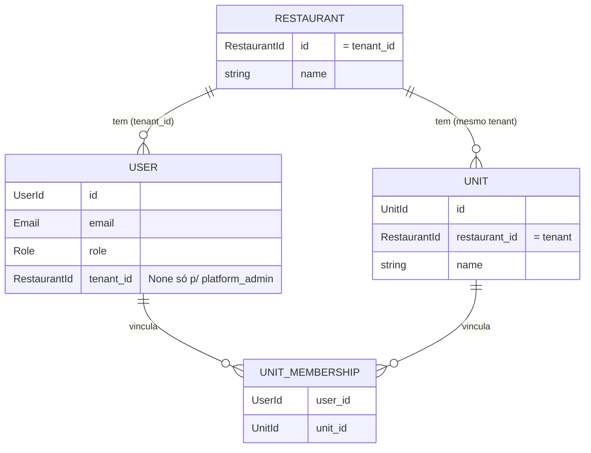

# Concept — Stage 2.1 — Domínio de tenancy e acesso

> **Escopo deste documento:** o que será feito nesta Stage, por quê, e as
> decisões de modelagem relevantes. O plano executável fica no
> [`technical.md`](./technical.md).

## 1. Escopo

### Dentro do escopo
- Entidades de domínio `Restaurant` (o tenant), `Unit` e `User`.
- Value-objects `Email`, `Role` (papel fixo de acesso), `Permission` e os
  identificadores tipados (`RestaurantId`, `UnitId`, `UserId`).
- Value-object `UnitMembership` — **esqueleto mínimo** do vínculo usuário↔unidade
  (kickoff #1), com a forma mínima (só `user_id` + `unit_id`), não a membership
  rica com papel-por-unidade.
- Exceções de domínio do BC (`IdentityError` e subclasses).
- Invariantes de **tenancy/isolamento** (nada cruza a fronteira do tenant; o
  `platform_admin` é a exceção explícita, vive sem tenant) e de **RBAC** (papel
  fixo → conjunto de permissões), cobertas por **testes unitários verdes, sem I/O**.

### Fora do escopo (explicitamente)
- Persistência, mappers, migrations, unicidade global de e-mail no banco (Stage 2.3).
- Use cases, ports, DTOs, checagem de autorização orquestrada (Stage 2.2).
- HTTP, hash de senha, emissão/validação de token JWT (Stages 2.2/2.4).
- Convite por e-mail e reset de senha (Stage 2.5).
- Papel-por-unidade (membership rica) — evolução futura; hoje só o esqueleto.
- Funções de trabalho customizáveis — BC `staff`, Step 3 (vocabulário distinto
  de "papel"; ver §3).

### Vínculo com o roadmap
Primeira Stage do **Step 2 — Restaurante e acesso** e o **primeiro código de
domínio do projeto**. Estabelece a fundação multi-tenant (ROADMAP-3: isolamento
por `tenant_id` row-level, reforçado em código + testes) sobre a qual as Stages
2.2–2.5 constroem application, persistência, HTTP e convite. Ver `roadmap.md`
§"Stage 2.1 — `2.1-identity-domain`" e `overview.md` §2–3, §9.

## 2. Objetivo da Stage

Ao final, o BC `identity` tem um núcleo de domínio puro (sem I/O) que expressa e
garante — por construção e por testes unitários — as invariantes de isolamento
entre tenants e de acesso baseado em papéis fixos, servindo de contrato para as
camadas seguintes.

## 3. Contexto e premissas

### Contexto
- **Tenant = Restaurante.** No glossário do overview (§9), "Tenant" é um
  restaurante cliente isolado dos demais. Logo a identidade de um `Restaurant`
  **é** o `tenant_id` de todas as linhas que lhe pertencem (Unit, User, e futuras
  linhas de staff/scheduling). Não há entidade `Tenant` separada — seria um
  sinônimo de `Restaurant`.
- **Papel (`Role`) ≠ Função (`JobFunction`).** `Role` é o papel **fixo** de
  acesso (RBAC): conjunto fechado `{platform_admin, owner, manager, hr,
  employee}`. Função de trabalho (cozinheiro, atendente…) é **100% customizável
  por restaurante** e pertence ao BC `staff` (Step 3). Vocabulários distintos —
  não confundir (kickoff #4, overview §9).
- **Dois eixos de acesso** (ver §5): (a) **RBAC** — o que um papel pode fazer
  (`Role` → `Permission`); (b) **visibilidade de unidade** — quais unidades um
  usuário enxerga (owner/platform_admin enxergam o tenant inteiro e ignoram o
  vínculo; manager/hr/employee só as unidades vinculadas). São ortogonais.

### Premissas
- ROADMAP-3: multi-tenancy por `tenant_id` row-level num único Postgres.
- ROADMAP-4: auth por JWT/argon2 — **hash e token são das Stages 2.2/2.4**, não
  desta; aqui é só domínio.
- ASSUM-4: o piloto opera 1 unidade hoje; multi-unidade é modelado desde já e
  exercitado quando existir a 2ª.

### Dependências
- `1.2-ci`: pipeline e gates verdes (mergeado em `develop`). Reusa a hierarquia
  base de exceções `shared/domain/exceptions/base.py` (`DomainError`).

## 4. Contratos

### Introduzidos
- **`RestaurantId`, `UnitId`, `UserId`** (`value-object`) — identificadores
  tipados (`NewType` sobre `str`), para o type-checker distinguir identidades e
  impedir troca acidental. `tenant_id` é sempre um `RestaurantId`.
- **`Email`** (`value-object`) — frozen; normaliza (trim + lowercase) e valida
  formato no `__post_init__`; inválido → `InvalidEmailError`.
- **`Permission`** (`value-object`) — `StrEnum` fechado de **capacidades** de
  acesso do BC identity: `{MANAGE_PLATFORM, MANAGE_TENANT, MANAGE_USERS}` (semente
  extensível pelas Stages/BCs seguintes). Permissão é o eixo A (o que o papel
  **faz**); a visibilidade de unidade é o eixo B (§3, §5) — "ver o tenant inteiro"
  **não** é uma permissão, é bypass de escopo.
- **`Role`** (`value-object`) — `StrEnum` fechado `{platform_admin, owner,
  manager, hr, employee}`; `Role.from_string` (parse defensivo → `InvalidRoleError`);
  `Role.permissions -> frozenset[Permission]` via mapeamento **total** por papel
  (mapa concreto em §5, regra 6).
- **`Restaurant`** (`entity`) — raiz de agregado; `id: RestaurantId`, `name`.
  Property `tenant_id -> RestaurantId` retorna `self.id` (é o próprio tenant).
  Igualdade por identidade.
- **`Unit`** (`entity`) — raiz de agregado; `id: UnitId`, `restaurant_id:
  RestaurantId`, `name`. Property `tenant_id -> RestaurantId` retorna
  `self.restaurant_id`. Igualdade por identidade.
- **`User`** (`entity`) — raiz de agregado; `id: UserId`, `email: Email`,
  `role: Role`, `tenant_id: RestaurantId | None` (None **só** para
  platform_admin). Métodos de domínio: `has_permission`, `bypasses_unit_scope`,
  `link_to_unit(unit) -> UnitMembership`, `can_view_unit(unit, memberships) -> bool`.
  Igualdade por identidade.
- **`UnitMembership`** (`value-object`) — esqueleto do vínculo user↔unit; frozen,
  `user_id: UserId`, `unit_id: UnitId`. Sem papel-por-unidade (futuro).
- **Exceções** (`IdentityError(DomainError)` e subclasses): `InvalidEmailError`,
  `InvalidRoleError`, `MissingTenantError`, `PlatformAdminTenantError`,
  `PlatformAdminMembershipError`, `CrossTenantError`.

### Consumidos
- **`DomainError`** — declarado em `shared/domain/exceptions/base.py` (Stage 1.1);
  raiz da hierarquia de erros de negócio.

## 5. Invariantes e regras

**Isolamento (tenancy):**
1. Todo `User` de papel não-plataforma **tem** `tenant_id` (não-nulo). Um `User`
   sem tenant só é válido se `role == platform_admin`.
2. O `platform_admin` **não pertence a nenhum tenant** (`tenant_id is None`) —
   exceção explícita e única às regras de isolamento (kickoff #3). Não existe
   "tenant plataforma" fabricado.
3. Um vínculo `UnitMembership` só pode ligar um usuário a uma unidade **do mesmo
   tenant**: `User.link_to_unit(unit)` exige `user.tenant_id == unit.tenant_id`.
4. Visibilidade de unidade (`User.can_view_unit(unit, memberships)`): um usuário
   de tenant **nunca** enxerga uma unidade de outro tenant (isolamento). Dentro do
   próprio tenant, owner enxerga todas as unidades (bypass); manager/hr/employee só
   enxergam uma unidade se **existir uma `UnitMembership` do próprio usuário para
   ela** — o predicado casa `m.user_id == self.id` **e** `m.unit_id == unit.id`
   (a membership de **outro** usuário do mesmo tenant **não** concede visibilidade;
   caso contrário haveria furo de escopo intra-tenant). O platform_admin enxerga
   qualquer unidade (acesso de plataforma — bypass total; kickoff #1).

**RBAC:**
5. `Role` é um conjunto **fechado** de exatamente 5 papéis. Nenhum outro valor é
   um papel válido.
6. Todo papel mapeia para um `frozenset[Permission]` **fixo e total** (todo papel
   tem entrada, mesmo que vazia). `User.has_permission(p)` ⇔ `p in role.permissions`.
   Mapa concreto desta Stage:

   | Papel | Permissões |
   |---|---|
   | `platform_admin` | `{MANAGE_PLATFORM}` |
   | `owner` | `{MANAGE_TENANT, MANAGE_USERS}` |
   | `manager` | `{MANAGE_USERS}` |
   | `hr` | `{MANAGE_USERS}` |
   | `employee` | `{}` (vazio) |

   Fontes: `platform_admin` gerencia plataforma/tenants (overview §3);
   `owner` gere o restaurante e seus usuários; `manager`/`hr` gerenciam usuários
   (overview §3 "funcionário cadastrado pelo gerente"; roadmap 3.4/3.5 RBAC
   gerente/RH/dono para criar login). `manager` e `hr` coincidem em identity
   (`{MANAGE_USERS}`) — diferem no **eixo de visibilidade** (ambos escopados por
   membership) e ganharão permissões próprias nos BCs `staff`/`scheduling`.
   `employee` sem capacidade de gestão em identity (só acessa o que lhe é próprio).
7. Acesso de plataforma ≠ acesso de restaurante (kickoff #3): o platform_admin
   detém **apenas** `MANAGE_PLATFORM`, **não** as permissões operacionais de
   restaurante (`MANAGE_TENANT`/`MANAGE_USERS`); e nenhum papel de restaurante
   detém `MANAGE_PLATFORM`. A visibilidade ampla do platform_admin (regra 4) é o
   eixo ortogonal (bypass), não uma permissão de restaurante.

## 6. Casos de erro e exceções

| Cenário | Exceção |
|---|---|
| E-mail malformado (sem `@`, sem domínio, com espaço, vazio) | `InvalidEmailError` |
| String de papel desconhecida em `Role.from_string` | `InvalidRoleError` |
| `User` não-plataforma criado sem `tenant_id` | `MissingTenantError` |
| `platform_admin` criado com `tenant_id` | `PlatformAdminTenantError` |
| `platform_admin.link_to_unit(...)` (plataforma não é escopo de unidade) | `PlatformAdminMembershipError` |
| `link_to_unit` entre tenants diferentes | `CrossTenantError` |

Todas subclasses de `IdentityError` → `DomainError` (o error handler HTTP da 2.4
as converte; aqui só se garante a hierarquia).

## 7. Decisões técnicas relevantes

### Fronteiras de agregado e esqueleto de membership
- **O quê:** `Restaurant`, `Unit`, `User` são **três raízes de agregado
  separadas**, referenciando-se **só por id** (`Unit.restaurant_id`,
  `User.tenant_id`), nunca por referência de objeto. O vínculo user↔unit entra
  como VO mínimo `UnitMembership(user_id, unit_id)`; a criação passa por
  `User.link_to_unit`, que impõe as invariantes de isolamento.
- **Por quê:** DDD (referência entre agregados por identidade); "instalar o
  esqueleto escalável com implementação mínima" (kickoff #1 + critério de
  escalabilidade progressiva do projeto). Papel-por-unidade cabe depois como
  coluna na membership sem refazer a forma.
- **Fonte:** kickoff #1; skill `ddd-tactical-patterns`; overview §4.
- **ADR:** [`../../adr/2_1_0001-identity-aggregates-and-membership.md`](../../adr/2_1_0001-identity-aggregates-and-membership.md)

### `platform_admin` como usuário sem tenant
- **O quê:** `User.tenant_id: RestaurantId | None`; `None` é válido **iff**
  `role == platform_admin`. Invariante condicional no construtor.
- **Por quê:** modela "acesso de plataforma fora de qualquer tenant" sem
  fabricar um tenant sentinela nem duplicar `User` numa entidade `PlatformAdmin`.
- **Fonte:** kickoff #3; overview §3.
- **ADR:** [`../../adr/2_1_0002-platform-admin-without-tenant.md`](../../adr/2_1_0002-platform-admin-without-tenant.md)

### Papéis e permissões como VOs fechados; mapeamento total no domínio
- **O quê:** `Role`/`Permission` são `StrEnum`. O mapa `Role → frozenset[Permission]`
  é fixo, total e vive no domínio (mapa concreto em §5, regra 6). Semente de 3
  **capacidades** — `MANAGE_PLATFORM`, `MANAGE_TENANT`, `MANAGE_USERS` — extensível
  pelas Stages/BCs seguintes. "Ver o tenant inteiro" **não** entra como permissão:
  é o eixo B (visibilidade/bypass), mantendo os dois eixos ortogonais e sem
  duplicar o conceito de "ver".
- **Por quê:** "papel fixo → conjunto de permissões" (kickoff #4); conjunto
  fechado dá exaustividade e testabilidade; `StrEnum` é idiomático e serializável
  nas camadas de fora sem vazar entidade.
- **Fonte:** kickoff #4; overview §3; CONVENTIONS §1 (valores de enum internos em
  inglês).

### Identificadores tipados
- **O quê:** `RestaurantId`/`UnitId`/`UserId` como `NewType` sobre `str`; geração
  do valor é responsabilidade da application/infra (não do domínio).
- **Por quê:** identidade distinta por tipo (evita trocar um id por outro) sem
  custo de runtime; alinhado ao exemplo `id: UserId` da skill `ddd-tactical-patterns`.
- **Fonte:** skill `ddd-tactical-patterns`; LAYOUT §3 (domínio só stdlib).

### Validação de e-mail mínima (não RFC 5322)
- **O quê:** normaliza (trim+lowercase) e valida um formato pragmático
  (local@domínio com ponto no domínio, sem espaços). Não implementa RFC completa.
- **Por quê:** suficiente para a invariante de domínio; unicidade global é da
  persistência (2.3); validação exaustiva de e-mail é fonte de falso-negativo.
- **Fonte:** decisão desta Stage (reversível; regex trocável).

### Enforcement de pureza do domínio via import-linter (expande o file-scope do roadmap)
- **O quê:** adicionar em `.importlinter` um contrato `forbidden` proibindo
  `restaurant_hub.features.identity.domain` de importar frameworks e
  `shared.application`/`shared.infrastructure` (espelhando LAYOUT §3, como já
  existe para `shared.domain`). E criar `features/identity/application/` e
  `features/identity/adapters/` como pacotes-placeholder vazios, exigidos por
  `scripts/check_layout.py` (toda feature precisa dos 3 diretórios).
- **Por quê:** esta é a **1ª feature**; o próprio `.importlinter` marca contratos
  de feature como "ativar quando a 1ª feature existir". import-linter é mais estrito
  que `check_layout.py` (pega `starlette`/`httpx`/etc.); a stage de domínio é o
  lugar certo para instalar a pureza. Reversível barato, ancorado em LAYOUT §3.
- **Nota de reconciliação:** o bloco do roadmap 2.1 traz `arquivos_a_modificar: []`
  e não lista `.importlinter`/placeholders; esta Stage necessariamente os toca.
  O bloco será corrigido com **nota datada** no fechamento (mesmo padrão das notas
  1.1/1.2), reconciliando `arquivos_a_criar`/`arquivos_a_modificar`,
  `contratos_introduzidos` (typed IDs, `UnitMembership`, exceptions) e
  `contratos_consumidos` (`DomainError`).
- **Fonte:** `.importlinter` (comentários de contratos futuros); `scripts/check_layout.py`
  (`REQUIRED_FEATURE_DIRS`); LAYOUT §3; decisão desta Stage.

## 8. Integrações

### Internas (com outras Stages/módulos)
- **Stage 2.2 (application):** consome entidades/VOs (cria `User`/`Restaurant`/
  `Unit`, checa `has_permission`, resolve visibilidade) via use cases.
- **`shared/domain`:** as exceções do BC herdam de `DomainError`.

## 9. Modelo de dados

> Diagrama estrutural do **domínio** (não é schema de banco — persistência é 2.3).
> platform_admin é um `USER` com `tenant_id` ausente, fora de qualquer `RESTAURANT`.

## 10. Riscos e mitigações

| Risco | Prob. | Impacto | Mitigação |
|---|---|---|---|
| Vazar autorização orquestrada (2.2) para o domínio | M | M | Predicados puros sem repositório/I/O; a orquestração (buscar memberships, decidir) fica na 2.2 |
| Vocabulário de `Permission` mudar quando staff/scheduling chegarem | M | B | Semente mínima e extensível; mapa total guardado por teste de exaustividade |
| Overengineering da membership (papel-por-unidade cedo demais) | B | M | Só o esqueleto (user_id+unit_id); forma não impede a coluna futura |

## 11. Critérios de aceitação

- [ ] `Email` normaliza válidos (trim+lowercase) e rejeita malformados com
      `InvalidEmailError` (teste unitário).
- [ ] `Role` é o conjunto fechado dos 5 papéis; `Role.from_string` lança
      `InvalidRoleError` para valor desconhecido (teste).
- [ ] `Role.permissions` é total sobre todos os papéis **e tem o conteúdo do mapa
      de §5.6** (cada papel com o conjunto exato); `User.has_permission` reflete o
      mapa (teste, incluindo exaustividade sobre todos os `Role`).
- [ ] Separação plataforma × restaurante (§5.7): `platform_admin` **não** detém
      `MANAGE_TENANT`/`MANAGE_USERS`; nenhum papel de restaurante detém
      `MANAGE_PLATFORM` (teste).
- [ ] `User` não-plataforma sem `tenant_id` → `MissingTenantError`;
      `platform_admin` com `tenant_id` → `PlatformAdminTenantError`;
      `platform_admin` com `tenant_id=None` é válido (teste).
- [ ] `User.link_to_unit` lança `CrossTenantError` entre tenants distintos,
      `PlatformAdminMembershipError` para platform_admin, e devolve
      `UnitMembership(user_id, unit_id)` no sucesso (teste).
- [ ] `User.can_view_unit` garante isolamento (usuário de tenant nunca vê unidade
      de outro tenant), bypass de owner/platform_admin e escopo por membership
      para manager/hr/employee — incluindo que a membership de **outro** usuário do
      mesmo tenant **não** concede visibilidade (teste).
- [ ] Entidades comparam por identidade (id); VOs (`Email`, `Role`,
      `UnitMembership`) comparam por valor (teste).
- [ ] Domínio sem I/O e sem import de application/adapters/infra/frameworks:
      `make check` verde (layout-check + import-linter, incluindo o contrato novo
      de `identity.domain`).
- [ ] Cobertura ≥ 90% em cada arquivo `src/` tocado.

## 12. Checklist de validação interna

- [x] Todos os contratos introduzidos têm assinatura definida? (§4)
- [x] Toda decisão em §7 tem fonte rastreável? (kickoff/overview/skill/decisão)
- [x] Toda integração externa tem contrato definido? (não há integração externa —
      Stage é domínio puro; §8 só internas)
- [x] Decisões com alternativa real descartada têm ADR escrito? (2.1.0001, 2.1.0002)
- [x] Dependências de Stages anteriores estão satisfeitas (`done`/mergeadas)?
      (`1.2-ci` mergeada em `develop`)
- [x] Stage cabe em ~3–12 Tasks? (7 Tasks planejadas)
- [x] Riscos críticos têm mitigação plausível? (§10)
- [x] O modelo distingue os dois eixos de acesso (RBAC × visibilidade) e o
      vocabulário papel × função? (§3, §5)

## 13. Questões em aberto

Nenhuma. As bifurcações materiais de identity foram fechadas na rodada de kickoff
(2026-07-16, ADR 0.0.0004 §Authorized runs) e estão baked em §5/§7.

## 14. Referências

- [`../../overview.md`](../../overview.md) §2–3, §9 — modelo de negócio e glossário.
- [`../../roadmap.md`](../../roadmap.md) — Stage `2.1-identity-domain`, ROADMAP-3/4.
- ADRs desta Stage: [`../../adr/`](../../adr/) (prefixo `2_1_`).
- Skills: `ddd-tactical-patterns`, `hex-arch-python`.
- [`../../LAYOUT.md`](../../LAYOUT.md) §3 — regras de dependência do domínio.
