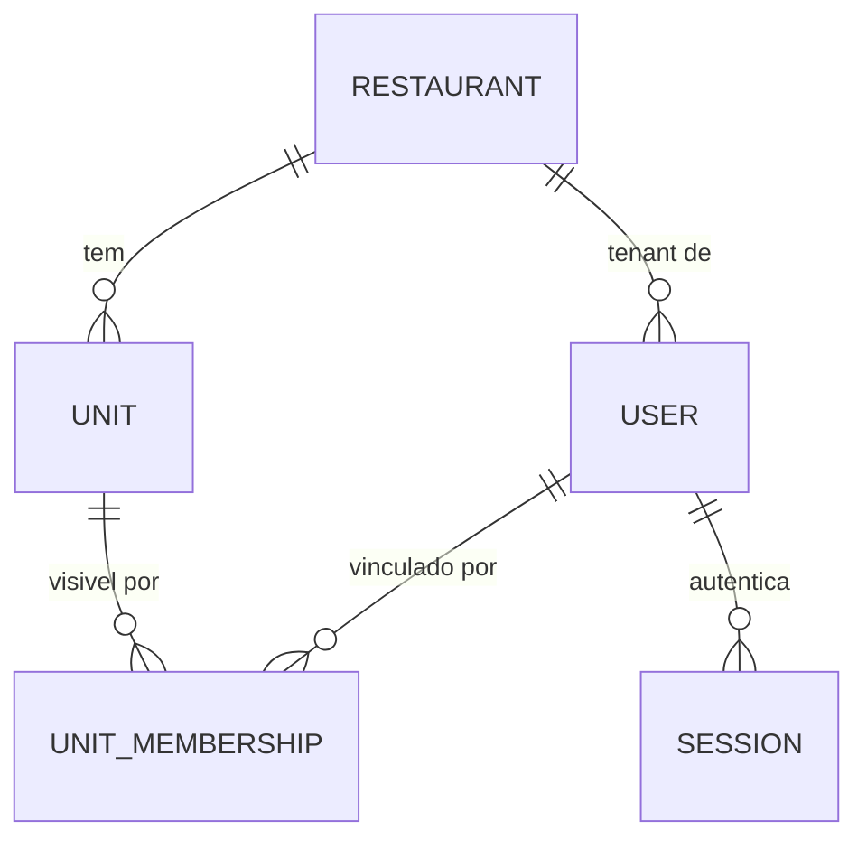

# Concept — Stage 2.2 — Use cases de tenancy e acesso

> **Escopo deste documento:** o que será feito nesta Stage, por quê, e as
> decisões de contrato relevantes. O plano executável fica no
> [`technical.md`](./technical.md).

## 1. Escopo

### Dentro do escopo

- **Cinco use cases** da camada `application` do BC `identity`:
  `create_restaurant`, `create_unit`, `create_user`, `authenticate_user`,
  `authorize_action`.
- **Ports-out** (`Protocol`) que esses use cases consomem: `RestaurantRepository`,
  `UnitRepository`, `UserRepository`, `PasswordHasher`, `TokenIssuer` e
  `SessionRepository` (este último decorrente da decisão de kickoff #1 — sessão
  revogável; ver §7.1 e ADR 2.2.0001).
- **DTOs** de fronteira (commands/results) + os registros que trafegam pelos
  ports (`Session`, `IssuedRefreshToken`, `AccessTokenClaims`, `UserCredentials`).
- **Erros de aplicação** do BC (`application/errors.py`), todos ancorados na
  hierarquia `IdentityError → DomainError` (§7.3, ADR 2.2.0003).
- **Testes unitários com fakes** in-memory de todos os ports-out, incluindo um
  teste de fluxo ponta-a-ponta (restaurante → unidade → usuário → autenticação →
  autorização) exercitando os use cases reais contra fakes.

### Fora do escopo (explicitamente)

- **Adapters reais:** Postgres (2.3), HTTP/argon2/JWT (2.4). Aqui só os `Protocol`
  e os fakes de teste.
- **Enforcement de autorização nos use cases de escrita.** `create_*` **não**
  recebe ator nem chama `authorize_action`: o roadmap aloca o *enforcement de RBAC
  via dependência* à Stage 2.4. Esta Stage entrega o guard como use case testado e
  a tabela permissão↔ação (§4) que a 2.4 vai usar para compô-lo. Decisão em §7.7.
- **Use case de refresh/rotação e de logout.** O `SessionRepository` já nasce com
  a forma que os suporta (`find_by_fingerprint`, `revoke`, `revoke_all_for_user`),
  mas o use case que os orquestra pertence à 2.4, junto do endpoint
  `POST /auth/refresh`. Ver §7.1 e o `[finding]` correspondente (§7 do technical).
- **Convite por e-mail e definição de senha por token** (2.5).
- **Unicidade global de e-mail imposta por constraint de banco** (2.3). Aqui ela é
  checada pelo use case via port; a garantia dura contra concorrência é da
  persistência.
- **Remoção/desativação de usuário, restaurante ou unidade.** Nenhum use case de
  exclusão existe ainda, então o cenário "tenant removido" não é modelável nesta
  Stage; fica registrado como `[finding]`.
- **Ports-in (`ports/in/`).** Nenhum adapter primário existe ainda; o roadmap não
  os lista para esta Stage e criá-los agora seria contrato sem consumidor.
- **BC `staff`** (Step 3) e qualquer noção de função de trabalho.

### Vínculo com o roadmap

Segunda Stage do Step 2 (*Restaurante e acesso*). A 2.1 entregou o domínio puro;
esta Stage entrega a **orquestração** e, sobretudo, **a fronteira que as duas
Stages seguintes vão implementar**: a 2.3 implementa os repositórios em Postgres e
a 2.4 implementa `PasswordHasher`/`TokenIssuer` e expõe tudo por HTTP. É por isso
que o custo de errar a forma dos ports aqui é alto — ele se paga em duas Stages.

## 2. Objetivo da Stage

Ao final desta Stage, os cinco casos de uso de tenancy e acesso do BC `identity`
executam corretamente contra implementações in-memory dos seus ports-out,
provando — sem nenhum I/O real — que **a decisão de acesso** (RBAC, escopo de
tenant e visibilidade de unidade) se sustenta na orquestração, e deixando
publicada a fronteira (`Protocol` + DTOs) que a persistência e o HTTP vão preencher.

> **Limite honesto do que esta Stage prova.** O isolamento multi-tenant é provado
> **no `authorize_action`** e na criação de vínculos (`link_to_unit`), não nas
> escritas: como os `create_*` não recebem ator (§7.7), quem garante que uma
> escrita respeita o tenant do ator é a composição que a 2.4 monta. O isolamento
> row-level em si é ROADMAP-3, entregue na 2.3.

## 3. Contexto e premissas

### Contexto

A 2.1 modelou `Restaurant` (que **é** o tenant), `Unit`, `User` (entidades
`frozen`, iguais por identidade) e os VOs `Email`, `Role`, `Permission`,
`UnitMembership`, com dois eixos de acesso deliberadamente **ortogonais**:

- **RBAC** — `User.has_permission(permission)`, a partir do mapa fixo e total
  `Role → frozenset[Permission]`. Responde *"o que pode fazer"*.
- **Visibilidade de unidade** — `User.can_view_unit(unit, memberships)`, com
  `owner` e `platform_admin` fazendo bypass do vínculo. Responde *"o que enxerga"*.

Esta Stage **compõe** os dois eixos sem colapsá-los e acrescenta a checagem de
**escopo de tenant**, que o domínio 2.1 só expressa indiretamente (dentro de
`can_view_unit`, e portanto apenas quando há unidade alvo) — ver §5.6 e ADR 2.2.0002.

Dois fatos do domínio 2.1 moldam os contratos desta Stage:

1. **`User` não carrega credencial.** A entidade tem `id`, `email`, `role`,
   `tenant_id` — e nada de senha. Logo, o hash de senha é responsabilidade da
   camada de aplicação e trafega **ao lado** da entidade pelos ports, nunca dentro
   dela (§4, `UserRepository.add` / `UserCredentials`).
2. **`platform_admin` não tem tenant** (`tenant_id is None` *sse* o papel é
   `platform_admin` — ADR 2.1.0002). Todo use case que resolve tenant trata a
   exceção explicitamente, sem tenant sentinela.

### Premissas

- O `IdGenerator` e o `Clock` compartilhados (`shared/application/ports/out/`) são
  os geradores de id e de tempo; nenhum use case chama `uuid4()` ou
  `datetime.now()` diretamente.
- Os TTLs de access token e de sessão são **injetados** (`timedelta` no construtor
  do use case), porque `Settings` é infraestrutura e a camada `application` não
  pode importá-la (LAYOUT §3). O composition root os fornece na 2.4.
- O refresh token é material opaco de alta entropia gerado pelo adapter de
  segurança (2.4), não pela aplicação.

### Dependências

- `2.1-identity-domain`: entidades `Restaurant`/`Unit`/`User`, VOs
  `Email`/`Role`/`Permission`/`UnitMembership`, hierarquia `IdentityError`, e os
  predicados `has_permission`, `bypasses_unit_scope`, `link_to_unit`,
  `can_view_unit`. Os dois `[finding]` abertos na §7 da 2.1 (`name` não
  normalizado → 2.3; precedência de validações no `__post_init__` → 2.4) **não**
  restringem esta Stage; o segundo, porém, é a lição que §5.6 e §5.7 aplicam aqui —
  a precedência entre checagens é **fixada e testada** em vez de ficar implícita.

## 4. Contratos

> Todos os ports são `typing.Protocol` em `application/ports/out/` (LAYOUT §5,
> skill `hex-arch-python`) e **síncronos** (§7.5, ADR 2.2.0004).

### Introduzidos

#### Ports-out

- **`RestaurantRepository`** (`port-out`)
  ```python
  class RestaurantRepository(Protocol):
      def add(self, restaurant: Restaurant) -> None: ...
      def find_by_id(self, restaurant_id: RestaurantId) -> Restaurant | None: ...
  ```

- **`UnitRepository`** (`port-out`)
  ```python
  class UnitRepository(Protocol):
      def add(self, unit: Unit) -> None: ...
      def find_by_id(self, unit_id: UnitId) -> Unit | None: ...
  ```

- **`UserRepository`** (`port-out`) — o hash de senha e os vínculos entram
  **junto** do usuário, numa escrita só, porque na 2.3 eles são a mesma transação.
  ```python
  class UserRepository(Protocol):
      def add(
          self,
          user: User,
          password_hash: PasswordHash,
          memberships: Sequence[UnitMembership] = (),
      ) -> None: ...
      def find_by_id(self, user_id: UserId) -> User | None: ...
      def exists_by_email(self, email: Email) -> bool: ...
      def find_credentials_by_email(self, email: Email) -> UserCredentials | None: ...
      def list_memberships(self, user_id: UserId) -> tuple[UnitMembership, ...]: ...
  ```
  - `exists_by_email` é **global**, não escopado por tenant (kickoff #2).
  - `find_credentials_by_email` devolve usuário + hash numa ida só — o
    `authenticate_user` precisa dos dois, e separá-los custaria duas queries e
    abriria janela de inconsistência.
  - `exists_by_email` existe *além de* `find_credentials_by_email` para que a
    checagem de unicidade do `create_user` **não carregue o hash** de uma
    credencial alheia (princípio de menor exposição de segredo).
  - `list_memberships` **pode** devolver vínculos de outros usuários sem quebrar
    o contrato (§5.13) — o domínio filtra por `user_id`, e o teste exercita isso.

- **`PasswordHasher`** (`port-out`)
  ```python
  class PasswordHasher(Protocol):
      def hash(self, plain_password: str) -> PasswordHash: ...
      def verify(self, plain_password: str, password_hash: PasswordHash) -> bool: ...
      def dummy_hash(self) -> PasswordHash: ...
  ```
  **Leis do port:** (a) `verify` **nunca levanta exceção** — hash malformado ou não
  correspondente devolve `False` (um argon2 cru levanta `InvalidHash` nesse caso, e
  o adapter da 2.4 é quem absorve isso); (b) `dummy_hash()` devolve um hash válido,
  com os **mesmos parâmetros de custo** da produção, contra o qual `verify` sempre
  falha. É o que torna implementável a defesa contra oráculo de enumeração por
  tempo (§5.14): a aplicação não tem como fabricar um hash argon2 constante, e
  hardcodá-lo seria conhecimento de adapter vazando para a camada application.

- **`TokenIssuer`** (`port-out`) — toda a criptografia de token vive atrás deste
  port; a aplicação nunca hasheia nem assina nada por conta própria.
  ```python
  class TokenIssuer(Protocol):
      def issue_access_token(self, claims: AccessTokenClaims) -> str: ...
      def issue_refresh_token(self) -> IssuedRefreshToken: ...
      def fingerprint(self, refresh_token_value: str) -> str: ...
  ```
  **Lei do port (obrigatória para fake e para adapter):** para todo
  `t = issuer.issue_refresh_token()`, vale `issuer.fingerprint(t.value) == t.fingerprint`.
  Sem essa lei um adapter poderia derivar o fingerprint de dois jeitos diferentes
  na emissão e na consulta, e **toda** busca de refresh falharia na 2.4 — um bug
  que nenhum teste desta Stage pegaria (§5.11).

- **`SessionRepository`** (`port-out`) — sessão de refresh persistida e revogável
  (kickoff #1; ADR 2.2.0001).
  ```python
  class SessionRepository(Protocol):
      def add(self, session: Session) -> None: ...
      def find_by_fingerprint(self, fingerprint: str) -> Session | None: ...
      def revoke(self, session_id: SessionId, revoked_at: datetime) -> None: ...
      def revoke_all_for_user(self, user_id: UserId, revoked_at: datetime) -> None: ...
  ```
  **Semântica normativa** (§5.12): `find_by_fingerprint` devolve a sessão
  **independentemente** de estar revogada ou expirada — filtrar é papel do chamador
  via `Session.is_active(now)`. `revoke` e `revoke_all_for_user` são silenciosos
  para id inexistente e **idempotentes no sentido forte**: revogar uma sessão já
  revogada é *no-op* e **preserva o `revoked_at` original**, nunca o sobrescreve
  (sem essa precisão, fake e adapter divergem de forma observável, e a forense de
  reuso de token perde o instante real da primeira revogação).

#### DTOs e registros de fronteira

Tipos auxiliares:

- **`PasswordHash`** — `NewType("PasswordHash", str)`. Impede trocar um hash por
  uma senha em claro em tempo de type-check, custo zero em runtime.
- **`SessionId`** — `NewType("SessionId", str)`.

Registros (todos `@dataclass(frozen=True)`):

| Tipo | Campos |
|---|---|
| `UserCredentials` | `user: User`, `password_hash: PasswordHash` |
| `Session` | `id: SessionId`, `user_id: UserId`, `refresh_token_fingerprint: str`, `issued_at: datetime`, `expires_at: datetime`, `revoked_at: datetime \| None = None` |
| `IssuedRefreshToken` | `value: str`, `fingerprint: str` |
| `AccessTokenClaims` | `subject: UserId`, `role: Role`, `tenant_id: RestaurantId \| None`, `session_id: SessionId`, `expires_at: datetime` |

`Session` expõe **um** predicado puro: `is_active(now: datetime) -> bool`, com
convenção half-open — ativa sse `revoked_at is None and now < expires_at` (§5.10).
Não expõe método de revogação: revogar é operação de port, não de DTO (§7.1).

Commands:

| Command | Campos |
|---|---|
| `CreateRestaurantCommand` | `name: str` |
| `CreateUnitCommand` | `restaurant_id: RestaurantId`, `name: str` |
| `CreateUserCommand` | `email: Email`, `plain_password: str`, `role: Role`, `tenant_id: RestaurantId \| None`, `unit_ids: Sequence[UnitId] = ()` |
| `AuthenticateUserCommand` | `email: Email`, `plain_password: str` |
| `AuthorizeActionCommand` | `actor_id: UserId`, `permission: Permission`, `tenant_id: RestaurantId \| None = None`, `unit_id: UnitId \| None = None` |

Results:

| Result | Campos |
|---|---|
| `RestaurantResult` | `id: RestaurantId`, `name: str` |
| `UnitResult` | `id: UnitId`, `restaurant_id: RestaurantId`, `name: str` |
| `UserResult` | `id: UserId`, `email: Email`, `role: Role`, `tenant_id: RestaurantId \| None`, `unit_ids: tuple[UnitId, ...]` |
| `AuthenticationResult` | `access_token: str`, `refresh_token: str`, `access_token_expires_at: datetime`, `refresh_token_expires_at: datetime`, `user_id: UserId` |
| `AuthorizedActor` | `user_id: UserId`, `role: Role`, `actor_tenant_id: RestaurantId \| None`, `scope_tenant_id: RestaurantId \| None`, `scope_unit_id: UnitId \| None` |

`AuthorizedActor` devolve **o ator e o escopo que acabou de ser validado**:
`actor_tenant_id` é o tenant do próprio ator (`None` para `platform_admin`),
enquanto `scope_tenant_id`/`scope_unit_id` são o alvo aprovado. Sem os campos de
escopo, um `platform_admin` (cujo `actor_tenant_id` é `None`) obrigaria a 2.4 a
re-derivar o alvo a partir do request — reintroduzindo no adapter a decisão que
este use case existe para tomar.

Nenhum result carrega senha, `PasswordHash` ou entidade de domínio (§5.9).

> **VOs de domínio dentro de DTO são permitidos** por LAYOUT §7 ("value objects
> imutáveis de domínio podem trafegar em DTOs"). Por isso `Email`, `Role` e
> `Permission` aparecem em commands/results, mas **entidades não**. `UserCredentials`
> carrega a entidade `User`, e isso é legítimo: é um registro **interno de
> port-out**, no mesmo nível de `UserRepository.find_by_id() -> User | None`; a
> regra de LAYOUT §7 governa o **retorno de use case**, que nunca expõe entidade.

#### Use cases

Todos com a forma `<Nome>UseCase(deps…).execute(command) -> result`.

| Use case | Consome | Devolve | Erros |
|---|---|---|---|
| `CreateRestaurantUseCase` | `RestaurantRepository`, `IdGenerator` | `RestaurantResult` | `InvalidNameError` (do domínio) |
| `CreateUnitUseCase` | `UnitRepository`, `RestaurantRepository`, `IdGenerator` | `UnitResult` | `RestaurantNotFoundError`, `InvalidNameError`, `InvalidIdentifierError` (do domínio) |
| `CreateUserUseCase` | `UserRepository`, `RestaurantRepository`, `UnitRepository`, `PasswordHasher`, `IdGenerator` | `UserResult` | `EmailAlreadyRegisteredError`, `RestaurantNotFoundError`, `UnitNotFoundError`, + erros de domínio 2.1 |
| `AuthenticateUserUseCase` | `UserRepository`, `SessionRepository`, `PasswordHasher`, `TokenIssuer`, `IdGenerator`, `Clock` | `AuthenticationResult` | `InvalidCredentialsError` |
| `AuthorizeActionUseCase` | `UserRepository`, `UnitRepository` | `AuthorizedActor` | `UserNotFoundError`, `PermissionDeniedError`, `TenantScopeRequiredError`, `TenantNotVisibleError`, `UnitScopeRequiredError`, `UnitNotFoundError`, `UnitNotVisibleError` |

#### Tabela permissão ↔ ação (contrato para a 2.4)

Esta Stage **não** aplica o guard nas escritas (§7.7), mas declara qual permissão
governa cada ação, para que a 2.4 componha `authorize_action` sem inventar
vocabulário. Como `authorize_action` recebe **uma** permissão por chamada, a
coluna "permissão exigida" define qual permissão a 2.4 passa em cada rota:

| Ação | Rota tenant-scoped exige | Rota de bootstrap (plataforma) exige | Escopo do command |
|---|---|---|---|
| `create_restaurant` | — (não existe versão tenant-scoped) | `MANAGE_PLATFORM` | `tenant_id=None` (ator `platform_admin`) |
| `create_unit` | `MANAGE_TENANT` (`owner`) | `MANAGE_PLATFORM` | `tenant_id` = restaurante alvo |
| `create_user` | `MANAGE_USERS` (`owner`/`manager`/`hr`) | `MANAGE_PLATFORM` | `tenant_id` = tenant do novo usuário; `unit_id` quando o ator é escopado por unidade |

> **Por que existe a coluna de bootstrap.** O mapa RBAC da 2.1 é deliberadamente
> estanque: `platform_admin` tem **apenas** `MANAGE_PLATFORM` ("acesso de
> plataforma não é acesso de restaurante" — concept 2.1 §5). Consequência que
> precisa ficar explícita: um restaurante recém-criado **não tem nenhum usuário**,
> e as permissões que criam usuários (`MANAGE_USERS`) só existem em papéis que
> vivem dentro do tenant. Sem uma rota de bootstrap gated por `MANAGE_PLATFORM`,
> **ninguém consegue criar o primeiro `owner`** de um tenant novo — e o DoD da 2.4
> ("admin cria tenant→unidade→usuário", roadmap §Stage 2.4) seria inalcançável.
> A saída adotada **não** altera o domínio 2.1: são rotas distintas na 2.4, cada
> uma chamando `authorize_action` com a permissão da sua coluna. Fica registrado
> como `[finding]` para a 2.4 desenhar essas rotas conscientemente — se ela
> preferir, a alternativa é conceder `MANAGE_TENANT`/`MANAGE_USERS` ao
> `platform_admin`, o que é mudança de domínio e exige ADR próprio.

### Consumidos

- **`Restaurant`, `Unit`, `User`** (entities) — Stage `2.1-identity-domain`.
- **`Email`, `Role`, `Permission`, `UnitMembership`, `RestaurantId`, `UnitId`,
  `UserId`** (value objects) — Stage `2.1-identity-domain`.
- **`IdentityError`** e subclasses — Stage `2.1-identity-domain`.
- **`Clock`, `IdGenerator`** (ports compartilhados) — Stage `1.1-bootstrap`.
- **`DomainError`, `NotFoundError`** — `shared/domain/exceptions/base.py`.

## 5. Invariantes e regras

1. **Nenhum import de `adapters` nem de `shared.infrastructure`** a partir de
   `features/identity/application/` — provado pelo `import-check` (contrato
   novo no `.importlinter`) e pelo `layout-check`.
2. **Use case devolve DTO, nunca entidade** (CLAUDE.md §6, LAYOUT §7).
3. **Identificadores são derivados do `IdGenerator` por uma conversão única e
   canônica:** `RestaurantId(str(id_generator.next_id()))` — idem `UnitId`,
   `UserId`, `SessionId`. O port devolve `UUID` e os identificadores do domínio são
   `NewType` sobre `str` (2.1); fixar `str(uuid)` (forma canônica com hífens) evita
   que 2.3 persista `hex` e 2.4 leia `str`.
4. **E-mail é único globalmente**, não por tenant (kickoff #2): `create_user`
   rejeita e-mail já registrado ainda que o tenant seja outro. Como `Email`
   normaliza (trim + lowercase) no domínio, a unicidade é **case-insensitive** por
   construção.
5. **`platform_admin` é criado sem tenant e sem vínculo de unidade**: o
   `create_user` não exige restaurante para esse papel e **rejeita `unit_ids` não
   vazio antes de resolver qualquer unidade** (§5.7), levantando
   `PlatformAdminMembershipError`. Reciprocamente, papel de restaurante **exige**
   tenant existente.
6. **`authorize_action` avalia as checagens nesta ordem normativa, sem
   colapsá-las** (ADR 2.2.0002):
   1. resolve o ator — `UserNotFoundError`;
   2. **eixo RBAC** — `user.has_permission(permission)`; falha ⇒
      `PermissionDeniedError`;
   3. **escopo de tenant** — se o ator **não** é `platform_admin`:
      `command.tenant_id is None` ⇒ `TenantScopeRequiredError`;
      `command.tenant_id != user.tenant_id` ⇒ `TenantNotVisibleError`.
      Para `platform_admin` (sem tenant) a checagem é pulada;
   4. **exigência de escopo de unidade** — se `command.unit_id is None` e
      `not user.bypasses_unit_scope()` ⇒ `UnitScopeRequiredError`;
   5. **eixo visibilidade** — havendo `unit_id`: resolve a unidade
      (`UnitNotFoundError`); se `command.tenant_id is not None` e
      `unit.tenant_id != command.tenant_id` ⇒ `TenantNotVisibleError` (coerência do
      par alvo, que vale inclusive para `platform_admin`); então aplica
      `user.can_view_unit(unit, memberships)`; falha ⇒ `UnitNotVisibleError`.

   **Por que 3 e 4 são exigências, não filtros opcionais.** Uma checagem que só
   roda quando o chamador se lembra de passar o parâmetro não é uma regra imposta:
   omitir o parâmetro vira o caminho de escalada. Por isso ambas são *fail-closed
   por ausência* — quem não é `platform_admin` **precisa** declarar o tenant alvo, e
   quem não faz bypass de unidade **precisa** declarar a unidade alvo. Sem o passo
   3 nesta forma, um `owner` (que faz bypass, e portanto escapa do passo 4) chegaria
   ao sucesso sem nenhuma comparação de tenant ter sido executada.

   A **ordem é normativa e testada**: um ator que falha em mais de uma checagem
   recebe o erro da checagem mais alta. Sem isso, uma reordenação silenciosa passa
   pela suíte — a lacuna que a 2.1 registrou como `[finding]`.
7. **`create_user` também tem precedência fixa:** (1) unicidade de e-mail;
   (2) coerência papel↔tenant (`platform_admin` com `unit_ids` é rejeitado aqui,
   antes de qualquer consulta de unidade, para não vazar existência de unidade);
   (3) existência do restaurante; (4) construção do `User` (invariantes 2.1);
   (5) resolução das unidades e criação dos vínculos.
8. **A autorização é fail-closed**: negar é levantar exceção, nunca devolver
   `False` que o chamador possa esquecer de checar (ADR 2.2.0002).
9. **A senha em claro nunca é persistida nem devolvida**: só o `PasswordHash`
   produzido pelo `PasswordHasher` chega ao repositório, e nenhum result DTO
   carrega senha ou hash.
10. **Sessão: nasce ativa, expira half-open.** `issued_at = clock.now()`,
    `expires_at = issued_at + refresh_token_ttl`, `revoked_at = None`;
    `is_active(now)` é verdadeiro sse `revoked_at is None and now < expires_at` —
    em `now == expires_at` a sessão **já expirou**.
11. **O valor do refresh token nunca é persistido**: a sessão guarda apenas o
    `fingerprint`, obtido do `IssuedRefreshToken`; o `value` só existe no
    `AuthenticationResult`. Vale a lei `fingerprint(t.value) == t.fingerprint` (§4).
12. **`find_by_fingerprint` não filtra**: devolve sessão revogada ou expirada
    também. É o que torna detectável, na 2.4, o reuso de um refresh token já
    rotacionado (sem isso, reuso e token forjado são indistinguíveis).
13. **A visibilidade não confia na filtragem do repositório:** o use case repassa
    o resultado de `list_memberships` para `can_view_unit` **sem filtrar**, porque
    o domínio já casa `user_id` **e** `unit_id`. Um fake que devolve vínculo de
    outro usuário não pode conceder visibilidade.
14. **Autenticação não revela existência de e-mail**: e-mail inexistente e senha
    errada produzem **a mesma** `InvalidCredentialsError` e **nenhuma** sessão. Além
    do tipo de exceção, o caminho de e-mail inexistente executa
    `hasher.verify(plain_password, hasher.dummy_hash())`, para que o custo do
    KDF seja pago nos dois caminhos e o tempo de resposta não vire oráculo de
    enumeração de e-mails. É por isso que `dummy_hash()` existe no port (§4): a
    camada application não pode fabricar nem hardcodar um hash argon2.
15. **`unit_ids` duplicados são deduplicados** preservando a ordem, antes de virar
    `UnitMembership` — vínculo é relação, não multiconjunto, e a 2.3 terá PK
    composta.
16. **Todo erro levantado por use case desta Stage é subclasse de `IdentityError`**
    (logo de `DomainError`) — nenhum caminho de negócio escapa para 500 na 2.4
    (ADR 2.2.0003).

## 6. Casos de erro e exceções

| Cenário | Exceção | Hierarquia |
|---|---|---|
| Restaurante inexistente ao criar unidade/usuário | `RestaurantNotFoundError` | `IdentityError` + `NotFoundError` |
| Unidade inexistente ao vincular ou autorizar | `UnitNotFoundError` | `IdentityError` + `NotFoundError` |
| Ator inexistente ao autorizar | `UserNotFoundError` | `IdentityError` + `NotFoundError` |
| E-mail já registrado (qualquer tenant) | `EmailAlreadyRegisteredError` | `IdentityError` |
| E-mail inexistente **ou** senha incorreta | `InvalidCredentialsError` | `IdentityError` |
| Papel do ator não concede a permissão | `PermissionDeniedError` | `IdentityError` |
| Ator de tenant omitiu o tenant alvo | `TenantScopeRequiredError` | `IdentityError` |
| Ator age sobre tenant que não é o seu, ou par `tenant_id`/`unit_id` incoerente | `TenantNotVisibleError` | `IdentityError` |
| Ator escopado por unidade omitiu a unidade alvo | `UnitScopeRequiredError` | `IdentityError` |
| Ator não enxerga a unidade alvo | `UnitNotVisibleError` | `IdentityError` |
| `platform_admin` com tenant / papel de restaurante sem tenant | `PlatformAdminTenantError` / `MissingTenantError` | domínio 2.1 |
| Vínculo cross-tenant / vínculo de `platform_admin` | `CrossTenantError` / `PlatformAdminMembershipError` | domínio 2.1 |
| E-mail malformado, papel desconhecido, nome/id vazio | `InvalidEmailError`, `InvalidRoleError`, `InvalidNameError`, `InvalidIdentifierError` | domínio 2.1 |

Os erros de domínio da 2.1 **não são reembrulhados**: o use case deixa a exceção
do domínio subir. Reembrulhar perderia a especificidade que a 2.4 usa para montar
a resposta, e a hierarquia já é a mesma (`IdentityError`).

As três exceções de "não encontrado" herdam de `IdentityError` **e** de
`NotFoundError`, nesta ordem, para pertencerem ao BC e, ao mesmo tempo, casarem o
handler 404 já registrado em `shared/infrastructure/http/error_handlers.py` (a MRO
encontra `NotFoundError` antes de `DomainError`).

## 7. Decisões técnicas relevantes

### 7.1 Sessão de refresh persistida e revogável é um port próprio

- **O quê:** introduzir `SessionRepository` como port-out separado do
  `TokenIssuer`, com um registro `Session` que guarda o **fingerprint** do refresh
  token (nunca o token), `expires_at` e `revoked_at`; `authenticate_user` cria e
  persiste a sessão ao emitir o par de tokens. Revogar é operação **de port**
  (`revoke`/`revoke_all_for_user`), não método do DTO — não existe `save(session)`,
  então um `Session` "revogado em memória" não teria caminho de persistência.
- **Por quê:** a decisão de kickoff #1 exige refresh persistido e rotacionado, para
  que logout e demissão cortem acesso. Separar de `TokenIssuer` é imposto pela
  fronteira de adapter: emissão de token é o adapter de segurança da 2.4 (JWT),
  persistência de sessão é o adapter Postgres da 2.3 — juntá-los num port só
  forçaria um adapter a depender das duas tecnologias.
- **Fonte:** issue #20 (§Decisões já fechadas, kickoff #1 de 2026-07-16); roadmap
  §Stage 2.3 (repositórios) e §Stage 2.4 (`jwt_issuer`).
- **ADR:** [`../../adr/2_2_0001-revocable-refresh-session-port.md`](../../adr/2_2_0001-revocable-refresh-session-port.md)

### 7.2 `authorize_action` compõe as checagens e falha fechado

- **O quê:** um único use case avalia RBAC, escopo de tenant e visibilidade de
  unidade **em ordem normativa, com erro distinto por checagem**, e **levanta**
  exceção ao negar em vez de devolver booleano. Ator escopado por unidade que omite
  `unit_id` é **negado**, não promovido a tenant-wide.
- **Por quê:** erros distintos tornam a ortogonalidade observável em teste — é
  impossível colapsar as checagens sem quebrar a suíte. Levantar em vez de devolver
  `False` elimina a classe de bug "esqueci de checar o retorno". E a checagem de
  tenant precisa existir aqui porque o domínio só a expressa **dentro** de
  `can_view_unit`, isto é, apenas quando há unidade alvo: sem ela, uma ação
  tenant-wide de um `manager` não teria nenhuma barreira de tenant.
- **Fonte:** issue #20 (kickoff #3 e #4); ADR 2.1.0001 §Decision (eixos
  ortogonais); ADR 2.1.0002 (`platform_admin` sem tenant); roadmap §Stage 2.4 DoD
  ("ação sem permissão retorna 403").
- **ADR:** [`../../adr/2_2_0002-authorization-two-axes-fail-closed.md`](../../adr/2_2_0002-authorization-two-axes-fail-closed.md)

### 7.3 Erros de aplicação ancorados em `IdentityError`

- **O quê:** os erros novos desta camada vivem em
  `features/identity/application/errors.py` e herdam de `IdentityError` (do
  domínio 2.1), não de `ApplicationError`; os de "não encontrado" herdam também de
  `NotFoundError`.
- **Por quê:** `ApplicationError` **não** tem handler HTTP registrado — cairia em
  500. A 2.1 já pagou exatamente esse preço com `ValueError` e registrou o desvio
  na sua §7. Ancorar em `IdentityError` garante o pior caso 422 (nunca 500), e a
  2.4 refina para 401/403/404 sem nenhuma mudança nesta camada.
- **Fonte:** `shared/infrastructure/http/error_handlers.py` (handlers registrados);
  §7 do `technical.md` da 2.1 (`[deviation]` sobre `ValueError` → 500); concept 2.1
  §6 ("todas subclasses de `IdentityError` → `DomainError`").
- **ADR:** [`../../adr/2_2_0003-application-errors-in-identity-hierarchy.md`](../../adr/2_2_0003-application-errors-in-identity-hierarchy.md)

### 7.4 Vínculos de unidade são lidos pelo `UserRepository`

- **O quê:** `list_memberships(user_id)` fica no `UserRepository` em vez de um
  `UnitMembershipRepository` dedicado; `create_user` grava os vínculos junto do
  usuário em `add(...)`.
- **Por quê:** a consulta desta Stage é sempre *"os vínculos deste usuário"*, e o
  agregado `User` é quem cria o vínculo (`User.link_to_unit`, ADR 2.1.0001).
  Introduzir um quarto repositório que o roadmap não sanciona adicionaria
  superfície de contrato para a 2.3 sem consumidor real.
- **Alternativa descartada:** `UnitMembershipRepository` dedicado. **Custo de
  reverter:** mover um método entre dois ports, um fake e um adapter (2.3) — local
  e mecânico, portanto reversível-barato, o que o mantém como decisão de §7 e não
  ADR (ADR 0.0.0004 §Decision #4).
- **Fonte:** roadmap §Stage 2.2 (`contratos_introduzidos` lista três repositórios);
  ADR 2.1.0001 (`UnitMembership` criado pela raiz `User`).
- **Consequência registrada:** quando o Step 3 precisar da consulta inversa
  (*"quais usuários desta unidade"*), o port dedicado passa a ser o desenho certo
  — vira `[finding]` para a 3.2.

### 7.5 Assinaturas síncronas

- **O quê:** ports e use cases são síncronos.
- **Por quê:** async contaminaria os seis ports e os dois adapters downstream, e
  nada no Step 2 pede concorrência. Escolha de forma de port, portanto cara de
  mudar depois — registrada em ADR.
- **Fonte:** verificado por busca. `async`/`await` não aparecem em
  `docs/roadmap.md`, `docs/overview.md` nem `docs/LAYOUT.md` — zero ocorrências:
  nenhum documento pede concorrência. No código existe async, mas **só na
  superfície de framework**: os dois exception handlers de
  `shared/infrastructure/http/error_handlers.py` (assinatura exigida pelo
  Starlette) e o cliente `httpx.AsyncClient` dos testes e2e (`tests/conftest.py`,
  `tests/e2e/test_app_smoke.py`). Em `domain/` e `application/` — as camadas que
  esta decisão governa — não há nenhuma ocorrência.
- **ADR:** [`../../adr/2_2_0004-synchronous-port-signatures.md`](../../adr/2_2_0004-synchronous-port-signatures.md)

### 7.6 TTLs injetados, não lidos de `Settings`

- **O quê:** `AuthenticateUserUseCase` recebe `access_token_ttl` e
  `refresh_token_ttl` (`timedelta`) no construtor.
- **Por quê:** `Settings` vive em `shared/infrastructure`, proibido para a camada
  `application` (LAYOUT §3). Injetar mantém o use case puro e o teste determinístico.
- **Fonte:** LAYOUT §3 (Application: nunca importa `shared/infrastructure`).

### 7.7 Os use cases de escrita não recebem ator; o guard é composto na 2.4

- **O quê:** `create_restaurant`, `create_unit` e `create_user` **não** recebem
  `actor_id` nem chamam `authorize_action` internamente. Esta Stage entrega o guard
  como use case testado + a tabela permissão↔ação (§4).
- **Por quê:** o roadmap atribui explicitamente à 2.4 o *"enforcement de RBAC via
  dependência"* (`docs/roadmap.md` §Stage 2.4 › "Descrição humana") — o guard como dependência do router é o
  desenho sancionado, e antecipá-lo para dentro de cada use case duplicaria a
  composição e contrariaria a fronteira da Stage.
- **Custo assumido (declarado, não escondido):** enquanto a 2.4 não compõe o guard,
  os use cases de escrita são **inguardados**. Por isso §2 limita o que esta Stage
  afirma provar, e a tabela permissão↔ação existe: sem ela, a 2.4 teria de inventar
  qual permissão governa cada ação.
- **Fonte:** roadmap §Stage 2.4 (descrição humana e DoD); ADR 2.2.0002
  §Alternatives (a alternativa "checar inline no router" continua rejeitada — o
  guard é este use case, chamado pela dependência, não lógica reescrita no adapter).

### 7.8 Nota de escopo — reconciliação do roadmap

Esta Stage extrapola, de forma **aditiva**, três blocos do `roadmap.md`:

1. **Bloco 2.2** — `contratos_introduzidos` lista cinco ports (sem
   `SessionRepository`) e `arquivos_a_modificar: []` (mas o `.importlinter` precisa
   do contrato de pureza da camada `application`).
2. **Bloco 2.3** — `arquivos_a_criar` não inclui `session_repository.py` nem a
   tabela de sessões, e `contratos_consumidos` diz apenas "ports-out de 2.2".
3. **Bloco 2.4** — `arquivos_a_criar` não inclui
   `application/use_cases/refresh_session.py`, embora o endpoint de refresh esteja
   alocado lá.

A autorização para (1) está na issue #20, posterior ao roadmap e operativa para
esta Stage, que manda **modelar** o port e registrá-lo em ADR. (2) e (3) são
consequências diretas. Os três blocos são reconciliados com nota datada no
fechamento da Stage, no mesmo padrão que a 2.1 usou ao expandir o `.importlinter`
— e (3) fica também como `[finding]` explícito para a 2.4.

## 8. Integrações

### Internas

- `features/identity/domain/`: consumido integralmente (entidades, VOs, exceções).
- `shared/application/ports/out/`: `Clock` e `IdGenerator` injetados nos use cases.
- `shared/domain/exceptions/base.py`: `DomainError`/`NotFoundError` como âncoras da
  hierarquia de erros.
- `.importlinter`: ganha o contrato de pureza da camada `application` de identity.

### Externas

Nenhuma. Esta Stage não fala com sistema externo algum — é exatamente o ponto de
testá-la só com fakes.

## 9. Modelo de dados

Sem schema nesta Stage (a persistência é da 2.3). O registro `Session`, porém,
antecipa a forma da tabela que a 2.3 vai criar:



## 10. Riscos e mitigações

| Risco | Probabilidade | Impacto | Mitigação |
|---|---|---|---|
| Forma do port de sessão erra e força retrabalho na 2.3 e na 2.4 | M | A | ADR 2.2.0001; port cobre logout (`revoke`), demissão (`revoke_all_for_user`) e detecção de reuso (`find_by_fingerprint` sem filtro) |
| As checagens de acesso colapsam numa só na implementação | M | A | Erro distinto por checagem + ordem normativa (§5.6) + matriz de CA8–CA12; mutação real na auditoria |
| Escalada por omissão de `unit_id` | M | A | §5.6 passo 4 (`UnitScopeRequiredError`) + CA10 |
| Fake e futuro adapter Postgres divergirem no contrato | M | M | Semântica normativa dos ports (§4) escrita como lei testável; contract tests são da 2.3, e os fakes já são escritos contra o `Protocol` |
| Fingerprint calculado de dois jeitos no adapter da 2.4 | M | A | Lei do port `fingerprint(t.value) == t.fingerprint` (§4) + CA6 assertando via `issuer.fingerprint(...)`, não por igualdade de campo |
| Erro de aplicação virar 500 na 2.4 | B | A | Invariante 16 + ADR 2.2.0003 + CA13 |
| Vazamento de senha/hash/refresh em DTO ou persistência | B | A | Invariantes 9 e 11 + CA14 e CA15 |

## 11. Critérios de aceitação

- [ ] **CA1** — `create_restaurant` persiste um restaurante cujo `id` é
      `str(uuid)` do `IdGenerator` injetado (fake com UUID fixo), devolvendo
      `RestaurantResult` com esse id e o nome.
- [ ] **CA2** — `create_unit` cria a unidade sob restaurante existente e levanta
      `RestaurantNotFoundError` quando o restaurante não existe.
- [ ] **CA3** — `create_user` persiste o usuário com o `PasswordHash` devolvido
      pelo `PasswordHasher` (nunca a senha em claro) e rejeita e-mail já usado **em
      outro tenant** com `EmailAlreadyRegisteredError`, inclusive quando o e-mail
      difere só por caixa (`Owner@X.com` após `owner@x.com`).
- [ ] **CA4** — `create_user` cria `platform_admin` com `tenant_id is None`, e
      rejeita `unit_ids` não vazio para esse papel com
      `PlatformAdminMembershipError` **sem consultar o `UnitRepository`** (o fake
      registra zero chamadas), conforme a precedência de §5.7.
- [ ] **CA5** — `create_user` de papel de restaurante cria um `UnitMembership` por
      unidade (deduplicando `unit_ids` repetidos), e propaga `CrossTenantError`
      quando a unidade é de outro tenant.
- [ ] **CA6** — `authenticate_user` devolve access + refresh token e persiste uma
      sessão **ativa** com `session.refresh_token_fingerprint ==
      issuer.fingerprint(result.refresh_token)` e
      `expires_at == clock.now() + refresh_token_ttl`.
- [ ] **CA7** — `authenticate_user` levanta a **mesma** `InvalidCredentialsError`
      para e-mail inexistente e para senha incorreta, não persiste sessão em
      nenhum dos dois casos, e chama `hasher.verify` **também** quando o e-mail não
      existe (§5.14 — sem oráculo de tempo).
- [ ] **CA8** — `authorize_action` autoriza e devolve `AuthorizedActor` quando o
      papel concede a permissão e (havendo `unit_id`) o usuário enxerga a unidade.
- [ ] **CA9** — nega por **RBAC** com `PermissionDeniedError` (`employee` pedindo
      `MANAGE_USERS`) e por **visibilidade** com `UnitNotVisibleError` (`manager`
      e unidade do mesmo tenant à qual não está vinculado); um ator que falha em
      ambos recebe `PermissionDeniedError` (precedência de §5.6).
- [ ] **CA10** — as quatro negativas de escopo, com o command completo explícito
      (a ordem de §5.6 importa, então o input precisa isolar a checagem sob teste):
      1. `(manager de A, MANAGE_USERS, tenant_id=B, unit_id=U_B)` →
         `TenantNotVisibleError`;
      2. `(manager de A, MANAGE_USERS, tenant_id=None, unit_id=U_A)` →
         `TenantScopeRequiredError`;
      3. `(manager de A, MANAGE_USERS, tenant_id=A, unit_id=None)` →
         `UnitScopeRequiredError`;
      4. `(owner de A, MANAGE_USERS, tenant_id=A, unit_id=None)` → **autorizado**
         (bypass de unidade), e `(owner de A, MANAGE_USERS, tenant_id=A,
         unit_id=U_B)` → `TenantNotVisibleError` pela coerência do par alvo.
- [ ] **CA11** — `platform_admin` com `MANAGE_PLATFORM` é autorizado sobre unidade
      de **qualquer** tenant (bypass) e pode omitir `tenant_id`; o **mesmo**
      `platform_admin` pedindo `MANAGE_USERS` recebe `PermissionDeniedError` — os
      dois eixos não se confundem. Ainda assim, `platform_admin` com
      `tenant_id=B` e `unit_id` de uma unidade do tenant C recebe
      `TenantNotVisibleError`: o bypass dispensa a checagem de *pertencimento*, não
      a coerência do par alvo.
- [ ] **CA12** — `authorize_action` não concede visibilidade quando
      `list_memberships` devolve vínculo de **outro** usuário para a mesma unidade
      (§5.13).
- [ ] **CA13** — para cada classe de `application/errors.py`: é `IdentityError` e
      `DomainError`; e as três de "não encontrado" são também `NotFoundError`, com
      a MRO resolvendo `NotFoundError` antes de `DomainError`.
- [ ] **CA14** — nenhum campo de `RestaurantResult`, `UnitResult`, `UserResult`,
      `AuthenticationResult` ou `AuthorizedActor` contém a senha em claro ou um
      `PasswordHash`.
- [ ] **CA15** — o `value` do refresh token nunca chega ao `SessionRepository`:
      nenhuma `Session` registrada pelo fake contém o valor emitido.
- [ ] **CA16** — o fake de `SessionRepository` honra a semântica normativa:
      `find_by_fingerprint` devolve sessão revogada **e** expirada; `is_active` é
      falso exatamente em `now == expires_at`; revogar duas vezes **preserva o
      `revoked_at` da primeira revogação**; `revoke`/`revoke_all_for_user` com id
      inexistente não levantam.
- [ ] **CA17** — nenhum módulo de `features/identity/application/` importa
      `adapters` ou `shared.infrastructure` (`make check` verde, contrato novo no
      `.importlinter`).
- [ ] **CA18** — existe teste de fluxo ponta-a-ponta encadeando os cinco use cases
      reais sobre fakes: restaurante → unidade → usuário → autenticação →
      autorização (usando a permissão da tabela §4 para a ação autorizada).

## 12. Checklist de validação interna

- [x] Todos os contratos introduzidos têm assinatura definida? — §4 traz os seis
      ports com semântica normativa e a **lista de campos** de todos os DTOs,
      commands e results.
- [x] Toda decisão em §7 tem fonte rastreável? — cada uma cita issue/roadmap/ADR/
      arquivo, com linha quando a citação é literal.
- [x] Toda integração externa tem contrato definido? — não há integração externa
      (§8); é o ponto da Stage.
- [x] Decisões com alternativa real descartada têm ADR escrito? — as
      irreversíveis-caras sim (2.2.0001, 2.2.0002, 2.2.0003, 2.2.0004). §7.4, §7.6
      e §7.7 registram alternativa e **custo de reversão** em §7 por serem
      reversíveis-baratas ou já decididas pelo roadmap (ADR 0.0.0004 §Decision #4).
- [x] Dependências de Stages anteriores estão satisfeitas (`done`)? —
      `2.1-identity-domain` está `done` e mergeada em `develop` (commit
      `stage 2.1: complete`).
- [x] Stage cabe em ~3–12 Tasks? — o recorte de §4/§11 foi dimensionado para ~9
      Tasks; a decomposição efetiva é responsabilidade da Fase 3B e ainda não
      existe neste momento.
- [x] Riscos críticos têm mitigação plausível? — §10, com CA correspondente para
      cada linha.
- [x] **As checagens de acesso continuam ortogonais depois de compostas?** — sim:
      erro distinto por checagem, ordem normativa (§5.6) e CA8–CA12 cobrindo RBAC,
      tenant, exigência de escopo, coerência do par alvo, visibilidade e bypass.
- [x] **Nenhum segredo é persistido ou devolvido onde não deve?** — invariantes 9
      e 11, com CA14 e CA15 dedicados.
- [x] **Toda afirmação sobre outro arquivo foi verificada?** — sim, por leitura ou
      `grep`: handlers registrados em `error_handlers.py`; ocorrências de `async`
      contadas em `src/` e `tests/` (existem, e §7.5 diz exatamente onde — uma
      versão anterior deste concept afirmava "não há código async no repo", o que
      era **falso** e foi corrigido); texto do roadmap §Stage 2.4 › "Descrição humana";
      §Decision #4 do ADR 0.0.0004 (sem subitem "d", como uma versão anterior
      citava); mapa `Role → Permission` de `role.py` conferido contra a tabela
      permissão↔ação de §4.

## 13. Questões em aberto

Nenhuma bloqueante. As bifurcações materiais (forma do port de sessão, composição
das checagens de acesso, hierarquia de erros, sync × async) foram fechadas em §7
com ADR, sob o modo autônomo do ADR 0.0.0004.

Registrado para Stages seguintes, sem bloquear esta:

- **`employee` não tem permissão alguma** (`Role.EMPLOYEE → frozenset()`), logo
  nenhum command de `employee` chega a ser autorizado. É consequência correta do
  mapa RBAC da 2.1, não defeito desta Stage — mas a Stage que introduzir
  auto-serviço de funcionário (3.x/2.5) precisará de uma permissão para isso.
  Vira `[finding]`.
- **Janela residual do access token:** revogar sessão corta o *refresh*, não o
  access token já emitido (ele carrega `session_id`, mas nada nesta Stage o
  valida). O limite prático é o `access_token_ttl` que a 2.4 configurar — ADR
  2.2.0001 §Consequences registra o trade-off.
- **Tenant removido:** não há exclusão em lugar nenhum do sistema ainda, então o
  cenário "usuário cujo restaurante sumiu" não é modelável aqui. Vira `[finding]`.
- **Bootstrap de tenant (o mais importante para a 2.4):** o mapa RBAC da 2.1 não
  dá a nenhum papel a capacidade de criar o **primeiro** usuário de um restaurante
  recém-criado — `platform_admin` só tem `MANAGE_PLATFORM`, e `MANAGE_USERS` só
  existe em papéis internos ao tenant. A tabela de §4 resolve com rotas de
  bootstrap gated por `MANAGE_PLATFORM`, sem tocar no domínio; a alternativa
  (ampliar as permissões do `platform_admin`) é mudança de domínio e exigiria ADR.
  Vira `[finding]` para a 2.4, que é quem precisa fechar o DoD
  "admin cria tenant→unidade→usuário".
- **`hr` não tem ação tenant-wide:** `hr` não faz bypass de escopo de unidade
  (`_UNIT_SCOPE_BYPASS_ROLES` = `{OWNER, PLATFORM_ADMIN}`), então pelo passo 4 de
  §5.6 todo command de `hr` precisa nomear uma unidade. O comentário de `role.py`
  ("`manager` e `hr` coincidem em identity e divergem no eixo de visibilidade")
  descreve uma divergência que hoje não existe no código — ambos são não-bypass.
  Não é defeito desta Stage; vira `[finding]` para quando `hr` ganhar atribuição
  tenant-wide (ex.: folha por restaurante).

## 14. Referências

- [`../../overview.md`](../../overview.md) — §4 (sem overengineering), §9 (glossário).
- [`../../roadmap.md`](../../roadmap.md) — Stage `2.2-identity-application` e vizinhas (2.3, 2.4).
- [`../2.1-identity-domain/concept.md`](../2.1-identity-domain/concept.md) — contratos consumidos.
- [`../2.1-identity-domain/technical.md`](../2.1-identity-domain/technical.md) §7 — findings herdados.
- ADRs desta Stage: [`../../adr/2_2_0001-revocable-refresh-session-port.md`](../../adr/2_2_0001-revocable-refresh-session-port.md),
  [`../../adr/2_2_0002-authorization-two-axes-fail-closed.md`](../../adr/2_2_0002-authorization-two-axes-fail-closed.md),
  [`../../adr/2_2_0003-application-errors-in-identity-hierarchy.md`](../../adr/2_2_0003-application-errors-in-identity-hierarchy.md),
  [`../../adr/2_2_0004-synchronous-port-signatures.md`](../../adr/2_2_0004-synchronous-port-signatures.md)
- ADRs consumidos: [`../../adr/2_1_0001-identity-aggregates-and-membership.md`](../../adr/2_1_0001-identity-aggregates-and-membership.md),
  [`../../adr/2_1_0002-platform-admin-without-tenant.md`](../../adr/2_1_0002-platform-admin-without-tenant.md),
  [`../../adr/0_0_0004-autonomous-overnight-mode.md`](../../adr/0_0_0004-autonomous-overnight-mode.md) §Decision #4
- [`../../LAYOUT.md`](../../LAYOUT.md) §3, §5, §7; [`../../CONVENTIONS.md`](../../CONVENTIONS.md) §1, §4.
- Skills: `pytest-with-fakes`, `task-ordering-hex`, `hex-arch-python`.
