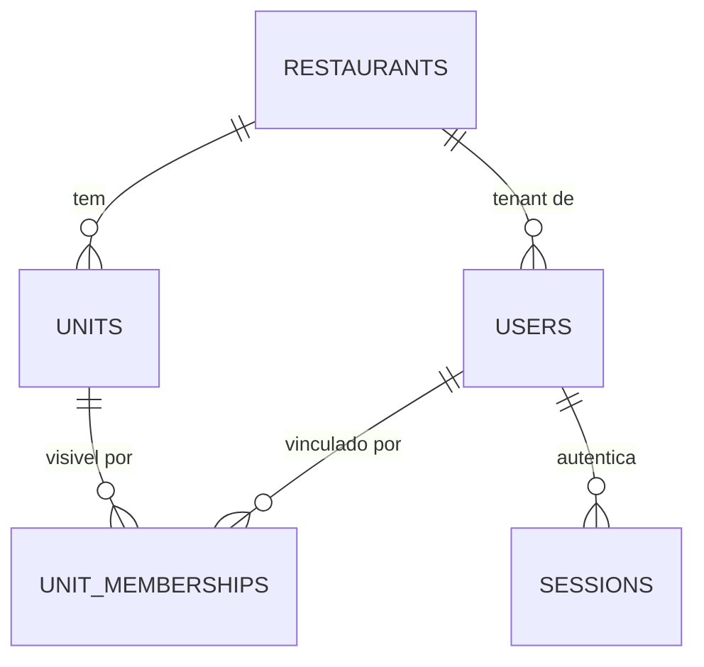

# Concept — Stage 2.3 — Persistência de identity

> **Escopo deste documento:** o que será feito nesta Stage, por quê, e
> decisões técnicas relevantes para entender o "porquê". O plano executável
> fica no [`technical.md`](./technical.md) correspondente.

## 1. Escopo

### Dentro do escopo

- **Schema Postgres do BC identity** descrito em **SQLAlchemy 2 Core** (`tables.py`),
  sem ORM declarativo: cinco tabelas (`restaurants`, `units`, `users`,
  `unit_memberships`, `sessions`) com as constraints que expressam no banco as
  invariantes do domínio.
- **Migration inicial** (`migrations/versions/0001_identity_initial.py`) com
  `upgrade()` **e** `downgrade()` funcionais.
- **Mappers** domínio↔linha (`mappers.py`), reidratando **pelo construtor** da
  entidade (revalidando invariantes — decisão herdada da 2.1).
- **Quatro repositórios Postgres** implementando os ports-out de 2.2:
  `RestaurantRepository`, `UnitRepository`, `UserRepository`, `SessionRepository`.
- **Testes de integração** contra Postgres real e **testes de contrato**
  provando `fake ≡ real` (a mesma suíte roda contra as duas implementações).
- **Correção dos quatro fakes**, que hoje divergem dos próprios ports: todos
  aceitam re-gravar uma chave já existente (semântica de upsert que a PK do
  Postgres rejeita).
- **Política de expurgo de sessões** (`purge_expired`) — finding herdado da 2.2.
- **Wiring no `composition_root.py`**.
- **Fix do gate de CI:** `ci.yml` ganha service de Postgres, para que os testes de
  integração rodem **de verdade** no runner em vez de ficarem vermelhos ou de se
  auto-pularem (o falso-verde que a Stage 1.2 existe para impedir).
- **Extensão do `docs/runbooks/validate-ci-gate.md`** — a §Maintenance do runbook
  exige, quando o gate endurece, uma nova classe de erro documentada na mesma Stage.
- **Driver Postgres** (`psycopg`) declarado no `pyproject.toml` — hoje o projeto
  tem SQLAlchemy mas **nenhum DBAPI**, então nenhuma conexão real seria possível.
- **Reconciliação do bloco 2.3 do `roadmap.md`** por nota datada, no padrão que as
  Stages 1.1/1.2/2.1/2.2 já usaram (§7 Decisão 9).

### Fora do escopo (explicitamente)

- HTTP, argon2/bcrypt e JWT — adapters de entrada e criptografia concreta são da
  Stage 2.4. Nenhum adapter `in/`, nenhum `PasswordHasher`, nenhum `TokenIssuer`.
- Convite por e-mail (2.5).
- **Row-level security nativa do Postgres** (`CREATE POLICY`) — non-goal declarado
  no roadmap; o isolamento desta Stage é imposto por **schema, código e testes**
  (ROADMAP-3).
- Use case de refresh/rotação de sessão (finding da 2.2 → Stage 2.4).
- Job agendado que efetivamente chama o expurgo — esta Stage entrega a **operação**
  e a política; o agendador é de operação/deploy (Step 6).
- **Normalização de `name`** e validação de formato canônico de identificador —
  ver §7 Decisão 5 e o finding escalado em §13.

### Vínculo com o roadmap

Fecha o Step 2 do lado da persistência: a 2.1 entregou o domínio puro, a 2.2 a
camada de aplicação com seis ports-out e fakes in-memory, e a 2.3 é a primeira
Stage do projeto a **tocar I/O real**. É aqui que ROADMAP-3 (multi-tenancy por
`tenant_id` row-level num único Postgres) deixa de ser premissa e vira schema.

## 2. Objetivo da Stage

Os ports-out de identity passam a ter implementação Postgres real, verificada
contra um banco de verdade por testes de integração e de contrato que provam que
o adapter real e o fake in-memory obedecem à **mesma** semântica — com o gate de
CI exercitando esses testes, não os pulando.

## 3. Contexto e premissas

### Contexto

A Stage 2.2 publicou seis ports-out e, junto, **fakes in-memory que são a
especificação executável** desses ports. O risco explicitamente registrado no
concept da 2.2 (§10) era "fake e futuro adapter Postgres divergirem no contrato",
mitigado com "semântica normativa escrita como lei testável; **contract tests são
da 2.3**". Esta Stage é o momento em que essa dívida é cobrada — e o inventário de
divergências é maior do que a 2.2 previa (§7 Decisão 3).

Duas coisas são certas **antes** de escrever uma linha de adapter:

1. Os quatro fakes de repositório gravam com `dict[chave] = valor` ou
   `list.extend(...)`, ou seja, **sobrescrevem em silêncio**, enquanto a PK do
   Postgres rejeita. Há inclusive um teste da 2.2
   (`test_regravar_o_mesmo_usuario_nao_e_conflito_de_email`) afirmando que
   re-gravar o mesmo `user_id` é legítimo — enquanto o docstring do próprio port
   diz "**É inserção, não upsert**". O teste codificou o que o contrato proíbe.
2. O projeto não tem driver Postgres instalado; nenhuma conexão real jamais foi
   aberta neste repositório.

### Premissas

- Docker local disponível para subir `postgres:16-alpine` (o `docker-compose.yml`
  já traz o serviço habilitado; worktrees paralelas parametrizam a porta do host).
- O runner do GitHub Actions (`ubuntu-latest`) suporta `services:` com Postgres —
  caminho padrão e sem custo.
- Os identificadores persistidos são `str(uuid4)` na forma canônica com hífens
  (invariante #3 da 2.2), então `TEXT` é suficiente. O domínio trata o id como
  **opaco** ("a geração do valor concreto é responsabilidade da application/infra"
  — `value_objects/identifiers.py`), então o banco **não** valida formato de id;
  ver §13.

### Dependências

- `2.2-identity-application`: os seis ports-out, os DTOs (`Session`,
  `UserCredentials`, `PasswordHash`, `SessionId`), a hierarquia de erros de
  aplicação e os fakes que esta Stage precisa igualar.
- `2.1-identity-domain`: as entidades `frozen` (`Restaurant`, `Unit`, `User`), os
  value objects (`Email`, `Role`, `UnitMembership`) e as invariantes de tenancy que
  o schema precisa espelhar.

## 4. Contratos

### Introduzidos

- **`identity_metadata`** (`schema`) — `sqlalchemy.MetaData` com as cinco tabelas do
  BC, descritas em Core. Fonte única do schema, consumida pelo Alembic
  (`target_metadata`) e pelos repositórios.
- **`PostgresRestaurantRepository`**, **`PostgresUnitRepository`**,
  **`PostgresUserRepository`**, **`PostgresSessionRepository`** (`adapter-out`) —
  implementações dos ports homônimos. Todas recebem um `Engine` no construtor e
  abrem a própria transação por chamada (§7 Decisão 6).
- **`RestaurantAlreadyExistsError`**, **`UnitAlreadyExistsError`**,
  **`UserAlreadyExistsError`**, **`SessionAlreadyExistsError`** e
  **`SessionFingerprintAlreadyExistsError`** (`application-error`) — cinco erros
  novos em `application/errors.py`, todos subclasses de `IdentityError`, simétricos
  aos três `*NotFoundError` que já existem. Tornam "chave já gravada" um resultado
  idêntico no fake e no real. O quinto separa reuso de **fingerprint** de colisão de
  **id de sessão**, pela mesma razão que `UserAlreadyExistsError` é distinto de
  `EmailAlreadyRegisteredError`: são violações diferentes, e a 2.4 precisa
  distingui-las — reuso de fingerprint é justamente o sinal de token roubado que o
  ADR 2.2.0001 existe para tornar detectável.
  Ver [ADR 2.3.0003](../../adr/2_3_0003-add-is-insertion-not-upsert.md).
- **`SessionRepository.purge_expired(before) -> int`** (`port-out`, **acréscimo ao
  port da 2.2**) — remove sessões cuja `expires_at` é anterior ou igual a `before` e
  devolve quantas removeu. Ver
  [ADR 2.3.0004](../../adr/2_3_0004-session-retention-and-purge.md).

### Consumidos

- **`RestaurantRepository`**, **`UnitRepository`**, **`UserRepository`**,
  **`SessionRepository`** — ports declarados na Stage `2.2-identity-application`.
- **`Restaurant`**, **`Unit`**, **`User`**, **`Email`**, **`Role`**,
  **`UnitMembership`** — domínio da Stage `2.1-identity-domain`.
- **`Session`**, **`UserCredentials`**, **`PasswordHash`**, **`SessionId`** — DTOs da
  Stage `2.2-identity-application`. **Nenhum DTO muda de forma nesta Stage.**
- **`EmailAlreadyRegisteredError`** — erro da Stage `2.2-identity-application`, que o
  adapter passa a levantar por tradução de `IntegrityError`.

> `PasswordHasher` e `TokenIssuer` **não** são implementados aqui (Stage 2.4).

## 5. Invariantes e regras

Ao final desta Stage, valem:

1. **I1 — Reidratação passa pelo construtor.** Todo mapper linha→entidade constrói a
   entidade chamando o construtor, que reexecuta `__post_init__`. É **proibido**
   `object.__setattr__`, `__new__` ou qualquer caminho que contorne a validação.
   Vale integralmente para `User`, `Restaurant` e `Unit` (que têm `__post_init__`);
   `Session` e `UnitMembership` não declaram invariantes na 2.2, então para eles a
   regra é apenas "construir normalmente" — a ausência de validação é fato da 2.2,
   registrado como finding em §13, não uma lacuna desta Stage.
2. **I2 — E-mail de login é único globalmente e em forma normalizada.** Índice único
   sobre `users.email` **sem** `tenant_id` na chave, mais
   `CHECK (email = lower(btrim(email)))`. O índice sozinho seria insuficiente: em
   Postgres a comparação é byte a byte, então `A@X.com` e `a@x.com` seriam duas
   linhas aceitas que reidratam para o mesmo login (o VO `Email` normaliza na
   leitura). A CHECK torna explícita, no banco, a garantia que hoje só existe no VO.
3. **I3 — `tenant_id` é nulo se e somente se o papel é `platform_admin`.**
   `role` é `NOT NULL` e restrito ao conjunto fechado por
   `CHECK (role IN ('platform_admin','owner','manager','hr','employee'))`; sobre isso,
   `CHECK ((role = 'platform_admin') = (tenant_id IS NULL))`. O `NOT NULL` é
   **load-bearing**, não decoração: uma CHECK em Postgres aceita `NULL`, então com
   `role` nulo o predicado do iff avaliaria `NULL` e a linha passaria.
4. **I4 — O schema torna vínculo cross-tenant irrepresentável.** `unit_memberships`
   carrega `tenant_id` `NOT NULL` e **duas** FKs compostas — `(unit_id, tenant_id) →
   units(id, restaurant_id)` e `(user_id, tenant_id) → users(id, tenant_id)` — de
   modo que usuário e unidade de um vínculo pertencem necessariamente ao mesmo
   tenant. Como efeito colateral, `platform_admin` (cujo `tenant_id` é nulo) não
   consegue casar a segunda FK, e o banco passa a impor o
   `PlatformAdminMembershipError` que hoje só o domínio impõe.
   **Esta invariante é sobre representabilidade, não sobre filtro de query:** nenhum
   método dos ports recebe tenant, então não há por onde filtrar. Em particular,
   `list_memberships` **não é obrigado** a filtrar — a 2.2 concede explicitamente que
   ele "**pode** devolver vínculos de outros usuários sem quebrar o contrato", porque
   quem casa usuário e unidade é `User.can_view_unit`, no domínio. O adapter real vai
   naturalmente filtrar por `user_id` (é o `WHERE` óbvio), e isso é conforme; o que a
   invariante proíbe é o inverso — **a visibilidade nunca pode depender** de o
   repositório filtrar direito.
5. **I5 — O banco nunca guarda o valor do refresh token.** O conjunto de colunas de
   `sessions` é exatamente
   `{id, user_id, refresh_token_fingerprint, issued_at, expires_at, revoked_at}` —
   verificável contra `information_schema.columns`.
6. **I6 — `find_by_fingerprint` não filtra.** Devolve a sessão mesmo revogada ou
   expirada (regra 1 do port) — é o que torna detectável o reuso de token na 2.4.
7. **I7 — `revoke` é idempotente no sentido forte.** Revogar sessão já revogada é
   no-op e **preserva o `revoked_at` original** (`WHERE revoked_at IS NULL` no
   `UPDATE`). Id inexistente é no-op silencioso.
8. **I8 — `add` é inserção, não upsert, nos quatro repositórios.** Chave já gravada
   levanta o `*AlreadyExistsError` correspondente; para `users`, e-mail já
   registrado por outro usuário levanta `EmailAlreadyRegisteredError`.
   `UserRepository.add` grava usuário, credencial e vínculos numa **única
   transação**. Vale para o fake **e** para o real.
9. **I9 — Sessão expira half-open.** `now == expires_at` já está expirada.
   Consequentemente `purge_expired(before)` remove por `expires_at <= before`: a
   fronteira do expurgo é a mesma fronteira de `is_active`.
10. **I10 — Datetimes atravessam a fronteira aware em UTC, nos dois sentidos.** As
    colunas são `TIMESTAMP WITH TIME ZONE` (microssegundos, sem precisão reduzida) e
    o mapper devolve `.astimezone(UTC)`. A normalização no mapper é necessária:
    `timestamptz` guarda um instante, e o psycopg o devolve no fuso **da sessão**,
    não em UTC — sem normalizar, o mesmo teste passaria no runner (UTC) e falharia
    numa máquina em `America/Sao_Paulo`.
11. **I11 — Erro de negócio nunca escapa como exceção fora de `IdentityError`.** As
    violações com significado de negócio (chave duplicada, e-mail duplicado) são
    traduzidas. Violação de FK **não** é traduzida, por decisão explícita (§7
    Decisão 7): sobe como `IntegrityError`, porque representa bug ou concorrência
    exótica, não regra de negócio.
12. **I12 — O gate de teste não passa sem exercitar o banco.** Não existe caminho em
    que a suíte reporte verde tendo pulado os testes de integração. Ver
    [ADR 2.3.0001](../../adr/2_3_0001-integration-tests-require-real-postgres.md).

## 6. Casos de erro e exceções

Ordem de validação do mapper de `User` (fixada aqui porque a precedência determina
qual exceção o chamador vê): `Role.from_string(role)` → `Email(email)` →
`User(...)`; dentro de `User.__post_init__`, a ordem herdada da 2.1 é id vazio →
iff de `platform_admin` → tenant ausente.

| Cenário | Comportamento esperado | Exceção |
|---|---|---|
| `add` com chave primária já gravada (nos 4 repositórios) | tradução do `IntegrityError` da PK | `RestaurantAlreadyExistsError` / `UnitAlreadyExistsError` / `UserAlreadyExistsError` / `SessionAlreadyExistsError` |
| `add` de usuário com e-mail já registrado por **outro** usuário | tradução do `IntegrityError` do índice único de e-mail | `EmailAlreadyRegisteredError` |
| `add` de sessão com fingerprint já gravado | tradução do `IntegrityError` de `uq_sessions_fingerprint` — **erro próprio**, distinto do de id duplicado, porque reuso de fingerprint é o sinal de token roubado que a 2.4 precisa distinguir (ADR 2.2.0001) | `SessionFingerprintAlreadyExistsError` |
| `find_by_id` / `find_by_fingerprint` / `find_credentials_by_email` sem linha | devolve `None` (não levanta) | — |
| `revoke` / `revoke_all_for_user` com id inexistente | no-op silencioso | — |
| `revoke` de sessão já revogada | no-op; `revoked_at` original preservado | — |
| Linha de `users` com `role` fora do conjunto fechado | `Role.from_string` levanta **antes** de construir `User` | `InvalidRoleError` |
| Linha de `users` com `id` vazio | 1ª checagem do `__post_init__` | `InvalidIdentifierError` |
| Linha de `users` com `platform_admin` **e** tenant | 2ª checagem do `__post_init__` | `PlatformAdminTenantError` |
| Linha de `users` com papel de restaurante **sem** tenant | 3ª checagem do `__post_init__` | `MissingTenantError` |
| `add` de unidade cujo `restaurant_id` não existe | violação de FK — **não** traduzida (§7 Decisão 7) | `IntegrityError` |
| `add` de vínculo cruzando tenants | violação de uma das FKs compostas — não traduzida | `IntegrityError` |
| Banco indisponível durante a suíte | falha alta e explícita, nunca skip silencioso | erro de fixture |

## 7. Decisões técnicas relevantes

### Decisão 1 — O gate exige Postgres real nos dois ambientes; nada de skip silencioso

- **O quê:** o `ci.yml` ganha um `services: postgres`, e os testes de integração
  **falham alto** quando o banco está inacessível — em vez de se auto-pularem.
  Não há assimetria local↔CI: `make check` exige banco nos dois lugares.
- **Por quê:** a alternativa "pular local, exigir no CI" é atraente, mas **não
  entrega o que promete**, e isso é mensurável, não opinião. O gate de cobertura é
  `fail_under = 90` sobre `src`, e a baseline medida nesta sessão é **606
  statements a 99,71%** (605 cobertos). Basta acrescentar ~66 statements não
  cobertos para a cobertura global cair abaixo de 90%, e os adapters desta Stage
  acrescentam várias centenas que **só** os testes de integração cobrem. Com eles
  pulados, `make check` fica vermelho de qualquer modo — o dev sem banco não
  ganharia um gate verde, ganharia uma falha de cobertura confusa em vez de uma
  mensagem dizendo "suba o Postgres". Exigir o banco é ao mesmo tempo o caminho
  mais simples, o mais honesto e o que tem **zero superfície de falso-verde**.
- **Fonte:** ADR 1.2.0001 (taxonomia decidida/semântica/**acidental**); baseline de
  cobertura medida nesta sessão; roadmap DoD "testes de integração e de contrato
  verdes contra Postgres real (docker)".
- **ADR:** [`2.3.0001`](../../adr/2_3_0001-integration-tests-require-real-postgres.md)

### Decisão 2 — Discriminador de tenant onde ele é dado de verdade, ancorado por FK composta

- **O quê:** `restaurants.id` é o próprio tenant; `units.restaurant_id` e
  `users.tenant_id` o carregam intrinsecamente; `unit_memberships.tenant_id` é
  denormalizado e ancorado por **duas** FKs compostas (I4). `sessions` **não** ganha
  `tenant_id`.
- **Por quê:** ROADMAP-3 pede o discriminador row-level, e para `unit_memberships`
  ele paga: é a única tabela onde ligação cross-tenant é representável, e a FK dupla
  a torna impossível. Para `sessions`, ao contrário, a coluna seria **inatingível e
  inverificável**: o DTO `Session` não tem `tenant_id` e o port entrega só o DTO, de
  modo que o adapter precisaria de um `SELECT` extra em `users` para preenchê-la, e o
  fake — que guarda o DTO — não poderia tê-la de jeito nenhum. Uma coluna que o
  contract test não alcança é uma coluna sem garantia. Pior: como o tenant de um
  `platform_admin` é nulo, uma FK composta sobre ela seria **MATCH SIMPLE** e ficaria
  desligada exatamente no caso privilegiado. A sessão chega ao tenant por
  `user_id → users.tenant_id`, que é a fonte, e nenhuma consulta de sessão é escopada
  por tenant.
- **Fonte:** roadmap ROADMAP-3; `dtos/session.py` (ausência de `tenant_id`);
  semântica MATCH SIMPLE de FK composta em Postgres.
- **ADR:** [`2.3.0002`](../../adr/2_3_0002-identity-schema-tenant-and-constraints.md)

### Decisão 3 — `add` é inserção nos quatro repositórios; os fakes é que são corrigidos

- **O quê:** os quatro fakes passam a rejeitar re-gravação de chave existente, cada
  um com o seu `*AlreadyExistsError`; o teste da 2.2 que afirmava o contrário é
  invertido.
- **Por quê:** o docstring do `UserRepository.add` já diz "**É inserção, não
  upsert**", e os demais dizem "persiste um restaurante/unidade/sessão **novo(a)**".
  Os quatro fakes fazem `dict[chave] = valor` (ou `extend`), sobrescrevendo em
  silêncio; os quatro correspondentes reais têm PK e rejeitam. Corrigir só o de
  `User` — como a primeira versão deste concept propunha — deixaria três quartos da
  divergência intacta e o contract test provando muito menos do que aparenta. A
  forma dos ports não muda: é o fake deixando de ser mais gentil que o real.
- **Fonte:** docstrings dos quatro ports em `application/ports/out/`; os quatro
  fakes em `tests/fakes/features/identity/`; finding da 2.2.
- **ADR:** [`2.3.0003`](../../adr/2_3_0003-add-is-insertion-not-upsert.md)

### Decisão 4 — Expurgo de sessões: operação no port, política no chamador

- **O quê:** `purge_expired(before: datetime) -> int` entra no port, no fake e no
  adapter real. Remove por `expires_at <= before` (mesma fronteira de `is_active`,
  I9); quem decide a janela de retenção é o chamador.
- **Por quê:** fecha o finding da 2.2 ("nada remove sessões; a tabela cresce
  indefinidamente") sem enterrar a política dentro do adapter. Deixar o `before` a
  cargo do chamador **preserva a forense** que o ADR 2.2.0001 protege: quem quiser
  guardar sessões revogadas por 90 dias passa `now - 90d`.
- **Fonte:** `[finding] limpeza de sessões expiradas` (§7 da 2.2), com Stage
  candidata `2.3-identity-persistence`.
- **ADR:** [`2.3.0004`](../../adr/2_3_0004-session-retention-and-purge.md)

### Decisão 5 — `name` é persistido verbatim; a persistência não normaliza

- **O quê:** o finding da 2.1 ("`name` não é normalizado") é fechado com a decisão
  de **não** normalizar na fronteira de persistência. As colunas são `TEXT` (nunca
  `CHAR(n)`, que faria padding à direita e quebraria a fidelidade).
- **Por quê:** o trabalho do repositório é round-trip fiel. Normalizar na escrita
  tornaria `add` lossy e faria o fake — que guarda verbatim — divergir do real,
  criando exatamente a classe de bug que os contract tests desta Stage existem para
  eliminar. Os dois motivos citados no finding (unicidade e ordenação por nome)
  **não têm requisito hoje**. Se um dia houver, o lugar certo é o construtor da
  entidade (como `Email` já faz), não o mapper.
- **Fonte:** `[finding] name não é normalizado nas entidades` (§7 da 2.1).
- **ADR:** [`2.3.0005`](../../adr/2_3_0005-names-persisted-verbatim.md)

### Decisão 6 — Fronteira transacional: `Engine` injetado, transação por chamada, sessão em UTC

- **O quê:** cada repositório recebe um `Engine` e abre `with engine.begin()` por
  método público. `UserRepository.add` grava usuário + credencial + vínculos dentro
  de **uma** dessas transações. O `Engine` é construído com
  `connect_args={"options": "-c timezone=UTC"}`, e o mapper ainda aplica
  `.astimezone(UTC)` na leitura.
- **Por quê:** os ports são síncronos e não existe port de Unit of Work; inventar um
  agora seria contrato novo sem consumidor. Transação por chamada é a fronteira mais
  simples que honra a exigência do port ("os três são a mesma transação") e é fácil
  de trocar depois. O cinto e a suspensório no fuso são deliberados: fixar a sessão
  em UTC resolve o caso normal, e a normalização no mapper garante I10 mesmo se o
  `Engine` vier de outro lugar (um teste, um script, a 2.4).
- **Fonte:** ADR 2.2.0004 (ports síncronos); docstring de `UserRepository.add`;
  skill `repository-pattern`.

### Decisão 7 — Só constraints com significado de negócio são traduzidas

- **O quê:** o adapter traduz para exceção de domínio apenas as violações que
  representam **regra de negócio** (chave duplicada, e-mail duplicado). Violação de
  FK — inclusive a de vínculo cross-tenant — sobe como `IntegrityError`.
- **Por quê:** o use case já valida a existência do restaurante e o mesmo-tenant
  **antes** de gravar (`RestaurantNotFoundError`, `CrossTenantError` — CA2/CA5 da
  2.2), então uma violação de FK aqui significa concorrência exótica ou bug. Traduzir
  para erro de negócio esconderia o defeito atrás de um 4xx plausível.
- **Fonte:** concept 2.2 §4; invariante I11.

### Decisão 8 — Driver `psycopg` (v3) com esquema de URL explícito

- **O quê:** entra `psycopg[binary]` no `pyproject.toml`, e a URL passa a
  `postgresql+psycopg://`. As listas de `forbidden_modules` do `.importlinter`
  ganham `psycopg` no mesmo commit.
- **Por quê:** o projeto não tem DBAPI algum — sem isso nada conecta (verificado por
  `find_spec`: nem `psycopg` nem `psycopg2` presentes). Entre psycopg2 (legado) e
  psycopg 3 (linha atual, com caminho para async se a 2.4+ precisar), a v3 custa o
  mesmo hoje e não fecha porta. O esquema explícito evita depender do driver default
  do SQLAlchemy, que é o psycopg2. O `.importlinter` **exige**, por comentário
  próprio, que dependência nova entre nas listas de pureza no mesmo commit.
- **Fonte:** `pyproject.toml`; cabeçalho do `.importlinter`.

### Decisão 9 — O bloco 2.3 do roadmap é reconciliado por nota datada

- **O quê:** o bloco declara `contratos_introduzidos: []`, não lista
  `session_repository.py` em `arquivos_a_criar` e não menciona `ci.yml`,
  `pyproject.toml`, `.importlinter`, `migrations/env.py`, `application/errors.py`,
  o port de sessão nem os fakes em `arquivos_a_modificar`. Todos são tocados. A nota
  **também** precisa corrigir a *descrição humana* do bloco, que hoje diz "com
  `tenant_id` em **todas** as tabelas": `sessions` deliberadamente não recebe a
  coluna (Decisão 2), e deixar a frase intacta faria o roadmap seguir afirmando um
  recorte que o schema não implementa.
- **Por quê:** o desvio é real e conhecido — a própria 2.2 registrou que o bloco
  desta Stage estava incompleto. As Stages 1.1, 1.2, 2.1 e 2.2 já estabeleceram o
  padrão: nota datada em blockquote sob o bloco YAML, no fechamento. Silenciar o
  desvio deixaria o roadmap afirmando um recorte que a execução contradiz.
- **Fonte:** `docs/roadmap.md` bloco 2.3; §7.8 do concept da 2.2; notas datadas
  existentes nos blocos 1.1/1.2/2.1/2.2.

## 8. Integrações

### Internas (com outras Stages/módulos)

- `composition_root.py`: passa a construir o `Engine` e instanciar os quatro
  repositórios. Continua sendo o **único** lugar que conhece classes concretas.
- `migrations/env.py`: passa a apontar `target_metadata` para o `identity_metadata`,
  habilitando `--autogenerate` a partir daqui.
- `tests/conftest.py`: a fixture `test_engine` (SQLite in-memory, herdada do
  template) não serve aos testes desta Stage — SQLite não expressa o schema usado
  (FK compostas, CHECK, `TIMESTAMPTZ`, nomes de constraint) e validaria contra um
  banco que não é o de produção.

### Externas

- **PostgreSQL 16** via `docker-compose.yml` local (porta do host parametrizada) e
  via `services:` no GitHub Actions. Contrato: URL de conexão em `DATABASE_URL`.

## 9. Modelo de dados

Todas as colunas são `TEXT` salvo indicação; todas são `NOT NULL` salvo indicação.
Toda constraint recebe **nome explícito** (`pk_`/`uq_`/`fk_`/`ck_`/`ix_`), porque a
tradução `IntegrityError` → exceção de domínio identifica a regra violada pelo nome
da constraint (§7 Decisão 7).

| Tabela | Colunas | Constraints |
|---|---|---|
| `restaurants` | `id`, `name` | `pk_restaurants(id)` |
| `units` | `id`, `restaurant_id`, `name` | `pk_units(id)`; `fk_units_restaurant(restaurant_id)`; **`uq_units_id_restaurant(id, restaurant_id)`** — âncora de FK composta |
| `users` | `id`, `email`, `role`, `tenant_id` (**nullable**), `password_hash` | `pk_users(id)`; `uq_users_email(email)` (I2); `ck_users_email_normalized` (I2); `ck_users_role_known` (I3); `ck_users_tenant_iff_platform_admin` (I3); `fk_users_tenant(tenant_id)`; **`uq_users_id_tenant(id, tenant_id)`** — âncora de FK composta |
| `unit_memberships` | `user_id`, `unit_id`, `tenant_id` | `pk_unit_memberships(user_id, unit_id)`; `fk_memberships_unit(unit_id, tenant_id) → units(id, restaurant_id)`; `fk_memberships_user(user_id, tenant_id) → users(id, tenant_id)` (I4) |
| `sessions` | `id`, `user_id`, `refresh_token_fingerprint`, `issued_at`, `expires_at`, `revoked_at` (**nullable**) | `pk_sessions(id)`; `uq_sessions_fingerprint`; `fk_sessions_user(user_id)`; `ix_sessions_user_id`; `ix_sessions_expires_at` |

Notas de projeto:

- **`uq_users_id_tenant` é obrigatório**, não redundante: Postgres exige índice único
  cobrindo as colunas referenciadas por uma FK composta, e `fk_memberships_user`
  aponta para `(id, tenant_id)`. Sem ele a migration não roda. O mesmo vale para
  `uq_units_id_restaurant`.

> **Este schema foi verificado empiricamente contra PostgreSQL 16 antes de ser
> aprovado**, e não apenas raciocinado. O probe criou as cinco tabelas e exercitou
> cada invariante; os resultados que mais importam:
>
> - `platform_admin` com tenant, papel de restaurante sem tenant, `role` nulo, `role`
>   desconhecido, e-mail não normalizado e e-mail duplicado em outro tenant foram
>   **todos rejeitados**, cada um pela constraint nomeada esperada.
> - **`role` nulo é barrado pelo `NOT NULL`, não pela CHECK** — confirmando que o
>   `NOT NULL` de I3 é load-bearing: sozinha, a CHECK aceitaria a linha.
> - Vínculo cross-tenant foi rejeitado **nas duas grafias** (`tenant_id` do usuário ou
>   da unidade), uma por `fk_memberships_unit` e a outra por `fk_memberships_user` —
>   é a prova de que a FK dupla de I4 fecha o cerco, e não só metade dele.
> - Vínculo de `platform_admin` foi rejeitado por `fk_memberships_user`.
> - `name` voltou como `[  Cantina A  ]`, com os espaços intactos (Decisão 5), e
>   `timestamptz` preservou microssegundos (`…13:00:00.654321+00`).
> - **O controle negativo confirmou a inércia do MATCH SIMPLE:** numa tabela de prova
>   com `tenant_id` nulo, a FK composta aceitou um `user_id` **inexistente**. É a
>   evidência direta de por que `sessions` não ganha a coluna (Decisão 2).
> - O mesmo instante voltou como `-03` numa sessão em `America/Sao_Paulo` e `+00` numa
>   sessão em UTC — evidência direta de I10 e da necessidade do `.astimezone(UTC)` no
>   mapper.
- **`users.password_hash` é coluna de `users`** (relação 1:1 obrigatória, escrita na
  mesma transação) e é `NOT NULL`. `find_by_id` não a seleciona.
- Colunas de tempo em `TIMESTAMP WITH TIME ZONE` **sem precisão reduzida**
  (microssegundos, como o `datetime` do Python).
- `sessions` **não** tem `tenant_id` (§7 Decisão 2).

## 10. Riscos e mitigações

| Risco | Probabilidade | Impacto | Mitigação |
|---|---|---|---|
| Adapter e fake divergirem em detalhe não coberto | A | A | Contract tests rodando o **mesmo** corpo de teste contra as duas implementações; inventário explícito de divergências conhecidas em §7 Decisão 3 e CA16 |
| Testes de integração se auto-pularem e o gate ficar míope | M | A | Sem caminho de skip (Decisão 1); teste de invariante do `ci.yml` reprova se o service sumir |
| Round-trip de datetime voltar em fuso local | A | M | `timezone=UTC` na sessão **e** `.astimezone(UTC)` no mapper (I10); assert de `tzinfo` no contract test |
| FK composta ficar inerte por NULL (MATCH SIMPLE) | M | A | `tenant_id` é `NOT NULL` em `unit_memberships`, a única tabela com FK composta sobre tenant; `sessions` não tem a coluna |
| Reidratação contornar invariante do domínio | B | A | I1 + mutação real no mapper na auditoria de testes |
| Ordem de `list_memberships` divergir entre fake e SQL | A | B | Ordenação **não** faz parte do contrato; contract test compara como conjunto (CA16) |
| Mudar os fakes quebrar testes da 2.2 já mergeada | A | B | Impacto localizado e enumerado no ADR 2.3.0003 |

## 11. Critérios de aceitação

- [ ] **CA1** — `alembic upgrade head` cria as cinco tabelas em Postgres limpo e
      `alembic downgrade base` as remove, com saída dos dois comandos colada.
- [ ] **CA2** — Round-trip fiel **campo a campo** (não por `==`, que nas entidades é
      igualdade só por id): para `Restaurant` e `Unit`, `add` seguido de `find_by_id`
      devolve `id`, `name` e `restaurant_id` idênticos, com `name = "  Cantina  "`
      preservando os espaços.
- [ ] **CA3** — `find_by_id` devolve `None` para id inexistente nos quatro
      repositórios; `find_credentials_by_email` e `find_by_fingerprint` idem.
- [ ] **CA4** — `PostgresUserRepository.add` é atômico: com uma sequência cujo
      **terceiro** elemento é um `UnitMembership` apontando para unidade inexistente,
      a chamada levanta e um `find_by_id` posterior devolve `None` — nenhum usuário,
      hash ou vínculo permanece gravado.
- [ ] **CA5** — E-mail duplicado em **outro tenant** levanta
      `EmailAlreadyRegisteredError` (I2), inclusive diferindo só por caixa; e um
      `INSERT` direto de `'A@X.com'` é rejeitado pela `ck_users_email_normalized`.
- [ ] **CA6** — `add` com chave já gravada levanta o `*AlreadyExistsError`
      correspondente nos **quatro** repositórios, no fake **e** no real; e uma sessão
      com fingerprint repetido levanta `SessionFingerprintAlreadyExistsError`,
      distinguível de `SessionAlreadyExistsError` (I8).
- [ ] **CA7** — Por `INSERT` direto: o banco aceita `platform_admin` com `tenant_id`
      nulo; **rejeita** `platform_admin` com tenant; **rejeita** papel de restaurante
      sem tenant; **rejeita** `role` nulo; **rejeita** `role` fora do conjunto
      fechado (I3 — os dois últimos são o buraco de lógica ternária).
- [ ] **CA8** — Por `INSERT` direto, um vínculo cujo usuário e unidade estão em
      tenants diferentes é **rejeitado** pelas FKs compostas, e um vínculo de
      `platform_admin` também (I4).
- [ ] **CA9** — O conjunto de colunas de `sessions` lido de
      `information_schema.columns` é exatamente
      `{id, user_id, refresh_token_fingerprint, issued_at, expires_at, revoked_at}`
      (I5) — asserção de igualdade de conjunto, não inspeção subjetiva.
- [ ] **CA10** — `find_by_fingerprint` devolve sessão revogada **e** expirada (I6).
- [ ] **CA11** — `revoke` duas vezes preserva o `revoked_at` da primeira; `revoke` de
      id inexistente não levanta (I7).
- [ ] **CA12** — `revoke_all_for_user` revoga só as sessões do usuário indicado.
- [ ] **CA13** — `purge_expired(before)` remove as sessões com `expires_at <= before`
      (fronteira inclusiva, I9), **não** remove as de `expires_at > before`, e
      devolve a contagem exata do que removeu.
- [ ] **CA14** — Round-trip de `datetime` devolve `tzinfo` UTC e o mesmo instante;
      `is_active(now)` dá o mesmo resultado antes de gravar e depois de ler, inclusive
      no instante de fronteira `now == expires_at` (I9, I10).
- [ ] **CA15** — Reidratação pelo construtor: linhas inseridas por `INSERT` direto
      violando cada cenário de §6 fazem a leitura levantar **a exceção nomeada
      naquela linha da tabela** — `InvalidRoleError`, `InvalidIdentifierError`,
      `PlatformAdminTenantError` e `MissingTenantError`, respectivamente (I1).
- [ ] **CA16** — A suíte de contrato roda o **mesmo corpo de teste** contra o fake e
      contra o adapter Postgres, cobrindo **todos os métodos dos quatro ports**. Ficam
      explicitamente fora os ganchos que só existem no fake e não pertencem ao port
      (`seed_membership`, `list_all_memberships`, `leak_foreign_memberships`,
      `find_calls`). Coleções de vínculos são comparadas como **conjunto** — ordem
      não faz parte do contrato.
- [ ] **CA17** — `composition_root.wire_dependencies()` devolve os quatro
      repositórios Postgres montados; e um teste de import verifica que nenhum módulo
      fora de `composition_root.py` importa
      `features.identity.adapters.out.postgres` (asserção mecânica, não julgamento).
- [ ] **CA18** — O job de gate do `ci.yml` declara service de Postgres e
      `DATABASE_URL`, e continua rodando **literalmente** `make check` (invariante I3
      da 1.2); `tests/unit/test_ci_workflow.py` reprova se qualquer um dos três
      sumir. Esta é a proteção **regressiva** de I12.
- [ ] **CA19** — Um teste de integração deliberadamente quebrado derruba o CI —
      demonstração pontual num run real, com link colado. É **evidência** de que I12
      vale hoje; quem protege I12 daqui em diante é CA18.
- [ ] **CA20** — Tradução de erro (I11 e Decisão 7): chave duplicada chega ao chamador
      como `IdentityError`, e violação de FK chega como `IntegrityError` — as duas
      asseridas explicitamente, para que a exceção deliberada à tradução não vire
      omissão silenciosa.

## 12. Checklist de validação interna

- [x] Todos os contratos introduzidos têm assinatura definida? — §4.
- [x] Toda decisão em §7 tem fonte rastreável? — todas citam arquivo, ADR herdado,
      finding ou medição feita nesta sessão.
- [x] Toda integração externa tem contrato definido (interface, formato, auth)? —
      §8 (Postgres 16 via `DATABASE_URL`).
- [x] Decisões com alternativa real descartada têm ADR escrito? — cinco ADRs
      (2.3.0001 a 2.3.0005).
- [x] Dependências de Stages anteriores estão satisfeitas (`done`)? — `2.2` mergeada
      em `develop` (commit `461d38a stage 2.2: complete`).
- [x] Stage cabe em ~3–12 Tasks? — o recorte de §1 se decompõe em 12 Tasks; a
      decomposição efetiva é responsabilidade do `technical.md` (Fase 3B), e se
      passar de 12 a Stage será quebrada em vez de inflada.
- [x] Riscos críticos têm mitigação plausível? — §10.
- [x] **Específica desta Stage:** existe caminho pelo qual a suíte fique verde sem
      ter tocado o banco? — não, por construção (Decisão 1 + CA18/CA19).
- [x] **Específica desta Stage:** toda invariante de §5 tem ao menos um critério de
      aceite? — I1→CA15, I2→CA5, I3→CA7, I4→CA8, I5→CA9, I6→CA10, I7→CA11+CA12,
      I8→CA6+CA4, I9→CA13+CA14, I10→CA14, I11→CA20, I12→CA18+CA19. (CA12 cobre o
      escopo de `revoke_all_for_user`, não a idempotência de I7 — quem carrega I7 é
      CA11 sozinho.)

## 13. Questões em aberto

Nenhuma bloqueante. Os dois findings herdados endereçados a esta Stage
(normalização de `name`, expurgo de sessões) foram fechados em §7 (Decisões 5 e 4),
e a divergência dos fakes foi resolvida na Decisão 3.

Três findings **novos**, descobertos no Checkpoint A, são escalados em vez de
resolvidos aqui — nenhum é bloqueante e todos estão fora da camada-alvo desta Stage:

- **`Session` e `UnitMembership` não têm `__post_init__`.** Um `Session` com
  `revoked_at` anterior a `issued_at`, ou com fingerprint vazio, é construível. É
  fato da 2.2 (camada `application`), não desta Stage. **Stage candidata:** `2.4`.
- **Formato canônico de identificador não é imposto em lugar nenhum.** A invariante
  #3 da 2.2 fixa `str(uuid4)`, mas `NewType` não valida em runtime e o domínio trata
  o id como opaco por decisão explícita — impor no banco contrariaria essa opacidade.
  **Stage candidata:** a Stage que introduzir ingestão de id externo.
- **Agendamento do `purge_expired`.** Esta Stage entrega a operação; falta o job
  periódico, a janela de retenção escolhida e o alerta sobre a contagem devolvida.
  **Stage candidata:** Step 6 (deploy/operação).

## 14. Referências

- [`../../overview.md`](../../overview.md) — glossário de tenant e escopo do produto
- [`../../roadmap.md`](../../roadmap.md) — bloco `2.3-identity-persistence`, ROADMAP-3
- [`../2.2-identity-application/concept.md`](../2.2-identity-application/concept.md) — §4 semântica normativa dos ports, §5 invariantes, §9 modelo de dados
- [`../2.1-identity-domain/technical.md`](../2.1-identity-domain/technical.md) — §7, finding de normalização de `name`
- [`../../adr/1_2_0001-deterministic-pr-path-gates.md`](../../adr/1_2_0001-deterministic-pr-path-gates.md) — taxonomia de degradação de gate
- [`../../adr/2_2_0001-revocable-refresh-session-port.md`](../../adr/2_2_0001-revocable-refresh-session-port.md) — sessão revogável, fingerprint
- ADRs desta Stage: [`../../adr/`](../../adr/) (prefixo `2_3_`)
- [`../../runbooks/validate-ci-gate.md`](../../runbooks/validate-ci-gate.md) — §Maintenance exige extensão quando o gate muda
