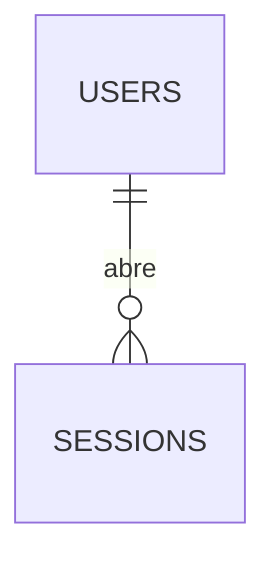

# Concept — Stage 2.4 — API de tenancy, usuários e auth

> **Escopo deste documento:** o que será feito nesta Stage, por quê, e
> decisões técnicas relevantes para entender o "porquê". O plano executável
> fica no [`technical.md`](./technical.md) correspondente.

## 1. Escopo

### Dentro do escopo

- **Adapters de segurança (`adapters/out/security/`)** — as duas implementações
  concretas que a 2.2 declarou como port e ninguém implementou:
  `Argon2PasswordHasher` (`PasswordHasher`) e `JwtTokenIssuer` (`TokenIssuer`).
- **Extensão aditiva do port `TokenIssuer`** com `decode_access_token`, para que
  o guard HTTP verifique o access token sem fazer criptografia por conta própria
  (ADR 2.4.0002).
- **Dois use cases de ciclo de vida de sessão** (`application/use_cases/`):
  - `refresh_session.py` — rotação de refresh com **detecção de reuso**
    (alocado a esta Stage pelo ADR 2.2.0001; registrado como `[finding]` na §7
    da 2.2 por não constar do bloco do roadmap).
  - `revoke_session.py` — logout: revoga a sessão do refresh apresentado.
    **Proveniência:** ao contrário do refresh, o logout **não** consta do bloco do
    roadmap nem da §Escopo da issue #24, e nenhum `[finding]` o alocou aqui. Ele
    entra por **decisão autônoma aditiva** (ADR 0.0.0004 §Decision 4), por dois
    motivos: a decisão do sponsor de 2026-07-19 descreve o desenho afirmando que
    "demissão/logout cortam o refresh na hora", o que não é verdade de nada
    entregue enquanto não houver rota; e `SessionRepository.revoke` ficaria sem
    chamador de produção — a mesma condição que a 2.3 registrou como `[finding]`
    para `purge_expired`. Custo: um use case de ~20 linhas e uma rota. Está
    declarado aqui em vez de silenciado porque escopo sem fonte superior é escopo
    que ninguém aprovou.
- **Adapter HTTP de entrada (`adapters/in/http/`)** — `schemas.py` (Pydantic,
  só aqui), `error_handlers.py` (mapa exceção → status), `dependencies.py`
  (guard de autenticação/autorização) e `router.py` (as rotas).
- **Mapeamento exceção → status HTTP**, exaustivo sobre a hierarquia
  `IdentityError` e guardado por teste de totalidade (ADR 2.4.0001).
- **Wiring:** `composition_root.py` passa a montar os use cases (e não mais só
  repositórios); `shared/infrastructure/http/app.py` registra router e handlers
  a partir do que o composition root entrega.
- **Configuração:** TTL de access/refresh, segredo e algoritmo do JWT entram em
  `Settings` — **TTL é configuração, não constante** (decisão do sponsor).
- **Testes e2e (`tests/e2e/features/identity/`)** exercitando a app FastAPI real
  contra Postgres real: cadeia de provisionamento, 403 por falta de permissão,
  401 por token ausente/inválido/expirado, rotação de refresh e detecção de reuso.

### Fora do escopo (explicitamente)

- **Leitura (o "R", "U" e "D" do CRUD).** Esta Stage entrega apenas a criação.
  Não é recorte arbitrário: os ports-out de 2.2 têm `find_by_id` e
  `exists_by_email`, e **nenhuma operação de listagem ou de update/delete**.
  Endpoints de consulta exigiriam ports novos, métodos novos no adapter Postgres
  e migration — uma Stage inteira, não um adendo a esta.
- **Convite por e-mail e reset de senha** — Stage 2.5.
- **Auto-cadastro público de restaurante e verificação de e-mail** — Step 13.
- **Introspecção de sessão por request** — decisão do sponsor (2026-07-19): a
  janela de revogação é fechada por TTL curto. O campo `session_id` de
  `AccessTokenClaims` é **preservado** para que a introspecção futura não exija
  remodelar port.
- **Criação de `platform_admin` pela API** — ver §5 regra 8 e §13. Consequência
  fail-closed do mapa de papéis da 2.1, não omissão.
- **Chamador de produção para `purge_expired`** — `[finding]` herdado da 2.3; o
  job agendado é do Step 6. Nenhum scheduler é inventado aqui.
- **Refresh por cookie httpOnly e decisões de front** — o front é outro
  repositório (ROADMAP-2). O refresh trafega no corpo JSON.
- **Rate limiting / lockout de tentativas de login** — infraestrutura
  transversal, Step 6 (`6.3-ops-baseline`).
- **Desativação/demissão de usuário.** Esta é a omissão que mais merece ser dita
  em voz alta, porque a decisão do sponsor a menciona: "demissão/logout cortam o
  refresh na hora e o access em até 15 minutos". Esta Stage entrega **só criação**
  — não há rota que desative ou remova um usuário, `User` não tem `is_active`, e
  os ports-out não têm update nem delete. `SessionRepository.revoke_all_for_user`
  (documentado no port como "demissão") continua **sem chamador de produção**.
  Ou seja: o **mecanismo** existe e está testado; a **rota** não. Enquanto ela não
  existir, a janela de corte por demissão não é de 15 minutos — é indefinida.
  `[finding]` registrado em §13, Stage candidata `3.5-employee-login-link` (a
  primeira que mexe no ciclo de vida de uma pessoa) ou uma Stage dedicada de
  gestão de usuários.
- **Teto absoluto de vida de sessão.** A rotação renova `expires_at` a cada uso
  (`now + refresh_ttl`), sem propagar o `issued_at` original nem impor limite
  duro. Um cliente que rotacione dentro do TTL mantém sessão indefinidamente. A
  RFC 6819 §5.2.2.3 trata rotação como **complemento** de um tempo de vida
  absoluto, não como substituto. Não é feito aqui porque exige campo novo em
  `Session` e migration, ambos fora do recorte. `[finding]` em §13.

### Vínculo com o roadmap

Fecha o Step 2 do lado funcional: é a Stage em que o BC `identity` ganha
**superfície de runtime**. Domínio (2.1), use cases (2.2) e persistência (2.3)
existem, mas nada que um cliente HTTP consiga chamar. O DoD do bloco
`2.4-identity-http` no [`roadmap.md`](../../roadmap.md) — "e2e: admin cria
tenant → unidade → usuário; login emite JWT; ação sem permissão retorna 403" —
é satisfeito com os **atores corretos** conforme a decisão do sponsor de
2026-07-19 (ver §5 regra 7): o `platform_admin` provisiona o restaurante e o seu
primeiro `owner`; o `owner` cria unidades e usuários dali em diante.

**Divergências declaradas em relação ao bloco do roadmap** (mesma classe que a
2.2 e a 2.3 reconciliaram com nota datada no `roadmap.md`; a nota correspondente
a esta Stage é escrita no fechamento, junto do `status: done`):

- `contratos_introduzidos: []` **não se sustenta.** A Stage introduz a extensão
  aditiva `TokenIssuer.decode_access_token`, dois commands, dois use cases, três
  erros de aplicação e os dois adapters de segurança — todos listados em §4.
- `camada_alvo: adapters/in/http` é incompleta: a Stage também cria em
  `application/use_cases/` (os dois use cases de sessão, um deles alocado aqui
  pelo ADR 2.2.0001) e em `adapters/out/security/` — este último, aliás, já
  consta do próprio `arquivos_a_criar` do bloco.
- `arquivos_a_criar` não previa `adapters/in/http/error_handlers.py` (ADR
  2.4.0001), nem os dois use cases de sessão.
- "middleware de auth" em `arquivos_a_modificar` vira dependência FastAPI — ver
  §7.5, com a justificativa.

## 2. Objetivo da Stage

Ao final desta Stage, a aplicação FastAPI real atende requisições autenticadas
por JWT e autorizadas pelos dois eixos do BC `identity`, com o ciclo completo de
provisionamento e sessão (login, rotação de refresh com detecção de reuso, e
logout) exercitado ponta a ponta pelo entrypoint real.

## 3. Contexto e premissas

### Contexto

As três Stages anteriores entregaram um BC completo e **inerte**. Os dois ports
de segurança (`PasswordHasher`, `TokenIssuer`) existem apenas como `Protocol` e
como fake de teste; a única coisa que já rodou contra eles foi a suíte unitária.
Esta Stage é, portanto, a primeira vez que uma decisão criptográfica real é
tomada no projeto — e a primeira em que o `create_app()` deixa de ser um esqueleto.

O ADR 2.2.0001 desenhou a sessão de refresh para que o **reuso** de um token já
rotacionado seja **detectável**: `find_by_fingerprint` é deliberadamente
não-filtrante, devolvendo a sessão mesmo revogada. Essa decisão só produz valor
quando alguém a consome — e o consumidor é o use case de rotação desta Stage.

### Premissas

- O primeiro `platform_admin` é semeado fora da API (inserção direta / futura
  seed), como toda raiz de confiança. Ver §13.
- Não há port de unidade de trabalho (transação) atravessando repositórios: cada
  adapter da 2.3 abre a sua própria transação. Operações compostas desta Stage,
  portanto, **não** são atômicas entre agregados, e o desenho evita depender
  disso (§5 regra 7).
- `httpx` + `ASGITransport` (já em uso na fixture `client` de `tests/conftest.py`)
  exercitam a app sem abrir porta TCP; isso conta como entrypoint real para o
  gate de verificação end-to-end, pois passa por middlewares, handlers e wiring.

### Dependências

- `2.1-identity-domain`: `User`, `Unit`, `Restaurant`, `Role`, `Permission`,
  `Email`, e a hierarquia `IdentityError`.
- `2.2-identity-application`: os cinco use cases, os seis ports-out, os DTOs e a
  hierarquia de erros de aplicação (ADR 2.2.0003), cujo desenho já previa que
  "a Stage 2.4 refina para 401/403/404 registrando handlers, sem tocar nesta
  camada".
- `2.3-identity-persistence`: os quatro adapters Postgres, a migration e o
  `.env`/`Settings` de banco.

## 4. Contratos

### Introduzidos

- **`TokenIssuer.decode_access_token(token: str) -> AccessTokenClaims`**
  (`port-out`, extensão aditiva) — verifica assinatura e expiração e devolve as
  claims. Levanta `InvalidAccessTokenError` para qualquer falha (assinatura,
  formato, expiração, claim faltante). **Nunca** devolve claims de um token que
  não passou na verificação. ADR 2.4.0002.

- **`RefreshSessionCommand`** (`dto`) — `refresh_token: str`.
- **`RevokeSessionCommand`** (`dto`) — `refresh_token: str`.

- **`RefreshSessionUseCase.execute(cmd) -> AuthenticationResult`** (`use-case`) —
  rotação. Sequência normativa em §5 regra 5.
- **`RevokeSessionUseCase.execute(cmd) -> None`** (`use-case`) — logout.
  Idempotente: refresh desconhecido ou já revogado **não** levanta (§5 regra 6).

- **`InvalidAccessTokenError`**, **`InvalidRefreshTokenError`**,
  **`RefreshTokenReuseError`** (`application-error`) — herdam de `IdentityError`,
  como todos os erros de aplicação deste BC (ADR 2.2.0003). Os três têm mensagem
  **genérica**: não distinguem para o cliente a causa da falha (§5 regra 10).

- **`Argon2PasswordHasher`** (`adapter-out`) — implementa `PasswordHasher`,
  honrando as duas leis do port (`verify` nunca levanta; `dummy_hash()` é um hash
  válido e inatingível).
- **`JwtTokenIssuer`** (`adapter-out`) — implementa `TokenIssuer`, honrando a lei
  `issuer.fingerprint(t.value) == t.fingerprint`.

- **Superfície HTTP** (prefixo `/api/v1`):

  | Método | Rota | Permissão exigida | Sucesso |
  |---|---|---|---|
  | POST | `/auth/login` | — (pública) | 200 |
  | POST | `/auth/refresh` | — (autoridade é a posse do refresh) | 200 |
  | POST | `/auth/logout` | — (idem) | 204 |
  | POST | `/restaurants` | `manage_platform` | 201 |
  | POST | `/restaurants/{restaurant_id}/owners` | `manage_platform` | 201 |
  | POST | `/restaurants/{restaurant_id}/units` | `manage_tenant` | 201 |
  | POST | `/users` | `manage_users` ∪ permissões do papel alvo | 201 |

- **Schemas Pydantic** (`adapters/in/http/schemas.py`, e **só** aqui):
  `LoginRequest`, `RefreshRequest`, `LogoutRequest`, `TokenResponse`,
  `CreateRestaurantRequest`, `RestaurantResponse`, `CreateUnitRequest`,
  `UnitResponse`, `CreateUserRequest`, `CreateOwnerRequest`, `UserResponse`.
  Campos de credencial em request são `SecretStr` (§5 regra 9).

### Consumidos

- **`CreateRestaurantUseCase`, `CreateUnitUseCase`, `CreateUserUseCase`,
  `AuthenticateUserUseCase`, `AuthorizeActionUseCase`** — Stage `2.2`.
- **`RestaurantRepository`, `UnitRepository`, `UserRepository`,
  `SessionRepository`, `PasswordHasher`, `TokenIssuer`** — Stage `2.2`,
  implementados em `2.3` (os quatro primeiros) e nesta Stage (os dois últimos).
- **`Clock`, `IdGenerator`** — `shared/application/ports/out`.

## 5. Invariantes e regras

1. **Pydantic só no boundary.** Nenhum símbolo de `pydantic` aparece fora de
   `features/identity/adapters/in/http/` e de `shared/infrastructure/config/`.
   **O que é garantido mecanicamente e o que não é:** os contratos
   `identity-application-purity` e `identity-domain-purity` do import-linter
   proíbem `pydantic` em `features.identity.application` e
   `features.identity.domain` — que são as camadas onde o vazamento importaria.
   Nada no `.importlinter` proíbe `pydantic` em `adapters/out/` (postgres ou
   security); ali a garantia é revisão de Checkpoint C, não gate. Dito assim
   porque afirmar cobertura mecânica inexistente é pior que não tê-la.

2. **O adapter HTTP não reimplementa autorização.** Toda decisão de acesso passa
   por `AuthorizeActionUseCase`. O que o adapter faz — e que é legitimamente seu
   — é **declarar qual permissão a ação exige** e **qual é o alvo** (tenant,
   unidade), porque `AuthorizeActionCommand` recebe esses campos como entrada.
   Declarar o requisito não é decidi-lo. ADR 2.4.0003.

3. **O tenant do usuário criado nunca vem do corpo da requisição.** Há
   exatamente **duas** origens permitidas, e a rota determina qual:
   - **Rotas de tenant** (`POST /users`): o tenant é o `actor_tenant_id`
     devolvido por `AuthorizedActor`. Um `tenant_id` aceito do corpo seria vetor
     de escalada entre tenants num POST.
   - **Rota de plataforma** (`POST /restaurants/{restaurant_id}/owners`): o
     tenant é o `{restaurant_id}` do **path** — isto é, o próprio recurso pai
     sobre o qual a ação é declarada. Não pode ser o do ator: o ator é
     `platform_admin` e `actor_tenant_id` é obrigatoriamente `None` (invariante
     de `User.__post_init__`, ADR 2.1.0002), de modo que a primeira origem
     produziria `MissingTenantError` e a rota seria natimorta.
   A distinção é material: um path param **nomeia o recurso** e é resolvido
   contra o banco (`CreateUserUseCase` levanta `RestaurantNotFoundError` se não
   existir), enquanto um campo de corpo seria uma afirmação não verificada do
   cliente. A rota de plataforma só é segura porque **apenas** `manage_platform`
   a alcança, e esse papel é, por construção, global.

4. **"Não se concede o que não se detém" — nas rotas de tenant.** Em
   `POST /users`, criar um usuário de papel `P` exige que o ator detenha
   `manage_users` **e** todas as permissões de `P`. A regra é implementada **sem
   código de política novo**: o adapter chama `AuthorizeActionUseCase` uma vez
   por permissão exigida, e o conjunto exigido é derivado do mapa
   `Role -> permissions` da 2.1 — fonte única, já testada como total. Sem ela, um
   `manager` (que tem `manage_users`) criaria um `owner` (que tem
   `manage_tenant`) e escalaria privilégio.

   **Exceção declarada:** a rota de provisionamento da regra 7 **viola esta
   composição de propósito** — `platform_admin` emite um `owner` sem deter
   `manage_tenant` nem `manage_users`. É a definição de bootstrap: alguém fora da
   hierarquia do tenant precisa criar o topo dela, ou o tenant nasce inoperável.
   O que contém a exceção não é a regra 4, é o **conjunto de rotas**: existe uma
   só, ela exige `manage_platform`, e cria exclusivamente `role=owner` no
   restaurante do path. Qualquer rota nova que emita papel sem passar pela
   composição precisa de ADR próprio. ADR 2.4.0003.

4b. **A autorização roda uma vez por unidade requisitada.** Quando o request
   nomeia `unit_ids`, o adapter chama `AuthorizeActionUseCase` para **cada** uma;
   com a lista vazia, chama uma vez com `unit_id=None` (e um ator escopado por
   unidade é negado por `UnitScopeRequiredError` — omitir não promove).

   Esta regra parece detalhe de implementação e **não é**: é ela que mantém
   seguro o `str(exc)` das faixas 404/422 da regra 10. Sem ela,
   `CreateUserUseCase` seria alcançado com unidades não-visíveis e responderia
   `UnitNotFoundError` (404) para inexistente e `CrossTenantError` (422) para
   unidade de outro tenant — reabrindo, com dois status falantes, exatamente o
   oráculo de enumeração que §6 fecha. Autorizando antes, os dois erros ficam
   inalcançáveis para unidade que o ator não enxerga. ADR 2.4.0003 §3.

5. **Rotação de refresh — sequência normativa** (a ordem é contrato):
   1. `fingerprint = token_issuer.fingerprint(valor apresentado)`.
   2. `session = sessions.find_by_fingerprint(fingerprint)`; `None` →
      `InvalidRefreshTokenError`.
   3. **`session.revoked_at is not None` → REUSO**: `revoke_all_for_user(...)`
      e então `RefreshTokenReuseError`. **"Família" aqui significa literalmente
      todas as sessões do usuário**, porque é a única granularidade que o port
      oferece — `Session` não tem campo de linhagem nem de causa de revogação.
      Usar a palavra "família" sem essa nota nomearia um conceito que o modelo de
      dados não tem. Consequência declarada em §6.
   4. `session.is_active(now)` falso (isto é, expirada) →
      `InvalidRefreshTokenError`.
   5. Usuário inexistente → `InvalidRefreshTokenError`.
   6. `revoke` da sessão antiga; `add` da nova; par de tokens novo devolvido.

   **O passo 3 vem antes do 4 de propósito.** Invertê-los faria um refresh
   revogado *e* expirado ser tratado como simples expiração, e a família não
   seria revogada — que é exatamente o caso do token roubado e guardado. Há
   teste dedicado fixando essa precedência.

6. **Logout é idempotente e silencioso.** Refresh desconhecido, expirado ou já
   revogado devolve 204 assim mesmo. Um logout que respondesse 404 para token
   desconhecido viraria oráculo de validade de token — e não há nada a proteger:
   quem apresenta o token já o possui.

   **Efeito colateral declarado:** como a regra 5 passo 3 não distingue *por que*
   uma sessão foi revogada, **reapresentar em `/auth/refresh` um token cuja
   sessão já saiu por logout é tratado como reuso** e derruba as demais sessões
   do usuário. Um cliente correto não faz isso (recebeu 204 e descartou o token),
   mas um retry automático ou uma requisição em voo fazem. Está aceito e
   declarado — não descoberto em produção — em §6 e §10; distinguir a causa exige
   campo novo em `Session` e migration, fora do recorte. `[finding]` em §13.

7. **Provisionamento de tenant é ação de plataforma.** `platform_admin` cria o
   restaurante **e** o seu primeiro `owner` (rota dedicada
   `POST /restaurants/{id}/owners`, exigindo `manage_platform`). Sem isso a
   cadeia do DoD é impossível: `platform_admin` detém apenas `manage_platform`
   (mapa da 2.1, "acesso de plataforma não é acesso de restaurante"), logo não
   poderia criar usuário nenhum, e o restaurante nasceria sem ninguém capaz de
   operá-lo. A rota reusa `CreateUserUseCase` com `role=owner` — nenhum use case
   novo, nenhuma permissão nova, nenhuma mudança no domínio. ADR 2.4.0003.

8. **`platform_admin` não é criável pela API.** Duas barreiras, e é importante
   não confundi-las:
   - Em `POST /users`, a composição da regra 4 exigiria `manage_users` ∪
     `{manage_platform}`, e nenhum papel detém os dois — barreira **derivada do
     mapa de papéis**, robusta a rotas novas que usem a composição.
   - A rota de plataforma da regra 7 não fecha nada por composição (ela é a
     exceção); o que a fecha é que ela cria **exclusivamente `role=owner`**,
     fixo no código, não vindo do request.

   Ou seja: a garantia real é "**nenhuma rota emite `platform_admin`**", não
   "a regra 4 o proíbe". A distinção importa porque é a segunda formulação que
   um autor futuro relê antes de escrever a próxima rota de provisionamento — e
   ela é falsa. Coberta por CA20. Ver §13.

9. **Nenhum material de credencial é serializado ou logado.** `password_hash`
   nunca aparece em schema de resposta (`UserResult` sequer o carrega). Senhas e
   refresh tokens **em request** são `SecretStr`, cujo `repr` é `**********` —
   fecha o vazamento por traceback com `--showlocals` e por captura de locals.
   O `refresh_token` de **resposta** é `str` por necessidade (é para o cliente).

10. **As faixas 401 e 403 respondem com corpo constante; a mensagem da exceção
    nunca chega ao cliente.** Não basta igualar o status: o corpo padrão dos
    handlers é `{"detail": str(exc)}`, e as mensagens dos erros deste BC carregam
    ids e tenants (`"isolamento de tenant violado: ator do tenant 'A' e alvo no
    tenant 'B'"`). Duas consequências se o corpo vazasse:
    - **O oráculo volta pelo corpo.** Um `manager` distingue "unidade
      inexistente" (convertida em `UnitNotVisibleError`) de "unidade de outro
      tenant" (`TenantNotVisibleError`) só lendo o `detail`, mesmo com ambos em
      403 — o vazamento que a conversão de §6 existe para fechar.
    - **`TenantNotVisibleError` revela o tenant dono do recurso**, que é pior do
      que revelar a existência dele.

    Portanto: **401** devolve um `detail` fixo, e **403** devolve outro `detail`
    fixo, iguais para todas as exceções da faixa. `type` também é constante por
    faixa. A mensagem específica continua existindo — vai para o log do servidor,
    onde é útil e não é oráculo.

    As faixas **404, 409 e 422 mantêm `str(exc)`**: ali a mensagem descreve o
    recurso que o próprio cliente nomeou ou a invariante que o payload dele
    violou, e nenhuma delas é alcançável através de fronteira de tenant — as
    checagens de escopo do `AuthorizeActionUseCase` rodam **antes**, de modo que
    um 404 só fala de recurso do tenant do próprio ator. Suprimir a mensagem
    também ali custaria diagnóstico sem comprar isolamento.

    É a mesma propriedade que a 2.2 defendeu com `dummy_hash()` e com a mensagem
    única de `InvalidCredentialsError`, agora estendida ao eixo de autorização.

11. **O mapa exceção → status é total sobre `IdentityError`.** Toda subclasse
    concreta tem entrada explícita; um teste enumera as subclasses por
    `__subclasses__` recursivo e falha se alguma ficou de fora. Sem a
    totalidade, um erro novo cairia no default 422 em silêncio — que é
    justamente como um 403 vira 422 sem ninguém notar. ADR 2.4.0001.

12. **TTL é configuração.** `access_token_ttl_minutes` (default 15) e
    `refresh_token_ttl_days` (default 14) vivem em `Settings`. Nenhum
    `timedelta` literal no corpo de use case ou de adapter.

13. **`session_id` permanece nas claims** mesmo sem consumidor, para que a
    introspecção futura não exija remodelar o port (`[finding]` herdado da 2.2).

## 6. Casos de erro e exceções

**Mapa normativo** (ADR 2.4.0001). O handler é único, registrado sobre
`IdentityError`, e resolve o status percorrendo o `__mro__` da exceção.

| Status | Exceções | Racional |
|---|---|---|
| **401** | `InvalidCredentialsError`, `InvalidAccessTokenError`, `InvalidRefreshTokenError`, `RefreshTokenReuseError`, `SessionFingerprintAlreadyExistsError` | Quem você é não foi estabelecido. Resposta acompanha `WWW-Authenticate: Bearer` (RFC 6750 §3) e corpo genérico (§5 regra 10). |
| **403** | `PermissionDeniedError`, `TenantScopeRequiredError`, `TenantNotVisibleError`, `UnitScopeRequiredError`, `UnitNotVisibleError` | Você é conhecido e não pode. Os cinco erros são os dois eixos do ADR 2.2.0002 mais as duas exigências de escopo. |
| **404** | `RestaurantNotFoundError`, `UnitNotFoundError`, `UserNotFoundError` | Alvo inexistente. Já herdam de `NotFoundError`. **Ver a ressalva abaixo:** vindos do *guard*, `UserNotFoundError` e `UnitNotFoundError` não chegam a este handler. |
| **409** | `EmailAlreadyRegisteredError`, `RestaurantAlreadyExistsError`, `UnitAlreadyExistsError`, `UserAlreadyExistsError`, `UnitMembershipAlreadyExistsError`, `SessionAlreadyExistsError` | Conflito com estado já gravado (ADR 2.3.0003). |

**Por que `SessionFingerprintAlreadyExistsError` fica em 401 e não em 409.** A
própria classe declara o que significa: "id repetido é colisão, enquanto
**fingerprint repetido é o sinal de reuso de refresh token**". Classificá-lo
como conflito de escrita registraria o oposto do que o erro quer dizer, e — pior
— produziria, num endpoint de autenticação, um status **distinguível** das demais
falhas de credencial, furando a regra 10 justamente no caminho mais sensível. Ele
não é alcançável pelo fluxo normal (o passo 3 da regra 5 pega o reuso antes do
`add`), o que torna a classificação barata de acertar e sem custo.
| **422** | `InvalidEmailError`, `InvalidRoleError`, `InvalidNameError`, `InvalidIdentifierError`, `MissingTenantError`, `PlatformAdminTenantError`, `PlatformAdminMembershipError`, `CrossTenantError` | Invariante de domínio violada pelo conteúdo enviado. |

Casos de erro adicionais, com comportamento fixado:

- **Ator do token não existe mais** (`UserNotFoundError` vinda de
  `AuthorizeActionUseCase`): o guard a converte em `InvalidAccessTokenError` →
  **401**, não 404. Em `AuthorizeActionCommand` o único usuário é o **ator**,
  então a origem é inequívoca; um token cujo sujeito sumiu é credencial inválida,
  não recurso ausente. O mapa global segue com `UserNotFoundError` → 404 para os
  caminhos em que o usuário é **alvo** (Stages seguintes). Coberto por CA21.

- **Unidade alvo inexistente, vinda do guard** (`UnitNotFoundError` levantada por
  `AuthorizeActionUseCase._assert_unit_visibility`): o guard a converte em
  `UnitNotVisibleError` → **403**, não 404.

  **Isto fecha um oráculo de enumeração cross-tenant.** Sem a conversão, um
  `manager` do tenant A itera `unit_ids` em `POST /users` e lê a resposta: **404
  = a unidade não existe em lugar nenhum; 403 = existe, em algum tenant**. O
  `UnitRepository.find_by_id` não filtra por tenant — por desenho, porque quem
  casa tenant e vínculo é o domínio — então a unidade do tenant B é encontrada e
  só depois recusada por `TenantNotVisibleError`. A diferença entre os dois
  status vaza a existência de recursos através da fronteira que o BC inteiro
  existe para isolar.

  É exatamente a ameaça que `create_user.py` já documenta no próprio módulo — "a
  diferença entre as duas respostas revelaria quais unidades existem" — e que
  motivou lá a ordem das checagens. Reproduzi-la no boundary desfaria no HTTP a
  defesa erguida na aplicação. Para quem não enxerga a unidade, "não existe" e
  "existe e não é sua" **têm de ser a mesma resposta**. Coberto por CA22.

- **Rotação não-atômica** (`revoke` da antiga confirma, `add` da nova falha): não
  há port de unidade de trabalho, então os dois passos são transações separadas.
  O cliente fica com um refresh cuja sessão já está revogada e, no retry,
  dispara a detecção de reuso — derrubando as sessões do usuário por causa de uma
  falha transitória de escrita. **Aceito e declarado**, pela mesma razão da
  corrida abaixo: erra para o lado seguro. Inverter a ordem (`add` antes de
  `revoke`) trocaria isto por uma janela em que dois refresh valem ao mesmo
  tempo — pior trade para um sistema com detecção de reuso. `[finding]` em §13.

- **Logout seguido de reapresentação do mesmo refresh** → tratado como reuso
  (§5 regra 6). Declarado, não descoberto.
- **Header `Authorization` ausente ou sem esquema `Bearer`** → 401 com o mesmo
  corpo genérico.
- **Corpo malformado / campo faltante** → 422 do próprio FastAPI
  (`RequestValidationError`), sem handler customizado: é erro de forma, anterior
  ao domínio.
- **`verify` do argon2 contra hash malformado** → `False`, nunca exceção
  (lei 1 do port). O adapter absorve `InvalidHash`/`VerificationError` do
  argon2-cffi; deixá-las vazar transformaria "credencial inválida" em 500.
- **Rotação concorrente do mesmo refresh:** as duas requisições podem passar do
  passo 2. A segunda encontra a sessão já revogada e dispara a revogação de
  família — falso positivo de reuso possível sob corrida. É **aceito**: o
  comportamento erra para o lado seguro (derruba as sessões e força novo login),
  e a alternativa exigiria bloqueio pessimista de linha, que não cabe no port
  atual. Registrado em §10.

## 7. Decisões técnicas relevantes

### 7.1 Mapeamento exceção → status por handler único + mapa total
- **O quê:** um `@app.exception_handler(IdentityError)` resolve o status num
  dicionário `tipo -> status`, com totalidade guardada por teste.
- **Por quê:** a alternativa (try/except por rota) espalha a política por 7
  endpoints e apodrece silenciosamente; a alternativa (um handler registrado por
  classe) são **27 registros manuais** (24 subclasses concretas de `IdentityError`
  já mergeadas — 8 no domínio, 16 na aplicação — mais as 3 desta Stage) com o
  mesmo risco de esquecimento. O mapa total transforma "esqueci de mapear" em
  suíte vermelha.
- **Fonte:** ADR 2.2.0003 ("a Stage 2.4 refina para 401/403/404 registrando
  handlers, sem tocar nesta camada"); issue #24 §Comportamento esperado.
- **ADR:** [`../../adr/2_4_0001-http-error-status-mapping.md`](../../adr/2_4_0001-http-error-status-mapping.md)

### 7.2 Verificação do access token estende `TokenIssuer`
- **O quê:** `decode_access_token` entra no port existente, em vez de um port
  `AccessTokenVerifier` novo.
- **Por quê:** o port já declara concentrar **toda** a criptografia de token, e
  emissão e verificação compartilham segredo e algoritmo — separá-los criaria
  dois pontos de configuração que podem divergir em silêncio.
- **Fonte:** `token_issuer.py` (docstring do módulo); LAYOUT §5.
- **ADR:** [`../../adr/2_4_0002-decode-extends-token-issuer.md`](../../adr/2_4_0002-decode-extends-token-issuer.md)

### 7.3 Autorização composta no boundary
- **O quê:** o adapter declara o conjunto de permissões exigidas (incluindo as do
  papel alvo, regra 4) e o alvo de escopo; `platform_admin` provisiona o primeiro
  `owner` por rota dedicada (regra 7).
- **Por quê:** fecha a escalada de privilégio e o impasse de bootstrap sem tocar
  no mapa de papéis da 2.1 nem adicionar política nova.
- **Fonte:** issue #24 (decisões do sponsor 2026-07-19); ADR 2.2.0002; mapa
  `_ROLE_PERMISSIONS` em `role.py`.
- **ADR:** [`../../adr/2_4_0003-authorization-composition-at-boundary.md`](../../adr/2_4_0003-authorization-composition-at-boundary.md)

### 7.4 Parâmetros dos adapters de segurança
- **O quê:** `argon2-cffi` (argon2id, parâmetros default da lib) para senha;
  `PyJWT` com HS256 para access token; refresh = `secrets.token_urlsafe(32)` e
  fingerprint = SHA-256 hex do valor.
- **Por quê:** argon2id é a recomendação do OWASP Password Storage Cheat Sheet e
  `argon2-cffi` é o binding de referência (`passlib` está sem release desde 2020;
  `python-jose` acumula CVEs). SHA-256 sem sal é correto **aqui** e errado para
  senha: o refresh tem 256 bits de entropia, então não há dicionário a percorrer
  — e o fingerprint precisa ser determinístico para que `find_by_fingerprint`
  encontre.
- **Fonte:** ROADMAP-4 (JWT access+refresh, hash argon2); ADR 2.2.0001
  (banco guarda fingerprint, nunca o token).
- **ADR:** [`../../adr/2_4_0004-security-adapter-parameters.md`](../../adr/2_4_0004-security-adapter-parameters.md)

### 7.5 Guard como `Depends`, não como middleware
- **O quê:** a autenticação é uma dependência FastAPI por rota, não um
  `BaseHTTPMiddleware` global.
- **Por quê:** o bloco do roadmap diz "middleware de auth", mas middleware global
  precisaria de uma lista de rotas públicas (login/refresh/logout, `/docs`,
  `/openapi.json`) — configuração que erra por omissão e **abre** rota sem
  querer. Com `Depends`, uma rota sem o guard é visível na assinatura da função,
  e o default é "não autenticada por declaração explícita", não "esqueci da
  allowlist". É refinamento de implementação dentro do contrato do bloco, não
  contradição: o efeito declarado (enforcement de RBAC no boundary) é o mesmo.
- **Fonte:** `roadmap.md` §Stage 2.4 (`arquivos_a_modificar`); skill
  `fastapi-thin-adapter`.

### 7.6 Wiring do router via composition root
- **O quê:** `app.py` não conhece a feature: o `composition_root` monta os use
  cases, carrega o módulo do router (via `importlib`, porque `in` é keyword) e
  entrega ao `create_app()` o router pronto e o registrador de handlers.
- **Por quê:** mantém intacta a única exceção de import já declarada
  (LAYOUT §6 / `ignore_imports` do `.importlinter`: `shared...http.app ->
  composition_root`). Qualquer outro caminho exigiria uma supressão nova ou
  faria `shared` importar feature.
- **Fonte:** LAYOUT §6 e §8; `.importlinter` (cabeçalho e `shared-independence`).

## 8. Integrações

### Internas
- `composition_root` ↔ `adapters/out/security`: instancia os dois adapters com
  os parâmetros de `Settings`.
- `composition_root` ↔ `adapters/in/http`: monta os use cases e os injeta no
  router por `app.dependency_overrides`.
- `shared/infrastructure/http/app.py`: passa a registrar router + handlers de
  identity.

### Externas
Nenhuma. Os dois adapters novos são criptografia local (`argon2-cffi`, `PyJWT`);
nada sai da máquina, o que também satisfaz o ADR 0.0.0004 §7 (corrida autônoma
não faz chamada externa).

## 9. Modelo de dados

Nenhuma tabela nova e **nenhuma migration**: a tabela `sessions` da 2.3 já
comporta a rotação (`revoked_at`, `uq_sessions_fingerprint`). A rotação grava uma
linha nova e revoga a antiga — o histórico revogado é preservado de propósito,
porque é o dado que a forense de um incidente de reuso consome (ADR 2.2.0001).

## 10. Riscos e mitigações

| Risco | Prob. | Impacto | Mitigação |
|---|---|---|---|
| Segredo JWT default vaza para produção | M | A | Default é `dev-insecure-change-me` e está em `.env.example`; **`[finding]` escalado para `6.2-deploy-pipeline`**: fail-fast no boot quando `debug=false` e segredo default. Não é feito aqui porque quebraria o boot de teste, que roda com `debug=false`. |
| Corrida na rotação dispara revogação de família indevida | B | M | Aceito: erra para o lado seguro (§6). Documentado; solução real exige lock pessimista fora do port atual. |
| `verify` do argon2 vazando exceção vira 500 no login | M | A | Lei 1 do port, testada no adapter real **e** no teste de contrato contra hash malformado/vazio/de outro algoritmo. |
| Mapa de status incompleto após erro novo | A | M | Teste de totalidade sobre as subclasses de `IdentityError` (regra 11). |
| Custo do argon2 deixa a suíte lenta | M | B | Parâmetros default da lib; os testes e2e criam poucos usuários. Medido na Task 03; se doer, `Settings` já é o ponto de ajuste. |
| Enumeração cross-tenant de unidades pelo par 404/403 | A | A | Guard converte `UnitNotFoundError` em `UnitNotVisibleError` → 403 (§6). CA22 fixa a indistinguibilidade. |
| Logout num dispositivo derruba os demais (replay do refresh já revogado) | M | M | Aceito e declarado (§5 regra 6, §6). Erra para o lado seguro. `[finding]` para distinguir causa de revogação. |
| Sessão perpétua por rotação indefinida | M | M | Aceito nesta Stage; `[finding]` em §13 para teto absoluto (RFC 6819 §5.2.2.3). |
| "Demissão corta acesso" sem rota que a execute | A | A | Declarado fora de escopo em §1, com `[finding]` e Stage candidata. O mecanismo (`revoke_all_for_user`) existe e é testado; falta o chamador. |

## 11. Critérios de aceitação

- [ ] **CA1** — `POST /auth/login` com credencial correta devolve 200 com access
      token, refresh token e os dois instantes de expiração; uma sessão é
      persistida com o **fingerprint**, nunca o valor.
- [ ] **CA2** — `POST /auth/login` com e-mail inexistente e com senha errada
      devolvem **401 com corpo idêntico** (mesmo status, mesmo JSON, mesmos
      headers). **E a defesa de tempo é verificada, não presumida:** com o fake
      espião, o login de e-mail inexistente registra exatamente uma chamada a
      `verify`, contra `dummy_hash()` — corpo idêntico sem essa asserção deixa
      passar verde o oráculo de tempo, que é a metade que importa.
- [ ] **CA3** — access token emitido é decodificável por `decode_access_token` e
      carrega `subject`, `role`, `tenant_id` e `session_id`; token com assinatura
      adulterada ou expirado levanta `InvalidAccessTokenError`.
- [ ] **CA4** — `POST /auth/refresh` rotaciona: devolve par novo, revoga a sessão
      antiga e grava a nova; o refresh antigo deixa de servir.
- [ ] **CA5** — apresentar um refresh **já rotacionado** revoga **todas** as
      sessões do usuário e responde 401 (detecção de reuso).
- [ ] **CA6** — a precedência revogado-antes-de-expirado é testada: um refresh
      revogado **e** expirado dispara reuso, não expiração.
- [ ] **CA7** — `POST /auth/logout` revoga a sessão e devolve 204; refresh
      desconhecido ou já revogado também devolve 204.
- [ ] **CA8** — `Argon2PasswordHasher` satisfaz as duas leis do port; teste de
      contrato roda o mesmo corpo contra o fake e contra o adapter real.
- [ ] **CA9** — `JwtTokenIssuer` satisfaz `fingerprint(t.value) == t.fingerprint`;
      teste de contrato roda contra fake e real.
- [ ] **CA10** — requisição sem header `Authorization`, com esquema não-Bearer,
      com token malformado ou expirado devolve 401 com `WWW-Authenticate: Bearer`.
- [ ] **CA11** — `POST /restaurants` por `platform_admin` devolve 201; por
      `owner` devolve 403.
- [ ] **CA12** — `POST /restaurants/{id}/units` por `owner` do tenant devolve
      201; por `owner` de **outro** tenant devolve 403; por `manager` devolve 403.
- [ ] **CA13** — `POST /users` por `owner` devolve 201 com o `tenant_id` do
      **ator**, mesmo que o corpo tente informar outro.
- [ ] **CA14** — `POST /users` por `manager` pedindo papel `owner` devolve 403
      (não se concede o que não se detém).
- [ ] **CA15** — `POST /users` por `manager` com unidade que ele **não** enxerga
      devolve 403; com unidade que enxerga devolve 201.
- [ ] **CA16** — todo `IdentityError` concreto tem entrada **explícita própria**
      no mapa de status; o teste enumera as subclasses recursivamente e falha se
      alguma só herda a entrada do pai.
- [ ] **CA16b** — cada faixa de status (401/403/404/409/422) é exercitada **pela
      API** por ao menos um teste. Verificação objetiva: o teste é parametrizado
      sobre as cinco faixas e assere o status devolvido por uma requisição real,
      de modo que uma faixa sem cenário deixa o parametrize incompleto e falha.
- [ ] **CA17** — nenhum schema de resposta contém senha, hash ou fingerprint.
      Verificação objetiva: o teste varre `model_fields` de **todos** os schemas
      cujo nome termina em `Response` contra uma lista negra de nomes
      (`password`, `senha`, `hash`, `password_hash`, `fingerprint`, `secret`), de
      modo que um schema novo entra na varredura sem ninguém lembrar. E o `repr`
      dos schemas de request não revela a senha (`SecretStr`).
- [ ] **CA18** — e2e da cadeia completa contra Postgres real: `platform_admin`
      cria restaurante → cria o `owner` → `owner` faz login → cria unidade →
      cria `employee` → `employee` faz login → `employee` tentando criar unidade
      recebe 403.
- [ ] **CA19** — `make check` verde e cobertura ≥ 90% em cada arquivo novo.
- [ ] **CA20** — `POST /users` com `role="platform_admin"`, por **qualquer** ator
      (inclusive `owner` e `platform_admin`), devolve 403 — a garantia
      fail-closed da §5 regra 8, verificada em vez de argumentada.
- [ ] **CA21** — token válido cujo usuário foi removido do banco devolve **401**
      (não 404), com `WWW-Authenticate: Bearer` — a inversão deliberada do mapa
      global descrita em §6.
- [ ] **CA22** — em `POST /users`, `unit_id` **inexistente** e `unit_id`
      **existente em outro tenant** produzem respostas **indistinguíveis** (mesmo
      status 403, mesmo corpo **byte a byte**). Três cenários no mesmo teste:
      unidade inexistente, unidade de outro tenant, e unidade do próprio tenant
      não vinculada ao ator. É o fechamento do oráculo de enumeração
      cross-tenant de §6 + §5 regra 10; um teste que só cheque "403 para unidade
      invisível" passaria verde na versão vazada, e um que só cheque o status
      passaria verde na versão que vaza pelo corpo.
- [ ] **CA23** — reapresentar em `/auth/refresh` um refresh cuja sessão saiu por
      **logout** dispara a detecção de reuso e revoga as demais sessões do
      usuário — o efeito colateral de §5 regra 6, fixado por teste para que
      deixe de ser efeito colateral e passe a ser comportamento contratado.
- [ ] **CA24** — o `tenant_id` do `owner` criado por
      `POST /restaurants/{id}/owners` é o `{id}` do path; um `{id}` inexistente
      devolve 404 e **nenhum** usuário é gravado (§5 regra 3, segunda origem).
- [ ] **CA25** — os dois TTLs são configuração observável: um teste monta o grafo
      de dependências com `Settings(access_token_ttl_minutes=…, …)` alterado e
      assere que a mudança se reflete nos instantes de expiração devolvidos por
      `/auth/login`. (A ausência de `timedelta` literal é consequência disso e
      fica com o Checkpoint C, não com um teste — varredura textual seria gate
      frágil.)
- [ ] **CA26** — as respostas 401 e 403 têm `detail` e `type` **constantes por
      faixa**: um teste reúne, para cada faixa, ≥ 3 cenários que levantam
      exceções **diferentes** e assere que os corpos são idênticos entre si
      (§5 regra 10). É o que impede que a mensagem da exceção volte ao cliente
      numa refatoração.

## 12. Checklist de validação interna

- [x] Todos os contratos introduzidos têm assinatura definida? — §4.
- [x] Toda decisão em §7 tem fonte rastreável? — §7, cada item com **Fonte**.
- [x] Toda integração externa tem contrato definido? — não há (§8).
- [x] Decisões com alternativa real descartada têm ADR escrito? — 2.4.0001 a
      2.4.0004.
- [x] Dependências de Stages anteriores estão satisfeitas (`done`)? — 2.1/2.2/2.3
      `done` e mergeadas em `develop`.
- [x] Stage cabe em ~3–12 Tasks? — 12 (ver `technical.md`).
- [x] Riscos críticos têm mitigação plausível? — §10.
- [x] **O DoD do roadmap é satisfeito com os atores que a decisão do sponsor
      permite?** — sim, via §5 regra 7 (CA18).
- [x] **Toda superfície nova é fail-closed por default?** — sim: guard explícito
      por rota (§7.5), mapa total (regra 11), exigências de escopo herdadas do
      ADR 2.2.0002.

## 13. Questões em aberto

- [ ] **Semeadura do primeiro `platform_admin`.** Nenhuma rota o cria (§5 regra
      8). Hoje ele nasce por inserção direta (é o que o e2e faz, via repositório).
      Direção sugerida: comando de seed/CLI idempotente. **Stage candidata:
      `6.3-ops-baseline`** (baseline operacional), ou antes se um ambiente de
      demonstração precisar. Não bloqueia esta Stage: raiz de confiança semeada
      fora da API é a norma, não a exceção.
- [ ] **Fail-fast de segredo default em produção.** Ver §10. **Stage candidata:
      `6.2-deploy-pipeline`.**
- [ ] **Rota de desativação/demissão de usuário.** Sem ela, a propriedade
      "demissão corta o refresh na hora" não é alcançável pela API e
      `revoke_all_for_user` segue sem chamador de produção (§1 Fora do escopo).
      Direção sugerida: `is_active` em `User` + rota de desativação que chama
      `revoke_all_for_user` na mesma transação lógica. **Stage candidata:
      `3.5-employee-login-link`**, que já mexe no ciclo de vida da pessoa, ou uma
      Stage dedicada de gestão de usuários no Step 2/3.
- [ ] **Teto absoluto de vida de sessão.** A rotação renova `expires_at` sem
      limite (§1 Fora do escopo). Direção sugerida: preservar o `issued_at` da
      primeira sessão da cadeia e recusar rotação além de `issued_at + máximo`.
      Exige campo em `Session` + migration. **Stage candidata: uma Stage de
      endurecimento de sessão no Step 6**, junto do job de `purge_expired`.
- [ ] **Distinguir causa de revogação (logout × rotação × incidente).** Hoje um
      único `revoked_at` serve aos três, o que faz o replay pós-logout ser lido
      como reuso (§5 regra 6, §6). Direção sugerida: coluna de causa em
      `sessions`, consultada no passo 3 da regra 5. **Mesma Stage candidata do
      item anterior** — os dois mexem em `Session` e valem uma migration só.
- [ ] **Atomicidade da rotação.** `revoke` + `add` são transações separadas (§6).
      Direção sugerida: port de unidade de trabalho compartilhado, útil também
      para o provisionamento restaurante+owner (ADR 2.4.0003, Alternative B).
      **Stage candidata: a primeira que precise de escrita multi-agregado** —
      provavelmente `4.4-scheduling-persistence`.

## 14. Referências

- [`../../overview.md`](../../overview.md)
- [`../../roadmap.md`](../../roadmap.md) — bloco `2.4-identity-http`
- [`../2.2-identity-application/concept.md`](../2.2-identity-application/concept.md)
- [`../2.3-identity-persistence/concept.md`](../2.3-identity-persistence/concept.md)
- ADRs desta Stage: `2_4_0001` … `2_4_0004` em [`../../adr/`](../../adr/)
- ADRs herdados: 2.2.0001 (sessão revogável), 2.2.0002 (dois eixos fail-closed),
  2.2.0003 (hierarquia de erros), 2.2.0004 (ports síncronos), 2.3.0003
  (`add` é inserção), 2.1.0002 (`platform_admin` sem tenant)
- OWASP Password Storage Cheat Sheet (argon2id); RFC 6750 §3
  (`WWW-Authenticate: Bearer`); RFC 6819 §5.2.2.3 (rotação e detecção de reuso
  de refresh token)
