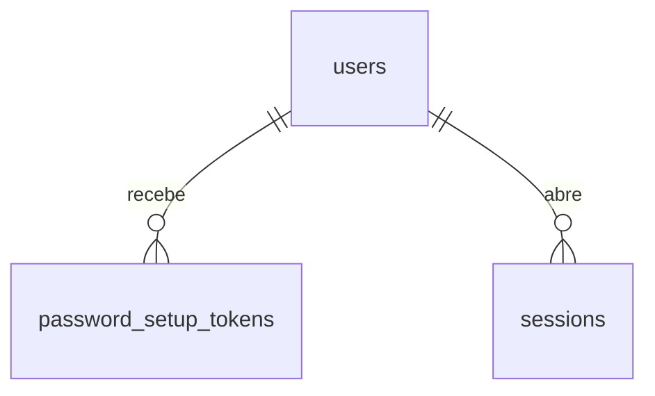

# Concept — Stage 2.5 — Convite por e-mail e definição de senha

> **Escopo deste documento:** o que será feito nesta Stage, por quê, e
> decisões técnicas relevantes. O plano executável fica no
> [`technical.md`](./technical.md).

## 1. Escopo

### Dentro do escopo

- **Port compartilhado `EmailSender`** (`shared/application/ports/out/`) e o DTO
  `EmailMessage` que ele transporta.
- **`ConsoleSender`** (`shared/infrastructure/email/`) — o adapter que satisfaz o
  DoD: escreve a mensagem numa saída local, sem sair da máquina.
- **Mecanismo próprio de token de definição de senha**: `SetupTokenIssuer`
  (port-out de identity), o registro persistido `PasswordSetupToken` e o
  `PasswordSetupTokenRepository`, com **uso único**, **expiração** e
  **invalidação em massa por usuário**.
- **Três use cases** em `features/identity/application/use_cases/`:
  `invite_user`, `set_password_with_token`, `request_password_reset`.
- **`UserRepository.set_password_hash`** — o método que faltava para que uma
  senha possa ser trocada depois da criação.
- **`PasswordHasher.unusable_hash`** — o hash sem pré-imagem conhecida que um
  usuário convidado carrega até definir a própria senha (D4).
- **Handler de `RequestValidationError` com corpo constante** — impede que o
  framework devolva o token (ou a senha) de volta ao cliente no 422 (D6).
- **Três rotas HTTP**: convite (autenticada), pedido de reset (pública),
  definição de senha por token (pública).
- **Persistência**: tabela `password_setup_tokens` + migration + adapter Postgres.
- **Wiring** no `composition_root.py` e as configurações novas em `Settings`.
- **Testes**: unit com fakes, contrato (fake × real) para o issuer e para o
  repositório, integração contra Postgres real, e2e do fluxo completo
  convite → definir senha → login.

### Fora do escopo (explicitamente)

- **Adapter Resend / SMTP real.** O provedor está decidido (kickoff #7,
  ASSUM-3), mas a credencial é do sponsor e o ADR 0.0.0004 §Decision 7 proíbe
  chamada externa nesta corrida. Vira `[finding]` para `6.2-deploy-pipeline`.
- Templates de e-mail elaborados (HTML, i18n, branding). Corpo em texto puro.
- **Auto-login após definir a senha.** A resposta não devolve par de tokens; o
  cliente faz login pelo caminho normal.
- **Equalização de tempo do pedido de reset** — ver §10 (risco declarado) e §13.
- Rate limiting / throttling de envio de e-mail.
- Login de funcionário (Stage 3.5, BC `staff`); auto-cadastro e cobrança (Step 13).
- **Reenvio de convite.** Não há rota para isso, e **reconvidar não funciona**:
  o e-mail já está cadastrado, então a rota de convite responde 409. Quem perdeu
  ou deixou expirar o link tem um caminho, e é o **pedido público de reset** — o
  usuário existe, logo o reset emite um token novo e funciona exatamente igual.
  Uma rota de reenvio dedicada (autenticada, para o admin reenviar sem depender
  do convidado) fica como `[finding]` (§13).

### Vínculo com o roadmap

Fecha o Step 2 (`Restaurante e acesso`). Até a 2.4 um usuário só existia se
alguém o criasse **com a senha já definida** — o que é impossível num produto
real, onde quem convida não conhece a senha de quem é convidado. Esta Stage
entrega o caminho de onboarding de verdade e, de quebra, o de recuperação de
acesso. É também a primeira Stage a introduzir um port em `shared/` que uma
**outra feature** vai consumir (Stage 4.6, notificação de publicação de escala).

### Divergências declaradas em relação ao bloco do roadmap

Seguindo o padrão que a 2.2/2.3/2.4 estabeleceram (`[decision]` da §7 da 2.4), as
diferenças em relação ao bloco `#### Stage 2.5` do `roadmap.md` são declaradas
aqui, e a nota datada no próprio `roadmap.md` entra no commit de fechamento.

1. **Persistência entra no escopo.** O roadmap não lista tabela, migration nem
   `adapters/out` para esta Stage. O DoD ("token define a senha") combinado com a
   exigência de **uso único** da issue #27 é inalcançável sem estado do lado do
   servidor — ver ADR 2.5.0002, que examina e rejeita a alternativa stateless.
   Entram `password_setup_tokens`, a migration `0002` e o adapter Postgres.
2. **Três use cases, não dois.** O roadmap nomeia `invite_user` e
   `set_password_with_token`; o DoD e a issue exigem também o reset de senha
   "pelo mesmo mecanismo de token", que precisa de um caminho de entrada próprio
   (`request_password_reset`) porque o pedido de reset é **público** e o convite é
   autenticado.
3. **`smtp_or_api_sender` não é entregue.** O roadmap o lista ao lado do
   `console_sender`; a issue #27 autoriza explicitamente entregar só o
   `ConsoleSender` e escalar o adapter real. Vira `[finding]` para a 6.2.
4. **`TokenIssuer` não é consumido.** O roadmap o lista em
   `contratos_consumidos`; esta Stage introduz um mecanismo próprio, pelas razões
   do ADR 2.5.0002 — que é exatamente a decisão que a issue #27 mandou tomar e
   registrar.
5. **O port fica em `shared/application/ports/out/`**, e não em
   `shared/application/ports/` como o roadmap escreve: o subdiretório `out/` é a
   convenção vigente (`clock.py`, `id_generator.py` moram lá) e LAYOUT §5 separa
   ports primários de secundários.

## 2. Objetivo da Stage

Uma pessoa autorizada convida alguém por e-mail, e a pessoa convidada define a
própria senha por um link de uso único e prazo determinado, passando a conseguir
fazer login — sem que quem convidou jamais conheça a senha, e sem que o token
apareça em log, em resposta de API ou em URL de redirect.

## 3. Contexto e premissas

### Contexto

A 2.2 fechou a revogação de sessão (`revoke_all_for_user`), a 2.3 a persistência
e a 2.4 o boundary HTTP com o guard de autorização em dois eixos. O que falta é
o caminho pelo qual uma credencial **nasce** sem passar pelas mãos de terceiros.

O sistema já tem um token opaco persistido por fingerprint — o refresh token
(ADR 2.2.0001). O token desta Stage **parece** o mesmo objeto e não é: tem uso
único (o refresh rotaciona, não se consome), prazo próprio (horas, não semanas),
é entregue por um canal fora de banda (e-mail) e serve a um usuário que ainda
**não** se autenticou. Confundir os dois é a vulnerabilidade que o §7 desta Stage
existe para evitar.

### Premissas

- O `ConsoleSender` satisfaz o DoD. O sponsor aceita que o provedor real entre
  na 6.2 (issue #27, "Decisões herdadas").
- Postgres local disponível para os testes de integração (ADR 2.3.0001).
- **`dummy_hash()` NÃO serve como credencial persistida** — ver D4. A lei 2 do
  `PasswordHasher` promete um hash contra o qual `verify` "sempre falha", mas a
  implementação o deriva de uma constante literal do repositório
  (`_SENTINELA_DUMMY` em `argon2_hasher.py`), de modo que `verify(sentinela,
  dummy_hash())` devolve **`True`**. Enquanto o dummy só era comparado e
  descartado (2.2/2.4), isso era inofensivo; gravá-lo como `users.password_hash`
  transformaria uma string pública em senha válida de todo usuário convidado.
  Esta Stage introduz `unusable_hash()` justamente para não depender dessa
  premissa falsa.

### Dependências

- `2.4-identity-http`: `IdentityGuard`, `required_permissions_for_role`, o mapa
  exceção→status, os corpos constantes das faixas 401/403, o router e o padrão
  de `dependency_overrides`.
- `2.3-identity-persistence`: `identity_metadata`, o padrão de tradução de
  `IntegrityError` e a suíte de integração.
- `2.2-identity-application`: `SessionRepository.revoke_all_for_user`,
  `PasswordHasher`, `UserRepository`, `Clock`, `IdGenerator`.

## 4. Contratos

### Introduzidos

**`EmailMessage`** (`dto`, `shared/application/ports/out/email_sender.py`)

```python
@dataclass(frozen=True)
class EmailMessage:
    to: str          # endereço do destinatário, já normalizado pelo chamador
    subject: str
    body_text: str   # corpo em texto puro
```

**`EmailSender`** (`port-out`, **compartilhado** — ADR 2.5.0001)

```python
class EmailSender(Protocol):
    def send(self, message: EmailMessage) -> None: ...
```

A assinatura inteira é descritível sem a palavra "convite" — é o teste que a
issue #27 impõe para admitir o port em `shared/`. `to` é `str` e não o value
object `Email` de identity **por obrigação de LAYOUT §3**: `shared/application`
não importa de `features/`. A restrição de camada é, aqui, o que garante a
genericidade.

**`SetupTokenPurpose`** (`value-object`, enum de aplicação de identity)

```python
class SetupTokenPurpose(StrEnum):
    INVITATION = "invitation"
    PASSWORD_RESET = "password_reset"
```

**`IssuedSetupToken`** (`dto`) — `value` (`repr=False`) + `fingerprint`.

**`PasswordSetupToken`** (`dto` persistido)

```python
@dataclass(frozen=True)
class PasswordSetupToken:
    id: SetupTokenId
    user_id: UserId
    purpose: SetupTokenPurpose
    token_fingerprint: str
    issued_at: datetime
    expires_at: datetime
    consumed_at: datetime | None = None

    def is_usable(self, now: datetime) -> bool:
        return self.consumed_at is None and now < self.expires_at
```

Fronteira **half-open**, idêntica à de `Session.is_active`: em
`now == expires_at` o token já expirou.

**`SetupTokenIssuer`** (`port-out`, identity)

```python
class SetupTokenIssuer(Protocol):
    def issue(self) -> IssuedSetupToken: ...
    def fingerprint(self, token_value: str) -> str: ...
```

Vale a mesma lei do `TokenIssuer`: `issuer.fingerprint(t.value) == t.fingerprint`.

**`PasswordSetupTokenRepository`** (`port-out`, identity)

```python
class PasswordSetupTokenRepository(Protocol):
    def add(self, token: PasswordSetupToken) -> None: ...
    def find_by_fingerprint(self, fingerprint: str) -> PasswordSetupToken | None: ...
    def consume(self, token_id: SetupTokenId, consumed_at: datetime) -> bool: ...
    def invalidate_all_for_user(
        self,
        user_id: UserId,
        consumed_at: datetime,
        purpose: SetupTokenPurpose | None = None,
    ) -> int: ...
    def purge_expired(self, before: datetime) -> int: ...
```

**`purpose` em `invalidate_all_for_user` não é conveniência — é o que impede uma
negação de serviço.** Na **emissão**, a invalidação é escopada ao mesmo propósito:
pedir um reset invalida os resets anteriores e **não** toca no convite pendente.
Sem o escopo, qualquer pessoa na internet mataria o link de convite de qualquer
vítima em laço, pela rota pública de reset, indefinidamente. Na **redenção**
(senha efetivamente definida), a invalidação é **sem escopo** — aí o objetivo é o
oposto: nenhum token do usuário pode sobreviver à troca de senha, inclusive um
convite antigo que de outro modo permitiria redefinir a senha semanas depois.

`find_by_fingerprint` **não filtra** por expiração nem por consumo, pela mesma
razão de `SessionRepository.find_by_fingerprint`: filtrar tornaria um token já
consumido indistinguível de um token forjado, e a decisão de "ainda vale" é do
chamador, via `PasswordSetupToken.is_usable`.

**`consume` devolve `bool`, e o retorno é o contrato de uso único.** Devolve
`True` **apenas** se transicionou `consumed_at` de nulo para preenchido; `False`
se já estava consumido. No Postgres isso é um `UPDATE ... WHERE consumed_at IS
NULL`, atômico. Um `consume` que devolvesse `None` empurraria a decisão de uso
único para uma checagem prévia no use case — e duas requisições simultâneas com
o mesmo token passariam ambas pela checagem antes de qualquer uma gravar. O
retorno booleano é o que torna o replay impossível, e não apenas improvável.

**`UserRepository.set_password_hash(user_id, password_hash) -> None`** — método
**novo** num port existente. Levanta `UserNotFoundError` se o usuário não existe;
não cria linha (é `UPDATE`, não upsert — mesmo espírito do ADR 2.3.0003). O use
case **converte** esse erro em `InvalidSetupTokenError` — ver regra 16.

**`PasswordHasher.unusable_hash() -> PasswordHash`** — método **novo** num port
existente. Devolve um hash **válido, distinto a cada chamada e sem pré-imagem
conhecida por ninguém**: o adapter o deriva de material aleatório gerado com
`secrets`, que é descartado imediatamente. É o hash que um usuário convidado
carrega enquanto não define a própria senha.

**Não é `dummy_hash()`, e a diferença é a Stage inteira.** `dummy_hash()` existe
para equalizar tempo de login e é derivado de uma constante **literal do
repositório**; ele nunca foi persistido, então conhecer a pré-imagem não valia
nada. Persistido, valeria tudo: seria a senha de todo usuário convidado, legível
por qualquer pessoa que abra o repositório. `unusable_hash()` é aleatório por
chamada, o que também elimina o efeito colateral de todos os convidados
compartilharem a mesma string em `users.password_hash` — que enumeraria, para
quem tem leitura no banco, exatamente quais contas ainda não foram ativadas.

**Leis do método** (valem para o fake e para o adapter):
1. `verify(p, unusable_hash())` é `False` para **todo** `p` — inclusive
   `_SENTINELA_DUMMY`.
2. Duas chamadas devolvem valores **diferentes**.

**`SetPasswordWithTokenCommand`** (`dto`) — carrega **apenas** `token` e
`plain_password` (ambos `repr=False`). **Não carrega `user_id`, e a ausência é a
defesa**: o usuário alvo vem exclusivamente de `PasswordSetupToken.user_id`. Se o
command tivesse o campo, alguém acabaria por lê-lo, e quem tivesse um token
legítimo do próprio usuário definiria a senha de qualquer outro. É a mesma
disciplina do `CreateUserRequest` sem `tenant_id` (2.4, nota 3 de `schemas.py`).

**`InvalidSetupTokenError`** (erro de aplicação de identity) — token
desconhecido, expirado, já consumido, ou cujo usuário sumiu. **Uma exceção só
para todas as causas**, pelo mesmo motivo de `InvalidAccessTokenError`. A
mensagem é constante e não interpola valor, fingerprint, id de usuário nem
instante de expiração.

### Consumidos

- **`UserRepository`**, **`SessionRepository`**, **`PasswordHasher`** — 2.2/2.3.
- **`Clock`**, **`IdGenerator`** — `shared/application/ports/out/`.
- **`IdentityGuard`**, **`required_permissions_for_role`** — 2.4.

## 5. Invariantes e regras

1. **O token nunca sai por API, log ou URL de redirect.** O único lugar onde o
   valor aparece é o corpo do `EmailMessage`. Nenhum schema `*Response` tem campo
   de token de setup; `IssuedSetupToken.value` é `repr=False`; nenhuma mensagem
   de exceção o carrega.
2. **Só o fingerprint é persistido.** A tabela não tem coluna capaz de guardar o
   valor — mesma disciplina de `sessions` (ADR 2.2.0001). Um dump do banco não
   devolve token utilizável.
3. **Uso único é atômico.** A transição para consumido é condicional
   (`consume -> bool`); o segundo uso do mesmo token perde a corrida e recebe
   `InvalidSetupTokenError`.
4. **Definir a senha revoga todas as sessões do usuário** (ADR 2.5.0003) e
   **invalida todos os demais tokens de setup dele, de qualquer propósito**. Um
   convite pendente e uma sessão viva são as duas formas de o acesso anterior
   sobreviver à troca.
5. **A ordem de `set_password_with_token` é contrato, e é fail-closed**:

   ```
   consume(token)  →  revoke_all_for_user(sessions)  →
   invalidate_all_for_user(tokens, sem escopo)  →  set_password_hash
   ```

   Consumir vem primeiro porque um replay que perdesse a corrida não pode ter
   escrito nada. As duas evicções vêm **antes** da escrita da senha porque não há
   transação abrangendo os quatro passos (a unidade de trabalho é por chamada de
   repositório, e o `[finding]` de atomicidade da 2.4 aponta para a 4.4). Nesta
   ordem, **toda** falha parcial deixa a conta *menos* acessível do que antes:
   o pior caso é token queimado, sessões revogadas e senha inalterada — o usuário
   pede um novo reset. Na ordem ingênua (senha primeiro), uma falha em
   `revoke_all_for_user` deixaria a sessão do atacante viva **depois** de um reset
   concluído — exatamente o buraco que o ADR 2.5.0003 existe para fechar,
   alcançável por um erro transitório de banco.
6. **Emitir um token novo invalida os anteriores do mesmo propósito** — e apenas
   deles (ver §4). Pedir reset duas vezes deixa **um** reset vivo; um pedido de
   reset **não** mata um convite pendente. Na prática, o único caminho que emite
   dois tokens para o mesmo usuário é o reset: convidar duas vezes o mesmo e-mail
   responde 409 e não emite nada (regra 13).
7. **Indistinguibilidade do pedido de reset** (concept 2.4 §5 regra 10, com força
   maior): e-mail cadastrado e e-mail não cadastrado produzem **status, corpo e
   cabeçalhos idênticos** (202). O use case não levanta exceção no caminho "não
   existe" — retorna normalmente sem enviar nada.
8. **Falha do `EmailSender` no caminho de reset é absorvida.** É o complemento
   indispensável da regra 7: como `send` só é chamado quando o e-mail **existe**,
   deixar a exceção propagar faria "500" significar *cadastrado* e "202"
   significar *não cadastrado* — enumeração completa, sem precisar medir tempo,
   durante qualquer indisponibilidade do provedor. No caminho de **convite** a
   falha propaga (regra 13 abaixo): ali o chamador é um ator autenticado que
   precisa saber que o convite não saiu, e não há nada a enumerar.
9. **O usuário convidado nasce sem senha utilizável.** O hash gravado é
   `hasher.unusable_hash()` — aleatório, sem pré-imagem conhecida (§4). Tentar
   login antes de definir a senha devolve `InvalidCredentialsError`,
   indistinguível de senha errada, **inclusive quando a senha tentada é o
   `_SENTINELA_DUMMY` do adapter**.
10. **O usuário alvo vem exclusivamente do token.** `set_password_with_token`
    lê `PasswordSetupToken.user_id`; nem o command nem o schema HTTP têm campo de
    usuário. Um token de A jamais define a senha de B.
11. **O token de setup não vaza pelo corpo de erro de validação do framework.**
    Um `RequestValidationError` do FastAPI serializa, por default, o `input` que
    falhou — isto é, o corpo inteiro da requisição, com o token dentro, de volta
    ao cliente e para dentro de qualquer log de acesso. A aplicação registra um
    handler próprio de `RequestValidationError` que devolve 422 com corpo
    **constante**, sem `input` e sem eco do payload. Isto também fecha, de
    carona, o mesmo vazamento para as senhas de `/auth/login` e `/users`, que
    existe desde a 2.4.
12. **Convidar não concede o que não se detém.** A rota de convite usa exatamente
    a mesma composição de autorização de `POST /users`
    (`required_permissions_for_role` + autorização por unidade requisitada), e o
    tenant vem do **ator**, nunca do corpo.
13. **`EmailSender.send` é síncrono e, no caminho de convite, pode levantar.**
    Convidar alguém e reportar sucesso sem que o e-mail tenha saído é pior que
    falhar alto. O usuário fica criado (a transação da 2.3 já fechou); reconvidar
    não funciona (409), mas **pedir um reset funciona** — o usuário existe, e é
    esse o caminho de recuperação. No caminho de reset vale a regra 8.
14. **Definir a senha não autentica.** A resposta é 204 sem corpo. Devolver um
    par de tokens transformaria o link de e-mail em credencial de sessão.
15. **TTLs são configuração, não literal** (concept 2.4 §5 regra 12). Convite e
    reset têm janelas **diferentes** e ambas configuráveis: um convite legitima
    dias de atraso humano; um reset é uma emergência de minutos.
16. **A conversão de `UserNotFoundError` é obrigatória.** `set_password_hash`
    levanta `UserNotFoundError` para usuário inexistente, e o mapa da 2.4 o
    classifica como **404 com corpo falante**. Numa rota **pública**, isso
    distinguiria "token genuíno cujo usuário foi apagado" (404, com o id no
    corpo) de "token inventado" (401, corpo constante) — um oráculo que confirma
    ao atacante que a string que ele apresentou era um token de verdade. O use
    case converte para `InvalidSetupTokenError` antes de a exceção deixar a
    camada de aplicação. Mesma manobra que o guard da 2.4 faz com
    `UnitNotFoundError`.

## 6. Casos de erro e exceções

| Cenário | Exceção | Status |
|---|---|---|
| Convite com e-mail já cadastrado | `EmailAlreadyRegisteredError` | 409 |
| Convite por ator sem permissão do papel alvo | `PermissionDeniedError` | 403 |
| Convite para unidade que o ator não enxerga | `UnitNotVisibleError` | 403 |
| Convite com papel inválido / e-mail malformado | `InvalidRoleError` / `InvalidEmailError` | 422 |
| Definir senha com token desconhecido | `InvalidSetupTokenError` | 401 |
| Definir senha com token expirado | `InvalidSetupTokenError` | 401 |
| Definir senha com token já consumido (replay) | `InvalidSetupTokenError` | 401 |
| Definir senha com token cujo usuário sumiu | `InvalidSetupTokenError` (convertida — regra 16) | 401 |
| Definir senha com propósito de convite ou de reset | — (ambos válidos) | 204 |
| Duas redenções **concorrentes** do mesmo token | uma vence; a outra `InvalidSetupTokenError` | 204 / 401 |
| Consume OK e `set_password_hash` falha | propaga (500); token queimado, conta **mais** fechada (regra 5) | 500 |
| Pedido de reset para e-mail não cadastrado | — (nenhuma) | 202 |
| Pedido de reset para usuário que ainda não ativou | — (nenhuma; token emitido normalmente) | 202 |
| Pedido de reset com e-mail malformado | `InvalidEmailError` | 422 |
| Falha do `EmailSender` no **convite** | propaga (regra 13) | 500 |
| Falha do `EmailSender` no **reset** | absorvida (regra 8) | 202 |
| Corpo de requisição malformado em qualquer rota | `RequestValidationError` com corpo constante (regra 11) | 422 |

**Por que 401 e não 422 para o token de setup.** Precedente direto:
`InvalidRefreshTokenError` também viaja no corpo, também não é Bearer, e a 2.4 o
classificou como 401 (ADR 2.4.0001). Manter a coerência importa mais que a
literalidade do `WWW-Authenticate`, e a faixa 401 já tem **corpo constante** —
que é exatamente a propriedade de que este token precisa, de graça.

**Consequência aceita e declarada:** a faixa 401 da 2.4 anexa
`WWW-Authenticate: Bearer` (`_CABECALHOS_401`), então a rota de definição de
senha responderá com um desafio Bearer que ela não aceita. Isso é semanticamente
impreciso, e o preço da alternativa é pior: exceptuar esta exceção do cabeçalho
criaria uma **segunda** forma de resposta 401 no BC, e a diferença entre as duas
seria observável — reintroduzindo, por um cabeçalho, exatamente o sinal que o
corpo constante remove. Um cabeçalho impreciso não é um oráculo; duas faixas 401
distinguíveis são.

**Por que 422 para e-mail malformado no reset não fura a regra 7.** O formato de
um e-mail é conhecimento que o cliente já tem antes de perguntar; a resposta não
revela nada sobre a **base**. O que a regra 7 proíbe é distinguir *cadastrado* de
*não cadastrado* — e ambos são e-mails bem formados, ambos respondem 202.

**O 409 da rota de convite é um oráculo conhecido e herdado, não novo.**
`EmailAlreadyRegisteredError` já vaza, desde a 2.4, a existência global de uma
conta para quem chama `POST /users`: a unicidade é global por decisão de kickoff
#2, e `error_handlers.py` declara por escrito que o 409 ecoa o e-mail que o
próprio cliente enviou. A rota de convite herda o comportamento em vez de
divergir dele. Ela **agrava** um ponto — uma sondagem bem-sucedida agora também
dispara um e-mail ao endereço sondado — e por isso o assunto vira `[finding]`
(§13), não decisão silenciosa desta Stage. Divergir aqui, sozinha, produziria
duas rotas de criação com semânticas de conflito diferentes, que é pior.

## 7. Decisões técnicas relevantes

### D1 — `EmailSender` nasce em `shared/`
- **O quê:** o port e o DTO vivem em `shared/application/ports/out/email_sender.py`;
  o `ConsoleSender` em `shared/infrastructure/email/`.
- **Por quê:** o segundo consumidor é conhecido, planejado e nomeado (Stage 4.6,
  `contratos_consumidos: EmailSender (2.5)` no roadmap), e a assinatura passa no
  teste de genericidade da issue #27 — descrevível sem a palavra "convite". A
  regra do LAYOUT §4 existe contra abstração **prematura**, e prematuro é o que
  não tem segundo consumidor identificado.
- **Fonte:** roadmap §Stage 2.5 e §Stage 4.6; LAYOUT §4; issue #27.
- **ADR:** [`../../adr/2_5_0001-email-sender-in-shared.md`](../../adr/2_5_0001-email-sender-in-shared.md)

### D2 — Mecanismo de token próprio, persistido, separado do `TokenIssuer`
- **O quê:** port `SetupTokenIssuer` + tabela `password_setup_tokens`, e não
  reuso de `TokenIssuer.issue_refresh_token()` nem token stateless assinado.
- **Por quê:** ciclo de vida diferente (uso único vs. rotação; horas vs. semanas;
  canal fora de banda vs. resposta de API). Separar torna estrutural — e não
  convencional — o fato de que um refresh token não é um token de convite. A
  alternativa stateless (token ligado ao hash atual da senha) foi considerada e
  rejeitada: economiza uma tabela ao preço de acoplar a validade do convite aos
  parâmetros internos do KDF e de tornar impossível matar um convite mal enviado.
- **Fonte:** issue #27 "Decisões herdadas"; ADR 2.2.0001 (mesmo argumento de
  revogabilidade).
- **ADR:** [`../../adr/2_5_0002-dedicated-single-use-setup-token.md`](../../adr/2_5_0002-dedicated-single-use-setup-token.md)

### D3 — Definir ou trocar a senha revoga todas as sessões do usuário
- **O quê:** `set_password_with_token` chama `sessions.revoke_all_for_user`.
- **Por quê:** o caso de uso principal do reset é **retomar** uma conta
  comprometida. Trocar a senha e deixar a sessão do atacante viva é o buraco que
  a revogação da 2.2 foi construída para fechar. O custo — o usuário legítimo
  refaz login nos seus dispositivos — é irrelevante para quem acabou de definir
  uma senha.
- **Fonte:** issue #27 "Cuidados de segurança"; ADR 2.2.0001.
- **ADR:** [`../../adr/2_5_0003-password-change-revokes-sessions.md`](../../adr/2_5_0003-password-change-revokes-sessions.md)

### D4 — O usuário convidado nasce com `unusable_hash()`, **não** com `dummy_hash()`
- **O quê:** um método novo no `PasswordHasher`, `unusable_hash()`, que o adapter
  deriva de material aleatório (`secrets`) descartado na hora. `InviteUserUseCase`
  grava esse hash.
- **Por quê:** a alternativa óbvia — reusar `dummy_hash()` — é uma **vulnerabilidade
  crítica**, encontrada no Checkpoint A desta Stage. `dummy_hash()` é o hash de
  `_SENTINELA_DUMMY = "dummy-password-that-never-authenticates"`, um literal do
  repositório; a "lei 2" do port ("`verify` sempre falha") só vale para senhas que
  não são a sentinela. Enquanto o hash nunca era persistido, conhecer a pré-imagem
  não valia nada. Persistido como credencial de um usuário convidado real, valeria
  uma tomada de conta completa: `POST /auth/login` com a sentinela devolveria o par
  de tokens da vítima, com o papel e o tenant dela, antes de a vítima sequer abrir
  o e-mail. Aleatório por chamada resolve isso e ainda impede que todos os
  convidados compartilhem a mesma string em `users.password_hash`, o que
  enumeraria as contas não ativadas para quem tem leitura no banco.
- **A geração continua fora da camada de aplicação:** o `secrets` vive no adapter,
  atrás do port, como todo o resto da criptografia (LAYOUT §3, CLAUDE.md §5).
- **Fonte:** Checkpoint A (dois revisores independentes, achado blocker);
  `argon2_hasher.py` › `_SENTINELA_DUMMY`, `Argon2PasswordHasher.__init__`; `password_hasher.py` (lei 2).
- **ADR:** [`../../adr/2_5_0004-unusable-hash-for-pending-accounts.md`](../../adr/2_5_0004-unusable-hash-for-pending-accounts.md)

### D5 — O link é composto no use case, a partir de configuração injetada
- **O quê:** o use case recebe `base_url: str` e os TTLs pelo construtor, como
  `AuthenticateUserUseCase` já recebe `access_token_ttl`.
- **Por quê:** o `EmailSender` transporta uma mensagem pronta; quem sabe o que a
  mensagem diz é quem tem a intenção. Um `EmailComposer` intermediário seria uma
  camada a mais para um corpo de três linhas que o non-goal do roadmap manda
  manter simples.
- **Fonte:** `composition_root.py` (precedente dos TTLs); roadmap §non_goals 2.5.

### D6 — Corpo constante para `RequestValidationError`
- **O quê:** registrar um handler de `RequestValidationError` que devolve 422 com
  corpo constante, sem o campo `input` do Pydantic.
- **Por quê:** o handler default do FastAPI ecoa o corpo da requisição que falhou
  na validação. Na rota de definição de senha isso devolveria o **token vivo** ao
  cliente e o gravaria em qualquer log de acesso — furando a regra 1 pelo caminho
  que ela não previa (o framework, não o nosso código). O mesmo vazamento já
  existe para senhas desde a 2.4; fechá-lo aqui custa um handler.
- **Fonte:** Checkpoint A; ausência de handler em
  `shared/infrastructure/http/error_handlers.py`.

### D7 — Ordem fail-closed em vez de transação
- **O quê:** consumir → revogar sessões → invalidar tokens → gravar a senha
  (regra 5), sem unidade de trabalho abrangente.
- **Por quê:** não há UoW no projeto (o `[finding]` de atomicidade da 2.4 aponta
  para a 4.4), e inventar uma aqui seria uma decisão de infraestrutura tomada de
  passagem numa Stage de fluxo. A ordenação entrega a propriedade que importa de
  graça: toda falha parcial deixa a conta mais fechada, nunca mais aberta. Com a
  ordem ingênua, um erro transitório de banco reabriria justamente o buraco que o
  ADR 2.5.0003 fecha.
- **Fonte:** Checkpoint A; §7 da 2.4 (`[finding]` de atomicidade).
- **ADR:** [`../../adr/2_5_0003-password-change-revokes-sessions.md`](../../adr/2_5_0003-password-change-revokes-sessions.md) (a ordem é normativa lá)

## 8. Integrações

### Internas

- `shared/infrastructure/email` ← instanciado só pelo `composition_root`.
- `features/identity` consome `EmailSender` pela interface, sem conhecer o adapter.
- Stage 4.6 (BC `scheduling`) reusará o mesmo port — é a premissa de D1.

### Externas

- **Nenhuma nesta Stage.** O `ConsoleSender` escreve localmente. O adapter Resend
  (HTTPS, header `Authorization: Bearer <api_key>`, `POST /emails`) fica
  registrado como finding para a 6.2, sem código nem credencial aqui.

## 9. Modelo de dados



`password_setup_tokens`:

| Coluna | Tipo | Nota |
|---|---|---|
| `id` | `Text` PK | `pk_password_setup_tokens` |
| `user_id` | `Text` NOT NULL FK→`users.id` | `fk_setup_tokens_user` |
| `purpose` | `Text` NOT NULL | CHECK contra os valores do enum |
| `token_fingerprint` | `Text` NOT NULL UNIQUE | `uq_setup_tokens_fingerprint` |
| `issued_at` | `TIMESTAMPTZ` NOT NULL | |
| `expires_at` | `TIMESTAMPTZ` NOT NULL | índice para `purge_expired` |
| `consumed_at` | `TIMESTAMPTZ` NULL | nulo = ainda utilizável |

Sem `tenant_id`, pela mesma razão de `sessions`: o DTO não o carrega, a coluna
seria inatingível pelo port e impossível para o fake. O índice
`ix_setup_tokens_user_id` serve `invalidate_all_for_user`.

## 10. Riscos e mitigações

| Risco | Prob. | Impacto | Mitigação |
|---|---|---|---|
| Token vaza em log pelo corpo do e-mail impresso pelo `ConsoleSender` | A | B | É o comportamento desejado em dev e está documentado; o adapter de produção (6.2) não imprime corpo |
| Oráculo de **tempo** no pedido de reset (caminho "existe" grava e envia; "não existe" retorna na hora) | M | M | Declarado; corpo e status já são constantes. Equalização real exige envio assíncrono → `[finding]` para o Step 6 |
| `EmailSender` falha após o usuário já ter sido criado | M | B | Regra 13: falha alto. Reconvidar **não** é o caminho de recuperação (responde 409); o pedido público de reset é |
| Reuso indevido do token de setup como credencial de sessão | B | A | Regra 14 (204 sem corpo, não autentica) + regra 10 (alvo vem do token); teste dedicado |
| Fake e adapter Postgres divergirem no `consume` condicional | M | A | Teste de **contrato** cobrindo as duas implementações + teste de **concorrência real** (CA9b) |
| Mail-bomb / DoS pela rota pública de reset (sem rate limit) | M | M | O escopo por propósito (§4) impede que isso mate um convite pendente; o volume de e-mail fica como `[finding]` para o Step 6 |
| Sondagem de existência global de conta pelo 409 da rota de convite | M | M | Comportamento herdado da 2.4 e da decisão de kickoff #2, declarado em §6; o agravante (e-mail disparado ao endereço sondado) vira `[finding]` |
| `consume` implementado como select-then-update (check-then-act) | M | A | CA9b exige duas transações concorrentes contra Postgres real, assertando exatamente um `True` |

## 11. Critérios de aceitação

- [ ] **CA1** — `EmailSender` e `EmailMessage` existem em
      `shared/application/ports/out/email_sender.py`, e um teste assere que os
      campos de `EmailMessage` são **exatamente** `{to, subject, body_text}` — o
      import-linter garante a direção do import, mas não impede que o port ganhe
      um campo `invitation_url`; a asserção sobre os campos, sim.
- [ ] **CA2** — `ConsoleSender` implementa o port e escreve destinatário, assunto e
      corpo numa saída injetável (teste captura sem tocar em `stdout` global).
- [ ] **CA3** — `SetupTokenIssuer` respeita a lei `fingerprint(t.value) == t.fingerprint`,
      provada por teste de **contrato** para o fake **e** para o adapter real.
- [ ] **CA4** — `PasswordSetupToken.is_usable` é half-open: falso em
      `now == expires_at`, falso se `consumed_at` não é nulo.
- [ ] **CA5** — `consume` devolve `True` na primeira chamada e `False` na segunda,
      no fake **e** no Postgres (teste de contrato + integração).
- [ ] **CA6** — `invite_user` cria o usuário com `unusable_hash()`, emite token,
      persiste **só o fingerprint** e envia exatamente um `EmailMessage` cujo
      corpo contém o valor do token.
- [ ] **CA6b** — **leis de `unusable_hash()`**, testadas no fake **e** no adapter
      argon2: (i) `verify(p, unusable_hash())` é `False` para um conjunto de
      senhas que **inclui explicitamente `_SENTINELA_DUMMY`**; (ii) duas chamadas
      devolvem hashes diferentes. O teste da sentinela é o que impede a regressão
      para `dummy_hash()`.
- [ ] **CA6c** — **login de convidado não ativado falha com a sentinela**: teste
      e2e que convida alguém e tenta `POST /auth/login` com
      `"dummy-password-that-never-authenticates"`, esperando 401.
- [ ] **CA7** — `invite_user` respeita "não se concede o que não se detém": um
      `manager` não convida um `owner` (403), e o tenant vem do ator.
- [ ] **CA8** — `set_password_with_token` com token válido grava o novo hash,
      **revoga todas as sessões** do usuário e invalida os demais tokens dele **de
      todos os propósitos** (inclusive um convite antigo ainda vigente).
- [ ] **CA8b** — **a ordem de regra 5 é observável**: teste em que
      `set_password_hash` levanta, assertando que o token já foi consumido e as
      sessões já foram revogadas — isto é, que a falha deixa a conta mais fechada,
      não mais aberta.
- [ ] **CA9** — **replay**: o mesmo token usado duas vezes falha na segunda com
      `InvalidSetupTokenError`, e a senha **não** é gravada de novo.
- [ ] **CA9b** — **replay concorrente**: duas transações simultâneas contra
      Postgres real chamando `consume` no mesmo token — exatamente uma devolve
      `True`. Sem este teste, uma implementação `SELECT` + `UPDATE`
      (check-then-act) passa em CA5 e CA9 e perde a corrida em produção.
- [ ] **CA10** — token expirado, token desconhecido e token de usuário
      **inexistente** falham com a **mesma** exceção e produzem respostas HTTP
      idênticas em status, corpo e cabeçalhos (regra 16).
- [ ] **CA11** — após definir a senha, o login com a senha nova funciona, e antes
      dela o login do usuário convidado falhava.
- [ ] **CA11b** — **o token não define a senha de outro usuário**: o
      `SetPasswordWithTokenCommand` não tem campo de usuário (asserção sobre
      `dataclasses.fields`), e um teste prova que o hash gravado pertence ao
      `user_id` do **token**.
- [ ] **CA12** — `request_password_reset` produz respostas **byte a byte
      idênticas** — status, corpo **e** cabeçalhos (excluídos os variáveis por
      natureza, como `date`) — em **três** cenários: e-mail cadastrado e ativo,
      e-mail cadastrado ainda não ativado, e e-mail não cadastrado. Mesma força
      da CA22 da 2.4, que alerta que um teste só de status passa verde na versão
      que vaza pelo corpo.
- [ ] **CA12b** — **falha do `EmailSender` no reset não é observável**: com um
      sender que sempre levanta, a resposta continua idêntica à do cenário de
      e-mail não cadastrado (regra 8).
- [ ] **CA13** — **dois pedidos de reset** para o mesmo usuário deixam vivo
      apenas o segundo token; e um pedido de reset **não** invalida um convite
      pendente. (O caminho de convite não tem contraparte: convidar o mesmo
      e-mail duas vezes responde 409 e não emite token nenhum — regra 6.)
- [ ] **CA14** — teste **enumerativo**, no molde do teste de totalidade do mapa de
      erros: varre todas as subclasses de `BaseModel` cujo nome termina em
      `Response` e falha se alguma declarar campo de token de setup; e varre as
      mensagens construídas por `InvalidSetupTokenError` provando que são
      constantes (não interpolam valor, fingerprint nem id).
- [ ] **CA14b** — **corpo de erro de validação não ecoa o payload**: requisição
      malformada para a rota de definição de senha devolve 422 cujo corpo **não
      contém** a string do token (regra 11).
- [ ] **CA15** — e2e: convite → e-mail capturado → extrai o link → define a senha
      → login devolve par de tokens, tudo pela app HTTP real.
- [ ] **CA16** — migration `0002` aplica e o schema resultante bate com
      `identity_metadata` (mesmo teste de paridade que a 2.3 usa para a `0001`).
- [ ] **CA17** — `composition_root` instancia `ConsoleSender` e os três use cases;
      o teste mecânico existente em
      `tests/unit/features/identity/adapters/test_composition_root_identity.py`
      é estendido para incluir o adapter de e-mail na varredura de "nenhum outro
      módulo instancia adapter".
- [ ] **CA18** — `make check` verde e, para **cada** arquivo listado por
      `git diff --name-only $(git merge-base origin/develop HEAD) HEAD -- src/`,
      cobertura ≥ 90% na tabela de
      `uv run pytest tests/ --cov=src/restaurant_hub --cov-report=term-missing`.

## 12. Checklist de validação interna

- [x] Todos os contratos introduzidos têm assinatura definida? — §4.
- [x] Toda decisão em §7 tem fonte rastreável? — sim, 7/7 (D1–D7).
- [x] Toda integração externa tem contrato definido? — não há externa nesta Stage (§8).
- [x] Decisões com alternativa real descartada têm ADR? — D1→2.5.0001, D2→2.5.0002,
      D3 e D7→2.5.0003, D4→2.5.0004. D5 (compor o link no use case) e D6 (corpo
      constante no erro de validação) não têm ADR de propósito: D5 é escolha de
      lugar sem alternativa de peso, e D6 é **correção de defeito** — a
      "alternativa" seria manter o vazamento, o que não é um fork de design.
- [x] Dependências de Stages anteriores satisfeitas? — 2.4 `done` e mergeada.
- [x] Stage cabe em ~3–12 Tasks? — 12.
- [x] **O hash inicial do convidado tem pré-imagem conhecida por alguém?** — não,
      após D4 (`unusable_hash()`); CA6b trava a regressão.
- [x] **Alguma faixa de resposta distingue "cadastrado" de "não cadastrado" por
      status, corpo, cabeçalho ou modo de falha?** — não; regras 7, 8 e 16, com
      CA10, CA12 e CA12b.
- [x] Riscos críticos têm mitigação plausível? — §10.
- [x] **O token de setup é distinguível do refresh token em tipo, tabela e ciclo
      de vida?** — sim: DTO próprio, port próprio, tabela própria, `consume`
      em vez de rotação (ADR 2.5.0002).
- [x] **Existe algum caminho em que o token chega ao cliente fora do e-mail?** —
      não; CA14 e a regra 1 o verificam mecanicamente.

## 13. Questões em aberto

- [ ] Equalização de tempo do pedido de reset — exige envio assíncrono/fila.
      Vira `[finding]` para o Step 6 (`6.2-deploy-pipeline` ou Stage de
      hardening), não bloqueia esta Stage.
- [ ] Adapter Resend real + credencial — `[finding]` para `6.2-deploy-pipeline`
      (sponsor fornece a API key).
- [ ] **Rate limiting das rotas públicas** (reset e definição de senha) e do
      volume de e-mail por destinatário — `[finding]` para o Step 6. Sem ele, a
      rota de reset é um vetor de mail-bomb, e a de definição de senha admite
      força bruta sobre o espaço de tokens (mitigada, mas não eliminada, pela
      entropia do token e pelo TTL curto).
- [ ] **Oráculo de existência global de conta** no 409 da rota de convite, agora
      com o agravante de disparar e-mail ao endereço sondado — `[finding]` para
      uma Stage de hardening do Step 6. Herdado da 2.4 e da decisão de kickoff
      #2; mudar só nesta rota criaria duas semânticas de conflito.
- [ ] **Rota autenticada de reenvio de convite.** Hoje o admin não consegue
      reenviar: a rota de convite responde 409 e só o próprio convidado, pela
      rota pública de reset, consegue um link novo. `[finding]` para a Stage que
      tratar de gestão de usuários.
- [ ] **Docstring de `dummy_hash()` continua afirmando "`verify` sempre falha"**,
      o que é falso para `_SENTINELA_DUMMY`. Esta Stage não depende mais da
      afirmação (ADR 2.5.0004), mas o texto do port segue convidando o próximo
      leitor ao mesmo erro. `[finding]` para uma Stage de hardening do Step 6.
- [ ] **Estado explícito de "conta não ativada"**. Hoje ele é implícito (o hash é
      inutilizável). Uma coluna própria permitiria listar convites pendentes e
      recusar login com mensagem própria — mas também criaria o sinal que hoje
      não existe. `[finding]` para a Stage que precisar da listagem.

## 14. Referências

- [`../../roadmap.md`](../../roadmap.md) — Stage `2.5-email-invite` e `4.6`
- [`../2.4-identity-http/concept.md`](../2.4-identity-http/concept.md) — §5 regra 10, §6
- [`../../adr/2_2_0001-revocable-refresh-session-port.md`](../../adr/2_2_0001-revocable-refresh-session-port.md)
- [`../../adr/2_4_0001-http-error-status-mapping.md`](../../adr/2_4_0001-http-error-status-mapping.md)
- ADRs desta Stage: `2_5_0001`, `2_5_0002`, `2_5_0003`, `2_5_0004`
