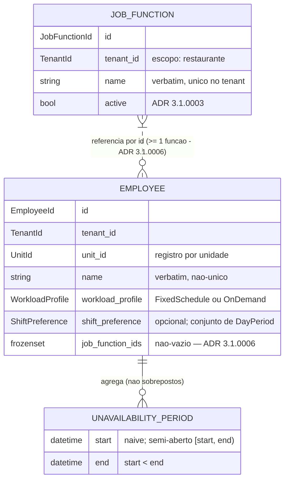

# Concept — Stage 3.1 — Domínio de equipe

> **Escopo deste documento:** o que será feito nesta Stage, por quê, e as
> decisões de modelagem relevantes. O plano executável fica no
> [`technical.md`](./technical.md).
>
> **Base teórica obrigatória:** este concept **aplica** a teoria canônica de
> [`docs/domain/staff/workforce.md`](../../domain/staff/workforce.md)
> (`accepted`) ao recorte da Stage — não re-deriva nem contradiz
> (hierarquia: Overview > Roadmap > Domain > Concept).
>
> **Fork F1 resolvido (2026-07-28):** a cardinalidade da referência
> Funcionário → Função foi decidida pelo **sponsor** via sessão mestra —
> **conjunto de funções com no mínimo uma** (`frozenset` não-vazio de
> `JobFunctionId`). Registro em
> [ADR 3.1.0006](../../adr/3_1_0006-employee-function-set-cardinality.md);
> histórico do fork em §13.

## 1. Escopo

### Dentro do escopo
- Entidades `Employee` e `JobFunction` — duas **raízes de agregado
  separadas**, referenciando-se **só por id** (padrão da 2.1).
- Value-objects: `FixedSchedule`/`OnDemand` (união `WorkloadProfile`),
  `DayPeriod` + `ShiftPreference`, `UnavailabilityPeriod`, e os
  identificadores tipados **próprios do BC** (`EmployeeId`, `JobFunctionId`,
  `TenantId`, `UnitId`).
- Exceções de domínio do BC (`StaffError(DomainError)` e subclasses).
- Invariantes **canônicas do workforce** (perfil exclusivo; carga > 0;
  indisponibilidade `[início, fim)` sem sobreposição por funcionário) e as
  invariantes **fixadas pelos ADRs desta Stage** (nomes verbatim não-vazios
  — ADR 3.1.0002; preferência como conjunto não-vazio — ADR 3.1.0004),
  cobertas por **testes unitários verdes, sem I/O**.
- Ciclo de vida da função: estado `active`/`inactive` com
  `deactivate()`/`reactivate()` (ADR 3.1.0003).
- Extensão do enforcement estrutural (precedente da 2.1 §7): contratos
  import-linter de pureza do `staff.domain` e de **independência entre os
  BCs** `identity` × `staff` (contrato já planejado em `.importlinter`),
  mais os pacotes-placeholder `features/staff/{application,adapters}/`
  exigidos por `scripts/check_layout.py`.

### Fora do escopo (explicitamente)
- Use cases, ports, DTOs, repositórios, HTTP (Stages 3.2–3.4).
- Vínculo com login (`user_id` no registro) — Stage 3.5; o campo **nem
  existe** no modelo da 3.1 (adição é evolução aditiva da 3.5).
- Comportamento da **cópia entre unidades** — use case da 3.2; a 3.1 só
  garante a forma compatível (registro por unidade; função tenant-scoped).
- Classificação "conta ou não para a carga contratada" da atuação sob
  demanda — pertence à **alocação** (Step 4); staff v1 não persiste nada
  disso, e nada de dinheiro (kickoff #11; workforce §3.3b).
- Fronteiras horárias dos períodos nomeados (mapa período → faixa é do
  scheduling — workforce §3.5) e regras trabalhistas (Step 4).
- Recorrência de indisponibilidade; atributo Setor; valor monetário
  (evoluções previstas — workforce §5).
- **Enforcement** da unicidade de nome de função no tenant e das regras
  cross-agregado do ciclo de vida (atribuir função inativa; remover função
  referenciada) — **declarados** aqui, impostos na application (3.2) e na
  persistência (3.3), como a 2.1 fez com a unicidade global de e-mail.

### Vínculo com o roadmap
Primeira Stage do **Step 3 — Equipe da unidade** e primeiro código do BC
`staff`. Fornece as entidades/VOs que a 3.2 (use cases), 3.3 (persistência),
3.4 (HTTP) e 3.5 (vínculo de login) consomem, e os **dados** que o Step 4
valida e o Step 5 otimiza (carga, preferência, indisponibilidade). Ver
`roadmap.md` §"Stage 3.1 — `3.1-staff-domain`" e `overview.md` §3, §9.

## 2. Objetivo da Stage

Ao final, o BC `staff` tem um núcleo de domínio puro (sem I/O) que expressa
e garante — por construção e por testes unitários — as invariantes de
registro de funcionário, função customizável, perfil de jornada, preferência
de turno e indisponibilidade fixadas pela teoria canônica do workforce,
servindo de contrato para as camadas seguintes do Step 3.

## 3. Contexto e premissas

### Contexto
- **Pessoa × registro** (workforce §3.1): o registro de funcionário é por
  unidade; a pessoa (User/login) é global e pertence ao BC identity. Nesta
  Stage não há nenhuma relação com User.
- **Função ≠ Papel** (workforce §2): `JobFunction` é papel de **trabalho**,
  100% customizável por restaurante (escopo: **tenant**); papel de acesso
  (RBAC) é de identity e não aparece aqui.
- **Independência entre BCs:** `staff` não importa `identity` — o contrato
  de independência do `.importlinter` (planejado para "quando o 2º BC
  existir") é ativado nesta Stage. Identificadores atravessam a fronteira
  como strings opacas; cada BC tipa os seus.

### Premissas
- A consistência `unit_id` ↔ `tenant_id` (a unidade pertence ao tenant) é
  garantida na borda (autorização da 3.4 + memberships de identity); o
  domínio de staff trata ambos como identificadores opacos não-vazios.
- Geração dos valores de id é responsabilidade da application/infra
  (padrão 2.1); o domínio os trata como opacos.
- Tenancy row-level por `tenant_id` (ROADMAP-3) é herdado da fundação — a
  Stage só carrega o campo tipado.

### Dependências
- `2.5-email-invite` (mergeada em `develop`): dependência de
  **encadeamento** — fecha as Stages de **backend** do Step 2 (a fundação
  identity do backend; o Step 2 segue `in_progress` aguardando frontend)
  antes de o Step 3 abrir. Nenhum contrato de código é consumido
  (`contratos_consumidos: []` no roadmap; o domínio de staff é puro e
  independente de identity).
- `1.2-ci` (transitiva): reusa `DomainError`
  (`shared/domain/exceptions/base.py`) como raiz da hierarquia de erros.

## 4. Contratos

### Introduzidos

- **`EmployeeId`, `JobFunctionId`, `TenantId`, `UnitId`** (`value-object`) —
  `NewType` sobre `str`, próprios do BC staff (independência entre BCs;
  ver §7). Vazio → `InvalidIdentifierError`, validado nas entidades.

- **`DayPeriod`** (`value-object`) — `StrEnum` fechado dos períodos nomeados
  do dia (kickoff #6): `MORNING` (manhã), `AFTERNOON` (tarde), `NIGHT`
  (noite), `OVERNIGHT` (madrugada). Identificadores em inglês
  (CONVENTIONS §1); o vocabulário PT é a língua ubíqua, glosada em docstring.

- **`ShiftPreference`** (`value-object`, frozen) — conjunto **não-vazio** de
  períodos preferidos (ADR 3.1.0004):

  ```python
  @dataclass(frozen=True)
  class ShiftPreference:
      periods: frozenset[DayPeriod]  # vazio -> EmptyShiftPreferenceError
  ```

- **`FixedSchedule` / `OnDemand`** (`value-object`, frozen) — os dois perfis
  de jornada (workforce §3.3); a união é o contrato `WorkloadProfile`:

  ```python
  @dataclass(frozen=True)
  class FixedSchedule:
      weekly_hours: Decimal  # > 0 e finito -> InvalidWeeklyHoursError

  @dataclass(frozen=True)
  class OnDemand:
      """Sem dados: não carrega carga nem valor monetário (kickoff #11)."""

  WorkloadProfile = FixedSchedule | OnDemand  # type alias
  ```

- **`UnavailabilityPeriod`** (`value-object`, frozen) — intervalo data-hora
  **semi-aberto** `[start, end)` (ADR 3.1.0001, decisão i); instantes
  **ingênuos** (wall-clock no fuso da unidade — ver §7):

  ```python
  @dataclass(frozen=True)
  class UnavailabilityPeriod:
      start: datetime  # naive; start < end, senão InvalidUnavailabilityPeriodError
      end: datetime    # naive (tzinfo presente -> InvalidUnavailabilityPeriodError)

      def overlaps(self, other: "UnavailabilityPeriod") -> bool:
          """start_A < end_B and start_B < end_A — adjacentes NÃO conflitam."""
  ```

- **`JobFunction`** (`entity`, raiz de agregado) — função de trabalho
  customizável, escopo tenant (workforce §3.2). **Entidade frozen com
  transições que devolvem nova instância** (padrão 2.1 — ver §7); igualdade
  por identidade (`eq=False` + `__eq__`/`__hash__` por id):

  ```python
  @dataclass(frozen=True, eq=False)
  class JobFunction:
      id: JobFunctionId
      tenant_id: TenantId
      name: str           # verbatim, não-vazio (≥ 1 char não-whitespace);
                          # unicidade no tenant: 3.2/3.3
      active: bool = True # ciclo de vida — ADR 3.1.0003
      # __post_init__ valida id/tenant_id/name (revalidado em cada transição)

      def rename(self, name: str) -> "JobFunction"
      def deactivate(self) -> "JobFunction"
      def reactivate(self) -> "JobFunction"
  ```

- **`Employee`** (`entity`, raiz de agregado) — registro de funcionário por
  unidade; agrega os períodos de indisponibilidade (invariante de
  não-sobreposição é consistência transacional do agregado). **Entidade
  frozen** (padrão 2.1 — ver §7); o `__post_init__` valida também a
  **coleção inicial** de períodos (par a par, semântica semi-aberta), de
  modo que **nenhum caminho de construção — inclusive a reidratação do
  mapper da 3.3 — representa estado sobreposto**:

  ```python
  @dataclass(frozen=True, eq=False)
  class Employee:
      id: EmployeeId
      tenant_id: TenantId
      unit_id: UnitId
      name: str                                  # verbatim, não-vazio — ADR 3.1.0002
      workload_profile: WorkloadProfile          # exatamente um perfil
      shift_preference: ShiftPreference | None   # None = sem preferência — ADR 3.1.0004
      job_function_ids: frozenset[JobFunctionId] # >= 1 (não-vazio) — ADR 3.1.0006;
                                                 # vazio -> EmptyJobFunctionsError
      unavailabilities: tuple[UnavailabilityPeriod, ...] = ()
      # __post_init__ valida ids/nome, o conjunto de funções não-vazio
      # E a não-sobreposição da coleção inicial

      def rename(self, name: str) -> "Employee"
      def assign_job_functions(self, ids: frozenset[JobFunctionId]) -> "Employee"
      def change_workload_profile(self, profile: WorkloadProfile) -> "Employee"
      def declare_shift_preference(self, preference: ShiftPreference | None) -> "Employee"
      def add_unavailability(self, period: UnavailabilityPeriod) -> "Employee"
      def remove_unavailability(self, period: UnavailabilityPeriod) -> "Employee"
  ```

- **Exceções** (`StaffError(DomainError)` e subclasses):
  `InvalidIdentifierError`, `InvalidNameError`, `InvalidWeeklyHoursError`,
  `EmptyShiftPreferenceError`, `EmptyJobFunctionsError`,
  `InvalidUnavailabilityPeriodError`, `OverlappingUnavailabilityError`,
  `UnavailabilityNotFoundError`.

### Consumidos
- **`DomainError`** — declarado em `shared/domain/exceptions/base.py`
  (Stage 1.1); raiz da hierarquia de erros de negócio.

## 5. Invariantes e regras

Numeração alinhada à teoria (workforce §3.x):

1. **Registro por unidade:** todo `Employee` pertence a exatamente uma
   unidade de exatamente um tenant (`tenant_id` e `unit_id` não-vazios).
   Nenhuma operação de domínio atravessa unidades (workforce §3.1).
2. **Nomes verbatim:** `Employee.name` e `JobFunction.name` são não-vazios —
   **não-vazio = ao menos um caractere não-whitespace** (predicado
   `.strip()` de validação, padrão identity; `"   "` é rejeitado) — e
   persistidos tal como digitados, sem trim/case silenciosos
   (ADR 2.3.0005; ADR 3.1.0002). Nome de funcionário **não** é único. O
   mesmo predicado de não-vazio vale para os identificadores (invariante 1).
3. **Nome de função único no tenant** (comparação verbatim, independente de
   `active`) — **declarado** aqui; enforcement cross-agregado na 3.2/3.3
   (workforce §3.2; ADR 3.1.0003).
4. **Perfil exclusivo:** todo `Employee` tem exatamente um
   `WorkloadProfile` — fixa **ou** sob demanda, nunca ambos, nunca nenhum
   (garantido pela união de tipos; workforce §3.3).
5. **Carga contratada:** `FixedSchedule.weekly_hours` é UMA carga semanal em
   horas, número positivo e finito (ADR 3.1.0001, decisão ii). Teto de
   horas NÃO é dado de staff.
6. **Sob demanda sem carga:** `OnDemand` não carrega carga contratada nem
   valor monetário (kickoff #11; workforce §3.3).
7. **Preferência:** valor = subconjunto **não-vazio** do conjunto fechado
   {manhã, tarde, noite, madrugada}; ausência (`None`) = sem preferência
   declarada. Válida para ambos os perfis (ADR 3.1.0004).
8. **Indisponibilidade não-vazia:** `start < end`; instantes ingênuos
   (wall-clock do fuso da unidade — workforce §3.6).
9. **Não-sobreposição por funcionário:** dois períodos do mesmo `Employee`
   não se sobrepõem, com semântica **semi-aberta** `[início, fim)` —
   sobrepõem sse `início_A < fim_B` e `início_B < fim_A`; **adjacentes são
   válidos**. Imposta em **todos os caminhos**: na **construção**
   (`__post_init__` valida a coleção inicial par a par — cobre a
   reidratação do mapper da 3.3) e em `add_unavailability`
   (ADR 3.1.0001, decisão i; workforce §3.6).
10. **Ciclo de vida da função:** `active` default; `deactivate()` bloqueia
    **novas** atribuições (enforcement na 3.2) e preserva referências
    existentes; remoção definitiva só sem funcionários referenciando
    (enforcement na 3.2/3.3) — ADR 3.1.0003.
11. **Referência entre agregados só por id, conjunto não-vazio:**
    `Employee.job_function_ids` é um `frozenset[JobFunctionId]` com **no
    mínimo uma** função (vazio → `EmptyJobFunctionsError`, na construção e
    em `assign_job_functions`); `Employee` nunca guarda o objeto
    `JobFunction` (skill `ddd-tactical-patterns`; padrão 2.1;
    ADR 3.1.0006 — decisão do sponsor, fork F1). Validade referencial e
    bloqueio de função inativa: enforcement na 3.2/3.3 (invariante 10).
12. **Igualdade e proteção de estado:** entidades comparam por identidade
    (id) e são **frozen** — atribuição direta de atributo falha
    (`FrozenInstanceError`); toda transição passa pelos métodos de negócio,
    que devolvem nova instância revalidada pelo `__post_init__` (padrão
    2.1 — ver §7). VOs comparam por valor.

## 6. Casos de erro e exceções

| Cenário | Exceção |
|---|---|
| Identificador vazio **ou só whitespace** em entidade | `InvalidIdentifierError` |
| Nome vazio **ou só whitespace** (`Employee`/`JobFunction`, construção ou `rename`) | `InvalidNameError` |
| `FixedSchedule` com `weekly_hours <= 0`, NaN ou infinito | `InvalidWeeklyHoursError` |
| `ShiftPreference` com conjunto vazio | `EmptyShiftPreferenceError` |
| `Employee` com conjunto de funções vazio (construção ou `assign_job_functions`) | `EmptyJobFunctionsError` |
| `UnavailabilityPeriod` com `start >= end` ou datetime com tzinfo (ADR 3.1.0005) | `InvalidUnavailabilityPeriodError` |
| Períodos sobrepostos (semântica semi-aberta) — em `add_unavailability` **ou na coleção inicial da construção/reidratação** | `OverlappingUnavailabilityError` |
| `remove_unavailability` de período inexistente no registro | `UnavailabilityNotFoundError` |

Todas subclasses de `StaffError` → `DomainError` (o error handler HTTP da
2.4 já converte a hierarquia em 4xx; a 3.4 a reusa — aqui só se garante a
hierarquia).

## 7. Decisões técnicas relevantes

### Atributos cadastrais mínimos do registro (lacuna workforce §3.1)
- **O quê:** cadastro mínimo = `EmployeeId` opaco + `name` livre, não-vazio,
  verbatim, **não-único**; sem contato/documentos na v1 (aditivos depois).
- **Por quê:** nenhuma feature v1 consome contato de staff (convite da 3.5
  colhe o e-mail na hora e o guarda em identity); homônimos são legítimos;
  menor superfície LGPD.
- **Fonte:** workforce §3.1 (lacuna delegada); overview §3, §6; ADR 2.3.0005.
- **ADR:** [`../../adr/3_1_0002-minimal-employee-record-attributes.md`](../../adr/3_1_0002-minimal-employee-record-attributes.md)

### Ciclo de vida da função: soft-state + remoção guardada (lacuna workforce §3.2)
- **O quê:** `active`/`inactive` com `deactivate()`/`reactivate()`; inativa
  não recebe **novas** atribuições; remoção definitiva só sem referências.
- **Por quê:** histórico por função é insumo do hub e do Step 4; limpeza de
  função criada por engano continua possível quando é segura por construção.
- **Fonte:** workforce §3.2 (lacuna com exigência de ADR); roadmap 3.2/4.1;
  overview §3.
- **ADR:** [`../../adr/3_1_0003-job-function-lifecycle-soft-state.md`](../../adr/3_1_0003-job-function-lifecycle-soft-state.md)

### Preferência de turno: ambos os perfis, conjunto não-vazio (lacunas workforce §3.3/§3.5)
- **O quê:** atributo opcional do registro (fora do `WorkloadProfile`),
  declarável por jornada fixa E sob demanda; valor = conjunto não-vazio de
  períodos nomeados; `None` = sem preferência.
- **Por quê:** overview §3 (fonte mais alta) liga a preferência ao perfil em
  geral; forma geral (conjunto) é o que o Step 5 consome — mesma lógica da
  decisão (i) do gate (UI pode começar com seleção única).
- **Fonte:** overview §3; kickoff #5/#6; workforce §3.3/§3.5; critério de
  escalabilidade progressiva.
- **ADR:** [`../../adr/3_1_0004-shift-preference-scope-and-cardinality.md`](../../adr/3_1_0004-shift-preference-scope-and-cardinality.md)

### Instantes de indisponibilidade como datetimes ingênuos (wall-clock)
- **O quê:** `UnavailabilityPeriod` guarda `datetime` **sem tzinfo**,
  interpretado como horário de parede no fuso da unidade do registro;
  tz-aware é rejeitado na construção.
- **Por quê:** o fuso é configuração por unidade (overview §6) que **não**
  vive no staff; o fato declarado é wall-clock local (correção de fuso não
  pode deslocar o que o gerente declarou); misturar naive/aware quebraria
  comparações. A conversão para instante absoluto é de quem conhece o fuso
  (scheduling/adapters). Alternativa real descartada (armazenar UTC/aware)
  → ADR.
- **Fonte:** workforce §3.6 ("interpretados no fuso da unidade");
  overview §6; ADR 3.1.0001 (decisão i).
- **ADR:** [`../../adr/3_1_0005-naive-wall-clock-unavailability-datetimes.md`](../../adr/3_1_0005-naive-wall-clock-unavailability-datetimes.md)

### Cardinalidade da referência funcionário → função: conjunto não-vazio (fork F1)
- **O quê:** `Employee.job_function_ids: frozenset[JobFunctionId]` com no
  mínimo uma função; vazio → `EmptyJobFunctionsError`; o registro casa com
  vagas de **qualquer** das suas funções (Step 4/5).
- **Por quê:** forma geral que contém o caso único; pessoa multifunção não
  exige cadastro duplicado; migração coluna→junção depois seria cara.
  Alternativas descartadas: exatamente uma; conjunto possivelmente vazio.
- **Fonte:** **decisão do sponsor (2026-07-28, via sessão mestra)** — fork
  F1 devolvido em formato rico por este concept; workforce §3.7; roadmap
  4.1/Step 5; critério de escalabilidade progressiva.
- **ADR:** [`../../adr/3_1_0006-employee-function-set-cardinality.md`](../../adr/3_1_0006-employee-function-set-cardinality.md)

### Entidades frozen com transições que devolvem nova instância
- **O quê:** `Employee` e `JobFunction` são `@dataclass(frozen=True,
  eq=False)`; métodos de negócio devolvem **nova instância** (via
  `dataclasses.replace`), revalidada pelo `__post_init__` — inclusive a
  coleção inicial de indisponibilidades (cobre a reidratação da 3.3).
- **Por quê:** com atributo público mutável, as invariantes valeriam só no
  instante da construção (`employee.name = ""` burlaria tudo); frozen faz
  "garante por construção" ser literal em todos os caminhos, como a 2.1
  documenta nas próprias entidades.
- **Fonte:** precedente `features/identity/domain/entities/*.py`
  (frozen + revalidação; docstring cita a reidratação como caminho de
  ataque); skill `ddd-tactical-patterns` (entidade nunca exposta em estado
  inválido); achado do Checkpoint A (revisor de domínio, 2026-07-27).

### Indisponibilidade sem atributo de motivo na v1
- **O quê:** o período é só o intervalo — sem campo motivo/rótulo
  (férias × atestado).
- **Por quê:** a teoria define indisponibilidade como intervalo
  (workforce §3.6); nenhum consumidor v1 lê o motivo (a validação do Step 4
  só cruza intervalos). Rótulo opcional depois é evolução aditiva.
- **Fonte:** workforce §3.6; overview §3; decisão desta Stage (reversível).

### Identificadores tipados próprios do BC (independência identity × staff)
- **O quê:** staff define `TenantId`/`UnitId`/`EmployeeId`/`JobFunctionId`
  (`NewType` sobre `str`) — **não** importa os tipos de identity. A Stage
  ativa o contrato `independence` entre `features.identity` e
  `features.staff` no `.importlinter` (planejado lá para "quando o 2º BC
  existir") + contratos de pureza de `staff.domain`, e cria os
  placeholders `features/staff/{application,adapters}/` exigidos pelo
  `check_layout.py`. Expande o file-scope do roadmap
  (`arquivos_a_modificar: []`) — reconciliar com **nota datada** no
  fechamento, mesmo padrão da 2.1.
- **Por quê:** BCs independentes se comunicam por ports (padrão da 3.5,
  `IdentityGateway`), nunca por import direto; ids atravessam a fronteira
  como strings opacas. Precedente direto da 2.1 §7.
- **Fonte:** `.importlinter` (contratos futuros comentados); LAYOUT §4;
  concept 2.1 §7; skill `hex-arch-python`.

### Perfil de jornada como união de dois VOs (não enum + campo opcional)
- **O quê:** `WorkloadProfile = FixedSchedule | OnDemand`; a carga só existe
  no tipo fixo.
- **Por quê:** torna estado inválido irrepresentável ("sob demanda com
  carga" ou "fixa sem carga" não compilam) — a invariante 4/5/6 vale por
  construção, não por validação condicional.
- **Fonte:** workforce §3.3 (invariantes); skill `ddd-tactical-patterns`
  (VO frozen, validação em `__post_init__`); reversível barato.

### Não-sobreposição imposta dentro do agregado `Employee`
- **O quê:** os períodos vivem no agregado; `add_unavailability` é o único
  caminho de escrita incremental e valida contra todos os existentes; o
  `__post_init__` valida a coleção inicial (construção/reidratação).
- **Por quê:** invariante "por funcionário" = fronteira de consistência
  transacional do agregado (1 transação = 1 agregado); fora do agregado a
  invariante dependeria de query, virando check de application.
- **Fonte:** workforce §3.6; skill `ddd-tactical-patterns` (§Aggregate).

## 8. Integrações

### Internas (com outras Stages/módulos)
- **Stage 3.2 (application):** consome entidades/VOs nos use cases (CRUD,
  jornada/preferência, indisponibilidade, cópia) e impõe as regras
  cross-agregado declaradas (invariantes 3 e 10).
- **`shared/domain`:** exceções do BC herdam de `DomainError`.
- **BC identity:** nenhuma integração nesta Stage (independência de import;
  o consumo via port `IdentityGateway` é da 3.5).

## 9. Modelo de dados



> Diagrama estrutural do **domínio** (não é schema de banco — persistência é
> a 3.3). A aresta Funcionário↔Função é conjunto **não-vazio** de ids
> (ADR 3.1.0006 — decisão do sponsor, 2026-07-28).

## 10. Riscos e mitigações

| Risco | Prob. | Impacto | Mitigação |
|---|---|---|---|
| Regras que dependem do conjunto de funções (validade referencial, função inativa) ficarem sem dono na 3.2 | M | A | Invariante 11 remete o enforcement explicitamente à 3.2/3.3; ADRs 3.1.0003/3.1.0006 §Implementation notes apontam os use cases e o RESTRICT |
| Regras cross-agregado (invariantes 3 e 10) esquecidas na 3.2 | M | A | Declaradas com destaque em §5 e nos ADRs 3.1.0003; a matriz de rastreabilidade da 3.2 deve mapeá-las |
| Semântica naive-datetime mal interpretada (comparação entre unidades/fusos) | B | M | Invariante 8 rejeita tz-aware na construção; docstring fixa "wall-clock do fuso da unidade"; conversão é de quem conhece o fuso |
| Nomes EN dos períodos (`OVERNIGHT` = madrugada) gerarem ambiguidade | B | B | Glossário PT na docstring do enum; língua ubíqua PT vive no workforce §2 |

## 11. Critérios de aceitação

- [ ] `FixedSchedule` aceita carga positiva (incl. fracionária) e rejeita
      `<= 0`, NaN e infinito com `InvalidWeeklyHoursError` (teste).
- [ ] `OnDemand` não expõe carga nem qualquer campo monetário (teste);
      "exatamente um `WorkloadProfile`" é garantia **estática** da união de
      tipos — coberta pelo mypy strict no `make check`, não por teste de
      runtime.
- [ ] `ShiftPreference` rejeita conjunto vazio (`EmptyShiftPreferenceError`)
      e aceita qualquer subconjunto não-vazio dos 4 períodos; `Employee`
      aceita `shift_preference=None` e ambos os perfis podem declarar
      preferência (teste).
- [ ] `UnavailabilityPeriod` rejeita `start >= end` e datetimes tz-aware
      (`InvalidUnavailabilityPeriodError`); `overlaps` cobre a tabela-verdade
      semi-aberta — sobreposição parcial/total detectada, **adjacentes
      (fim == início) NÃO sobrepõem** (teste).
- [ ] `Employee.add_unavailability` rejeita sobreposição com
      `OverlappingUnavailabilityError` e aceita períodos adjacentes; a
      **construção com coleção inicial sobreposta é igualmente rejeitada**
      (caminho de reidratação); `remove_unavailability` de período
      inexistente lança `UnavailabilityNotFoundError` (teste).
- [ ] Construção de `Employee`/`JobFunction` com **cada** identificador
      vazio ou só-whitespace lança `InvalidIdentifierError` (teste).
- [ ] `JobFunction.deactivate()`/`reactivate()` alternam `active`; nomes de
      `Employee`/`JobFunction` vazios **ou só-whitespace** são rejeitados
      (`InvalidNameError`) e não-vazios preservados **verbatim** (ex.:
      `"  Cozinheiro "` inalterado) na construção e no `rename` (teste).
- [ ] Entidades comparam por identidade (id), são **frozen** (atribuição
      direta de atributo falha) e toda transição devolve nova instância
      revalidada; VOs comparam por valor (teste).
- [ ] Todas as exceções do BC herdam de `StaffError` → `DomainError` (teste).
- [ ] Domínio sem I/O e sem import de application/adapters/frameworks/outros
      BCs: `make check` verde, incluindo os contratos novos de
      `staff.domain` e de independência identity × staff no import-linter.
- [ ] Cobertura ≥ 90% em cada arquivo `src/` tocado.
- [ ] `Employee` com conjunto de funções vazio é rejeitado
      (`EmptyJobFunctionsError`) na construção e em `assign_job_functions`;
      conjuntos com 1 e com N funções são aceitos (teste — ADR 3.1.0006).

## 12. Checklist de validação interna

> Todas devem estar respondidas com "sim" para esta Stage sair do
> Concept e entrar em Technical.

- [x] Todos os contratos introduzidos têm assinatura definida? (§4 —
      fork F1 resolvido pelo sponsor em 2026-07-28; ADR 3.1.0006)
- [x] Toda decisão em §7 tem fonte rastreável? (workforce/overview/roadmap/
      ADRs/kickoff/skills)
- [x] Toda integração externa tem contrato definido? (não há integração
      externa — domínio puro; §8 só internas)
- [x] Decisões com alternativa real descartada têm ADR escrito?
      (3.1.0002–3.1.0006; 3.1.0001 herdado do gate)
- [x] Dependências de Stages anteriores estão satisfeitas (`done`)?
      (`2.5-email-invite` mergeada em `develop`)
- [x] Stage cabe em ~3–12 Tasks? (estimativa: 6–8)
- [x] Riscos críticos têm mitigação plausível? (§10)
- [x] O concept aplica a teoria canônica sem re-derivar nem contradizer
      (workforce.md accepted; ADR 3.1.0001 honrado em §5)?

## 13. Questões em aberto

Nenhuma questão em aberto.

- [x] **F1 — Cardinalidade da referência Funcionário → Função** (exatamente
  uma × conjunto com ≥ 1 × conjunto possivelmente vazio): não recuperável de
  fonte ratificada, foi devolvida à sessão mestra em formato rico e
  **decidida pelo sponsor em 2026-07-28** — **conjunto com no mínimo uma**
  (opção b). Registro: [ADR 3.1.0006](../../adr/3_1_0006-employee-function-set-cardinality.md);
  contrato em §4, invariante em §5.11, critério em §11.

## 14. Referências

- [`../../domain/staff/workforce.md`](../../domain/staff/workforce.md) —
  teoria canônica consumida (§2, §3.1–§3.7, §5, §6).
- [`../../overview.md`](../../overview.md) §3, §6, §9 — escopo, restrições e
  glossário.
- [`../../roadmap.md`](../../roadmap.md) — Stage `3.1-staff-domain` e
  vizinhas (3.2–3.5, 4.1); ROADMAP-3.
- ADRs desta Stage: [`../../adr/`](../../adr/) (prefixo `3_1_`) — 3.1.0001
  (gate), 3.1.0002, 3.1.0003, 3.1.0004, 3.1.0005, 3.1.0006 (fork F1,
  decisão do sponsor).
- ADRs herdados: 2.3.0005 (verbatim), 2.1.0001 (padrão de agregados).
- Skills: `ddd-tactical-patterns`, `hex-arch-python`.
- [`../../LAYOUT.md`](../../LAYOUT.md) §3–§4; `.importlinter` (contrato de
  independência planejado).
- Decisões de kickoff ratificadas (memória do projeto): #5, #6, #11.
