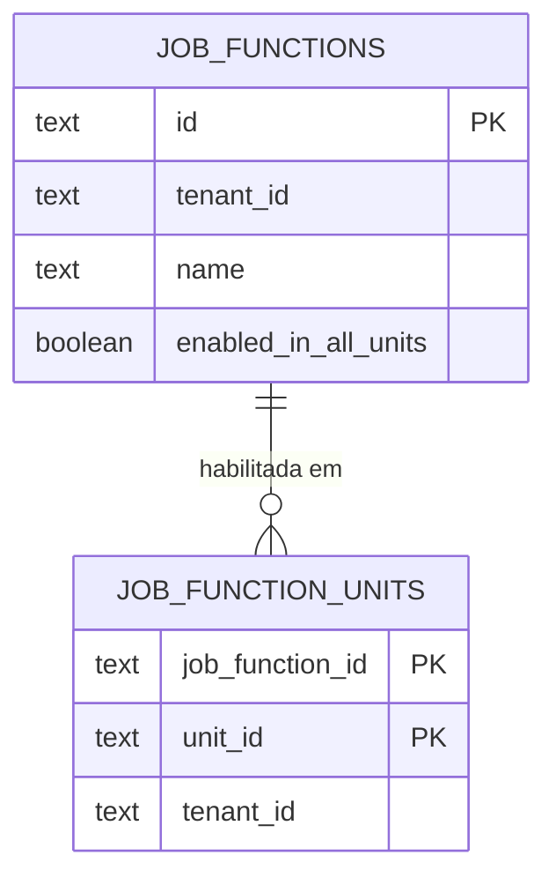

# Concept — Stage 3.11 — Habilitação de função de trabalho por unidade

> **Escopo deste documento:** o que será feito nesta Stage, por quê, e
> decisões técnicas relevantes para entender o "porquê". O plano executável
> fica no [`technical.md`](./technical.md) correspondente.
>
> **Forma (PIPELINE §4.5).** Promovida da issue #41: o corpo da issue deixava
> para "o concept" a invariante do conjunto de unidades, a unicidade do nome e a
> regra da cópia entre unidades, revisitava as leis L-JF1…L-JF5 + L-ORD do port e
> tocava modelo de dados com migration — "o corpo pede um concept".
>
> **Forks P delegados.** O sponsor delegou as bifurcações de produto desta Stage
> à opção recomendada (despacho da orquestração de 2026-11-09). Cada uma está em
> §7 como `P delegado — <opção>, motivo` e nos ADRs 3.11.0001 e 3.11.0002.

## 1. Escopo

### Dentro do escopo
- **Domínio:** value object `UnitEnablement` (todas as unidades **ou** conjunto
  não-vazio de unidades) e o campo `unit_enablement` em `JobFunction`.
- **Application:** criar função recebe as unidades-alvo; listar funções aceita
  uma unidade e filtra por ela; operação nova para **substituir** as unidades de
  uma função; a regra "funcionário só detém função habilitada na sua unidade"
  imposta em criar funcionário, atribuir funções, copiar entre unidades e
  estreitar a habilitação.
- **Ports:** `JobFunctionRepository` persiste a habilitação (L-JF1/L-JF2
  revisadas) e ganha `list_by_unit` (L-JF6) e `update_enablement` (L-JF7); `EmployeeRepository` ganha
  `units_referencing_job_function` (L-E8). Teste de contrato fake ≡ Postgres para
  as leis revisadas e as novas.
- **Persistência:** coluna `job_functions.enabled_in_all_units` e tabela
  `job_function_units`; migration `0005` em que o que existe nasce em todas as
  unidades.
- **HTTP:** `unit_ids` no corpo da criação (ids validados na borda como os
  demais identificadores); `all_units`/`unit_ids` na resposta;
  `GET /units/{unit_id}/job-functions`; `PUT /job-functions/{job_function_id}/units`.
- **Docs:** notas datadas em `overview.md` §3 e `workforce.md` §3.2 e §3.7.
  Errata datada nos ADRs 3.2.0003 (a cópia passa a consumir o repositório de
  funções), 3.4.0006 (`manage_job_functions` também com unidade nomeada) e 3.7.0001
  (exceção declarada de ordem na alteração de unidades).

### Fora do escopo (explicitamente)
- Mudar o dono da função (rejeitado na issue #41).
- Escala/demanda por unidade (Step 4): `scheduling` segue lendo funções por id,
  sem consultar a habilitação.
- Granularidade por unidade na autorização de **renomear** e **apagar** função —
  segue tenant-wide (ADR 3.4.0008).
- Mudança em identity (papéis, permissões, fachada): a Stage 2.7 está em voo nesses
  arquivos.

### Vínculo com o roadmap
Step 3 — Equipe da unidade: "gerente cadastra funções customizadas". Bloco
`roadmap.md` §Stage 3.11; nasce do fork F3 da Stage 3.4 (issue #40) e da nota "It is
the foundation issue #41 will need" do ADR 3.4.0008.

## 2. Objetivo da Stage

Ao fechar a Stage, cada unidade lista só as funções habilitadas nela, a função
continua pertencendo ao restaurante, e quem cria ou altera onde uma função vale só
alcança as unidades que enxerga — "todas as unidades" exige alcance sobre o
restaurante inteiro.

## 3. Contexto e premissas

### Contexto
- `workforce.md` §3.2 › "Escopo: o restaurante (tenant), não a unidade" e
  `overview.md` §3 › "Funções são criadas e parametrizadas pelo gerente" — a função
  é do restaurante; esta Stage refina, não reverte.
- `manage_job_functions` é tenant-wide (ADR 3.4.0008): o passo 4 de
  `AuthorizeActionUseCase` dispensa nomear a unidade, mas o passo 5 (visibilidade)
  roda sempre que uma unidade **é** nomeada.
- Os use cases de staff autorizam o próprio alvo antes de qualquer outra instrução
  (ADR 3.7.0001); a borda HTTP também autoriza (defesa em profundidade).
- A cópia entre unidades é coerente hoje **porque** a função vale em todas
  (`workforce.md` §3.7 › "As funções tenant-scoped").

### Premissas
- `manage_tenant` é detida só por `owner` (`role.py` › `_ROLE_PERMISSIONS`), o
  papel que faz bypass de escopo de unidade.
- Staff não tem a lista de unidades do restaurante (unidades vivem em identity, sem
  FK entre BCs — ADR 3.3.0002).

### Dependências
- `3.7-application-authorization`: `AccessGuard` injetado e ator no command.
- `3.9-error-hierarchy`: raízes `StaffError`/`StaffApplicationError` e o mapa de
  status total.

## 4. Contratos

### Introduzidos
- **`UnitEnablement`** (`value-object`, `features/staff/domain/value_objects/unit_enablement.py`)
  ```python
  @dataclass(frozen=True)
  class UnitEnablement:
      all_units: bool
      unit_ids: frozenset[UnitId]
      # invariante: all_units == True  ⇔ unit_ids vazio;
      #             all_units == False ⇒ unit_ids não-vazio, sem id em branco
      @classmethod
      def everywhere(cls) -> "UnitEnablement": ...
      @classmethod
      def only(cls, unit_ids: frozenset[UnitId]) -> "UnitEnablement": ...
      def covers(self, unit_id: UnitId) -> bool: ...
  ```
- **`JobFunction.unit_enablement`** (`entity`) — default `UnitEnablement.everywhere()`
  (o mesmo default da migration); `is_enabled_in(unit_id) -> bool`;
  `with_enablement(e) -> JobFunction`.
- **`InvalidUnitEnablementError`** (domínio, `StaffError`) — 422.
- **`JobFunctionNotEnabledInUnitError(job_function_id, unit_id)`** (application,
  `StaffError` — violação de regra) — 409.
- **`JobFunctionRepository`** (`port-out`):
  - **L-JF1′** `add` grava a habilitação com a linha, atomicamente.
  - **L-JF2** `update` **inalterada**: grava só `name`. Gravar a habilitação junto
    faria uma renomeação concorrente a uma alteração de unidades regravar a
    habilitação antiga sem autorização nem guarda (Checkpoint A).
  - **L-JF7 (nova)** `update_enablement(job_function)`: grava **só** a habilitação
    (substitui); função inexistente no tenant ⇒ `JobFunctionNotFoundError` e nada é
    gravado.
  - **L-JF3′** `delete` leva a habilitação junto.
  - **L-JF4/L-JF5** devolvem a entidade com a habilitação reidratada.
  - **L-JF6 (nova)** `list_by_unit(tenant_id, unit_id) -> tuple[JobFunction, ...]`:
    as funções do tenant cuja habilitação cobre a unidade (inclusive as de todas as
    unidades), nenhuma de outro tenant, ordem `L-ORD`.
- **`EmployeeRepository.units_referencing_job_function(tenant_id, job_function_id) -> frozenset[UnitId]`**
  (`port-out`, **L-E8**): unidades dos registros do tenant — ativos e inativos — que
  detêm a função; tenant alheio ⇒ conjunto vazio.
- **DTOs** (application): `CreateJobFunctionCommand.unit_ids: frozenset[UnitId] | None`
  (`None` = todas as unidades); `ListJobFunctionsQuery.unit_id: UnitId | None`
  (`None` = catálogo inteiro); `SetJobFunctionUnitsCommand(actor, tenant_id,
  job_function_id, unit_ids: frozenset[UnitId] | None)`; `JobFunctionResult` ganha
  `all_units: bool` e `unit_ids: tuple[UnitId, ...]` (ordenado).
- **`SetJobFunctionUnitsUseCase`** (`port-in`).
- **`PERMISSION_MANAGE_TENANT = "manage_tenant"`** citado em `access_guard.py`.
- **HTTP:** `CreateJobFunctionRequest.unit_ids: list[str] | None = None`;
  `SetJobFunctionUnitsRequest.unit_ids: list[str] | None` (obrigatório, anulável);
  `JobFunctionResponse` ganha `all_units` e `unit_ids`;
  `GET /units/{unit_id}/job-functions`; `PUT /job-functions/{job_function_id}/units`;
  `MANAGE_JOB_FUNCTIONS_IN_UNIT_ACCESS` (`names_unit=True`) em `dependencies.py`.
- **`CopyEmployeeToUnitUseCase`** passa a receber `JobFunctionRepository` (supera, nesse
  ponto, o ADR 3.2.0003 › "The copy does not consume `JobFunctionRepository`").

### Consumidos
- **`AccessGuard`** (3.4/3.7) — L-AG1…L-AG4.
- **`JobFunctionRepository`/`EmployeeRepository`** (3.2/3.3/3.4) e `L-ORD` (ADR 3.3.0003).
- **Mapa de status de staff** (3.4, 3.9) — totalidade por teste.

## 5. Invariantes e regras

- **R1 — dono.** A função pertence ao restaurante; `tenant_id` não muda.
- **R2 — habilitação.** Ou todas as unidades (inclusive futuras), ou um conjunto
  não-vazio de unidades; nunca vazio, nunca os dois. Vale na construção **e** na
  reidratação.
- **R3 — nome.** Único no restaurante, verbatim (inalterado).
- **R4 — alcance da criação.** Sempre `manage_job_functions` no tenant primeiro.
  Unidades nomeadas: `manage_job_functions` em **cada** unidade, em ordem estável
  (`sorted`). Todas as unidades: `manage_tenant` no tenant.
- **R5 — alcance da alteração: só o que muda.** Substituir a habilitação exige
  alcance sobre a **diferença** entre antiga e nova: cada unidade **acrescentada** e
  cada unidade **removida** (`manage_job_functions` na unidade, em ordem estável);
  se a antiga ou a nova é "todas" e as duas diferem, `manage_tenant`. Igual ⇒ nenhuma
  autorização além do tenant. Assim o gerente **habilita na sua unidade** uma função
  que já existe em outra (o nome é único — R3), sem alcançar a unidade alheia; e não
  remove unidade que não enxerga. (Checkpoint A: exigir alcance sobre a antiga
  inteira tornava esse caminho impossível.)
- **R6 — invariante funcionário × unidade** (ADR 3.11.0002). Um registro só detém
  funções habilitadas na sua unidade. Imposta em: criar funcionário, atribuir
  funções, copiar (recusa — sem habilitar junto, sem copiar assim mesmo) e estreitar
  a habilitação (recusa com `JobFunctionInUseError` se algum registro — ativo ou
  desligado — de unidade removida detém a função).
- **R7 — listagem.** Catálogo (`unit_id` ausente) = todas as funções do tenant, com a
  habilitação de cada uma. Por unidade = só as que cobrem a unidade; a unidade é
  alvo de autorização.
- **R8 — ordem das checagens** (ADR 3.7.0001; concept 3.2 §5.16):
  - **criar:** autorização (tenant, depois habilitação) → construção (nome e
    habilitação) → unicidade do nome → escrita;
  - **substituir unidades:** autorização do tenant → existência → autorização da
    diferença (R5) → transição (validação local) → guarda R6 → escrita. A diferença
    depende do estado gravado, então é lida **antes** de ser autorizada: exceção
    declarada ao ADR 3.7.0001 §4 ("all targets before the first port call"), sem
    oráculo — a leitura só revela a habilitação, que o catálogo
    (`GET /job-functions`) já mostra a quem passou na autorização do tenant;
  - **criar funcionário / atribuir:** a checagem de habilitação vem logo **depois**
    da checagem referencial que já existe e antes da escrita;
  - **copiar:** autorização das duas unidades → origem existe → destino ≠ origem →
    resolução das funções da origem (`find_all_by_ids`; ausente ⇒
    `JobFunctionNotFoundError`, como em atribuir) → habilitação no destino → escrita.
    O 404 da origem e o 422 da mesma unidade vencem o 409.
- **R10 — erro com várias funções.** `JobFunctionNotEnabledInUnitError` nomeia a
  **menor** id (`sorted(...)[0]`), como `JobFunctionNotFoundError` em criar/atribuir.
- **R11 — ids repetidos.** `unit_ids` repetidos colapsam no conjunto, como
  `job_function_ids` (ADR 3.1.0006).
- **R9 — migration.** Função existente = todas as unidades; nada é lido de identity.

## 6. Casos de erro e exceções

| Situação | Erro | Status |
|---|---|---|
| `unit_ids` vazio na criação/substituição | `InvalidUnitEnablementError` | 422 |
| Id de unidade em branco ou malformado no corpo/path | `InvalidIdentifierError` da borda (ADR 3.6.0002), antes de autorizar | 422 |
| Ator sem alcance sobre unidade pedida, acrescentada ou removida; unidade inexistente ou de outro tenant | exceção do guard, crua (L-AG2; inexistente vira `UnitNotVisibleError`) | 403 |
| "Todas as unidades" sem `manage_tenant` | `PermissionDeniedError` de identity, cru | 403 |
| Função inexistente no tenant (substituir) | `JobFunctionNotFoundError` | 404 |
| Criar funcionário/atribuir com função não habilitada na unidade do registro | `JobFunctionNotEnabledInUnitError` | 409 |
| Copiar com função da origem não habilitada no destino | `JobFunctionNotEnabledInUnitError` | 409 |
| Estreitar habilitação com registro de unidade removida detendo a função | `JobFunctionInUseError` | 409 |
| Linha persistida incoerente (flag + vínculos, ou nenhum dos dois) | `InvalidUnitEnablementError` na reidratação | 422 pelo mapa (defeito de dado, inalcançável pela API: o adapter grava as duas partes na mesma transação) |

## 7. Decisões técnicas relevantes

### D1 — Forma: Stage, não issue
- **O quê:** a #41 é a Stage 3.11 (Step 3, BC staff).
- **Por quê:** litmus de PIPELINE §4.5 — o corpo pede concept (invariante, leis do
  port, regra da cópia com ADR) e toca modelo de dados.
- **Fonte:** issue #41 › "Escopo"; precedente da #48 → 3.9.
- `[decision] Forma — Stage 3.11, número conferido livre em develop, branches remotas e worktrees (#106 cria 4.8; 2.7 e 3.10 existem).`

### D2 — Modelo da habilitação
- **O quê:** `UnitEnablement` = todas **ou** conjunto não-vazio (R2).
- **Fonte:** issue #41 › "invariante (não-vazio? default?) a decidir no concept".
- **ADR:** [3.11.0001](../../adr/3_11_0001-job-function-unit-enablement-model.md) §2.
- `[decision] P delegado — conjunto não-vazio ou "todas" como valor próprio, motivo: função em nenhuma unidade seria inalcançável pelas listagens e ainda ocuparia o nome; "todas" cobre unidades futuras e migra sem ler identity.`

### D3 — Unicidade do nome
- **O quê:** único no restaurante (inalterado).
- **ADR:** [3.11.0001](../../adr/3_11_0001-job-function-unit-enablement-model.md) §3.
- `[decision] P delegado — único no restaurante, motivo: a função é do restaurante e o índice único segue imposto pelo banco; "por unidade" não tem índice que o imponha contra funções de todas as unidades.`

### D4 — Alcance de "todas as unidades"
- **O quê:** `manage_tenant` além de `manage_job_functions` (R4).
- **ADR:** [3.11.0001](../../adr/3_11_0001-job-function-unit-enablement-model.md) §4.
- `[decision] P delegado — exigir manage_tenant, motivo: único sinal de alcance sobre o restaurante que o guard expõe sem tocar identity (2.7 em voo), e fail-closed.`

### D5 — Forma da alteração
- **O quê:** uma operação que substitui a habilitação inteira (R5).
- `[decision:C] D5 — substituir × habilitar/desabilitar por unidade. Escolha: substituir · Alternativas: duas operações delta · Degrau (C): 1 (ADR 3.1.0006 e assign_job_functions já substituem conjunto) · Verificado: não verificado (§4.2) — fonte interna · Configuração candidata: nenhuma · Reversível: sim.`
- **ADR:** [3.11.0001](../../adr/3_11_0001-job-function-unit-enablement-model.md) §5.

### D6 — Listagem
- **O quê:** catálogo inteiro preservado; rota nova por unidade (R7).
- `[decision] P delegado — catálogo + rota por unidade, motivo: preserva o contrato da rota de catálogo e põe a unidade no endereço, como as rotas de funcionário (ADR 3.4.0007).`
- **Leitura do critério da issue** "ela aparece só na unidade dele": cumprido na
  listagem **da unidade** (`GET /units/{unit_id}/job-functions`); o catálogo é a
  visão do restaurante e mostra onde cada função vale.
- A listagem por unidade exige `manage_job_functions` **na unidade** (passo 5 de
  identity roda porque a unidade é nomeada).
- `[decision] P delegado — a resposta expõe a habilitação inteira (unit_ids de todas as unidades), motivo: são ids opacos do mesmo restaurante, sem nome nem dado da unidade, e o gerente precisa saber se a função é "todas" ou restrita para pedir ao dono; a visibilidade protegida pelo ADR 3.4.0007 é a de registros de funcionário.`

### D7 — Cópia entre unidades e a invariante funcionário × unidade
- **O quê:** recusar (R6).
- **ADR:** [3.11.0002](../../adr/3_11_0002-employee-holds-only-functions-enabled-in-its-unit.md).
- `[decision] P delegado — recusar, motivo: a cópia segue sem efeito colateral no catálogo e sem permissão nova; habilitar junto exigiria manage_job_functions de quem só tem manage_staff.`

### D8 — Default do campo na entidade
- **O quê:** `unit_enablement` tem default `UnitEnablement.everywhere()`.
- **Por quê:** é o mesmo default da migration (R9), então reidratar/construir sem o
  campo reproduz o comportamento anterior; os use cases de criação e substituição o
  passam sempre explícito, travado por teste.
- `[decision:C] D8 — campo obrigatório × default "todas". Escolha: default · Degrau (C): 4 (reversível; não força reescrever 45 construções de teste numa Task) · Reversível: sim.`

### D8b — Escopo de `manage_job_functions`
- `manage_job_functions` segue em `TENANT_WIDE_PERMISSIONS` (identity intocada); esta
  Stage passa a exercê-la **também com unidade nomeada**, o que o passo 5 já aceita.
  O ADR 3.4.0006 recebe nota datada; a docstring de `permission.py` (identity) fica
  para a Stage que tocar identity — finding.

### D9 — Migration
- **O quê:** `enabled_in_all_units boolean NOT NULL DEFAULT true`; tabela de vínculo
  `job_function_units` com FK composta para `job_functions (id, tenant_id)`
  `ON DELETE CASCADE`.
- **Fonte:** issue #41 › "Migração de dado existente".

## 8. Integrações

### Internas
- identity, via `AccessGuard` (sem mudança em identity): visibilidade de unidade no
  passo 5 e `manage_tenant`.
- scheduling: nenhuma mudança (non-goal); finding para o Step 4.

## 9. Modelo de dados



Índice `ix_job_function_units_tenant_unit (tenant_id, unit_id)` serve `list_by_unit`.

## 10. Riscos e mitigações

| Risco | Probabilidade | Impacto | Mitigação |
|---|---|---|---|
| Corrida estreitar × atribuir deixa registro com função não habilitada | B | B | limite declarado no ADR 3.11.0002; não concede acesso |
| Rota de catálogo mostra a gerente funções de outras unidades | M | B | a função é do restaurante (R1); nome e unidades são dados do restaurante, não da unidade |
| e2e existentes criam função como gerente sem unidade | M | M | Task de HTTP ajusta o e2e; owner cria "todas" como antes |

## 11. Critérios de aceitação

- [ ] **CA1** Gerente cria função com `unit_ids` = a unidade dele e ela aparece em
  `GET /units/{a}/job-functions` e não em `GET /units/{b}/job-functions`.
- [ ] **CA2** Gerente que pede unidade que não enxerga, ou "todas", recebe 403;
  dono cria para todas e a função aparece em toda unidade. As unidades são
  autorizadas em ordem `sorted` (teste de chamadas ao guard).
- [ ] **CA3** A listagem de uma unidade não mostra função não habilitada nela (fake e
  Postgres, L-JF6); listar unidade que o ator não enxerga é 403.
- [ ] **CA4** Funções pré-existentes seguem visíveis em todas as unidades após a
  migration (teste de migration).
- [ ] **CA5** Cópia para unidade onde alguma função não está habilitada é recusada
  com `409` e nada é gravado (teste unit e e2e; ADR 3.11.0002); origem inexistente
  (`404`) e mesma unidade (`422`) vencem o `409`.
- [ ] **CA6** Criar funcionário e atribuir funções recusam função não habilitada na
  unidade do registro (409).
- [ ] **CA7** Substituir unidades: gerente de A habilita em A uma função que vale só
  em B (só A é autorizada); remover unidade que o ator não enxerga é 403; passar de
  ou para "todas" sem `manage_tenant` é 403; função inexistente é 404 antes de
  qualquer autorização de unidade; estreitar com registro — **inclusive desligado** —
  detendo a função em unidade removida é 409.
- [ ] **CA8** Teste de contrato prova fake ≡ Postgres para L-JF1′, L-JF3′, L-JF4/L-JF5
  (habilitação reidratada), L-JF6, L-JF7 e L-E8, com um corpo de teste só; L-JF2
  segue gravando só o nome.
- [ ] **CA9a** Habilitação vazia é recusada na construção (422 na borda).
- [ ] **CA9b** Linha incoerente é recusada na reidratação (teste do mapper).
- [ ] **CA11** O catálogo (`GET /job-functions`) devolve `all_units`/`unit_ids` de cada
  função.
- [ ] **CA10** Varreduras de totalidade verdes: mapa de erros, pasta de use cases no
  composition root, `router.routes`, DTOs.

## 12. Checklist de validação interna

- [x] Todos os contratos introduzidos têm assinatura definida?
- [x] Toda decisão em §7 tem fonte rastreável?
- [x] Toda integração externa tem contrato definido? (não há externa)
- [x] Decisões com alternativa real descartada têm ADR escrito? (3.11.0001, 3.11.0002)
- [x] Dependências de Stages anteriores estão satisfeitas (`done`)?
- [x] Stage cabe em ~3–12 Tasks? (9)
- [x] Riscos críticos têm mitigação plausível?
- [x] A regra da cópia está em ADR e tem critério com teste? (CA5)

## 14. Referências

- [`../../overview.md`](../../overview.md) §3; [`../../roadmap.md`](../../roadmap.md) §Stage 3.11
- [`../../domain/staff/workforce.md`](../../domain/staff/workforce.md) §3.2, §3.7
- ADRs 3.11.0001, 3.11.0002; 3.2.0003, 3.3.0001, 3.3.0003, 3.3.0007, 3.4.0001,
  3.4.0007, 3.4.0008, 3.7.0001
- Issue #41
