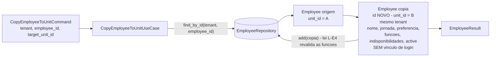

# Concept — Stage 3.2 — Use cases de equipe

> **Escopo deste documento:** o que será feito nesta Stage, por quê, e as
> decisões de contrato relevantes. O plano executável fica no
> [`technical.md`](./technical.md).
>
> **Base teórica obrigatória:** este concept **aplica** a teoria canônica de
> [`docs/domain/staff/workforce.md`](../../domain/staff/workforce.md)
> (`accepted`) e o domínio já implementado na Stage 3.1 — não re-deriva nem
> contradiz (hierarquia: Overview > Roadmap > Domain > Concept).
>
> **Nenhum fork aberto.** Os dois forks devolvidos na rodada 1 foram fechados
> em 2026-08-08 pelo **sponsor**, via sessão mestra (§13): F1 decidido na
> opção (d) e F2 **dissolvido** — deixou de existir. As decisões estão nos
> ADRs [3.2.0005](../../adr/3_2_0005-job-function-has-no-lifecycle-state.md) e
> [3.2.0006](../../adr/3_2_0006-employee-lifecycle-and-guarded-deletion.md), e
> **prevalecem sobre ADR anterior** — o 3.1.0003 passou a `superseded`.

## 1. Escopo

### Dentro do escopo

- **Use cases da camada `application` do BC `staff`**, em três famílias:
  - **Função de trabalho (CRUD):** criar, renomear, remover (com guarda) e
    listar. **Sem ciclo de vida** — função não tem estado ativo/inativo
    (ADR 3.2.0005).
  - **Funcionário (CRUD + edição do agregado + ciclo de vida):** criar,
    renomear, atribuir funções, trocar perfil de jornada, declarar/limpar
    preferência de turno, registrar e remover indisponibilidade, listar por
    unidade, **desligar (`deactivate`) / recontratar (`reactivate`)** e
    **remover definitivamente com guarda** (ADR 3.2.0006).
  - **Cópia de funcionário para outra unidade** do mesmo restaurante.
- **Ports-out** (`Protocol`): `JobFunctionRepository` e `EmployeeRepository`,
  ambos com **escopo de tenant na assinatura** (§7, ADR 3.2.0002).
- **DTOs de fronteira** (commands, queries e results) — use case nunca devolve
  entidade de domínio (CLAUDE.md nota 6; LAYOUT §7).
- **Erros de aplicação do BC** (`application/errors.py`), ancorados em
  `StaffError → DomainError`.
- **Enforcement das três regras cross-agregado que a 3.1 declarou e delegou**
  (mapeamento exato em §5.5/§5.8/§5.9 e na tabela de §5):
  1. **nome de função único no tenant**, verbatim (invariante 3 do concept 3.1);
  2. **remoção definitiva de função só quando nenhuma referência existe**
     (segunda metade da invariante 10 do concept 3.1);
  3. **validade referencial do conjunto de funções** — toda id existe no
     tenant (invariante 11 do concept 3.1).
- **Expansão declarada de camada-alvo (`camada_alvo: application`):** as
  decisões do sponsor mudam o **domínio já mergeado da 3.1**, e a mudança é
  feita **aqui**, com Tasks próprias e nota de reconciliação no `roadmap.md` no
  fechamento da Stage (§7, mesmo padrão datado da 2.1 e da 3.1):
  - `JobFunction` **perde** `active`, `deactivate()` e `reactivate()` — e os
    testes correspondentes (D1/ADR 3.2.0005);
  - `Employee` **ganha** `active: bool = True`, `deactivate()` e
    `reactivate()` — com testes (D2/ADR 3.2.0006).
- **Fakes in-memory** dos dois ports em `tests/fakes/features/staff/` e testes
  unitários **sem I/O** (skill `pytest-with-fakes`), incluindo um **fluxo
  ponta-a-ponta** que exercita duas unidades do mesmo tenant e prova a
  ausência de vazamento entre elas. Os fakes são um **par acoplado** (§4).
- **Extensão do enforcement estrutural:** contrato `staff-application-purity`
  no `.importlinter` (espelha `identity-application-purity`).

### Fora do escopo (explicitamente)

- **Adapters reais:** Postgres (3.3) e HTTP (3.4). Aqui só os `Protocol` e os
  fakes de teste; nenhum wiring no `composition_root` (não há implementação
  concreta para montar).
- **Enforcement de RBAC e de autorização.** Nenhum use case recebe ator nem
  chama `authorize_action`; o roadmap aloca isso à 3.4 (precedente idêntico da
  2.2 §7.7). Esta Stage garante **escopo de dados** (tenant/unidade), não
  **permissão** — ver o limite honesto em §2 e o `[finding]` de §10.
- **Vínculo com login (`user_id`)** — Stage 3.5. O campo nem existe no modelo
  da 3.1; a cópia declara desde já que **nunca** o carregará (§5.10).
- **Noção de escala, demanda, vaga e alocação** — Step 4 (`non_goals` do
  roadmap 3.2). Nenhum use case aqui conhece turno concreto ou faixa horária.
- **Fronteiras horárias dos períodos nomeados** (mapa período → faixa é do
  scheduling — workforce §3.5).
- **Validação de existência da unidade destino** da cópia: `Unit` é entidade de
  **identity**, e o BC staff é independente por contrato (`bc-independence` no
  `.importlinter`). A coerência `unit_id` ↔ `tenant_id` é garantida na borda
  (3.4 + memberships) — premissa herdada do concept 3.1 §3. Ver o `[finding]`
  escalado para a 3.4 em §10.
- **Controle de concorrência** na escrita do agregado (lost update em
  read-modify-write) — decisão da persistência (3.3); ver risco em §10.
- **Schema e migration** — 3.3. Esta Stage **não** cria tabela nem coluna; o
  que ela muda no modelo em memória são os dois campos declarados acima, e a
  3.3 herda o modelo já ajustado (é justamente por isso que a mudança é feita
  agora, e não depois da tabela existir).

### Vínculo com o roadmap

Segunda Stage do **Step 3 — Equipe da unidade**. A 3.1 entregou o domínio puro;
esta Stage entrega a **orquestração** e, sobretudo, **a fronteira que as três
Stages seguintes preenchem**: a 3.3 implementa os dois repositórios em Postgres,
a 3.4 expõe os use cases por HTTP com RBAC, e a 3.5 acrescenta o vínculo de
login. Como na 2.2, o custo de errar a forma dos ports aqui se paga em duas
Stages. Ver `roadmap.md` §"Stage 3.2 — `3.2-staff-application`" e `overview.md` §3.

## 2. Objetivo da Stage

Ao final, os casos de uso de equipe do BC `staff` executam contra
implementações in-memory dos seus ports-out — provando, sem nenhum I/O, que as
três regras cross-agregado delegadas pela 3.1 são impostas, que o ciclo de vida
do funcionário mantém o histórico fora da lista da unidade sem apagá-lo, e que
a cópia entre unidades duplica o cadastro sem compartilhar estado nem vazar
dados entre unidades — e deixando publicada a fronteira (`Protocol` + DTOs) que
a persistência e o HTTP vão preencher.

> **Limite honesto do que esta Stage prova.** Ela prova **isolamento de dados
> por construção da assinatura** (nenhum port permite localizar registro sem
> `tenant_id`; a listagem de funcionários exige `unit_id`), não **autorização**:
> quem garante que o `tenant_id`/`unit_id` do command é o do ator é a composição
> que a 3.4 monta com `authorize_action`. O isolamento row-level em si é
> ROADMAP-3, entregue na 3.3. E as guardas cross-agregado desta camada têm
> limites de concorrência **distintos por regra** — declarados um a um em §5.

## 3. Contexto e premissas

### Contexto

A 3.1 entregou **duas raízes de agregado separadas** que se referenciam só por
id, ambas `frozen`, com transições que devolvem nova instância revalidada. As
decisões do sponsor de 2026-08-08 ajustam o ciclo de vida das duas, em direções
**opostas e intencionais**:

- **`JobFunction`** — escopo **tenant**, nome verbatim, **sem estado**: função
  sem atribuição é **inerte** (não aparece em operação, não é escalável, não
  carrega história). O custo do estado (duas operações, um campo, uma regra de
  corrida) não se paga; quem não quer mais a função **apaga** — e a remoção
  continua **guardada** (ADR 3.2.0005).
- **`Employee`** — registro **por unidade**, com `workload_profile` (união
  `FixedSchedule | OnDemand`), `shift_preference` opcional,
  `job_function_ids: frozenset` **não-vazio**, a coleção de
  `UnavailabilityPeriod` sem sobreposição e, a partir desta Stage, **estado de
  desligamento** (`active`). Funcionário desligado **não é inerte**: sem
  estado ele apareceria no seletor da escala e seria escalável, e o registro
  carrega história que o hub lê (ADR 3.2.0006).

> **A assimetria é intencional, não incoerência.** As duas decisões respondem à
> mesma pergunta — "o que acontece com o registro que saiu de uso?" — e chegam
> a respostas diferentes porque os dois registros **se comportam diferente
> quando ninguém os usa**: a função some da operação sozinha; o funcionário,
> não. Está registrada nos dois ADRs, dos dois lados.

Três fatos do domínio 3.1 moldam os contratos desta Stage:

1. **As entidades são `frozen` e as transições retornam nova instância.** Toda
   edição aqui é um ciclo **carregar → transicionar → gravar o agregado
   inteiro**; não existe mutação in-place que o repositório pudesse observar.
   Por isso o port precisa de `update`, além de `add` (§4).
2. **Invariantes cross-agregado foram declaradas e explicitamente delegadas** a
   esta Stage porque **cruzam agregados** — nenhuma é decidível olhando uma
   entidade só (concept 3.1, invariantes 3, 10 e 11 da §5).
3. **Ids são opacos e gerados fora do domínio** (concept 3.1 §3): quem os
   produz é o `IdGenerator` compartilhado, nesta camada.

### Premissas

- A coerência `unit_id` ↔ `tenant_id` (a unidade pertence ao tenant e existe)
  é garantida na borda — autorização da 3.4 + memberships de identity. O staff
  trata `unit_id` como identificador opaco não-vazio (premissa herdada do
  concept 3.1 §3, mantida aqui sem alteração).
- O `IdGenerator` compartilhado (`shared/application/ports/out/id_generator.py`)
  é a única fonte de ids novos; nenhum use case chama `uuid4()`.
- **Nenhum `Clock` é necessário:** o staff v1 não carimba tempo. Os instantes de
  indisponibilidade são **wall-clock ingênuos** vindos do command
  (ADR 3.1.0005), e nenhuma entidade tem `created_at`/`updated_at` (carimbos de
  auditoria, se vierem, são decisão da persistência — 3.3). O desligamento
  também **não** carimba data: o campo é booleano (ADR 3.2.0006).
- Tenancy row-level por `tenant_id` (ROADMAP-3) é herdada da fundação; esta
  Stage carrega o campo em toda assinatura de port, mas não o impõe no banco.

### Dependências

- **`3.1-staff-domain`** (mergeada em `develop`, PR #33): entidades
  `Employee`/`JobFunction`, VOs `WorkloadProfile`/`ShiftPreference`/
  `UnavailabilityPeriod`/`DayPeriod`, identificadores tipados e a hierarquia
  `StaffError`. A §7 do seu `technical.md` não escalou nenhum `[finding]` para
  esta Stage; a `[decision]` relevante que sobrevive é `DayPeriod` co-locado em
  `shift_preference.py`. A outra (`deactivate`/`reactivate` da `JobFunction`
  idempotentes no valor) **deixa de existir junto com os métodos** — ver §7.
- **`1.1-bootstrap`** (transitiva): `IdGenerator`; `DomainError`/`NotFoundError`
  em `shared/domain/exceptions/base.py`.

## 4. Contratos

> Todos os ports são `typing.Protocol` em `application/ports/out/`
> (LAYOUT §5, skill `hex-arch-python`) e **síncronos** — mesma decisão da 2.2
> (ADR 2.2.0004), aplicada aqui por consistência de camada.

### Introduzidos

#### Ports-out

- **`JobFunctionRepository`** (`port-out`)

  ```python
  class JobFunctionRepository(Protocol):
      def add(self, job_function: JobFunction) -> None: ...
      def update(self, job_function: JobFunction) -> None: ...
      def delete(self, tenant_id: TenantId, job_function_id: JobFunctionId) -> None: ...
      def find_by_id(
          self, tenant_id: TenantId, job_function_id: JobFunctionId
      ) -> JobFunction | None: ...
      def find_by_name(self, tenant_id: TenantId, name: str) -> JobFunction | None: ...
      def find_all_by_ids(
          self, tenant_id: TenantId, job_function_ids: frozenset[JobFunctionId]
      ) -> tuple[JobFunction, ...]: ...
      def list_by_tenant(self, tenant_id: TenantId) -> tuple[JobFunction, ...]: ...
  ```

  **Leis do port** (valem para o fake e para o adapter da 3.3 — ADR 3.2.0001):
  - **L-JF1 —** `add` é **inserção, não upsert**: id já gravado ⇒
    `JobFunctionAlreadyExistsError`; nome já usado **no tenant**, comparado
    **verbatim** ⇒ `JobFunctionNameAlreadyExistsError` (na 3.3, índice único
    `(tenant_id, name)`).
  - **L-JF2 —** `update` é **`UPDATE`, não upsert**: função inexistente **no
    tenant** ⇒ `JobFunctionNotFoundError`, e **nada** é gravado. A mesma guarda
    de nome vale, **ignorando a própria função** (renomear para o nome atual não
    é conflito). `tenant_id` **não** é atualizável.
  - **L-JF3 —** `delete` é **remoção definitiva**: inexistente ⇒
    `JobFunctionNotFoundError`; **referenciada por algum funcionário** ⇒
    `JobFunctionInUseError` (na 3.3 é a FK `RESTRICT` traduzida pelo adapter).
    A referência conta **independentemente do estado do funcionário**: registro
    desligado ainda aponta para a função, e apagá-la corromperia o cadastro.
  - **L-JF4 —** `find_all_by_ids` devolve **só as encontradas** — o chamador
    compara com o conjunto pedido para descobrir as ausentes. Não levanta erro.
    **Não filtra por estado porque a função não tem estado** (ADR 3.2.0005).
  - **L-JF5 —** `list_by_tenant` devolve **todas** as funções do tenant. Não há
    flag de estado — não há estado.

  > **Escopo da unicidade de id em `add` (L-JF1).** A colisão de id é checada
  > **globalmente**, não por tenant: na 3.3 o id é a **chave primária**, e um
  > fake que só olhasse dentro do tenant aceitaria uma inserção que o Postgres
  > rejeita — exatamente a divergência fake↔adapter que o ADR 2.3.0003 registra.
  > É a **única** lei destes ports que não é escopada por tenant, e a exceção é
  > deliberada. Vale igual para `EmployeeRepository.add`.

- **`EmployeeRepository`** (`port-out`)

  ```python
  class EmployeeRepository(Protocol):
      def add(self, employee: Employee) -> None: ...
      def update(self, employee: Employee) -> None: ...
      def delete(self, tenant_id: TenantId, employee_id: EmployeeId) -> None: ...
      def find_by_id(
          self, tenant_id: TenantId, employee_id: EmployeeId
      ) -> Employee | None: ...
      def list_by_unit(
          self, tenant_id: TenantId, unit_id: UnitId, *, include_inactive: bool = False
      ) -> tuple[Employee, ...]: ...
      def exists_by_job_function(
          self, tenant_id: TenantId, job_function_id: JobFunctionId
      ) -> bool: ...
  ```

  **Leis do port:**
  - **L-E1 —** `add` é **inserção, não upsert**: id já gravado ⇒
    `EmployeeAlreadyExistsError` (escopo global do id — ver quadro acima).
  - **L-E2 —** `update` é **`UPDATE`, não upsert**: registro inexistente **no
    tenant** ⇒ `EmployeeNotFoundError`, e **nada** é gravado. Grava o agregado
    **inteiro** (nome, perfil, preferência, conjunto de funções,
    indisponibilidades, estado).
  - **L-E3 (localização imutável) —** `add`/`update` **não relocalizam** o
    registro: um `update` cujo par `(tenant_id, unit_id)` divirja do gravado ⇒
    **`EmployeeRelocationError`**. A lei tem exceção nomeada de propósito — sem
    nome, a única saída seria "gravar o que veio" (mover o registro em silêncio)
    ou "gravar o que estava" (descartar a escrita em silêncio), e as duas são
    corrupção silenciosa. O único caminho para existir em outra unidade é a
    cópia (§5.10).
  - **L-E4 (validade referencial) —** `add`/`update` exigem que **toda** id de
    `employee.job_function_ids` exista **no mesmo tenant**; alguma ausente ⇒
    `JobFunctionNotFoundError`. Sem esta lei, uma função removida entre a
    checagem do use case e a gravação faria o adapter da 3.3 bater na FK
    `RESTRICT` e levantar um erro **não previsto pelo contrato** — que a 3.4
    converteria em 500. Com ela, a corrida termina no mesmo erro tipado do
    caminho comum.
  - **L-E5 —** `delete` é **remoção definitiva guardada**: inexistente **no
    tenant** ⇒ `EmployeeNotFoundError`; **referenciado por qualquer registro
    de outro agregado** ⇒ `EmployeeInUseError`. Em v1 **nada referencia** o
    registro de funcionário, então a segunda metade é vacuamente satisfeita: o
    erro e a lei existem porque o Step 4 (alocação) é quem os preenche, e
    publicá-los agora evita que a 3.4/Step 4 retroajam o contrato do port —
    o defeito exato que a 2.2→2.3 pagou (ADR 2.3.0003). Declarado, não fingido:
    §11 tem critério que fixa a **ausência** de produtor em v1.
  - **L-E6 —** `list_by_unit` **exige a unidade** e devolve **apenas ativos**
    por default; `include_inactive=True` é opt-in explícito. Não existe listagem
    tenant-wide de funcionários nesta Stage. Essa ausência é deliberada — é o
    que torna impossível, **por assinatura**, a consulta que vazaria unidades
    (workforce §3.1; DoD da 3.4).
  - **L-E7 —** `exists_by_job_function` é a consulta que sustenta a guarda de
    remoção (§5.9); é **global no tenant** e conta referências de registros
    **ativos e inativos**.

  > **Por que `exists_by_job_function` atravessa unidades sem furar a
  > invariante canônica.** "Nenhuma operação de staff atravessa unidades
  > implicitamente" (workforce §3.1) protege **dados de funcionário**; esta
  > consulta devolve um **booleano sobre uma função**, que é tenant-scoped
  > (workforce §3.2) — não expõe registro, unidade nem contagem. A guarda tem
  > de ser tenant-wide justamente porque a função é: uma referência em qualquer
  > unidade impede a remoção.

  > **Por que não há `exists_by_name` de funcionário.** Nome de funcionário
  > **não** é único (concept 3.1 §5.2 — homônimos são legítimos). A ausência do
  > método é a declaração disso.

  > **Forma dos fakes: par acoplado, não dois dicionários isolados.** As leis
  > L-JF3 e L-E4 falam de dados que vivem **no outro agregado** — um
  > `InMemoryJobFunctionRepository` isolado não tem como saber se algum
  > funcionário referencia a função, e um `InMemoryEmployeeRepository` isolado
  > não tem como saber se a função existe. Decisão desta Stage: os dois fakes
  > compartilham um **store único** injetado na construção
  > (`InMemoryStaffStore`), e cada fake é uma **visão** dele
  > (`InMemoryJobFunctionRepository(store)`, `InMemoryEmployeeRepository(store)`).
  > Um par construído sobre stores diferentes é erro de teste, não configuração
  > válida — o construtor do store é o que torna o par explícito. **É a fixture
  > que a 3.3 herda:** o teste de contrato de lá parametriza o **par**
  > (fake-par × adapters-Postgres), não um repositório de cada vez, porque as
  > leis cross-agregado só são verificáveis sobre o par.

#### DTOs

Nenhum identificador novo é introduzido: os ids são os `NewType` da 3.1. Todos
os DTOs são `@dataclass(frozen=True)` — **igualdade por valor**, o que os torna
o alvo correto das asserções de "não mudou" (§11).

**Commands** (escrita) — todos carregam `tenant_id`; os que atuam sobre um
registro existente carregam também o id do registro:

| Command | Campos |
|---|---|
| `CreateJobFunctionCommand` | `tenant_id: TenantId`, `name: str` |
| `RenameJobFunctionCommand` | `tenant_id`, `job_function_id: JobFunctionId`, `name: str` |
| `DeleteJobFunctionCommand` | `tenant_id`, `job_function_id` |
| `CreateEmployeeCommand` | `tenant_id`, `unit_id: UnitId`, `name: str`, `workload_profile: WorkloadProfile`, `job_function_ids: frozenset[JobFunctionId]`, `shift_preference: ShiftPreference \| None = None` |
| `RenameEmployeeCommand` | `tenant_id`, `employee_id: EmployeeId`, `name: str` |
| `AssignJobFunctionsCommand` | `tenant_id`, `employee_id`, `job_function_ids: frozenset[JobFunctionId]` |
| `ChangeWorkloadProfileCommand` | `tenant_id`, `employee_id`, `workload_profile: WorkloadProfile` |
| `DeclareShiftPreferenceCommand` | `tenant_id`, `employee_id`, `shift_preference: ShiftPreference \| None` |
| `RegisterUnavailabilityCommand` | `tenant_id`, `employee_id`, `period: UnavailabilityPeriod` |
| `RemoveUnavailabilityCommand` | `tenant_id`, `employee_id`, `period: UnavailabilityPeriod` |
| `DeactivateEmployeeCommand` | `tenant_id`, `employee_id` |
| `ReactivateEmployeeCommand` | `tenant_id`, `employee_id` |
| `DeleteEmployeeCommand` | `tenant_id`, `employee_id` |
| `CopyEmployeeToUnitCommand` | `tenant_id`, `employee_id`, `target_unit_id: UnitId` |

**Queries** (leitura):

| Query | Campos |
|---|---|
| `ListJobFunctionsQuery` | `tenant_id` |
| `ListEmployeesQuery` | `tenant_id`, `unit_id`, `include_inactive: bool = False` |

**Results:**

| Result | Campos |
|---|---|
| `JobFunctionResult` | `id: JobFunctionId`, `tenant_id`, `name: str` |
| `EmployeeResult` | `id: EmployeeId`, `tenant_id`, `unit_id`, `name: str`, `workload_profile: WorkloadProfile`, `shift_preference: ShiftPreference \| None`, `job_function_ids: frozenset[JobFunctionId]`, `unavailabilities: tuple[UnavailabilityPeriod, ...]`, `active: bool` |

Os use cases de listagem devolvem `tuple[JobFunctionResult, ...]` /
`tuple[EmployeeResult, ...]`.

> **VOs de domínio dentro de DTO são permitidos** (LAYOUT §7 — valores
> imutáveis sem identidade); **entidades não**. Por isso `WorkloadProfile`,
> `ShiftPreference` e `UnavailabilityPeriod` trafegam em commands e results,
> exatamente como `Email`/`Role` trafegam nos DTOs da 2.2, mas nem `Employee`
> nem `JobFunction` aparecem em nenhum result. Um `WorkloadProfile` **não** é
> reduzível a primitivos no DTO sem reinventar o discriminador da união — e
> reinventá-lo devolveria à borda a decisão que a união de tipos da 3.1 existe
> para tornar irrepresentável.
>
> **`job_function_ids` sai como `frozenset`**, sem ordem: a ordem não é dado do
> domínio (ADR 3.1.0006 — é um conjunto). Ordenar para exibição é
> responsabilidade do adapter da 3.4.

#### Use cases

Todos com a forma `<Nome>UseCase(deps…).execute(command) -> result`, **um por
arquivo** (LAYOUT §7), granulares e espelhando as transições do agregado
(ADR 3.2.0004).

| Use case | Consome | Devolve | Erros próprios da Stage |
|---|---|---|---|
| `CreateJobFunctionUseCase` | `JobFunctionRepository`, `IdGenerator` | `JobFunctionResult` | `JobFunctionNameAlreadyExistsError` |
| `RenameJobFunctionUseCase` | `JobFunctionRepository` | `JobFunctionResult` | `JobFunctionNotFoundError`, `JobFunctionNameAlreadyExistsError` |
| `DeleteJobFunctionUseCase` | `JobFunctionRepository`, `EmployeeRepository` | `None` | `JobFunctionNotFoundError`, `JobFunctionInUseError` |
| `ListJobFunctionsUseCase` | `JobFunctionRepository` | `tuple[JobFunctionResult, ...]` | — |
| `CreateEmployeeUseCase` | `EmployeeRepository`, `JobFunctionRepository`, `IdGenerator` | `EmployeeResult` | `JobFunctionNotFoundError` |
| `RenameEmployeeUseCase` | `EmployeeRepository` | `EmployeeResult` | `EmployeeNotFoundError` |
| `AssignJobFunctionsUseCase` | `EmployeeRepository`, `JobFunctionRepository` | `EmployeeResult` | `EmployeeNotFoundError`, `JobFunctionNotFoundError` |
| `ChangeWorkloadProfileUseCase` | `EmployeeRepository` | `EmployeeResult` | `EmployeeNotFoundError` |
| `DeclareShiftPreferenceUseCase` | `EmployeeRepository` | `EmployeeResult` | `EmployeeNotFoundError` |
| `RegisterUnavailabilityUseCase` | `EmployeeRepository` | `EmployeeResult` | `EmployeeNotFoundError` (+ `OverlappingUnavailabilityError`, do domínio) |
| `RemoveUnavailabilityUseCase` | `EmployeeRepository` | `EmployeeResult` | `EmployeeNotFoundError` (+ `UnavailabilityNotFoundError`, do domínio) |
| `DeactivateEmployeeUseCase` | `EmployeeRepository` | `EmployeeResult` | `EmployeeNotFoundError` |
| `ReactivateEmployeeUseCase` | `EmployeeRepository` | `EmployeeResult` | `EmployeeNotFoundError` |
| `DeleteEmployeeUseCase` | `EmployeeRepository` | `None` | `EmployeeNotFoundError` (+ `EmployeeInUseError`, sem produtor em v1 — L-E5) |
| `CopyEmployeeToUnitUseCase` | `EmployeeRepository`, `IdGenerator` | `EmployeeResult` | `EmployeeNotFoundError`, `SameUnitCopyError` |
| `ListEmployeesUseCase` | `EmployeeRepository` | `tuple[EmployeeResult, ...]` | — |

> **Por que `CopyEmployeeToUnitUseCase` não consome `JobFunctionRepository`.**
> A única razão para consultá-lo seria checar o **estado** das funções copiadas
> — que deixou de existir (ADR 3.2.0005). O conjunto de ids da origem já é
> referencialmente válido (foi validado quando foi atribuído) e as funções são
> **tenant-scoped**, logo continuam válidas na unidade destino (workforce §3.2).
> A corrida "função apagada entre a leitura da origem e a gravação da cópia" é
> fechada pela lei **L-E4** do `EmployeeRepository.add`, não por uma consulta
> extra no use case.

#### Erros de aplicação (`features/staff/application/errors.py`)

| Erro | Herança | Papel |
|---|---|---|
| `JobFunctionNotFoundError` | `StaffError`, `NotFoundError` | recurso inexistente (404) |
| `EmployeeNotFoundError` | `StaffError`, `NotFoundError` | recurso inexistente (404) |
| `JobFunctionNameAlreadyExistsError` | `StaffError` | conflito de nome |
| `JobFunctionAlreadyExistsError` | `StaffError` | lei de inserção (id) |
| `EmployeeAlreadyExistsError` | `StaffError` | lei de inserção (id) |
| `JobFunctionInUseError` | `StaffError` | guarda de remoção |
| `EmployeeInUseError` | `StaffError` | guarda de remoção (contrato p/ Step 4) |
| `EmployeeRelocationError` | `StaffError` | lei L-E3 |
| `SameUnitCopyError` | `StaffError` | destino == origem |

**São dois** — não três — os erros de "não encontrado" desta camada
(`JobFunctionNotFoundError`, `EmployeeNotFoundError`). O
`UnavailabilityNotFoundError` da 3.1 **continua herdando só de `StaffError`** e
é deliberadamente **422, não 404**: ele fala de um **valor dentro do agregado**
(um período que o cliente pediu para remover e que aquele registro não tem), não
de um recurso endereçável — o recurso (o funcionário) existe e foi encontrado.

**Ordem de herança dos "não encontrado":** `StaffError` primeiro,
`NotFoundError` depois, `DomainError` por último na MRO. O motivo é o **lookup
de handler do Starlette**, que percorre `type(exc).__mro__` e para na primeira
classe registrada: a 3.4 registra um handler para a **raiz do BC**
(`StaffError`, espelhando `register_identity_error_handlers` da 2.4) e a 1.1 já
registra `NotFoundError` (404) e `DomainError` (422). O handler do BC precisa
**ganhar do genérico** — é ele que formata o corpo `{"detail", "type"}` do BC —
e, entre os dois genéricos, `NotFoundError` precisa vir antes de `DomainError`.
Daí a asserção exata de §11 (índices na MRO, não `issubclass`).

### Consumidos

- **`Employee`, `JobFunction`** (entities) — Stage `3.1-staff-domain`
  (com as duas mudanças de ciclo de vida declaradas em §1, feitas nesta Stage).
- **`WorkloadProfile` (`FixedSchedule`/`OnDemand`), `ShiftPreference`,
  `DayPeriod`, `UnavailabilityPeriod`, `EmployeeId`, `JobFunctionId`,
  `TenantId`, `UnitId`** (value objects) — Stage `3.1-staff-domain`.
- **`StaffError`** e subclasses — Stage `3.1-staff-domain`.
- **`IdGenerator`** — `shared/application/ports/out/id_generator.py` (1.1).
- **`DomainError`, `NotFoundError`** — `shared/domain/exceptions/base.py` (1.1).

## 5. Invariantes e regras

1. **Camada pura.** Nenhum import de `features.staff.adapters` nem de
   `shared.infrastructure` (nem de frameworks) a partir de
   `features/staff/application/` — provado pelo contrato
   `staff-application-purity` no `.importlinter` e pelo `layout-check`.
2. **Use case devolve DTO, nunca entidade** (CLAUDE.md nota 6; LAYOUT §7). VOs
   imutáveis podem trafegar.
3. **Ids novos vêm do `IdGenerator` por uma conversão única e canônica:**
   `EmployeeId(str(id_generator.next_id()))` — idem `JobFunctionId`. É a mesma
   forma canônica fixada na 2.2 §5.3, para que a 3.3 persista e a 3.4 leia a
   mesma string.
4. **Todo acesso a repositório é escopado por tenant.** Nenhuma assinatura de
   port permite localizar, listar ou gravar sem `tenant_id` (ADR 3.2.0002).
   Consequência normativa: um id **de outro tenant** é **indistinguível de
   inexistente** — devolve `*NotFoundError`, nunca um erro que confirme a
   existência do registro alheio (nem `JobFunctionInUseError`, nem
   `JobFunctionNameAlreadyExistsError`).
5. **Nome de função é único no tenant, verbatim.** Comparação **exata** — sem
   trim, sem case-folding: `"Cozinheiro"` e `"cozinheiro "` são nomes distintos.
   A **unicidade verbatim** é canônica em
   [`workforce.md`](../../domain/staff/workforce.md) §3.2 ("a unicidade é sobre
   o valor tal como o usuário digitou"); o ADR 2.3.0005 é só o precedente de
   **armazenamento** sem normalização (ele decidiu *não* normalizar em identity,
   onde não havia unicidade nenhuma sobre nome — não é a âncora da regra).
   No **rename**, a função encontrada com o mesmo nome **que seja ela própria**
   não é conflito.
6. **Função de trabalho não tem ciclo de vida** (ADR 3.2.0005, supersede
   3.1.0003). Não existe função inativa, `include_inactive`, nem regra "função
   inativa não recebe nova atribuição". Quem não usa mais a função **apaga**
   (§5.9) ou a deixa parada — função sem atribuição é inerte.
7. **Funcionário tem ciclo de vida** (ADR 3.2.0006): `active: bool = True`;
   `deactivate_employee` desliga, `reactivate_employee` recontrata, ambos
   **idempotentes no valor** (repetir não é erro — mesma forma que a 3.1 fixara
   para a função). O registro desligado **sobrevive** com toda a história:
   some da listagem default (L-E6), continua contando como referência para a
   guarda de remoção de função (L-JF3) e continua endereçável por id.
8. **Toda função referenciada existe e pertence ao tenant.** O conjunto do
   command é resolvido por `find_all_by_ids`; qualquer id não devolvido ⇒
   `JobFunctionNotFoundError` (consequência declarada do ADR 3.1.0006 — "use
   cases validate every id of the set"; a parte "active state" daquela
   consequência **caducou** com o ADR 3.2.0005). Como a busca é escopada (§5.4),
   um id de outro tenant cai neste mesmo erro. **Também é lei do port** (L-E4).
9. **Remoção de função só sem referências:** `delete_job_function` consulta
   `EmployeeRepository.exists_by_job_function` **antes** de chamar `delete`;
   havendo referência em **qualquer unidade** do tenant, de registro **ativo ou
   inativo** ⇒ `JobFunctionInUseError`. **Também é lei do port** (L-JF3); a
   guarda dura é a FK `RESTRICT` da 3.3.
10. **A cópia duplica; não compartilha, não vincula, não vaza**
    (workforce §3.7; ADR 3.2.0003): o registro novo recebe **id novo**,
    `unit_id` = unidade destino e o **mesmo `tenant_id`**; todo o resto do
    cadastro é duplicado (nome, perfil de jornada, preferência, conjunto de
    funções, indisponibilidades **e o estado `active`**). Os dois registros são
    **independentes** — alterar um não altera o outro, garantia que é
    **estrutural**: entidades e VOs da 3.1 são `frozen`, então não há objeto
    mutável a compartilhar. A cópia **não carrega vínculo de login**: hoje isso
    é vacuamente verdadeiro (o campo não existe), e fica declarado como
    **restrição para a 3.5**.
11. **A cópia é intra-tenant e para unidade diferente.** Não existe cópia
    cross-tenant (nem há como expressá-la: o command tem um `tenant_id` só). Se
    `target_unit_id == employee.unit_id` ⇒ `SameUnitCopyError`.
    **Limite declarado (não há guarda):** copiar **duas vezes** para o mesmo
    destino cria **dois registros** na unidade destino, indistinguíveis entre si
    (nomes de funcionário não são únicos por design). Não há guarda porque
    qualquer guarda exigiria o registro guardar de **onde veio** — e "não
    vincula" é literal em workforce §3.7. A assimetria com `SameUnitCopyError`
    é essa: destino == origem é detectável **sem** vínculo (comparação de dois
    `unit_id` que o use case já tem em mãos); "já copiei antes" não é. Fica como
    `[finding]` para a 3.4 (confirmação explícita na borda) — §10.
12. **A localização do registro é imutável.** Nenhum use case altera
    `tenant_id` ou `unit_id` de um `Employee` existente; o `Employee` da 3.1
    sequer expõe transição para isso. Lei do port L-E3, com erro nomeado.
13. **Nenhum use case recebe ator nem decide permissão.** Autorização é da 3.4
    (precedente 2.2 §7.7). O que esta camada garante é escopo de **dados**.
14. **Todo erro levantado por use case desta Stage é subclasse de
    `StaffError`** (logo de `DomainError`) — nunca de `ApplicationError`, que
    não tem handler registrado e viraria 500 (ADR 2.2.0003).
15. **Erros de domínio da 3.1 não são reembrulhados** — `InvalidNameError`,
    `OverlappingUnavailabilityError`, `EmptyJobFunctionsError`,
    `UnavailabilityNotFoundError` etc. sobem como estão, já sob a mesma raiz
    `StaffError`. Reembrulhar perderia a especificidade que a 3.4 usa para
    montar a resposta.
16. **Precedência fixa e testada das checagens**, para que a resposta não mude
    com uma reordenação silenciosa (lição da 2.2 §5.6/§5.7). Declarada para
    **todos** os use cases com mais de uma checagem; a coluna "par duplo"
    diz se existe cenário construível em que as duas falham ao mesmo tempo:

    | Use case | Ordem | Par duplo construível |
    |---|---|---|
    | `create_job_function` | (1) construir a entidade (nome não-vazio); (2) `find_by_name` → conflito; (3) `add` | **não** — um nome inválido nunca está gravado. O que se testa é que nome vazio **não toca o port** (nem `find_by_name`, nem `add`). O id já saiu do gerador nesse ponto e é descartado — desperdiçar um uuid4 num payload inválido não tem custo, e a alternativa (duplicar a validação de nome na application) violaria §5.15 |
    | `rename_job_function` | (1) carregar → `JobFunctionNotFoundError`; (2) `find_by_name` (ignorando a própria) → conflito; (3) transição; (4) `update` | **sim** — renomear função **inexistente** para um nome **já usado**: vence `NotFound` |
    | `delete_job_function` | (1) existência da função; (2) referências; (3) `delete` | **sim** — função do tenant A, **referenciada**, apagada com `tenant_id` do B: vence `NotFound` (§5.4 — o erro não pode confirmar que ela existe *nem* que está em uso) |
    | `create_employee` | (1) resolver o conjunto de funções → ausência; (2) construir o `Employee` (nome, conjunto não-vazio, ids); (3) `add` | **sim** — nome vazio **e** função inexistente: vence `JobFunctionNotFoundError` |
    | `rename_employee` | (1) carregar → `EmployeeNotFoundError`; (2) transição → `InvalidNameError`; (3) `update` | **sim** — funcionário inexistente **e** nome vazio: vence `EmployeeNotFoundError` |
    | `assign_job_functions` | (1) carregar o registro → `EmployeeNotFoundError`; (2) resolver as funções pedidas → ausência; (3) transição; (4) `update` | **sim** — funcionário inexistente **e** função inexistente: vence `EmployeeNotFoundError` |
    | `register_unavailability` | (1) carregar → `EmployeeNotFoundError`; (2) transição → `OverlappingUnavailabilityError`; (3) `update` | **sim** — funcionário inexistente **e** período sobreposto: vence `EmployeeNotFoundError` |
    | `remove_unavailability` | (1) carregar → `EmployeeNotFoundError`; (2) transição → `UnavailabilityNotFoundError`; (3) `update` | **sim** — funcionário inexistente **e** período ausente do registro: vence `EmployeeNotFoundError` |
    | `delete_employee` | (1) carregar → `EmployeeNotFoundError`; (2) guarda de referências (L-E5, sem produtor em v1); (3) `delete` | **não** em v1 — não há produtor de `EmployeeInUseError` |
    | `copy_employee_to_unit` | (1) carregar a origem; (2) destino ≠ unidade da origem; (3) construir a cópia; (4) `add` | **sim** — origem **de outro tenant** e `target_unit_id` igual à unidade **real** da origem: vence `EmployeeNotFoundError`, e a resposta não revela que o registro existe em outro tenant |

    > **Por que `create_job_function` constrói a entidade antes de tocar o port,
    > e `create_employee` consulta o port antes de construir.** A assimetria é
    > deliberada e tem uma regra só por trás: **a checagem mais barata que possa
    > falhar sozinha vem primeiro**. Em `create_job_function` a validação do nome
    > é local (não custa I/O) e é a única pré-condição, então validar antes evita
    > uma consulta inútil e evita consumir um id do gerador por um payload
    > inválido. Em `create_employee` a entidade **não pode ser construída** sem
    > que o conjunto de funções esteja resolvido — construir primeiro só para
    > descobrir depois que uma função não existe produziria erro de domínio
    > (`InvalidNameError`) num pedido cuja falha real é referencial, escondendo a
    > causa que o gerente precisa ler. Daí `JobFunctionNotFoundError` vencer o
    > nome vazio, e não o contrário.

17. **Escrita do agregado inteiro.** Toda edição é read-modify-write do
    `Employee` completo, sem controle de concorrência nesta Stage — duas edições
    simultâneas do mesmo registro têm semântica de "última escrita vence". Fica
    registrado como `[finding]` para a 3.3 (§10).

### Onde cada regra cross-agregado é imposta — e o limite honesto de cada uma

Não é verdade que "as três regras têm dupla proteção equivalente". Elas têm
**graus diferentes** de garantia, e a diferença importa para a 3.3:

| Regra | No use case | Como lei do port | Limite honesto sob concorrência |
|---|---|---|---|
| **Nome único no tenant** (§5.5) | `find_by_name` antes de `add`/`update` | **sim** — L-JF1/L-JF2 | **Fechada.** O fake impõe no store; a 3.3 impõe no índice único `(tenant_id, name)`. Sob corrida, o perdedor recebe **o mesmo tipo de erro**, vindo do port em vez do use case — indistinguível para a 3.4 |
| **Remoção só sem referências** (§5.9) | `exists_by_job_function` antes de `delete` | **sim** — L-JF3 | **Fechada só na 3.3**, pela FK `RESTRICT`. Nesta Stage o fake a fecha por construção (par acoplado, store único), o que é uma *simulação* da FK — fiel em comportamento, não em atomicidade |
| **Validade referencial do conjunto** (§5.8) | `find_all_by_ids` antes de `add`/`update` | **sim** — L-E4 | **Fechada só na 3.3**, pela mesma FK. O valor da lei aqui é impedir que a corrida vire **500**: o adapter traduz o `IntegrityError` para `JobFunctionNotFoundError`, que o contrato já prevê |

O que **não** existe mais: a regra "função inativa não recebe nova atribuição".
Ela era a única das quatro delegadas que era **puro check-then-act** — não havia
lei de port capaz de exprimi-la, porque o estado que ela consultava não existia
na escrita. Ela morreu com o ADR 3.2.0005, junto com o estado.

## 6. Casos de erro e exceções

### Levantados **por** um use case desta Stage

| Cenário | Exceção | Origem |
|---|---|---|
| Função inexistente **ou de outro tenant** ao renomear/remover | `JobFunctionNotFoundError` | application (3.2) |
| Funcionário inexistente **ou de outro tenant** em qualquer operação sobre registro existente | `EmployeeNotFoundError` | application (3.2) |
| Nome de função já usado no tenant (verbatim) | `JobFunctionNameAlreadyExistsError` | application (3.2) + port |
| Id de função/funcionário já gravado (`add` é inserção) | `JobFunctionAlreadyExistsError` / `EmployeeAlreadyExistsError` | port (L-JF1/L-E1) |
| Alguma função do conjunto não existe no tenant | `JobFunctionNotFoundError` | application (3.2) + port (L-E4) |
| Remoção de função referenciada por algum funcionário (ativo ou inativo) | `JobFunctionInUseError` | application (3.2) + port (L-JF3) |
| `update` que mudaria `tenant_id`/`unit_id` do registro | `EmployeeRelocationError` | port (L-E3) |
| Cópia cujo destino é a própria unidade de origem | `SameUnitCopyError` | application (3.2) |
| Nome vazio/só-whitespace (funcionário ou função); identificador vazio | `InvalidNameError` / `InvalidIdentifierError` | domínio (3.1), na construção/transição **dentro** do use case |
| Conjunto de funções vazio | `EmptyJobFunctionsError` | domínio (3.1), idem |
| Indisponibilidade sobreposta a outra do mesmo registro | `OverlappingUnavailabilityError` | domínio (3.1), idem |
| Remoção de indisponibilidade inexistente no registro | `UnavailabilityNotFoundError` | domínio (3.1), idem — **422**, não 404 (§4) |

### Declarados no contrato, **sem produtor** nesta Stage

| Cenário | Exceção | Quem passa a produzir |
|---|---|---|
| Remoção de funcionário referenciado por outro agregado | `EmployeeInUseError` | Step 4 (alocação) via FK da 3.3 — lei L-E5 publicada agora para não retroagir o contrato depois |

### Levantados **antes** do use case, ao construir o VO no chamador

Estes **não** são alcançáveis por nenhum caminho de use case, porque o command
já chega com o VO **construído** (a validação acontece no `__post_init__` do VO,
na borda — hoje o teste, na 3.4 o adapter HTTP). Estão listados para que a 3.4
saiba que precisa mapeá-los, e para que ninguém escreva teste de use case
esperando-os:

| Cenário | Exceção |
|---|---|
| Carga semanal ≤ 0, NaN ou infinita (`FixedSchedule`) | `InvalidWeeklyHoursError` |
| Preferência com conjunto vazio (`ShiftPreference`) | `EmptyShiftPreferenceError` |
| Período com `start >= end` ou tz-aware (`UnavailabilityPeriod`) | `InvalidUnavailabilityPeriodError` |

Todas — de aplicação e de domínio — herdam de `StaffError → DomainError`; o
error handler HTTP da 2.4 já converte a hierarquia em 4xx, e a 3.4 o reusa.

## 7. Decisões técnicas relevantes

### Função de trabalho não tem ciclo de vida (decisão do sponsor, 2026-08-08)
- **O quê:** `JobFunction` deixa de ter `active`/`deactivate()`/`reactivate()`;
  não há use case de desativação nem `include_inactive`. A **remoção continua
  guardada** (`JobFunctionInUseError`).
- **Por quê:** função sem atribuição é **inerte** — não polui operação, não é
  escalável, não carrega história própria; o custo do estado (duas operações, um
  campo, uma regra de corrida) não se paga. E apagar função referenciada
  deixaria o cadastro do funcionário apontando para função inexistente,
  corrompendo o dado e furando a invariante `job_function_ids ≥ 1` da 3.1 —
  por isso a guarda fica.
- **Fonte:** sponsor (2026-08-08, via sessão mestra); **supersede** o
  ADR 3.1.0003.
- **ADR:** [`../../adr/3_2_0005-job-function-has-no-lifecycle-state.md`](../../adr/3_2_0005-job-function-has-no-lifecycle-state.md)

### Funcionário tem ciclo de vida + remoção definitiva guardada (sponsor, 2026-08-08)
- **O quê:** `Employee` ganha `active`, com `deactivate_employee` (desligamento)
  e `reactivate_employee` (recontratação); a listagem esconde inativos por
  default; e existe `delete_employee`, **guardado**, para o cadastro criado por
  engano.
- **Por quê:** funcionário desligado **não é inerte** — sem estado ele
  apareceria no seletor da escala e seria escalável — e o registro carrega
  história que o hub lê (overview §3). Decidir agora evita migration na 3.3.
- **Fonte:** sponsor (2026-08-08, via sessão mestra), fork F1 opção (d).
- **ADR:** [`../../adr/3_2_0006-employee-lifecycle-and-guarded-deletion.md`](../../adr/3_2_0006-employee-lifecycle-and-guarded-deletion.md)

### Guardas cross-agregado no use case **e** como lei do port
- **O quê:** cada regra delegada é imposta pelo use case (com consulta explícita
  ao port) **e** declarada como comportamento obrigatório do próprio port,
  honrado tanto pelo fake quanto pelo adapter da 3.3. Os **graus de garantia
  são diferentes por regra** e estão tabelados ao final da §5 — não há
  afirmação genérica de "dupla proteção".
- **Por quê:** a checagem só no use case é *check-then-act*; a guarda só no
  banco chegaria como `IntegrityError` cru. A 2.2 fez só a primeira metade e a
  2.3 teve de retroagir o contrato (ADR 2.3.0003).
- **Fonte:** concept 3.1 (invariantes 3, 10, 11); ADR 2.3.0003.
- **ADR:** [`../../adr/3_2_0001-cross-aggregate-guards-in-use-case-and-port-law.md`](../../adr/3_2_0001-cross-aggregate-guards-in-use-case-and-port-law.md)

### Escopo de tenant na assinatura do port (não no corpo do use case)
- **O quê:** toda operação de leitura, escrita e remoção recebe `tenant_id`
  como parâmetro do port; não existe `find_by_id(employee_id)` sem escopo. A
  listagem de funcionários exige também `unit_id`.
- **Por quê:** a alternativa (buscar por id e comparar `entity.tenant_id` no use
  case) só protege enquanto **cada** use case lembrar de comparar — e um novo
  use case que esqueça compila, passa nos testes e vaza.
- **Fonte:** workforce §3.1; ROADMAP-3; DoD do roadmap 3.2; memória do projeto
  ("teste trava o caso, não a propriedade").
- **ADR:** [`../../adr/3_2_0002-tenant-scoped-repository-signatures.md`](../../adr/3_2_0002-tenant-scoped-repository-signatures.md)

### A cópia duplica o registro inteiro, com lista de exclusões explícita
- **O quê:** `copy_employee_to_unit` cria um registro novo na unidade destino
  com **todo** o conteúdo do agregado, **inclusive `active`**; a lista de
  exclusões é fechada e explícita — identidade (id novo), unidade (destino) e
  vínculo de login (nunca).
- **Por quê:** workforce §3.7 diz "duplica o registro" e enumera **uma única**
  exclusão (`user_id`). Carregar `active` como está não cria nenhum estado
  inalcançável (registro inativo na unidade B já é alcançável por
  criar + desligar), enquanto recusar a cópia de um desligado abriria um quarto
  item numa lista que o ADR fechou.
- **Fonte:** workforce §3.7; ADR 3.1.0001 (decisão iii); roadmap 3.2 DoD.
- **ADR:** [`../../adr/3_2_0003-copy-employee-full-duplication.md`](../../adr/3_2_0003-copy-employee-full-duplication.md)

### Use cases granulares espelhando as transições do agregado
- **O quê:** um use case por transição de negócio em vez de um `update_employee`
  com campos opcionais.
- **Por quê:** `shift_preference=None` **significa** "sem preferência declarada"
  (ADR 3.1.0004) — num DTO de update parcial, `None` teria de significar ao
  mesmo tempo "limpe" e "não mexa".
- **ADR:** [`../../adr/3_2_0004-granular-use-cases-over-partial-update.md`](../../adr/3_2_0004-granular-use-cases-over-partial-update.md)

### `find_by_name` em vez de `exists_by_name`
- **O quê:** o port devolve a função homônima (ou `None`), não um booleano.
- **Por quê:** o `rename` precisa saber **qual** função tem o nome para decidir
  se o conflito é consigo mesma; com booleano, renomear uma função para o
  próprio nome falharia. A 2.2 separou `exists_by_email` de
  `find_credentials_by_email` porque carregar a credencial exporia um **segredo**
  — nome de função não é segredo.
- **Fonte:** concept 2.2 §4 (razão declarada do `exists_by_email`);
  workforce §3.2 (a unicidade é sobre o valor digitado).

### `Clock` não é dependência desta Stage
- **O quê:** nenhum use case recebe `Clock`; os instantes vêm do command, e o
  desligamento não é datado.
- **Por quê:** o staff v1 não carimba tempo (ADR 3.1.0005) e nenhuma entidade da
  3.1 tem campo temporal de auditoria. Injetar um `Clock` "por precaução" criaria
  dependência sem consumidor. Se o produto pedir "desde quando está desligado",
  isso é um campo aditivo com `Clock` — reversível barato.

### Expansão declarada do bloco do roadmap (file-scope, camada e contratos)
- **O quê:** o bloco 3.2 do `roadmap.md` será reconciliado no fechamento da
  Stage, em **quatro** eixos:
  - **`camada_alvo: application`** não se sustenta sozinho — a Stage **também
    modifica `features/staff/domain/entities/{job_function,employee}.py`** (e
    seus testes), por decisão do sponsor de 2026-08-08. É expansão de
    camada-alvo, declarada aqui e anotada lá.
  - **`arquivos_a_modificar: []`** não se sustenta — entram o `.importlinter`
    (contrato aditivo `staff-application-purity`), as duas entidades da 3.1 e
    `tests/unit/features/staff/domain/test_job_function.py`.
  - **`contratos_introduzidos`** ganha, além dos dois ports-out, os **DTOs**
    (commands/queries/results), os **erros de aplicação** do BC e o campo
    `Employee.active` com suas transições.
  - **`contratos_consumidos`** ganha `IdGenerator` (`shared/application`) e
    `DomainError`/`NotFoundError` (`shared/domain`), contra o
    "entities/VOs de 3.1" atual.
- **Por quê:** mesmo padrão de reconciliação da 2.1 e da 3.1 — nota datada no
  bloco do roadmap no fechamento da Stage, em vez de bloco silenciosamente
  divergente.

### Contrato `staff-application-purity` no `.importlinter`
- **O quê:** contrato aditivo espelhando `identity-application-purity`.
- **Por quê:** o DoD da issue #35 pede literalmente "nenhum import de adapters
  na camada application (import-linter)" — e o gate pedido é **o do
  import-linter**, nominalmente. **Não** é verdade que sem ele o DoD ficaria sem
  gate nenhum: `scripts/check_layout.py` (regra 2, `/application/` não importa
  `features.*.adapters` nem `shared.infrastructure`) já roda em `make check` e
  cobriria a regra. O contrato entra porque (i) o DoD nomeia a ferramenta,
  (ii) o import-linter cobre também os **frameworks** (fastapi, sqlalchemy,
  pydantic…), que o `check_layout.py` não enumera, e (iii) a simetria com
  identity é o que faz um leitor futuro encontrar a regra.

## 8. Integrações

### Internas (com outras Stages/módulos)

- **Stage 3.1 (domínio):** entidades e VOs consumidos; as regras cross-agregado
  declaradas lá são **impostas aqui** (§5.5, §5.8, §5.9); e o ciclo de vida das
  duas entidades é **ajustado** aqui (§1).
- **Stage 3.3 (persistência):** implementa os dois ports; herda as **leis**
  declaradas em §4 como especificação executável, e herda a **fixture do par**
  (o teste de contrato parametriza fake-par × adapters, não um repositório
  isolado). Precisa de: índice único `(tenant_id, name)` em função, FK
  `RESTRICT` de funcionário→função, coluna booleana `active` em funcionário, e
  **duas decisões próprias** que esta Stage escala como `[finding]` (§10):
  controle de concorrência na escrita do agregado, e a estratégia de indexação
  sob o padrão de acesso `(tenant_id, chave)` que o ADR 3.2.0002 impôs.
- **Stage 3.4 (HTTP):** consome os use cases e **compõe** o escopo — o
  `tenant_id`/`unit_id` de cada command vem do `AuthorizedActor` devolvido por
  `authorize_action` (identity), nunca cru do request. Registra o handler de
  `StaffError` (espelho de `register_identity_error_handlers`). Recebe dois
  `[finding]` desta Stage (§10).
- **Stage 3.5 (login):** acrescenta `user_id` ao registro e o port
  `IdentityGateway`; herda a restrição de §5.10.
- **`shared/application`:** `IdGenerator`. **`shared/domain`:** `DomainError`,
  `NotFoundError`.

### Externas

Nenhuma. A camada é pura e não fala com nenhum sistema externo — os dois ports
são preenchidos por adapters internos na 3.3.

## 9. Modelo de dados

Esta Stage **não** cria schema (é da 3.3), mas **ajusta o modelo em memória da
3.1** em dois pontos declarados em §1 (`JobFunction` perde `active`, `Employee`
ganha `active`) e fixa o **fluxo de escrita** — em especial a semântica da cópia
(DoD do roadmap):



Os dois registros são **independentes por construção**: entidades e VOs da 3.1
são `frozen`, então a cópia não compartilha nenhum objeto mutável com a origem
(§5.10).

## 10. Riscos e mitigações

| Risco | Prob. | Impacto | Mitigação |
|---|---|---|---|
| Stage grande demais: 16 use cases + 2 mudanças no domínio da 3.1 fecham em **13 Tasks**, acima da faixa saudável (3–12) e a uma do alarme (≥ 14) | A | M | Agrupamento já declarado em §12; a 3B tem **uma** folga conhecida (fundir DTOs + ports numa Task, se o total de arquivos couber) e **para** se passar de 13 |
| Fake e adapter divergirem nas guardas (o buraco que a 2.3 teve de retroagir) | M | A | Leis do port **nomeadas** (L-JF1…L-E7) e testadas contra os fakes nesta Stage (ADR 3.2.0001); §11 tem critério direto por lei; a 3.3 as reusa como teste de contrato |
| Fakes isolados não conseguirem impor L-JF3/L-E4, e a Stage fechar com lei declarada e não implementada | M | A | Forma do par acoplado (store único) **decidida em §4**, não deixada para a 3B |
| Read-modify-write sem controle de concorrência (lost update) na edição do agregado | M | M | `[finding]` explícito para a 3.3 (versão/`SELECT … FOR UPDATE`); nesta Stage a semântica "última escrita vence" fica declarada em §5.17 |
| Escopo de tenant virar parâmetro decorativo (passado mas não usado pelo fake) | B | A | Teste dedicado por port: registro do tenant A não é encontrado com `tenant_id` do B — e o fluxo ponta-a-ponta cruza duas unidades |
| `EmployeeInUseError` nascer morto e ser esquecido (classe sem produtor) | M | B | §11 fixa a ausência de produtor em v1 como **critério explícito**, e a lei L-E5 nomeia quem passa a produzi-la (Step 4) |
| Mudar entidade já mergeada da 3.1 quebrar teste/coverage sem que ninguém note o desvio de camada-alvo | M | M | Duas Tasks dedicadas (uma por entidade), com remoção dos testes órfãos no mesmo commit, e reconciliação do roadmap declarada em §7 |

### `[finding]` escalados

- **`[finding]` para a 3.4 — validar que `target_unit_id` pertence ao tenant do
  ator.** O `target_unit_id` da cópia é **campo de corpo de requisição**, e o
  mecanismo que esta Stage declara (`AuthorizedActor` compondo `tenant_id`/
  `unit_id`) **não o cobre**: o ator pode ser legítimo e o destino ser uma
  unidade de outro restaurante. Esta Stage não pode validá-lo (`Unit` é de
  identity; `bc-independence`). A 3.4 **precisa** checá-lo com
  `authorize_action`/memberships antes de chamar o use case. **Stage candidata:
  `3.4-staff-http`.**
- **`[finding]` para a 3.4 — cópia repetida para o mesmo destino.** Sem guarda
  possível nesta camada (§5.11); a borda deve tornar a operação explícita
  (confirmação / feedback de que já existe registro homônimo na unidade
  destino). **Stage candidata: `3.4-staff-http`.**
- **`[finding]` para a 3.3 — controle de concorrência** na escrita do agregado
  (§5.17). **Stage candidata: `3.3-staff-persistence`.**
- **`[finding]` para a 3.3 — estratégia de indexação sob o escopo de tenant.**
  Consequência do ADR 3.2.0002: o padrão de acesso de **toda** consulta de staff
  passou a ser `(tenant_id, chave)`, nunca a chave sozinha. Escolher entre índice
  composto `(tenant_id, id)`, a PK simples com filtro, ou row-level security é
  decisão da persistência — com trade-offs (amplificação de escrita, tamanho do
  índice, estabilidade de plano) que só a Stage que os mede deve pesar. Esta
  Stage **não** a decide; só declara a exigência de decidi-la conscientemente.
  **Stage candidata: `3.3-staff-persistence`.**

> Os `[finding]` acima são a **lista canônica** desta Stage. Um finding que
> exista só no corpo de um ADR não é varrido pelo pipeline — se um ADR desta
> Stage escalar algo, a linha correspondente entra aqui.

## 11. Critérios de aceitação

### Leis dos ports (testadas **diretamente contra os fakes**)

Sem estes, um fake que vire upsert em silêncio passa verde — o defeito histórico
do BC identity (ADR 2.3.0003).

- [ ] **L-JF1 (`add` é inserção):** `add` de função com id já gravado ⇒
      `JobFunctionAlreadyExistsError`, **inclusive quando o id gravado está em
      outro tenant** (escopo global do id); `add` com nome já usado **no mesmo
      tenant** ⇒ `JobFunctionNameAlreadyExistsError`; em ambos os casos o
      registro anterior permanece **inalterado** (releitura por `find_by_id`
      devolve os campos antigos).
- [ ] **L-JF2 (`update` não é upsert):** `update` de função **inexistente no
      tenant** ⇒ `JobFunctionNotFoundError` **e nada é gravado** —
      `find_by_id` continua devolvendo `None` e `list_by_tenant` não cresce.
      `update` renomeando para o **próprio nome** é aceito; para o nome de
      **outra** ⇒ `JobFunctionNameAlreadyExistsError`.
- [ ] **L-JF3 (`delete` guardado):** `delete` de função **referenciada** ⇒
      `JobFunctionInUseError` e a função **continua legível** por `find_by_id`;
      vale também quando o único referenciador está **inativo**; `delete` de
      função inexistente no tenant ⇒ `JobFunctionNotFoundError`.
- [ ] **L-JF4/L-JF5:** `find_all_by_ids` devolve só as encontradas e **não**
      levanta erro para ids ausentes; `list_by_tenant` devolve **todas** as
      funções do tenant e nenhuma de outro.
- [ ] **L-E1/L-E2:** `add` de funcionário com id já gravado ⇒
      `EmployeeAlreadyExistsError`; `update` de funcionário inexistente no
      tenant ⇒ `EmployeeNotFoundError` **e nada é gravado**.
- [ ] **L-E3 (localização imutável):** `update` de um funcionário cujo `unit_id`
      (ou `tenant_id`) diverge do gravado ⇒ `EmployeeRelocationError`, e a
      releitura devolve o registro **na unidade original, com os campos
      antigos**.
- [ ] **L-E4 (validade referencial):** `add`/`update` de funcionário cujo
      conjunto contém id de função **inexistente no tenant** (ou existente em
      **outro** tenant) ⇒ `JobFunctionNotFoundError` e nada é gravado.
- [ ] **L-E5 (`delete` guardado):** `delete` de funcionário inexistente no
      tenant ⇒ `EmployeeNotFoundError`; `delete` de funcionário existente
      **remove** o registro (`find_by_id` ⇒ `None`); **e um teste declara que
      nenhum caminho de v1 produz `EmployeeInUseError`** — a classe existe, é
      instanciável, tem mensagem, e a lei está documentada no `Protocol` para o
      Step 4 preencher.
- [ ] **L-E6/L-E7:** `list_by_unit` devolve só a unidade pedida, só ativos por
      default, e inclui os inativos com `include_inactive=True`;
      `exists_by_job_function` é `True` para referência em **qualquer** unidade
      do tenant e para referenciador **inativo**, e `False` para referência de
      **outro** tenant.

### Erros — espelho do `test_errors.py` de identity

- [ ] Teste que percorre `application/errors.py` **por introspecção** (mesma
      forma de `tests/unit/features/identity/application/test_errors.py`):
      **toda** classe declarada no módulo é `BaseException`, `StaffError` e
      `DomainError`; e a lista de nomes é **fixada literalmente**, para que
      classe nova ou removida force revisão consciente.
- [ ] **Nenhum** erro de duplicidade ou de "em uso" herda de `NotFoundError`:
      `JobFunctionAlreadyExistsError`, `EmployeeAlreadyExistsError`,
      `JobFunctionNameAlreadyExistsError`, `JobFunctionInUseError`,
      `EmployeeInUseError`, `EmployeeRelocationError` e `SameUnitCopyError`
      ⇒ `not issubclass(cls, NotFoundError)`.
- [ ] **Ordem na MRO** dos dois erros de "não encontrado", asserida por
      **índice** (e não por `issubclass`, que passa nas duas ordens):
      `X.__mro__.index(StaffError) < X.__mro__.index(NotFoundError)
      < X.__mro__.index(DomainError)`. Razão: o handler da **raiz do BC**
      (registrado pela 3.4) precisa ganhar do handler genérico, e entre os
      genéricos o 404 precisa ganhar do 422.
- [ ] `UnavailabilityNotFoundError` **não** é `NotFoundError` (teste explícito):
      é 422 por decisão de §4, não esquecimento.
- [ ] Cada erro instanciado produz mensagem que cita o recurso ou a regra
      violada (executa o `__init__`).

### Função de trabalho

- [ ] `create_job_function` grava a função com nome **verbatim**; segunda
      criação com o **mesmo nome no mesmo tenant** ⇒
      `JobFunctionNameAlreadyExistsError`; o mesmo nome **em outro tenant** é
      aceito; nome que difere só por espaço/caixa (`"cozinheiro "` vs
      `"Cozinheiro"`) é aceito (unicidade verbatim — workforce §3.2). A
      releitura pelo port devolve o nome exatamente como enviado.
- [ ] `create_job_function` com nome vazio/só-whitespace ⇒ `InvalidNameError`
      **sem tocar o port** — nada gravado e **nenhuma consulta de nome**
      (o fake registra as chamadas recebidas e o teste asserta a lista vazia).
- [ ] `rename_job_function` para o **próprio nome atual** é aceito; para o nome
      de **outra** função do tenant ⇒ `JobFunctionNameAlreadyExistsError`; em
      ambos os casos **a releitura pelo port devolve o estado esperado** (o novo
      nome no caso aceito; o nome antigo no caso recusado).
- [ ] `delete_job_function` remove função **sem referências** (releitura ⇒
      `None`); com **um** funcionário referenciando, em **qualquer** unidade do
      tenant e **ativo ou inativo** ⇒ `JobFunctionInUseError` e a função
      **continua legível pelo port**.
- [ ] **Não existe** use case, command, campo de result nem parâmetro de query
      de ativação/desativação de função — teste que inspeciona o pacote
      `use_cases` e o `JobFunctionResult` (guarda mecânica contra a
      reintrodução do estado que o ADR 3.2.0005 removeu).

### Funcionário

- [ ] `create_employee` grava o registro com o conjunto de funções pedido e
      `active=True`; função **inexistente no tenant** ⇒
      `JobFunctionNotFoundError`; conjunto **vazio** ⇒ `EmptyJobFunctionsError`
      (domínio); **nome vazio/só-whitespace** ⇒ `InvalidNameError` (domínio) —
      levantado na construção, **depois** da resolução das funções (§5.16);
      **a releitura pelo port devolve o registro gravado**, e nos casos de erro
      **nada** é gravado.
- [ ] `rename_employee` troca o nome (verbatim), **a releitura pelo port devolve
      o nome novo**, e nenhum outro campo do registro muda — comparação
      **campo a campo** sobre o `EmployeeResult` (frozen, igualdade por valor),
      não `assert employee == employee` (que compara só por id).
- [ ] `assign_job_functions` **substitui** o conjunto; id inexistente no tenant
      ⇒ `JobFunctionNotFoundError` e nada é gravado; a releitura pelo port
      devolve o conjunto novo.
- [ ] `change_workload_profile` troca `FixedSchedule` ↔ `OnDemand`;
      `declare_shift_preference` grava preferência não-`None` **e** limpa com
      `None`; ambos devolvem o estado novo no result **e a releitura pelo port
      devolve o estado novo**.
- [ ] `register_unavailability` acrescenta o período; período **sobreposto** ⇒
      `OverlappingUnavailabilityError` e **nada é gravado** (a releitura devolve
      a coleção antiga); período **adjacente** (fim == início) é aceito.
      `remove_unavailability` remove por valor e a releitura confirma;
      inexistente ⇒ `UnavailabilityNotFoundError` e nada é gravado.
- [ ] **Ciclo de vida:** `deactivate_employee` põe `active=False` e
      `reactivate_employee` põe `active=True`; ambos são **idempotentes no
      valor** (repetir não é erro); a releitura pelo port confirma o estado; e
      **nenhum outro campo muda** (comparação campo a campo do result).
- [ ] **O desligado sobrevive e some da lista:** depois de `deactivate`,
      `list_employees(tenant, unidade)` **não** o devolve;
      `list_employees(…, include_inactive=True)` **devolve**; `find_by_id`
      continua achando; e o registro **continua bloqueando** a remoção das suas
      funções (`JobFunctionInUseError`).
- [ ] `delete_employee` remove o registro definitivamente (releitura ⇒ `None`,
      e ele some das duas listagens); registro inexistente **ou de outro
      tenant** ⇒ `EmployeeNotFoundError`.

### Cópia

- [ ] **Cópia (DoD do roadmap):** `copy_employee_to_unit` cria registro com
      **id novo**, `unit_id` = destino e mesmo `tenant_id`, replicando nome,
      perfil, preferência, conjunto de funções, indisponibilidades e `active`.
      A **origem permanece inalterada** — verificado **relendo a origem pelo
      port e comparando o `EmployeeResult` campo a campo com o snapshot tirado
      antes da cópia** (não `origem == origem`, que é vacuoso: `Employee.__eq__`
      compara só por id).
- [ ] **Independência estrutural:** editar a cópia (renomear, acrescentar
      indisponibilidade, desligar) e reler a **origem** pelo port ⇒ campos da
      origem inalterados; e vice-versa. O teste **muta e relê**, nunca compara
      campos logo após a cópia.
- [ ] O `EmployeeResult` da cópia **não contém nenhum campo de vínculo de
      login** (teste sobre os campos do dataclass — guarda para a 3.5).
- [ ] `copy_employee_to_unit` com `target_unit_id` == unidade de origem ⇒
      `SameUnitCopyError` e **nada é gravado**.
- [ ] **Limite declarado:** copiar **duas vezes** para o mesmo destino produz
      **dois** registros na unidade destino, com ids distintos — teste que
      **fixa o comportamento como decisão** (§5.11), para que ninguém o "conserte"
      sem revisitar o `[finding]` da 3.4.

### Escopo, listagem e fluxo

- [ ] **Escopo de tenant (por port, teste dedicado):** registro criado no tenant
      A não é encontrado, listado, atualizado nem removido usando `tenant_id` do
      tenant B — o erro é `*NotFoundError`, e **nunca** uma exceção que confirme
      a existência do registro alheio (nem `InUse`, nem `AlreadyExists`).
- [ ] **Não-vazamento entre unidades:** `list_employees(tenant, unidade A)` não
      devolve registro da unidade B, e vice-versa.
- [ ] **Precedência das checagens testada** em cada linha "par duplo = sim" da
      tabela de §5.16 (**oito** cenários), com o erro esperado nomeado.
- [ ] **Fluxo ponta-a-ponta com fakes:** criar função → criar funcionário na
      unidade A → definir jornada e preferência → registrar indisponibilidade →
      copiar para a unidade B → desligar o da unidade A → listar A e B (A vazia
      por default, A com um registro em `include_inactive=True`, B com um
      registro) → tentar apagar a função ⇒ `JobFunctionInUseError`. Sem I/O,
      sem mocks.
- [ ] Nenhum use case devolve `Employee` ou `JobFunction` (teste que inspeciona
      os tipos de retorno dos results).

### Gates

- [ ] `make check` verde, incluindo o contrato novo `staff-application-purity`
      no import-linter; cobertura ≥ 90% em cada arquivo `src/` tocado.
- [ ] A suíte da 3.1 continua verde **depois** da remoção de
      `JobFunction.active`/`deactivate`/`reactivate` e da adição de
      `Employee.active` — sem teste órfão referenciando os métodos removidos
      (`grep` limpo por `deactivate()`/`reactivate()` em `job_function`).

## 12. Checklist de validação interna

- [x] Todos os contratos introduzidos têm assinatura definida? (dois ports com
      leis nomeadas L-JF1…L-E7, 14 commands, 2 queries, 2 results, 16 use cases,
      9 erros)
- [x] Toda decisão em §7 tem fonte rastreável? (sponsor 2026-08-08;
      workforce §3.1/§3.2/§3.7; ADRs 3.1.0001/0002/0004/0005/0006, 2.2.0003,
      2.2.0004, 2.3.0003; concept 2.2; skills)
- [x] Toda integração externa tem contrato definido? (não há integração externa
      — camada pura; §8 só internas)
- [x] Decisões com alternativa real descartada têm ADR escrito?
      (3.2.0001–3.2.0006)
- [x] Dependências de Stages anteriores estão satisfeitas (`done`)?
      (`3.1-staff-domain` mergeada em `develop`, PR #33)
- [x] Stage cabe em ~3–12 Tasks? — **estimativa 13**, acima da faixa saudável e
      **abaixo do alarme** (≥ 14 = quebrar). Agrupamento previsto: (1) `JobFunction`
      sem ciclo de vida; (2) `Employee` com ciclo de vida; (3) erros + contrato
      `staff-application-purity` + teste-espelho; (4) DTOs; (5) ports-out;
      (6) fakes (par acoplado) + testes das leis; (7) função — create/rename/list;
      (8) função — delete; (9) funcionário — create/list; (10) funcionário —
      rename/workload/preferência; (11) funcionário — assign + indisponibilidades;
      (12) funcionário — deactivate/reactivate/delete; (13) cópia + fluxo
      ponta-a-ponta + reconciliação do roadmap. A 3B **para** se passar de 13.
- [x] Riscos críticos têm mitigação plausível? (§10, incluindo os **quatro**
      `[finding]` escalados — a lista canônica; um finding que só viva em ADR
      não é varrido pelo pipeline)
- [x] Tamanho do documento dentro do saudável? — **NÃO, e conscientemente.**
      O concept cruzou o sinal de alarme de CONVENTIONS §6 ("> 8 páginas: Stage
      grande demais, dividir"). A densidade **não** vem de escopo inchado: vem
      das **leis nomeadas** dos ports (L-JF1…L-E7) e de um critério de aceite
      **por lei**, que foram exigência explícita do Checkpoint A — sem eles um
      fake que virasse upsert em silêncio passaria verde (ADR 2.3.0003). O sinal
      que de fato mede recorte é o de **Tasks**, e ele está em **13**, abaixo do
      alarme (≥ 14). Registrado aqui para que a próxima leitura saiba que o
      sinal foi visto e pesado, não ignorado.
- [x] As regras cross-agregado da 3.1 têm dono explícito nesta Stage? — **sim,
      as três** (nome único, remoção guardada, validade referencial), com o
      grau de garantia de cada uma tabelado ao final da §5. A quarta ("função
      inativa não recebe nova atribuição") **deixou de existir** com o
      ADR 3.2.0005.

## 13. Questões em aberto

**Nenhuma.** Os dois forks devolvidos pela rodada 1 foram fechados em
**2026-08-08 pelo sponsor**, via sessão mestra. Registro (o histórico fica, não
some em silêncio):

### F1 — O que acontece quando um funcionário sai da equipe? — **DECIDIDO**

- **Decisão (sponsor, 2026-08-08): opção (d)** — estado de desligamento
  (`active`) **mais** remoção definitiva guardada. O concept da rodada 1
  recomendava (c); o sponsor acrescentou o hard delete guardado para o cadastro
  criado por engano.
- As quatro alternativas (a/b/c/d) e seus trade-offs estão preservados no
  **ADR 3.2.0006**, que também registra a autoria e a data.
- Consequência: `Employee` ganha `active` **nesta Stage** (expansão de
  camada-alvo, §1/§7), e a 3.3 nasce com a coluna — sem migration.

### F2 — A cópia entre unidades leva funções que ficaram inativas? — **DISSOLVIDO**

- **Dissolvido em 2026-08-08 pela decisão D1 do sponsor** (ADR 3.2.0005): não
  existe função inativa, logo não existe conjunto com função inativa para a
  cópia carregar. O fork não foi decidido — ele **deixou de ter objeto**.
- O que sobrou dele virou uma decisão menor e ancorada: a cópia carrega o
  **estado do funcionário** (`active`) como está, porque isso não cria nenhum
  estado inalcançável por outro caminho (§5.10; ADR 3.2.0003).

## 14. Referências

- [`../../domain/staff/workforce.md`](../../domain/staff/workforce.md) — teoria
  canônica (§3.1, §3.2, §3.5, §3.6, §3.7).
- [`../3.1-staff-domain/concept.md`](../3.1-staff-domain/concept.md) — §4
  (contratos consumidos), §5 invariantes 3, 10 e 11 (regras delegadas a esta
  Stage), §7 (decisões de modelagem); §7 do `technical.md`.
- [`../2.2-identity-application/concept.md`](../2.2-identity-application/concept.md)
  — precedente de camada application (forma de port, DTO, fake, precedência de
  checagens, §7.7 sobre autorização fora do use case).
- `tests/unit/features/identity/application/test_errors.py` — forma exata do
  teste-espelho de hierarquia de erros exigido em §11.
- ADRs consumidos: 3.1.0001 (gate do workforce), 3.1.0002 (cadastro mínimo),
  3.1.0004 (preferência), 3.1.0005 (wall-clock), 3.1.0006 (conjunto de funções);
  2.2.0003 (hierarquia de erros), 2.2.0004 (ports síncronos), 2.3.0003 (lei de
  inserção do port), 2.3.0005 (armazenamento verbatim).
  **Superseded:** 3.1.0003 (ciclo de vida da função) → 3.2.0005.
- ADRs desta Stage: [`../../adr/`](../../adr/) (prefixo `3_2_`) — 3.2.0001,
  3.2.0002, 3.2.0003, 3.2.0004, 3.2.0005, 3.2.0006.
- [`../../roadmap.md`](../../roadmap.md) — Stage `3.2-staff-application` e
  vizinhas; ROADMAP-3. Issue [#35](https://github.com/MarceloSanC/restaurant-hub/issues/35).
- [`../../LAYOUT.md`](../../LAYOUT.md) §3, §5, §7; `.importlinter`;
  `scripts/check_layout.py` (regra 2).
- Skills: `pytest-with-fakes`, `task-ordering-hex`, `hex-arch-python`.
