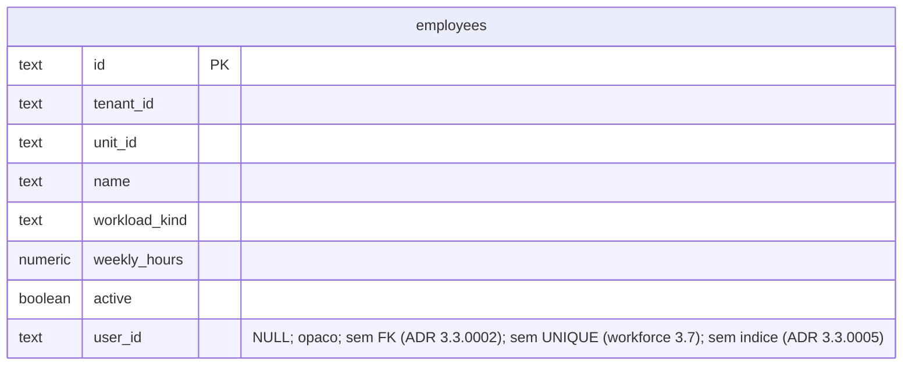

# Concept — Stage 3.5 — Vínculo de login do funcionário

> **Escopo deste documento:** o que será feito nesta Stage, por quê, e
> decisões técnicas relevantes para entender o "porquê". O plano executável
> fica no [`technical.md`](./technical.md) correspondente.
>
> **Status (apenas dois estados).** `draft` desde a criação; `done` após o gate
> humano. Regressão `done → draft` é permitida quando a Fase 3B revela gap
> material aqui.

> **Sete decisões do sponsor sustentam este concept** (§13; tomadas em
> 2026-09-12/13, na Fase 3A): a forma da "senha provisória em mãos" (**conta
> pendente + link de primeiro acesso**, ADR 3.5.0002); a forma da travessia
> staff→identity (**fachada em identity + gateway em staff, um par de
> `ignore_imports`**, ADR 3.5.0001, precedida de pesquisa em fontes primárias);
> o efeito do desligamento sobre o login (**revogar sessões, conta permanece**,
> ADR 3.5.0003); onde fechar o byte NUL em e-mail (**no VO `Email` de
> identity**); o que fazer com link perdido no canal em mãos (**TTL próprio e
> limite declarado**, sem reemissão nesta Stage); a **forma da Stage** — uma
> só, com deliverables em dois BCs **declarados** contra PIPELINE §4.2 #4; e o
> que R15 faz com registro vinculado (**recusa — desligue primeiro**).
> Nenhuma é recuperável de Overview/Roadmap/código — todas reinterpretam ou
> estendem texto ratificado.
>
> **Checkpoint A** (dois revisores independentes em 2026-09-12; rodada 2 em
> 2026-09-13) produziu 1 blocker, 23 majors e 32 minors; as disposições estão
> no relatório da Stage e as correções já estão incorporadas aqui. Quatro
> achados viraram pergunta ao sponsor (§13 Q4–Q7).

## 1. Escopo

### Dentro do escopo

- **Campo `user_id` no registro de funcionário** — `Employee.user_id: UserId | None`
  (aditivo, default `None`, não-vazio quando presente), com a transição
  `link_login` guardada por duas regras: registro **já vinculado** não recebe
  segundo login; registro **desligado** não recebe login. Persistido como coluna
  opaca anulável em `employees` (migration `0004`), **sem FK** para identity
  (ADR 3.3.0002).
- **Port `IdentityGateway`** (`features/staff/application/ports/out/identity_gateway.py`)
  — o que staff precisa de identity, no vocabulário de staff: provisionar o
  login pendente de um funcionário (dizendo por qual canal o link será
  entregue), enviar o convite, revogar as sessões de um login. Com leis
  publicadas (L-IG1…L-IG4, §4) e **segunda implementação** em `tests/fakes/`.
- **Use case `CreateLoginForEmployeeUseCase`** — a fatia do roadmap: encontra o
  registro, guarda as duas regras, provisiona a conta pendente via port, grava
  `user_id`, entrega o link pelo canal escolhido (e-mail **ou** resposta).
- **`DeactivateEmployeeUseCase` (R13) passa a revogar as sessões do login
  vinculado**, antes de escrever — decisão do sponsor (§7 D3). **`DeleteEmployeeUseCase`
  (R15) passa a recusar registro vinculado** (`EmployeeHasLoginError`, 409):
  remoção definitiva é para cadastro criado por engano (ADR 3.2.0006), e um
  registro com login concedido não é engano — o caminho é desligar (§13 Q7).
  Nenhuma conta órfã nasce por remoção.
- **`EmployeeResult.user_id`** e a consolidação dos **11 sítios** de construção
  de `EmployeeResult` num único mapper de application (direção do Gate 8 da
  issue #45) — sem ela, adicionar um campo exige tocar 11 use cases e a
  probabilidade de um deles devolver `None` para um registro vinculado é a
  probabilidade de esquecer um sítio.
- **Em identity — declarado como deliverable fora do BC desta Stage (§1
  Divergência 2, §13 Q6):**
  - **VO `Email` recusa o byte NUL** (`features/identity/domain/value_objects/email.py`,
    uma regra + teste) — fecha um 500 que hoje alcança `POST /users`,
    `POST /users/invitations`, `POST /auth/login` e alcançaria R17 (§7 D8).
  - **Três use cases novos** em `features/identity/application/use_cases/`:
    `ProvisionAccountUseCase` (cria a conta pendente, emite o token, devolve o
    **link**; o TTL depende do canal), `SendInvitationUseCase` (compõe e
    envia), `RevokeAllSessionsUseCase`. A composição do link — hoje inline em
    **dois** módulos, `InviteUserUseCase._enviar_convite` e
    `RequestPasswordResetUseCase` (`request_password_reset.py:147`) — e a da
    mensagem de convite saem para um **helper compartilhado**, que
    `ProvisionAccount`, `SendInvitation`, `InviteUser` e `RequestPasswordReset`
    passam a usar (duas linhas em cada um dos dois existentes); nenhum dos dois
    é recomposto (§7 D2).
  - **Fachada de identity** (`features/identity/application/facade.py`) — o
    *Open Host Service* de identity para consumidores in-process: três
    operações com tipos primitivos sobre os três use cases; re-exporta os dois
    erros que um consumidor traduz.
  - **Um teste-pino** em `tests/unit/features/identity/` fixando
    `required_permissions_for_role(Role.EMPLOYEE) == {MANAGE_USERS}`, com
    mensagem apontando para R17 (§5.3, §10).
- **Adapter `LocalIdentityGateway`** (`features/staff/adapters/out/identity/local_identity_gateway.py`)
  — a *Anticorruption Layer* de staff: traduz o port para a fachada e **só**
  para ela. O contrato `bc-independence` ganha **um** par de `ignore_imports`,
  nomeado e assertado exato por teste (§5.9, ADR 3.5.0001).
- **Rota R17** `POST /units/{unit_id}/employees/{employee_id}/login` (201) ao
  lado das 16 da 3.6, sob o mesmo `AccessGuard`, o mesmo handler e as mesmas
  varreduras; corpo `{email, delivery}`; resposta com o funcionário resultante
  (agora com `user_id`) e, **só** no canal `link`, o link de primeiro acesso.
- **`Settings.handover_link_ttl_hours`** (default **168**) — o TTL do link
  entregue em mãos, separado do TTL do convite por e-mail (72h) (§7 D9).
- **Wiring** no `composition_root.py` (fachada, gateway, use case novo, 18ª
  entrada de overrides) e **e2e** dos dois canais contra app e Postgres reais:
  criar login → definir senha pelo link → autenticar como `employee`.
- **Reconciliação documental**: nota datada em `workforce.md` §3.8 e em
  `overview.md` §3 (a "senha provisória" é um link de primeiro acesso); nota
  datada de **supersessão parcial** no ADR 3.4.0001 §Decision 3 (a cláusula
  "zero `ignore_imports`" é superada para a aresta da fachada — não é errata:
  muda conteúdo); entrada datada na §7 do `technical.md` da 2.5 apontando o
  carve-out da regra 1 (ADR 3.5.0002); `LAYOUT.md` §3 ganha a regra da
  travessia entre BCs; `CONVENTIONS.md` §5 ganha a terceira forma
  não-destrutiva de manter um ADR honesto (nota datada de supersessão
  parcial — ADR 3.5.0001 §Status); comentário re-escopando a issue #47.

### Fora do escopo (explicitamente)

- **Página do funcionário ver a própria escala** — Step 4 (`non_goals` do
  roadmap). `employee` continua com permissões **vazias**: esta Stage cria a
  conta, não lhe dá nada para ver (finding da 2.2 disposto em §10).
- **Completar o perfil no primeiro acesso** ("outras informações que o gestor
  não sabe", fala do sponsor) e **QR code** do link — são o **frontend** da
  página de definição de senha; o link entregue aqui é a **entrada** desse
  fluxo. `[finding]` em §10.
- **Reemissão do link / reenvio do convite.** Reemitir só é seguro para conta
  **pendente** — para conta ativa seria um gerente redefinindo a senha do
  funcionário —, e identity **não sabe distinguir** as duas: o hash inutilizável
  é aleatório por conta (ADR 2.5.0004 lei 2) e tokens expirados são purgados.
  Exige sinal novo em identity (coluna + migration). `[finding]` em §10 com o
  desenho; o limite fica **declarado** em §6.4 (§13 Q5).
- **`User.is_active` / desativação de conta em identity** — o sponsor decidiu
  que o desligado **continua conseguindo autenticar**; o que se corta são as
  sessões e, estruturalmente, o acesso às informações da unidade (§7 D3).
- **Vincular um login já existente** a um registro e **desvincular/trocar** o
  login de um registro (workforce §3.7: a mesma pessoa em N registros; o
  gerente que também trabalha na escala; o e-mail digitado errado) — o roadmap
  diz *criar*. São também os caminhos de recuperação dos limites de §6.4.
  `[finding]` em §10.
- **Mover `_IdentityAccessGuard`** para staff (issue #47) — a pesquisa da §13
  mostrou que o movimento honesto exige identity expor autenticação/autorização
  **fora do pacote `in/`**; fica na #47, re-escopada (§7 D1).
- **Recompor `InviteUserUseCase`** sobre os use cases novos — não é necessário
  para a DoD e é o item que mais mexeria em código mergeado de outro BC; a
  duplicação da ordem de checagens (agora em três lugares) vira `[finding]` de
  identity (§10).
- **Unit of Work entre os dois BCs** (issue #46) — as janelas de inconsistência
  são **declaradas** (§6.4), não fechadas.
- **Login por identificador que não seja e-mail** — kickoff #2 fixou e-mail
  único global; um funcionário sem e-mail precisa de um e-mail como identificador
  mesmo no canal `link`. Declarado, não resolvido.
- **Frontend**; **paginação**; qualquer noção de escala.

### Divergências declaradas em relação ao roadmap e ao PIPELINE

Padrão da 2.5/3.6: declaradas aqui, nota datada no `roadmap.md` no fechamento.

1. **`contratos_consumidos` diz `invite_user/create_user`; nenhum dos dois é
   consumido diretamente.** `create_user` cria conta **com senha** — o sponsor
   descartou a senha provisória literal (§13 Q1). `invite_user` provisiona **e
   envia** numa chamada só, o que impede staff de gravar `user_id` **antes** da
   entrega (§7 D2). O que se consome é a **fachada** sobre três use cases novos.
2. **Deliverables em dois bounded contexts — divergência de PIPELINE §4.2 #4,
   autorizada pelo sponsor (§13 Q6).** `arquivos_a_criar` do roadmap só nomeia
   staff e o `composition_root`; esta Stage entrega também
   `features/identity/application/{facade,use_cases/*}` e uma regra no VO
   `Email` (`features/identity/domain`). É a **quarta** expansão de camada para
   trás do BC staff (finding da 3.6) e a **segunda para dentro de identity** (a
   primeira foi a 3.4, ADR 3.4.0006/0008). O sponsor foi perguntado
   explicitamente se a parte de identity deveria ser Stage própria (3.7) antes
   desta e escolheu **manter uma Stage** — a alternativa está registrada em
   §13 Q6 com o custo de cada lado. **Limite da expansão:** nenhuma mudança de
   schema, de entidade ou de port em identity (§5.13).
3. **`complexidade_estimada: S` mede errado e a Stage mede 12 Tasks.** Duas
   camadas de staff, três de identity, uma migration e uma rota: o recorte
   mede **12** (§12), que é **M**, no teto da faixa saudável. Cinco Tasks
   ultrapassam ~5 arquivos com exceção **declarada** (PIPELINE §4.3 #2). A
   estimativa entra na nota do roadmap.
4. **O `definition_of_done` do roadmap ganha um segundo resultado testável:**
   "desligar revoga as sessões do login vinculado; remover registro vinculado é
   recusado" (§7 D3, CA24) não está na DoD do bloco 3.5 e é **extensão
   autorizada pelo sponsor** (§13 Q3, Q7), não "DoD único".
5. **`arquivos_a_criar` ganha `migrations/versions/0004_*`** — `user_id` é
   coluna nova.

### Vínculo com o roadmap

Última Stage de backend do **Step 3 — Equipe da unidade**. A 3.6 tornou o BC
exercitável pela API; esta fecha a única frase do overview §3 sobre equipe que
ainda não tinha código — *"login opcional ('criar login para este funcionário')
via convite por e-mail ou senha provisória entregue em mãos"* — e é a primeira
vez que **um BC consome outro por use case**, o caso que o ADR 3.4.0001 §4
antecipou ao colocar `AccessGuard` em `ports/out/`. O padrão que nasce aqui
(fachada + gateway + um par nomeado) é o que o Step 4 vai reusar quando
`scheduling` precisar de `staff` (`StaffReadPort`, bloco 4.3).

## 2. Objetivo da Stage

Ao final desta Stage, o registro de funcionário **pode carregar um login**,
criado pelo gerente pela API e completado pelo próprio funcionário: o gerente
escolhe o canal do link de primeiro acesso (na resposta ou por e-mail), o
funcionário define a própria senha por esse link e autentica como `employee`;
o registro passa a carregar `user_id`, a cópia para outra unidade **não** o
carrega, desligar o registro revoga as sessões desse login e removê-lo é
recusado enquanto o login existir — tudo sem que nenhum módulo de staff conheça
o interior de identity além de uma fachada nomeada.

## 3. Contexto e premissas

### Contexto

**O que existe.** Identity já tem tudo o que uma conta pendente precisa —
`PasswordHasher.unusable_hash` (ADR 2.5.0004), `PasswordSetupToken` de uso
único com expiração (ADR 2.5.0002), `SetPasswordWithTokenUseCase` e a rota
pública `POST /auth/password`, e `SessionRepository.revoke_all_for_user`. O que
**não** existe é um caminho de entrega que não seja o e-mail: `InviteUserUseCase`
faz criar-conta + emitir-token + enviar-e-mail numa operação, e o valor do token
existe, nas palavras do próprio módulo, *"entre esta linha e o corpo do
e-mail, e em nenhum outro lugar"* (`invite_user.py`, docstring de
`_emitir_token`; a regra é a 1 da 2.5 §5). Também não existe mecanismo de
**troca obrigatória de senha**: `User` não tem flag e `AuthenticateUserUseCase`
não força nada — o que torna a "senha provisória com troca obrigatória" de
`workforce.md` §3.8 **inimplementável como escrita** sem uma Stage de identity.

**O que a 3.5 faz com isso.** Reinterpreta a "senha provisória" como o que ela
sempre quis ser — uma credencial de **um só uso** que **só serve para definir a
senha** —, e a materializa com os tijolos que já existem: a conta nasce
pendente, o gerente recebe (ou manda) o **link** de primeiro acesso, e a troca
obrigatória deixa de ser regra a impor no login para ser **estrutura**: o
segredo em mãos não autentica ninguém. É a leitura que o sponsor confirmou:
*"conta pré-criada que ainda não está pronta para o uso; o gestor manda o link
ou o QR code para a pessoa"*.

**O staff não conhece identity.** `bc-independence` é contrato de
*independência* — proíbe as duas direções, inclusive **indireto** —, e até aqui
valia com **zero** `ignore_imports` porque a única travessia (o `AccessGuard`)
foi montada no `composition_root`, o único módulo que já importa os dois BCs
(ADR 3.4.0001 §3). O roadmap fixou para esta Stage um adapter **dentro** de
staff que *"chama use cases de identity in-process"* — o que obriga a primeira
supressão do contrato. A §13 registra a pesquisa que decidiu **como** abrir essa
fronteira sem perder a propriedade que o contrato protege.

**O desligamento hoje não toca identity.** `DeactivateEmployeeUseCase` marca
`active=False` e nada mais; `DeleteEmployeeUseCase` apaga qualquer registro sem
referência (ADR 3.2.0006); o finding da 2.4 (*"demissão corta o refresh na
hora"* não tem rota) chegou a esta Stage como candidata.

### Premissas

- **O handler de `IdentityError` continua registrado sobre a app** e resolvido
  por MRO, então um erro de identity que o gateway **não** traduz e que suba de
  dentro de R17 sai com a faixa/corpo de identity — mesma premissa da 3.6 §3.
- **`AuthorizeActionUseCase` autoriza uma permissão por chamada** e o port
  `AccessGuard` uma `(permissão, alvo)` por chamada (L-AG4). R17 exige **duas**
  permissões sobre o mesmo alvo e faz **duas** chamadas.
- **`Employee` e `EmployeeResult` são `frozen`; a cópia constrói a entidade
  campo a campo** (`copy_employee_to_unit.py:71`), nunca por
  `dataclasses.replace` — é isso que faz o default `None` de `user_id` valer
  como "a cópia não carrega" **por construção**, e não por lembrar de zerar.
- **`users.email` é `TEXT`** (`identity/adapters/out/postgres/tables.py:105`):
  um e-mail longo é aceito e gravado verbatim, não é 500.
- **`create_engine` não abre conexão**; montar a fachada e o gateway não muda o
  boot.
- **Testes e2e exigem Postgres real** (ADR 2.3.0001); `RecordingEmailSender` já
  é a costura de e-mail do e2e de identity (`create_app(..., email_sender=)`).
- **Ninguém em produção instancia adapter fora do composition root** — os dois
  testes mecânicos por BC continuam valendo e ganham o adapter novo na varredura.

### Dependências

- `3.6-staff-http`: router, `dependencies.py` (`validate_identifier`,
  `AccessRequirement`, ordem autenticar → validar → autorizar), `STAFF_ERROR_STATUS`
  total por MRO (ADR 3.4.0002), varreduras derivadas do router (unitárias e
  e2e), matriz papel × rota com o seu catálogo de invocação por rota,
  `HttpWiring` em coleções.
- `3.4-staff-access-scope`: port `AccessGuard` e leis L-AG1…L-AG4; endereço de
  três partes do funcionário (ADR 3.4.0007); `bc-independence` sem supressão
  (propriedade que **esta** Stage muda de forma controlada).
- `3.3-staff-persistence`: tabela `employees` e mappers; `_COLUNAS_IMUTAVEIS`
  do `update`; "última escrita vence" (ADR 3.3.0006); migration `0003` como
  padrão de escrita à mão.
- `3.2-staff-application`: os 16 use cases, `EmployeeResult`, a hierarquia
  `StaffError`; ADR 3.2.0003 (lista fechada de exclusão da cópia — `user_id`
  *"never carried"*); ADR 3.2.0006/0007 (ciclo de vida; remoção guardada).
- `3.1-staff-domain`: `Employee` frozen com transições por `replace`;
  `identifiers.py` (NewTypes opacos); ADR 3.1.0001 (iii) — vínculo explícito
  por registro.
- `2.5-email-invite`: `unusable_hash`, `PasswordSetupToken`, `SetupTokenIssuer`,
  `SetPasswordWithTokenUseCase`, `POST /auth/password`, `EmailSender` e o
  formato do link (`{base_url}/definir-senha?token=`).
- `2.2-identity-application` / `2.1-identity-domain`: `User`, `UnitMembership`,
  `Role.EMPLOYEE` com permissões vazias, `revoke_all_for_user`, `Email`,
  `required_permissions_for_role` (2.4).

## 4. Contratos

### Introduzidos

#### Domínio de staff

- **`UserId`** (`value-object`, `staff/domain/value_objects/identifiers.py`) —
  `NewType("UserId", str)`: o id do login em identity, **opaco** para staff,
  tipado por staff (regra literal do módulo: *"identificadores atravessam a
  fronteira entre BCs como strings opacas, e cada BC tipa os seus"*). A
  semântica do campo **não** restringe o papel do `User` apontado — hoje só
  existe um produtor (R17, papel `employee`), mas um vínculo futuro a um login
  de gerente que também trabalha na escala é legítimo (workforce §3.3(b), §3.7).
- **`Employee.user_id: UserId | None = None`** (campo aditivo; quando presente,
  **não-vazio** — `InvalidIdentifierError` no `__post_init__`, pelo princípio
  da 3.1 "invariante em todo caminho de construção", inclusive a reidratação) e
  **`Employee.link_login(user_id) -> Employee`** (transição por `replace`), com
  a guarda **`Employee.assert_can_link_login()`** — levanta
  `EmployeeAlreadyHasLoginError` se `user_id` já está definido e
  `TerminatedEmployeeLoginError` se `active` é `False`, **nesta ordem**. A
  guarda é método separado porque o use case precisa **perguntar antes de
  provisionar** a conta em identity (§5.4) — e `link_login` a chama de novo por
  dentro, para que a regra tenha **uma** casa.
- **`EmployeeAlreadyHasLoginError`, `TerminatedEmployeeLoginError`**
  (`staff/domain/exceptions/errors.py`, herdam só de `StaffError`) — conflito
  com estado **já gravado** ⇒ faixa 409 (§6.1).

#### Application de staff

- **`LoginDelivery`** (`dto`, no módulo do port): `EMAIL` (identity envia o
  link para o e-mail informado) | `LINK` (o link volta ao chamador autorizado,
  uma vez). Vive no módulo do port porque **o port o consome**: o canal decide
  o TTL do token (§7 D9), e isso é identity quem sabe.
- **`IdentityGateway`** (`port-out`, `staff/application/ports/out/identity_gateway.py`):

  ```python
  @dataclass(frozen=True)
  class ProvisionedLogin:
      user_id: UserId
      setup_link: str = field(repr=False)   # segredo de uso único (L-IG3)

  class IdentityGateway(Protocol):
      def provision_employee_login(
          self, *, email: str, tenant_id: TenantId, unit_id: UnitId, delivery: LoginDelivery
      ) -> ProvisionedLogin: ...
      def send_login_invitation(self, *, email: str, setup_link: str) -> None: ...
      def revoke_login_sessions(self, user_id: UserId) -> None: ...
  ```

  **Não há parâmetro de papel** — o port só sabe provisionar login de
  **funcionário**; é a forma estrutural de "não se concede o que não se detém"
  do lado de staff (L-IG1). **As leis (texto normativo do módulo, com segunda
  implementação em `tests/fakes/features/staff/in_memory_identity_gateway.py`):**

  - **L-IG1 — papel e escopo são do port; o resultado é o login recém-criado.**
    O login nasce com o papel de funcionário, dentro de `tenant_id`, membro de
    **exatamente** `unit_id`; nenhum argumento permite pedir outro papel ou
    outra unidade. O `user_id` devolvido identifica **esse** login — novo,
    nunca um pré-existente — e o `setup_link` devolvido o redime. (A metade
    "papel" só é observável na implementação real — CA08; o fake mantém um
    ledger `logins[user_id] = (email, tenant_id, unit_id)` e nunca devolve o
    mesmo `user_id` duas vezes.)
  - **L-IG2 — duas exceções são traduzidas; o resto sobe cru, inclusive a
    falha do envio.** E-mail já usado ⇒ `LoginEmailAlreadyInUseError`; e-mail
    malformado ⇒ `InvalidLoginEmailError` (as duas de staff). **Qualquer outra
    falha** — tenant desconhecido, unidade desconhecida, cross-tenant, falha do
    `EmailSender` em `send_login_invitation` — **sobe como a implementação a
    levantou** (mesma instância), pela mesma razão de L-AG1/L-AG2: traduzi-la
    criaria uma segunda faixa de erro para uma condição que já tem handler
    (§6.2); engoli-la faria o gateway responder sucesso sem entrega — o modo de
    falha que a regra 13 da 2.5 existe para impedir. O fake tem `raw_error` e
    `fail_send_with` para exercer as duas metades.
  - **L-IG3 — `setup_link` é segredo de uso único.** `repr=False`; staff **nunca
    o persiste** (em nenhuma tabela de staff), nunca o loga, nunca o põe em
    mensagem de exceção. Ele existe entre `provision_employee_login` e **um** de
    dois destinos: `send_login_invitation` ou o corpo da resposta 201 no canal
    `link`. É invariante do **consumidor** mais do que do port, e por isso os
    seus critérios são sobre o use case e a borda (CA05, CA14).
  - **L-IG4 — `revoke_login_sessions` é idempotente e total.** Login sem sessão,
    ou id **desconhecido**, **não é erro**. Chamado duas vezes, o efeito é o
    mesmo.

- **`LoginEmailAlreadyInUseError`** (409) e **`InvalidLoginEmailError`** (422)
  (`staff/application/errors.py`, herdam só de `StaffError`) — o vocabulário de
  staff para as duas condições que o gerente precisa distinguir.
- **`EmployeeHasLoginError`** (409, `staff/application/errors.py`, herda só de
  `StaffError`) — a guarda nova de `DeleteEmployeeUseCase`: registro com
  `user_id` não é removido; a mensagem diz que o caminho é desligar. Irmã de
  `EmployeeInUseError` (remoção guardada, L-E5), com outra causa.
- **`CreateLoginForEmployeeCommand`** (`dto`): `tenant_id`, `unit_id`,
  `employee_id`, `email: str`, `delivery: LoginDelivery`. O e-mail é `str` cru:
  o VO `Email` é de identity, e é a fachada quem o constrói (§5.7).
- **`EmployeeLoginResult`** (`dto`): `employee: EmployeeResult`,
  `setup_link: str | None = field(repr=False)` — `None` no canal `email`.
- **`EmployeeResult.user_id: UserId | None`** (campo novo) e o **mapper único**
  `employee_result(employee: Employee) -> EmployeeResult`
  (`staff/application/use_cases/_results.py`), que substitui os **11** sítios
  de construção inline (os 11 use cases que devolvem funcionário; os quatro de
  função e `delete_employee` não constroem `EmployeeResult`). Módulo privado da
  camada, sem método em DTO (Gate 6 da #45 continua satisfeito).
- **`CreateLoginForEmployeeUseCase`** (`port-in` = a classe, LAYOUT §5 Opção 2).

#### Identity — o VO, os tijolos e a fachada

- **`Email` recusa `\x00`** (`identity/domain/value_objects/email.py`): a regex
  `^[^@\s]+@[^@\s]+\.[^@\s]+$` **aceita** NUL (`\s` não o casa — medido no
  Checkpoint A: `Email("fulano\x00@cantina.com")` constrói), e o valor segue
  para `users.exists_by_email`, onde o `psycopg` o recusa client-side com
  `DataError` ⇒ **500** em `POST /users`, `POST /users/invitations`,
  `POST /auth/login` e em R17. A regra nova levanta `InvalidEmailError` — o
  precedente é o ADR 3.4.0003 em staff. É a **única** mudança de domínio em
  identity nesta Stage (§5.13).
- **`ProvisionAccountUseCase`** + `ProvisionAccountCommand(email, role,
  tenant_id, unit_ids, handed_over: bool)` + `ProvisionedAccountResult(user:
  UserResult, setup_link: str)` — cria o `User` com `unusable_hash` e vínculos,
  emite e persiste o `PasswordSetupToken` (`INVITATION`; TTL =
  `handover_link_ttl` se `handed_over`, senão `invitation_ttl`) e devolve o
  **link** montado. É `InviteUserUseCase` **sem o envio** e **com** o link no
  result — a **única** operação de identity cujo result carrega o segredo, e o
  carve-out está no ADR 3.5.0002. A ordem de checagens é a de
  `InviteUserUseCase`, verbatim (unicidade global → `platform_admin` **com**
  `unit_ids` → restaurante → construir → unidades).
- **`SendInvitationUseCase`** + `SendInvitationCommand(email, setup_link)` —
  compõe a mensagem e a envia pelo `EmailSender`; a falha **propaga**.
- **`RevokeAllSessionsUseCase`** + `RevokeAllSessionsCommand(user_id)` —
  `sessions.revoke_all_for_user(user_id, clock.now())`. Idempotente (o port já
  é); id desconhecido não levanta.
- **Helper de composição** (`identity/application/use_cases/_invitation.py`):
  `setup_link(base_url, token_value)` e `invitation_message(to, link)` — o
  formato `{base_url}/definir-senha?token=` passa a ter **uma** casa. Hoje ele
  vive em **dois** lugares (`invite_user.py:209` e
  `request_password_reset.py:147`); os dois passam a chamar o helper (duas
  linhas em cada; comportamento, assinaturas e testes **intactos** — CA16), e
  `ProvisionAccount`/`SendInvitation` nascem chamando-o.
- **`IdentityFacade`** (`features/identity/application/facade.py`) — o *Open
  Host Service* in-process de identity. Assinaturas em **primitivos**; converte
  para VOs por dentro; **levanta as exceções de identity sem tradução**; e
  **re-exporta** `EmailAlreadyRegisteredError` e `InvalidEmailError`, para que
  um consumidor só precise importar **este** módulo (§5.9):

  ```python
  @dataclass(frozen=True)
  class ProvisionedAccount:
      user_id: str
      setup_link: str = field(repr=False)

  class IdentityFacade:
      def provision_account(
          self, *, email: str, role: str, tenant_id: str, unit_ids: Sequence[str], handed_over: bool
      ) -> ProvisionedAccount: ...
      def send_invitation(self, *, email: str, setup_link: str) -> None: ...
      def revoke_all_sessions(self, user_id: str) -> None: ...
  ```

  A fachada **não autoriza** — como nenhum use case de identity autoriza hoje
  (#49), e é isso que faz dela um segundo caminho de entrada para "criar conta"
  que **não** passa por `required_permissions_for_role` (finding da 2.4,
  disposto em §10). Quem chama responde pela autorização; para staff é R17
  (§5.3), e o gateway fixa o papel como valor (L-IG1).

#### Adapter de staff

- **`LocalIdentityGateway`** (`features/staff/adapters/out/identity/local_identity_gateway.py`)
  — implementa `IdentityGateway` sobre `IdentityFacade`: fixa `role="employee"`
  e `unit_ids=(unit_id,)`; mapeia `delivery` para `handed_over`; traduz
  **exatamente** as duas exceções de L-IG2; repassa o resto (inclusive a falha
  do envio). **Importa só `restaurant_hub.features.identity.application.facade`.**

#### Borda HTTP de staff

- **R17** `POST /units/{unit_id}/employees/{employee_id}/login` → **201**.
  Requisito de acesso: `manage_staff` **e** `manage_users`, ambas sobre a
  unidade do path (§5.3). Sucesso devolve o estado resultante (3.6 §5.12).
- **`CreateLoginRequest`**: `email: str`, `delivery: Literal["email", "link"]`
  **sem default** — como `DeclareShiftPreferenceRequest`, um corpo `{}` não pode
  escolher canal em silêncio. O corpo **não tem identificador**.
- **`EmployeeLoginResponse`**: `employee: EmployeeResponse`,
  `setup_link: str | None`.
- **`EmployeeResponse.user_id: str | None`** — aparece em **toda** resposta que
  embute `EmployeeResponse`: as **12** rotas R05–R14, R16 e R17 (R17 a embute em
  `EmployeeLoginResponse`; R06 devolve uma lista dela).
- **`PERMISSION_MANAGE_USERS = "manage_users"`** e o requisito
  `MANAGE_USERS_IN_UNIT_ACCESS` em `dependencies.py` — valor, nunca enum.
- **Cinco entradas novas em `STAFF_ERROR_STATUS`** (§6.1).

#### Persistência de staff

- **`employees.user_id TEXT NULL`** — opaco, sem FK, sem `UNIQUE`, sem índice
  (§9, ADR 3.5.0004). Migration `0004_employees_user_id`.

#### Configuração

- **`Settings.handover_link_ttl_hours: int = 168`** — TTL do link entregue em
  mãos. Separado de `invitation_token_ttl_hours` (72) pela mesma razão que a
  2.5 separou convite de reset: são janelas de risco diferentes (§7 D9).

### Consumidos

- **`AccessGuard` / L-AG1…L-AG4** — Stage 3.4; R17 faz duas chamadas
  `authorize`, uma por permissão.
- **`EmployeeRepository`** — `find_by_id` (endereço de três partes) e `update`
  (`delete` continua sendo chamado por R15, agora atrás de uma guarda nova).
- **`PasswordHasher.unusable_hash`, `SetupTokenIssuer`, `PasswordSetupTokenRepository`,
  `SessionRepository.revoke_all_for_user`, `UserRepository`, `RestaurantRepository`,
  `UnitRepository`, `EmailSender`, `Clock`, `IdGenerator`** — via os use cases
  novos de identity.
- **`SetPasswordWithTokenUseCase` / `POST /auth/password` / `POST /auth/login`
  / `POST /auth/refresh`** — o lado do funcionário no e2e; **não mudam**.
- **`Settings.app_base_url`, `invitation_token_ttl_hours`** — o canal `email`
  usa o TTL do convite (72h): é a mesma credencial, com o mesmo carteiro.

## 5. Invariantes e regras

**5.1 — O vínculo é opcional e só nasce por R17.** Nenhuma outra rota o cria ou
infere. Registro sem vínculo é o estado default de todo funcionário (workforce
§3.8; ADR 3.1.0001 iii). **Contas** `employee` podem nascer por outras rotas
de identity (`POST /users`, `/users/invitations`) sem registro que as aponte —
são órfãs **por desenho**, não por falha, e staff não as conhece.

**5.2 — A cópia nunca carrega o vínculo.** `CopyEmployeeToUnitUseCase`
constrói o clone campo a campo e **não nomeia** `user_id`, que fica `None` por
default. Passa de vacuamente verdadeiro (3.2 §5.10, 3.6 §4.3) a **verificável**:
a lista de exclusão fechada do ADR 3.2.0003 ganha o seu primeiro item com
conteúdo (CA04).

**5.3 — Criar login exige `manage_staff` E `manage_users` sobre a unidade do
registro.** "Não se concede o que não se detém" (2.4 concept §5 regra 4,
`required_permissions_for_role`): criar uma conta é ato de identity, gerido por
`manage_users`; editar o registro é ato de staff, gerido por `manage_staff`.
Hoje `owner`, `manager` e `hr` detêm as duas e `employee`/`platform_admin`
nenhuma — a exigência dupla não muda a matriz (§5.13 da 3.6), mas fecha a porta
lateral que uma rota com uma só permissão abriria a um papel futuro com
`manage_staff` sem `manage_users`. São **duas** chamadas ao guard, sobre o
**mesmo** alvo (L-AG4 fala de alvos; permissões distintas são pedidos distintos).
**O conjunto está escrito à mão em staff** (o gateway não pode derivá-lo do
papel, que não conhece), então ele **diverge** de `required_permissions_for_role`
no dia em que `Role.EMPLOYEE` ganhar a primeira permissão: por isso um
teste-pino em identity fixa `required_permissions_for_role(Role.EMPLOYEE) ==
{MANAGE_USERS}` com mensagem apontando para R17 — falha e obriga a decisão
(§10). **Revogar sessões (R13) não exige `manage_users`**: revogar não concede nada;
é o oposto de conceder, e a permissão que governa mexer no registro basta.

**5.4 — Ordem do use case é contrato, e é a que minimiza o órfão.**

```
find_by_id(tenant, unit, id)      → EmployeeNotFoundError          (404)
assert_can_link_login()           → AlreadyHasLogin | Terminated    (409)
gateway.provision_employee_login  → LoginEmailAlreadyInUse (409) | InvalidLoginEmail (422) | cru
employees.update(link_login(uid)) → escreve user_id
delivery == EMAIL → gateway.send_login_invitation ; LINK → setup_link no result
```

As duas guardas de staff correm **antes** de identity ser tocada: rejeitar
depois de provisionar deixaria uma conta pendente sem registro para um pedido
que staff sempre ia recusar. A gravação de `user_id` acontece **antes** da
entrega: se o e-mail falhar, a exceção sobe (500) mas a conta existe **e está
vinculada** — o gerente vê o `user_id` em R06 e o caminho de recuperação é o
pedido público de reset (2.5 §5 regra 13). É a razão de a fachada expor
provisionar e enviar **separados** (§7 D2). As duas metades da ordem têm
critério próprio (CA09 e CA30).

**5.5 — Registro desligado não recebe login; registro vinculado não recebe
segundo login.** Desligar **corta** acesso (kickoff #4; decisão do sponsor em
§13 Q3) — criar acesso novo para quem foi desligado contradiz o corte. E
`user_id` é definido **uma vez**: não há "trocar o login" nesta Stage. Um
desligado **com** login mantém o `user_id` — é história, como as funções e as
indisponibilidades (ADR 3.2.0006).

**5.6 — Desligar (R13) revoga as sessões do login vinculado; a conta permanece.
Remover (R15) registro vinculado é recusado.** Em `DeactivateEmployeeUseCase`:
`find_by_id` → se `user_id` ⇒ `gateway.revoke_login_sessions(user_id)` →
`update(deactivate())`. **Revogar antes de escrever**, porque as duas falhas
possíveis têm custos assimétricos: revogar e não conseguir escrever deixa o
registro **intacto e consistente** (a pessoa só faz login de novo); escrever e
não conseguir revogar devolveria erro ao cliente com a mudança **já
persistida** — sucesso parcial escondido atrás de um 500. Em
`DeleteEmployeeUseCase`: `find_by_id` → se `user_id` ⇒ `EmployeeHasLoginError`
(409), **antes** de `delete` e sem tocar identity — remoção definitiva é para
cadastro criado por engano (ADR 3.2.0006), um registro com login concedido não
é engano, e apagá-lo deixaria uma conta que ninguém aponta (e-mail tomado
globalmente, membership viva): o caminho é desligar (§13 Q7). `DeleteEmployeeUseCase`
**não recebe o gateway** (propriedade de assinatura, CA21), como
`ReactivateEmployeeUseCase` (R14), que não faz nada com identity. O corte de
R13 é do **refresh**: o access token em curso continua válido até expirar
(15 min por default — kickoff #13, ADR 2.2.0001), e isso é o comportamento,
não um defeito. O acesso às informações da unidade é cortado
**estruturalmente** — `employee` não tem permissão nenhuma hoje, e quando tiver
(Step 4), o caminho passa pelo registro, que está `active=False`.

**5.7 — Staff não valida e-mail.** O VO `Email` é de identity; staff transporta
`str` cru até a fachada, que o constrói. `InvalidEmailError` volta traduzido
como `InvalidLoginEmailError` (L-IG2). Duplicar a regra em staff criaria duas
fontes de verdade sobre o que é um e-mail válido — e é por isso que o byte NUL
é fechado **no VO** (§7 D8), não na borda de staff: fechá-lo aqui deixaria as
três rotas de identity com o 500. **O e-mail não passa por
`validate_identifier`**: não é identificador de recurso.

**5.8 — O link só sai por dois caminhos, e nunca fica.** Canal `email`: o link
existe no corpo do `EmailMessage` e em lugar nenhum mais — a resposta 201 tem
`setup_link: null` (CA14 da 2.5 preservado para este canal). Canal `link`: o
link existe no corpo da resposta 201 **daquela** requisição, para um ator que
acabou de ser autorizado com `manage_users`, e em lugar nenhum mais. Em nenhum
canal staff o persiste, loga ou repete: `repr=False` nos DTOs, nenhuma
mensagem de exceção o carrega, nenhum registro de log o contém, e não há rota
de "ver o link de novo" (§6.4). É o carve-out **estreito** da regra 1 da 2.5
(ADR 3.5.0002).

**5.9 — A fronteira entre BCs abre em UMA aresta nomeada, e a forma da aresta é
a regra.** `bc-independence` recebe **um** `ignore_imports`:

```
restaurant_hub.features.staff.adapters.out.identity.* -> restaurant_hub.features.identity.application.facade
```

Wildcard `*` só no nome de módulo do lado de staff (semântica do import-linter:
`*` casa nomes de módulo, `**` casaria subpacotes — não é o caso) — qualquer
módulo novo dentro de `adapters/out/identity/` herda a permissão; qualquer
módulo **fora** dela, ou qualquer import de identity que **não** seja a fachada,
continua reprovando. `unmatched_ignore_imports_alerting = error` (default do
import-linter, escrito explícito) faz um par que não casa nada reprovar.
`test_bc_independence.py` deixa de assertar *"a lista não existe"* e passa a
assertar **a lista exata**: uma segunda aresta entra por decisão, nunca por
descuido. A varredura de vocabulário (nenhum módulo de staff nomeia `Role` ou
`Permission`) continua valendo para o gateway: ele passa `"employee"` como
**valor**.

**5.10 — A fachada é o único ponto de entrada in-process de identity.** Nenhum
módulo fora de `features/identity/` importa `identity.application.use_cases`,
`.dtos`, `.errors` ou `identity.domain` — exceto o `composition_root`, que já os
importa por desenho. É verificável por grep e entra em `LAYOUT.md` §3 como
regra: *adapter de um BC importa de outro BC **apenas** a fachada dele, com par
nomeado no `.importlinter`*.

**5.11 — O mapa de status continua total, e a totalidade é teste.** As cinco
exceções novas de staff têm entrada **própria**; CA17 da 3.6 (enumeração
recursiva de `StaffError`) reprova até que tenham.

**5.12 — Toda resposta que embute funcionário embute `user_id`.** A propriedade
vale para as 12 rotas de §4 e para cada item de R06, porque todas passam por
`EmployeeResponse.from_result`, e o result vem do mapper único. Para R05
(registro novo) e R16 (clone) o valor é `null` **por construção** (§5.2); para
as demais, o gravado. A trava é o mapper: **nenhum use case constrói
`EmployeeResult` diretamente** (CA06).

**5.13 — Identity não muda de forma persistida nem de contrato.** `User`,
`users`, `sessions`, `password_setup_tokens`: nenhuma coluna, nenhum campo,
nenhuma migration, nenhum port alterado. A expansão para identity é
**application** (fachada, três use cases, helper) mais **uma regra** no VO
`Email` — e essa é a lista inteira.

**5.14 — Autenticar → validar identificador → autorizar** (3.6 §5.14) vale
para R17: `unit_id` e `employee_id` do path passam por `validate_identifier`
antes das duas chamadas ao guard; o corpo não tem identificador.

## 6. Casos de erro e exceções

### 6.1 Entradas novas no mapa `STAFF_ERROR_STATUS`

| Faixa | Exceção | Onde nasce | Razão da faixa |
|---|---|---|---|
| **409** | `EmployeeAlreadyHasLoginError` | domínio, `assert_can_link_login` | conflito com estado gravado: o registro **já** tem login |
| **409** | `TerminatedEmployeeLoginError` | domínio, `assert_can_link_login` | conflito com estado gravado: o registro está desligado |
| **409** | `LoginEmailAlreadyInUseError` | gateway (tradução de `EmailAlreadyRegisteredError`) | o e-mail já é login de alguém — em **qualquer** tenant (unicidade global, kickoff #2); a mensagem cita só o e-mail enviado, nunca de quem é |
| **422** | `InvalidLoginEmailError` | gateway (tradução de `InvalidEmailError`) | conteúdo enviado não é e-mail (inclui o byte NUL, §7 D8) |
| **409** | `EmployeeHasLoginError` | application, `DeleteEmployeeUseCase` | conflito com estado gravado: o registro tem login e a remoção é recusada — mesma faixa de `EmployeeInUseError` (remoção guardada) |

O mapa passa de 18 para **23** entradas. As duas de domínio herdam só de
`StaffError` (nada de `NotFoundError`), como `UnavailabilityNotFoundError`.

### 6.2 Erros que **não** chegam ao handler de staff (L-IG2)

| Cenário | Exceção | Status | Quem responde |
|---|---|---|---|
| Sem Bearer; papel sem `manage_staff` **ou** sem `manage_users`; unidade não visível/inexistente | as da 3.6 §6.2 | 401/403 corpo constante | handler de identity |
| Tenant/unidade que a fachada não encontra, ou cross-tenant | `RestaurantNotFoundError`, `UnitNotFoundError`, `CrossTenantError` | 404/422 de identity | handler de identity — **inalcançáveis por R17**: o tenant vem do escopo autorizado e a unidade acabou de ser autorizada; ficam na tabela porque continuam sendo o comportamento da fachada, e CA12 assere que R17 não os produz |
| Falha do `EmailSender` no canal `email` | a do sender | 500 | handler genérico — conta criada **e vinculada**; recuperação = reset público (§5.4, 2.5 regra 13) |
| Falha do repositório de sessões em R13 ao revogar | a da implementação | 500 | handler genérico — registro **intacto** (§5.6) |
| `delivery` fora de `{"email","link"}`; corpo malformado | `RequestValidationError` | 422 corpo constante | handler de `shared` |

### 6.3 O que hoje viraria 500, e o que esta Stage faz

| Origem | Sem esta Stage | Nesta Stage |
|---|---|---|
| E-mail **bem-formado com `\x00` dentro** (`"fulano\x00@cantina.com"`) | **500** — a regex de `Email` aceita (medido no Checkpoint A) e o `psycopg` recusa em `exists_by_email`; vale hoje para `POST /users`, `/users/invitations` e `/auth/login` | `Email` recusa ⇒ `InvalidEmailError` — em identity, 422 pelo mapa de lá; em R17, traduzido ⇒ **422** (§7 D8, CA31) |
| `"\x00"` sozinho, vazio, só-whitespace, sem `@` | n/a (rota não existe) | `Email` recusa pela regex ⇒ traduzido ⇒ **422** (as varreduras da 3.6 cobrem `email` automaticamente — CA12) |
| E-mail de 1000 caracteres bem-formado | n/a | **aceito** e gravado verbatim (`users.email` é `TEXT`; ADR 2.3.0005) — não é 500 e não é recusa |
| E-mail bem-formado acima do limite de entrada do índice btree (~2.700 bytes; `uq_users_email`) | **500** herdado de identity (`ProgramLimitExceeded` em `users.add`; vale para as três rotas de identity) | **não fechado aqui** — cap no VO seria mais uma regra de domínio em identity e cap na borda de staff contraria §5.7; declarado em §6.4 e no finding de NUL/tamanho em identity (§10) |
| `user_id` com `\x00` vindo de identity | n/a | não é entrada de cliente — é gerado (`Uuid4Generator`); `Employee.__post_init__` recusa só o vazio |
| Segundo `POST /login` no mesmo registro | n/a | **409**, sem tocar identity (guarda antes de provisionar) |

### 6.4 Limites declarados (não fechados)

Os cinco primeiros compartilham a causa — **dois BCs escritos numa requisição
sem Unit of Work** (#46) — e o caminho de recuperação que **não existe**
nesta Stage: vincular/desvincular login existente (§10).

- **Órfão em identity ao criar.** Se `employees.update` falhar **depois** de
  `provision_employee_login` — por infraestrutura, ou porque um R15 concorrente
  apagou o registro entre o `find_by_id` e o `update` (`EmployeeNotFoundError`,
  404, com a conta já criada) —, a conta pendente existe e o registro não a
  aponta; a retentativa com o mesmo e-mail responde 409. A ordem de §5.4 a
  **estreita** ao mínimo.
- **Órfão dentro de identity.** `users.add` e `tokens.add` são transações
  separadas (herdado de `InviteUserUseCase`); a falha entre elas deixa conta sem
  token **e**, aqui, sem vínculo (a exceção sobe antes do `update`). O reset
  público recupera a **conta**, não o **vínculo** — diferente da 2.5, onde o
  reset era recuperação completa.
- **Última escrita vence sobre `user_id`.** `update` grava o agregado inteiro e
  a 3.3 declarou "última escrita vence" (ADR 3.3.0006). Um R07 (rename) que leu
  o registro **antes** de um R17 concorrente e escreve **depois** apaga o
  vínculo em silêncio; dois R17 concorrentes com e-mails distintos criam duas
  contas e o último vence. Na 3.3 a consequência era uma edição perdida
  (refazível); aqui é conta órfã com e-mail tomado. **Dois R17 com o mesmo
  e-mail**, ao contrário, resolvem bem: `uq_users_email` faz o perdedor receber
  `EmailAlreadyRegisteredError` ⇒ 409.
- **E-mail digitado errado.** Canal `email`: o convite vai para um estranho,
  que pode definir senha numa conta `employee` do tenant (hoje inofensiva —
  permissões vazias — deixa de ser no Step 4); o registro fica vinculado ao
  `User` errado, R17 de novo responde 409 e R15 também (registro vinculado não
  se remove). Canal `link`: a pessoa terá de autenticar com o e-mail errado, e
  um reset iria para o estranho. A saída hoje é **desligar o registro errado**
  (R13 — revoga as sessões do estranho) **e criar outro** com o e-mail certo; o
  registro errado fica como história, vinculado a uma conta que ninguém usa.
  Desvincular/trocar é o `[finding]` (§10).
- **E-mail bem-formado muito longo (> ~2.700 bytes) produz 500** — limite do
  índice btree de `uq_users_email`, herdado de identity e alcançável pelas três
  rotas de lá também; **não** é desta Stage fechá-lo (§6.3). Vai com o finding
  de NUL/tamanho em identity (§10).
- **Link perdido ou expirado no canal `link`, sem e-mail funcional — a conta
  fica pendente e irrecuperável até existir reemissão.** O reset público
  recupera só quem recebe e-mail. O canal `link` existe justamente para quem
  não tem e-mail confiável; o TTL de 168h (§7 D9) **alonga** a janela, não fecha
  o beco. Reemitir com segurança exige identity distinguir conta pendente de
  ativa — `[finding]` com o desenho em §10 (§13 Q5).
- **Sessão revogada ≠ conta desativada.** O desligado autentica de novo por
  senha e obtém tokens — sem permissão nenhuma. Decisão do sponsor; `is_active`
  fica com gatilho (§10).

## 7. Decisões técnicas relevantes

### D1 — Fachada em identity + gateway em staff, uma aresta nomeada; o guard não se move

- **O quê:** identity expõe `IdentityFacade` (OHS, tipos primitivos, re-exporta
  os dois erros); staff implementa `LocalIdentityGateway` em
  `adapters/out/identity/` importando **só** a fachada; `bc-independence` ganha
  um par com wildcard de módulo; `test_bc_independence.py` assere a lista exata.
  `_IdentityAccessGuard` **permanece** no `composition_root`; a issue #47 recebe
  o achado que muda o seu recorte.
- **Por quê:** é o que Evans/Vernon prescrevem (ACL no downstream, OHS no
  upstream; a implementação de referência `IDDD_Samples` põe os adapters de
  IdentityAccess em `collaboration/port/adapter/service/`), o que Grzybek fixa
  para monólito modular (*"on the caller side a gateway, on the callee side a
  facade"*) e o que Martin cap. 26 diz de Main (a política de mais baixo nível:
  cria e injeta, entrega o controle — a orquestração de R17 ficaria em Main na
  alternativa do composition root). Importar o interior de identity (use cases,
  DTOs, VOs) custaria ~10 pares e acoplaria staff à forma interna do módulo; a
  fachada colapsa em **um** e é o *Published Language*. **Onde a fonte diverge,
  fica dito:** Garrido de Paz separa a ACL semântica do adapter tecnológico e
  coloca a tradução **dentro** do hexágono; este concept segue Vernon (tradução
  no adapter do downstream), porque pôr tipos de identity dentro da application
  de staff é exatamente o que `bc-independence` proíbe. O guard não se move
  porque embrulha o `IdentityGuard` de `identity/adapters/in/http/` — pacote
  `in`, inimportável —, e movê-lo criaria aresta adapter→adapter entre BCs
  **invisível ao import-linter**: o oposto do objetivo. O movimento honesto
  exige identity expor autenticação/autorização fora de `in/` — trabalho da #47.
- **Alternativas reais descartadas:** internals de identity (N pares); gateway
  no composition root (3.4); fachada + mover o guard com `Any`.
- **Fonte:** §13 Q2 (pesquisa + decisão do sponsor, 2026-09-12); ADR 3.4.0001
  §3 e alternativa A; issue #45 (M1/Gate 1) e #47; docs do import-linter
  (`independence`, `ignore_imports`, wildcards); comentário do contrato
  `bc-independence` no `.importlinter` e `identifiers.py:6-7` ("identificadores
  atravessam a fronteira como strings opacas").
- **ADR:** [`../../adr/3_5_0001-cross-bc-facade-and-gateway-edge.md`](../../adr/3_5_0001-cross-bc-facade-and-gateway-edge.md)

### D2 — Conta pendente + link de primeiro acesso é a "senha provisória"; provisionar e entregar são operações separadas; `InviteUserUseCase` não é recomposto

- **O quê:** não existe senha provisória literal. O gerente escolhe o **canal**
  (`email` | `link`); nos dois a conta nasce com `unusable_hash` e um
  `PasswordSetupToken`, e o link é o único caminho para ela virar usável. A
  fachada expõe `provision_account` (devolve o link) e `send_invitation`
  (envia) **separados**, e o use case de staff grava `user_id` **entre** os
  dois. `InviteUserUseCase` e `RequestPasswordResetUseCase` **ficam como
  estão** — só a composição do link (e a mensagem do convite) sai para um helper
  que `Provision`, `Send`, `Invite` e `RequestPasswordReset` compartilham.
- **Por quê:** a troca obrigatória vira estrutura em vez de regra no login
  (identity não tem a regra, §3); o gerente **nunca** conhece a senha (a 2.5
  chamou o contrário de *"impossível num produto real"*); e separar provisionar
  de entregar é o que permite gravar o vínculo **antes** da falha mais provável
  (o e-mail), deixando a conta recuperável pelo reset. Não recompor
  `InviteUserUseCase` é escolha de escopo: a recomposição não é necessária para
  a DoD, mudaria o construtor que dois testes da 2.5 e o composition root
  chamam, e é o item que mais mexeria em código mergeado de outro BC; o helper
  fecha a única duplicação que **importa** (o formato do link — que hoje já
  vive em **dois** módulos, `invite_user.py:209` e
  `request_password_reset.py:147`, e viraria três), e a duplicação da ordem de
  checagens (`create_user`, `invite_user`, `provision_account`) fica
  **declarada** como finding de identity (§10). O carve-out da regra 1 da 2.5 é **estreito**: só
  `ProvisionAccountUseCase` devolve o segredo, e só R17 no canal `link` o expõe
  — uma vez, a um ator com `manage_users`.
- **Alternativas reais descartadas:** senha literal via `create_user`;
  `must_change_password` completo; só e-mail; uma operação de identity com flag
  de entrega (provisiona e envia dentro).
- **Fonte:** §13 Q1 (sponsor: *"conta pré-criada… manda o link ou o QR code"*);
  overview §3; workforce §3.8; ADR 2.5.0002/0004; 2.5 concept §5 regra 1 e §7 D5;
  `invite_user.py:11-14` (a duplicação deliberada da 2.5 e o seu motivo).
- **ADR:** [`../../adr/3_5_0002-pending-account-and-setup-link-as-in-hand-credential.md`](../../adr/3_5_0002-pending-account-and-setup-link-as-in-hand-credential.md)

### D3 — Desligar revoga as sessões e a conta permanece; remover registro vinculado é recusado; `is_active` fica com gatilho

- **O quê:** `DeactivateEmployeeUseCase` ganha o `IdentityGateway` e chama
  `revoke_login_sessions` **antes** de escrever; `DeleteEmployeeUseCase` ganha a
  guarda `EmployeeHasLoginError` (409) e **não** ganha o gateway; identity ganha
  `RevokeAllSessionsUseCase`; `User.is_active` **não** entra.
- **Por quê:** decisão do sponsor para o desligamento (§13 Q3): *"o usuário
  consegue logar ainda, mas não tem mais acesso às informações do
  estabelecimento"*. A remoção entrou pelo Checkpoint A (blocker B1: R15 de
  registro vinculado deixava sessões vivas) e a **forma** foi decidida pelo
  sponsor na rodada 2 (§13 Q7): recusar, não revogar-e-apagar — remoção é
  para cadastro por engano (ADR 3.2.0006), um registro com login não é engano,
  apagá-lo deixaria uma conta órfã irrecuperável, e o sponsor quer o registro
  vivo para, no futuro, mostrar ao próprio funcionário a sua escala e o seu
  ponto. O corte de informação é estrutural (permissões vazias hoje; registro
  `active=False` amanhã). A ordem revogar→escrever em R13 é a que não esconde
  sucesso parcial (§5.6).
- **Alternativas reais descartadas:** nada agora (finding puro); desativação
  completa em identity; escrever antes de revogar; remover a membership;
  **permitir R15 em registro vinculado, revogando as sessões** (deixaria conta
  órfã com e-mail tomado — a redação da rodada 1 deste concept).
- **Fonte:** §13 Q3 e Q7; kickoff #4 e #13; ADR 3.2.0006; 2.4 technical §7
  `[finding]` de 2026-07-20; Checkpoint A (blocker B1; rodada 2, achado 3).
- **ADR:** [`../../adr/3_5_0003-termination-revokes-sessions-account-remains.md`](../../adr/3_5_0003-termination-revokes-sessions-account-remains.md)

### D4 — `user_id` é coluna opaca anulável em `employees`, sem FK, sem UNIQUE, sem índice

- **O quê:** `employees.user_id TEXT NULL`; nenhuma constraint além do tipo;
  nenhum índice; não-vazio quando presente, imposto pela entidade.
- **Por quê:** sem FK por ADR 3.3.0002 (nenhuma FK atravessa BC). Sem `UNIQUE`
  porque workforce §3.7 admite *"vários registros apontando para o mesmo User
  via vínculos explícitos"* — hoje inalcançável (cada R17 cria um `User` novo),
  mas uma `UNIQUE` congelaria a decisão contrária numa Stage que não a discute.
  Sem índice porque não há acesso por `user_id` nesta Stage (ADR 3.3.0005: índice
  acompanha acesso medido); o Step 4 (`find_by_user_id` para "minha escala")
  o traz junto com o consumidor. Coluna e não tabela de vínculo: a relação é
  N registros → 1 login, que uma coluna representa; uma tabela só pagaria um
  `JOIN` para permitir N→N, que ninguém pediu.
- **Alternativa real descartada:** tabela `employee_logins`; `UNIQUE`; índice
  agora; permitir vincular registro desligado.
- **Fonte:** workforce §3.7/§3.8; ADR 3.1.0001 (iii); ADR 3.2.0003 (lista de
  exclusão); ADR 3.3.0002; ADR 3.3.0005.
- **ADR:** [`../../adr/3_5_0004-user-id-as-nullable-opaque-column.md`](../../adr/3_5_0004-user-id-as-nullable-opaque-column.md)

### D5 — Duas permissões, duas chamadas ao guard, e um pino em identity

- **O quê:** R17 autoriza `manage_staff` e depois `manage_users`, ambas com
  `unit_id` do path; identity ganha o teste-pino de §5.3.
- **Por quê:** §5.3. A ordem (`manage_staff` primeiro) segue a das outras 12
  rotas de funcionário — um ator sem `manage_staff` recebe o mesmo 403 que
  receberia em qualquer rota de funcionário, e o guard **não** é consultado
  sobre `manage_users` (CA10 assere a ausência da segunda chamada). O pino
  existe porque o conjunto é transcrito, não derivado.
- **Fonte:** 2.4 concept §5 regra 4; `required_permissions_for_role`; L-AG4;
  Checkpoint A (M5).
- **Sem ADR:** derivação de regra existente, não decisão nova.

### D6 — Mapper único de `EmployeeResult`

- **O quê:** `employee_result(employee)` em `application/use_cases/_results.py`;
  os **11** use cases que devolvem funcionário (12 com `CreateLoginForEmployee`)
  o chamam; nenhum constrói o DTO inline.
- **Por quê:** o campo novo tem de aparecer em **toda** resposta de funcionário
  (§5.12); com 11 sítios, a omissão de um é silenciosa (o result nasce com
  `None`) e nenhum teste de use case a pega, porque cada teste olha o seu.
  É a direção do Gate 8 da #45 (*"11 sítios → 1"*), aplicada ao BC que a Stage
  já toca — a de identity fica para a #45.
- **Fonte:** issue #45 (Gate 8); `results.py` (docstring: *"o result é onde a
  ausência é verificável por teste"*); `grep -c "EmployeeResult(" use_cases/*.py`
  → 11 arquivos.
- **Sem ADR:** refatoração mecânica sem alternativa que alguém precise entender
  depois.

### D7 — Sem `gate_mode: batch`

O bloco 3.5 declara `strict`. Esta Stage abre a fronteira entre BCs e cria
credencial — nada aqui é rotina sobre fundação validada.

### D8 — O byte NUL em e-mail é recusado no VO `Email` de identity

- **O quê:** `Email.__post_init__` recusa `\x00` com `InvalidEmailError`, além
  da regex. Teste no VO; o valor `"nul\x00@dentro.com"` entra no conjunto
  adversarial de `email` das varreduras de staff (unitária e e2e) e a rota
  `POST /users/invitations` de identity ganha um caso e2e.
- **Por quê:** medido no Checkpoint A: a regex aceita NUL e o `psycopg` o
  recusa client-side em `exists_by_email` — 500 em três rotas de identity hoje
  e em R17 amanhã, o que violaria a propriedade herdada da 3.6 §5.10 ("nenhum
  conteúdo de requisição produz 500"). Fechar na borda de staff duplicaria a
  regra de e-mail fora do VO e deixaria identity com o 500; fechar no VO é o
  precedente literal do ADR 3.4.0003 (que recusou NUL em nomes de staff) e
  atende o `[finding]` da 3.6 §10 ("o byte NUL também escapa em identity"), na
  parte que toca `Email`. É a única mudança de domínio em identity (§5.13) e
  está dentro da autorização de §13 Q6.
- **Alternativas reais descartadas:** guarda na borda de staff só para R17;
  declarar e adiar.
- **Fonte:** §13 Q4 (sponsor); `email.py:16` (a regex); 3.6 concept §10 e §5.10;
  ADR 3.4.0003.
- **Sem ADR próprio:** a decisão de princípio é o ADR 3.4.0003; aqui é a mesma
  regra aplicada a um VO de outro BC, com a autorização registrada em §13.

### D9 — TTL próprio para o link entregue em mãos

- **O quê:** `Settings.handover_link_ttl_hours = 168`; `ProvisionAccountCommand.handed_over`
  escolhe entre esse TTL e `invitation_ttl`; o port de staff carrega `delivery`
  para que a fachada saiba qual aplicar.
- **Por quê:** a 2.5 separou convite (dias) de reset (minutos) porque são
  janelas de risco diferentes; o link em mãos é uma terceira: a pessoa recebe
  o papel/QR na sexta e aparece na terça. Com 72h o beco de §6.4 abre no fim de
  semana; com 168h ele **não fecha** — só fica raro — e por isso o limite segue
  declarado. É a escolha barata depois de medir que a reemissão segura exige
  identity distinguir conta pendente de ativa (§13 Q5).
- **Alternativas reais descartadas:** TTL único de 72h; reemissão nesta Stage
  (com sinal de conta pendente + migration em identity).
- **Fonte:** §13 Q5 (sponsor); `settings.py:115-116`; 2.5 concept §5 regra 15.
- **Sem ADR:** configuração, reversível; o desenho da reemissão vai no finding.

## 8. Integrações

### Internas

- **`features/identity`** — alcançada pelo `LocalIdentityGateway` **só** via
  `identity.application.facade` (uma aresta, §5.9), e pelo `composition_root`
  (wiring, como sempre). O `AccessGuard` segue montado no composition root.
- **`composition_root.py`** — monta `IdentityFacade` sobre os três use cases
  novos (sobre os **mesmos** repositórios/`Engine`/`EmailSender`/`Clock` das
  rotas de identity — não um segundo grafo), `LocalIdentityGateway(facade)`,
  `CreateLoginForEmployeeUseCase(employees, gateway)`,
  `DeactivateEmployeeUseCase(employees, gateway)`; `DeleteEmployeeUseCase`
  **inalterado** no wiring (a guarda é interna); 18ª entrada de overrides de
  staff; `InviteUserUseCase` e `RequestPasswordResetUseCase` **inalterados** no
  wiring.
- **`shared/infrastructure/config/settings.py`** — `handover_link_ttl_hours`.
- **`shared/application/ports/out/email_sender.py`** — consumido por
  `SendInvitationUseCase`; nada muda no port.
- **`migrations/`** — `0004_employees_user_id.py`, escrita à mão como as três
  anteriores.
- **`.importlinter`** — um par em `bc-independence`, com comentário
  explicando a forma da aresta.
- **Docs:** `LAYOUT.md` §3 (regra da travessia), `workforce.md` §3.8 e
  `overview.md` §3 (notas datadas), ADR 3.4.0001 (nota de supersessão parcial),
  2.5 `technical.md` §7 (entrada datada), `CONVENTIONS.md` §5 (terceira forma
  não-destrutiva), roadmap (nota de fechamento), issue #47 (comentário).

### Externas

Nenhuma. O e-mail continua saindo pelo `ConsoleSender` em dev e pelo
`RecordingEmailSender` no e2e (ADR 0.0.0004 §Decision 7).

## 9. Modelo de dados

Uma coluna, uma migration, nenhuma constraint nova:



`user_id` **não** entra em `_COLUNAS_IMUTAVEIS` do `update`: é definido uma
vez, mas pelo `update` (o registro já existe quando o login nasce). A
imutabilidade "uma vez definido, não muda" é do **domínio**
(`assert_can_link_login`) e vale na entidade em memória — na persistência,
"última escrita vence" continua sendo o limite declarado (§6.4).

Identity: **nenhuma** mudança de schema (§5.13).

## 10. Riscos e mitigações

| Risco | Prob. | Impacto | Mitigação |
|---|---|---|---|
| Um segundo `ignore_imports` entrar em `bc-independence` "de carona" numa Stage futura | M | **A** | `test_bc_independence.py` assere a **lista exata** (um par); `unmatched_ignore_imports_alerting = error` faz um par que não casa nada reprovar. CA07 |
| O gateway importar algo de identity além da fachada | B | A | `lint-imports` reprova (o par nomeia o módulo destino); CA07 varre também por AST os imports do pacote `adapters/out/identity/` |
| O link vazar por log/exceção/persistência | B | **A** | `repr=False`; nenhuma exceção recebe o link como argumento (AST); `caplog` sem o valor do token nos dois canais; CA14 assere que o **valor do token** não está na resposta do canal `email`, não está em nenhuma tabela de staff e aparece **só** no corpo no canal `link` |
| Uma das 12 rotas devolver `user_id: null` para registro vinculado (sítio esquecido) | M | M | mapper único (D6); CA06 varre por AST que nenhum use case constrói `EmployeeResult` diretamente; CA13 e2e lê o registro por R06 depois de R17 |
| Um papel com `manage_staff` sem `manage_users` criar contas | B | A | §5.3, duas chamadas; CA10 com dublê que registra chamadas; pino em identity para o dia em que `EMPLOYEE` ganhar permissão |
| Guarda de staff correr **depois** de provisionar (órfão evitável) | M | M | ordem de §5.4 travada por CA09 com o fake do gateway: registro já vinculado ⇒ **zero** chamadas a `provision_employee_login` |
| Entregar **antes** de gravar (conta enviada e não vinculada) | M | M | CA30: sender que levanta ⇒ registro relido tem `user_id`; ordem relativa em `calls` |
| Gateway engolir a falha do envio (201 sem e-mail) | M | **A** | L-IG2 segunda metade; CA08 com `fail_send_with` nas duas implementações |
| Revogar sessões **depois** de escrever em R13 (sucesso parcial escondido) | M | M | CA11 assere a ordem pelo `calls` dos dois fakes |
| R15 apagar registro vinculado (conta órfã irrecuperável) | M | **A** | guarda `EmployeeHasLoginError` antes de `delete`, sem gateway; CA11 (zero `delete` em `store.calls`) e CA24 (409 pelo HTTP real) |
| Byte NUL em e-mail bem-formado produzir 500 | **A** (medido) | M | D8; CA31 no VO, na varredura de staff e em `POST /users/invitations` |
| A regra nova no VO `Email` quebrar a suíte de identity | B | A | CA16: suíte inteira de identity verde; a regra só recusa o que hoje vira 500 |
| Stage medir acima de 12 Tasks | M | M | recorte em 12 (§12) com cinco exceções de tamanho declaradas; a Fase 3B confirma antes de tudo; se medir 13+, o corte natural é o de §13 Q6 |
| Órfão em identity após falha de infraestrutura ou corrida | B | M | declarado em §6.4; findings "vincular/desvincular login" |
| O e-mail do funcionário ser dado pessoal (LGPD) | — | B | já é o caso de todo `users.email` (overview §6); nada novo é coletado em staff (ADR 3.1.0002: contato vive em identity) |

### `[finding]` a escalar

- **Reemissão do link / reenvio do convite, restrita a conta pendente.**
  Desenho: identity ganha um sinal de conta pendente (`users.password_set_at
  NULL` ou equivalente — coluna + migration), `SetPasswordWithTokenUseCase` o
  grava, e uma operação "reemitir" (invalida os tokens anteriores do usuário e
  emite outro) que **recusa** conta ativa — senão vira redefinição de senha por
  quem tem `manage_users`. Staff expõe a rota irmã de R17 com as mesmas duas
  permissões. Fecha também o finding de reenvio da 2.5 e o beco de §6.4.
  **Stage candidata:** Stage de gestão de acesso de identity, antes do
  frontend do Step 3 (é onde o canal `link` passa a ser usado de verdade).
- **Vincular login existente e desvincular/trocar login de um registro.** O
  caso imediato **não** é a segunda unidade do piloto: é o **gerente ou dono
  que também trabalha na escala** (workforce §3.3(b): sob demanda cobre
  "extra, gerente e dono") — ele já tem login, R17 responde 409, e "minha
  escala" no Step 4 não o alcança. Também é o caminho de recuperação de todos
  os órfãos de §6.4 e a única forma de **remover** um registro que recebeu
  login por engano (R15 o recusa). Precisa de regra própria (tenant do `User`,
  membership da unidade; **não** exige papel `employee` — §4). **Stage
  candidata:**
  `4.3-scheduling-application` (a mesma de `find_by_user_id`), ou uma Stage de
  gestão de acesso anterior a ela.
- **Completar perfil no primeiro acesso + QR code do link** — o sponsor
  descreveu o fluxo completo (*"escolher a senha e preencher outras
  informações"*); a rota `POST /auth/password` só define senha. **Stage
  candidata:** a primeira de frontend do Step 3 (página de definição de senha)
  e uma Stage de identity para os campos de perfil, se existirem.
- **`User.is_active` e desativação de conta** — o sponsor optou por não
  desativar. **Gatilho:** antes da **primeira permissão de auto-serviço** do
  `employee` (Step 4, "ver minha escala") — a partir daí um desligado que
  autentica passa a alcançar algo. **Stage candidata:** `4.3`/`4.5` (a que der
  a permissão) ou Stage de identity anterior a ela.
- **R17 × `required_permissions_for_role` — mesmo gatilho.** O conjunto
  `{manage_staff, manage_users}` de R17 é transcrito; quando `Role.EMPLOYEE`
  ganhar a primeira permissão, `POST /users` passará a exigi-la do ator e R17
  não — o pino de §5.3 falha nesse dia e obriga a decisão (derivar em identity
  e expor pela fachada, ou transcrever de novo).
- **Última escrita vence sobre `user_id`** (§6.4) — a consequência mudou de
  classe em relação ao ADR 3.3.0006 (conta órfã, não edição perdida). Fechar
  barato exigiria um método dedicado do port (`UPDATE … WHERE user_id IS NULL`)
  — mudança de contrato a decidir com o consumidor. **Stage candidata:** a
  mesma da issue #46 (Unit of Work), que ganha aqui o **segundo e terceiro**
  casos de escrita em dois BCs numa requisição (R13 e R17).
- **`find_by_user_id` + índice em `employees.user_id`** — junto com o primeiro
  consumidor ("minha escala"). **Stage candidata:** `4.3-scheduling-application`.
- **Issue #47 re-escopada** — mover `_IdentityAccessGuard` exige identity expor
  `authenticate`/`authorize` fora de `in/` (fachada de acesso), o que é
  redesenho do guard da 2.4. Comentário na issue no fechamento desta Stage; não
  é Stage nova.
- **Herdado da 2.4 e disposto aqui: "o guard de escalada vive no boundary e
  um segundo adapter de entrada não o herdaria."** A fachada **é** esse segundo
  caminho de entrada para "criar conta", e não passa por
  `required_permissions_for_role`. Tratado do lado de staff por L-IG1 (o
  gateway não tem parâmetro de papel) e §5.3 (R17 exige `manage_users`); do
  lado de identity **permanece** — a fachada aceita `role: str` e confia no
  chamador. É reforço da issue **#49** (autorização nos use cases): o próximo
  BC que chame a fachada entra sem checagem se a sua borda não a fizer.
- **Herdado da 2.5 §13 e mantido: oráculo de existência global de conta no
  409.** R17 é a **terceira** rota a responder 409 para e-mail já registrado em
  qualquer tenant (após `POST /users` e `/users/invitations`). Mantido por
  coerência de semântica — mudar só aqui criaria duas semânticas para a mesma
  condição, o argumento da 2.5. **Stage candidata:** a mesma da 2.5.
- **Duplicação da ordem de checagens em identity** — `create_user`,
  `invite_user` e `provision_account` carregam a mesma sequência e o mesmo
  `_link_units`. A 2.5 a aceitou entre dois; com três, consolidar é refatoração
  de identity que esta Stage **não** faz (D2). **Stage candidata:** a próxima
  que toque `features/identity/application`.
- **Herdado da 3.6 e parcialmente tratado: NUL e tamanho em identity.** D8 fecha
  o NUL no `Email`; ficam abertos o NUL em `Restaurant`/`Unit`/`User.name` e o
  e-mail bem-formado acima do limite do índice btree (§6.3/§6.4 — 500 em três
  rotas de identity e em R17). **Stage candidata:** a mesma da 3.6
  (`6.x-hardening` ou a próxima que toque `features/identity/domain`).
- **Herdado da 3.6 e disposto aqui: "definido mas não plugado"** — R17 é a
  primeira rota com corpo depois da 3.6, mas o corpo **não tem identificador**
  (`email`, `delivery`), então `identifier_fields` não ganha consumidor de
  produção nem diverge da validação à mão. O gatilho (terceira instância ou
  divergência medida) **não disparou**. Segue registrado na 3.6.

## 11. Critérios de aceitação

> **Regra desta lista** (herdada da 3.6): todo critério com quantificador nomeia
> o domínio enumerado e é travado por teste **parametrizado sobre ele** — os 11
> (12) use cases que devolvem funcionário, as 12 rotas que embutem
> `EmployeeResponse`, os dois canais `{email, link}`, os cinco papéis, as 23
> exceções do mapa, as três exceções cruas de L-IG2, as **duas** implementações
> de cada port. Onde o domínio é derivável do código, o teste **deriva**
> (`router.routes`, `StaffError.__subclasses__`, `ast` sobre `use_cases/`,
> `configparser` sobre `.importlinter`, `model_fields` dos schemas).

### Domínio e application de staff

- [ ] **CA01** — `Employee.user_id` nasce `None`; `UserId("")` ou só-whitespace
      é recusado no construtor (`InvalidIdentifierError`) — inclusive via
      `link_login`; `link_login(uid)` devolve nova instância com
      `user_id == uid` e todo outro campo igual (igualdade por valor via
      `employee_result`); `assert_can_link_login` levanta
      `EmployeeAlreadyHasLoginError` quando já vinculado e
      `TerminatedEmployeeLoginError` quando `active=False` — **nesta ordem** de
      precedência quando ambos valem, com teste dedicado à precedência; e
      **`link_login` chamado diretamente** sobre registro vinculado ou desligado
      levanta o mesmo erro (mata a mutação "remover a chamada interna").
- [ ] **CA02** — As leis L-IG1…L-IG4 são testadas contra a **segunda**
      implementação (`InMemoryIdentityGateway`), um teste por lei com o nome da
      lei; o fake tem `calls` (mesma forma do `InMemoryAccessGuard`), ledger
      `logins[user_id] = (email, tenant_id, unit_id)` com `user_id` **novo** a
      cada chamada, mapa configurável de e-mails "já usados" e "inválidos", e
      os dois knobs de L-IG2 — `raw_error` (levantado por
      `provision_employee_login`) e `fail_send_with` (levantado por
      `send_login_invitation`).
- [ ] **CA03** — `CreateLoginForEmployeeUseCase` no caminho feliz, nos **dois**
      canais (parametrizado): grava `user_id` igual ao devolvido pelo gateway;
      `provision_employee_login` recebe o `delivery` do command; canal `email`
      ⇒ `send_login_invitation` chamado **uma vez** com o link provisionado e
      `result.setup_link is None`; canal `link` ⇒ **zero** chamadas a
      `send_login_invitation` e `result.setup_link` igual ao provisionado.
- [ ] **CA04** — **A cópia não carrega o vínculo, com conteúdo:** copiar um
      registro **com** `user_id` produz clone com `user_id is None`, e a origem
      relida pelo port mantém o seu. Substitui o teste vacuoso da 3.2.
- [ ] **CA05** — `EmployeeResult.user_id` existe; `EmployeeLoginResult.setup_link`
      e `ProvisionedLogin.setup_link` têm `repr=False` (asserção sobre
      `dataclasses.fields(...).repr`); `repr(result)` **não** contém o link;
      varredura por AST de `features/staff/` prova que nenhuma `raise` recebe
      um argumento chamado `setup_link` ou derivado dele. O teste
      `test_nenhum_result_carrega_vinculo_de_login` da 3.2 é **substituído**
      por este (o guarda cumpriu o papel: falhou quando o campo chegou).
- [ ] **CA06** — **Nenhum use case constrói `EmployeeResult` diretamente**:
      varredura por AST de `application/use_cases/*.py` (excluído `_results.py`)
      não encontra `Call` cujo alvo seja `EmployeeResult`; e os **12** use cases
      que devolvem funcionário importam `employee_result` (contagem esperada
      declarada: 12, para a varredura saber quando está vazia).
- [ ] **CA07** — **A fronteira abre em uma aresta exata.** `test_bc_independence.py`
      lê `.importlinter` e assere que `bc-independence.ignore_imports` é
      **exatamente** `[staff.adapters.out.identity.* -> identity.application.facade]`
      e que `unmatched_ignore_imports_alerting = error`; varredura por AST de
      **todos** os módulos de `features/staff/` prova que o único import de
      `restaurant_hub.features.identity` vive em `adapters/out/identity/` e
      nomeia **só** `identity.application.facade`; nenhum módulo de staff nomeia
      `Role`/`Permission` (a varredura da 3.4 continua); e o gateway passa o
      papel como o **literal** `"employee"` (asserção sobre o AST). `lint-imports`
      verde.
- [ ] **CA08** — `LocalIdentityGateway` × `InMemoryIdentityGateway` passam a
      **mesma** suíte de contrato (`tests/contract/features/staff/test_identity_gateway_laws.py`),
      o real montado sobre `IdentityFacade` com os fakes de identity
      (`InMemoryUserRepository` etc.): **L-IG1** — o `User` criado tem
      `role == "employee"`, `tenant_id` e **exatamente** a membership da
      unidade (só no real); dois provisionamentos devolvem `user_id` distintos
      e o `setup_link` de cada um redime **a sua** conta (fake: ledger; real:
      `find_by_fingerprint` do token aponta para o `user_id` devolvido);
      **L-IG2** — as duas traduções **e** as três exceções cruas
      (parametrizado: unidade inexistente ⇒ `UnitNotFoundError`; unidade de
      outro tenant ⇒ `CrossTenantError`; tenant inexistente ⇒
      `RestaurantNotFoundError`) sobem como a **mesma instância**; e um sender
      que falha em `send_login_invitation` sobe **cru** (fake: `fail_send_with`;
      real: `RecordingEmailSender` configurado para levantar); **L-IG4** — duas
      chamadas seguidas, sem sessão, e uma com id desconhecido, sem erro.
- [ ] **CA09** — **Guardas antes de identity:** registro já vinculado **ou**
      desligado ⇒ **zero** entradas `provision_employee_login` em
      `gateway.calls` e nada gravado; e-mail já usado (fake configurado) ⇒
      `LoginEmailAlreadyInUseError` e o registro relido continua
      `user_id is None`.
- [ ] **CA11** — **R13 revoga antes de escrever; R15 recusa vinculado:** em
      `DeactivateEmployeeUseCase`, registro com `user_id` ⇒
      `revoke_login_sessions(user_id)` aparece em `gateway.calls` **antes** de
      `employees.update` em `store.calls`; registro **sem** `user_id` ⇒ zero
      chamadas ao gateway; gateway que levanta ⇒ registro relido **continua
      ativo**. Em `DeleteEmployeeUseCase`, registro com `user_id` ⇒
      `EmployeeHasLoginError` e **zero** entradas `employees.delete` em
      `store.calls` (registro relido existe); registro **sem** `user_id` ⇒
      removido como antes (a suíte de `delete_employee` da 3.2 continua verde);
      registro **desligado e vinculado** ⇒ ainda 409 (desligar não libera a
      remoção; o vínculo é história — §5.5).

### Identity — VO, tijolos e fachada

- [ ] **CA15** — `ProvisionAccountUseCase`: cria `User` com `unusable_hash`
      (o hash gravado **não** é `hasher.dummy_hash()` e dois provisionamentos
      gravam hashes **distintos** — as duas leis de `unusable_hash`), persiste
      `PasswordSetupToken` de propósito `INVITATION` com
      `expires_at = now + invitation_ttl` quando `handed_over=False` e
      `now + handover_ttl` quando `True` (valores **distintos** no teste),
      **não** chama o `EmailSender`, e o `setup_link` devolvido tem a forma
      `{base_url}/definir-senha?token=<valor>` cujo `<valor>` casa o
      fingerprint gravado. Ordem de checagens **idêntica** à de
      `InviteUserUseCase` (unicidade global → `platform_admin` **com**
      `unit_ids` → restaurante → construir → unidades), com o teste de
      precedência da 2.5 replicado.
- [ ] **CA16** — **Identity intacta onde não foi tocada:** toda a suíte de
      identity (unit, contrato, integração, e2e — inclusive
      `test_invitation_flow.py` e a do reset) passa; `InviteUserUseCase` e
      `RequestPasswordResetUseCase` têm construtor, ordem e comportamento
      inalterados (o diff de cada módulo se restringe à chamada do helper); e
      um teste prova que o link do e-mail de convite **e** o do reset continuam
      **byte-idênticos** aos anteriores ao helper.
- [ ] **CA17** — `SendInvitationUseCase` envia **uma** mensagem para o e-mail
      dado, cujo corpo contém o `setup_link` e cujo assunto é o da 2.5; a falha
      do sender **propaga**. `RevokeAllSessionsUseCase` chama
      `revoke_all_for_user(user_id, clock.now())` e é idempotente (id
      desconhecido não levanta). O helper `_invitation.py` é a **única** casa
      do formato do link: `grep -rn "definir-senha" src/` devolve **só** ele —
      o que exige que `request_password_reset.py:147` também passe a chamá-lo.
- [ ] **CA18** — `IdentityFacade` converte primitivos em VOs (`Email`,
      `Role.from_string`, `RestaurantId`, `UnitId`), repassa `handed_over`,
      **não** captura exceção nenhuma (o teste passa um use case que levanta e
      assere que a mesma instância sobe), e o módulo **re-exporta**
      `EmailAlreadyRegisteredError` e `InvalidEmailError` (asserção
      `facade.EmailAlreadyRegisteredError is errors.EmailAlreadyRegisteredError`).
- [ ] **CA31** — **`Email` recusa o byte NUL:** `Email("fulano\x00@cantina.com")`
      levanta `InvalidEmailError` (unit, identity); o valor entra no conjunto
      adversarial de `email` das varreduras de staff (unitária e e2e) e produz
      **422** em R17 pelo HTTP real; `POST /users/invitations` com esse e-mail
      responde **422** pelo HTTP real (era 500 — o teste **documenta** a
      medição na docstring).
- [ ] **CA32** — **O TTL do canal `link` é configuração:** `wire_dependencies`
      com `handover_link_ttl_hours=5` e `invitation_token_ttl_hours=11` monta
      `ProvisionAccountUseCase` com os dois prazos **distintos** e o e2e do
      canal `link` grava um token cujo `expires_at - issued_at` é o de
      `handover`, enquanto o do canal `email` é o de `invitation`.

### Persistência

- [ ] **CA19** — Round-trip de `user_id` pelo `PostgresEmployeeRepository`:
      `add` de registro sem login ⇒ relido `None`; `update` após `link_login`
      ⇒ relido igual; a suíte de contrato de `EmployeeRepository`
      (`test_employee_repository_laws.py`) ganha o campo no snapshot "nenhum
      outro campo mudou" e continua passando nas **duas** implementações.
      `test_schema.py` assere a coluna `user_id` anulável, **sem** FK, **sem**
      unique, **sem** índice; a migration `0004` sobe e desce (`downgrade`
      remove a coluna) contra Postgres real.

### Borda HTTP e wiring

- [ ] **CA10** — **Duas permissões, nesta ordem:** com o dublê que registra
      chamadas, R17 produz `authorize(manage_staff, unit_id=<path>)` **e**
      `authorize(manage_users, unit_id=<path>)` (alvo asserido pela string
      exata); com o dublê negando `manage_staff`, há **zero** chamadas com
      `manage_users`. `PERMISSION_MANAGE_USERS` é `str` (CA07 cobre). E o
      teste-pino em `tests/unit/features/identity/` assere
      `required_permissions_for_role(Role.EMPLOYEE) == {MANAGE_USERS}` com
      mensagem que nomeia R17.
- [ ] **CA12** — **As 16 rotas viram 17 em TODAS as varreduras derivadas de
      `router.routes` da 3.6**, unitárias e e2e — 401 (CA08), 403 para
      `employee`/`platform_admin` (CA09), alcance de `manager`/`owner`/`hr`
      (CA10–CA12), isolamento 404/403 (CA13), dublê adversarial de escopo
      (CA15), validar-antes-de-autorizar (CA21), ids de path adversariais
      (CA20), campos escalares adversariais (CA24 **da 3.6** — inclui `email`,
      com o valor do CA31 **desta Stage**, e `delivery`),
      `TenantScopeRequiredError` ausente (CA36) —
      passam com R17 incluída; as cardinalidades transcritas mudam (17 rotas,
      REMP 13, com `employee_id` 11, CA09 34 casos, CA36 51), e o catálogo de
      invocação por rota ganha a entrada de R17 (corpo válido, e-mail único por
      célula, efeito lido em `["employee"]["unit_id"]`). E R17 **não** produz
      `RestaurantNotFoundError`/`UnitNotFoundError`/`CrossTenantError` de
      identity para nenhum papel com acesso (§6.2).
- [ ] **CA13** — **`user_id` em toda resposta que embute funcionário:** teste
      parametrizado sobre as **12** rotas cujo `response_model` é
      `EmployeeResponse`, `list[EmployeeResponse]` **ou** um modelo com campo
      desse tipo (derivação por introspecção dos modelos; contagem asserida =
      12). Para R07–R14 e para cada item de R06, o corpo traz `user_id` igual
      ao gravado do registro **vinculado**; para R05 e R16 traz `null` por
      construção (§5.2); para R17, `employee.user_id` igual ao recém-criado.
- [ ] **CA14** — **O valor do token só aparece onde deve, medido nos dois
      canais pelo HTTP real:** canal `email` ⇒ `setup_link` é `null` no corpo
      e o valor está **só** no `RecordingEmailSender`; canal `link` ⇒ o valor
      está **só** no corpo (zero mensagens no sender); em nenhum canal o valor
      aparece em **qualquer coluna de qualquer tabela de staff** (consulta
      direta às cinco tabelas), em `repr(result)` nem em **nenhum registro de
      log** capturado (`caplog`) durante a requisição.
- [ ] **CA20** — O mapa `STAFF_ERROR_STATUS` tem **23** entradas; CA17/CA18 da
      3.6 (totalidade e par a par) passam com as cinco novas; cada faixa nova é
      alcançada pelo **HTTP real**: 409 já-vinculado, 409 desligado, 409 e-mail
      em uso, 409 remoção de vinculado, 422 e-mail inválido.
- [ ] **CA21** — `create_app()` registra R17; o mapa de overrides tem **18**
      entradas de staff; `_TOTAL_DE_ROTAS_DE_STAFF == 17`; o gateway de
      produção é `LocalIdentityGateway` montado sobre uma `IdentityFacade` cujos
      use cases usam o **mesmo** `Engine`/`EmailSender`/`Clock` das rotas de
      identity (asserção de identidade de objeto, como CA15 da 3.4);
      `DeactivateEmployeeUseCase` e `CreateLoginForEmployeeUseCase` recebem a
      **mesma** instância de gateway; `ReactivateEmployeeUseCase` e
      `DeleteEmployeeUseCase` **não** têm parâmetro de gateway (propriedade de
      assinatura, por `inspect`); a varredura "nenhum adapter instanciado fora
      do composition root" cobre `adapters/out/identity/`.

### Fluxo e isolamento (DoD do roadmap e da issue #51)

- [ ] **CA22** — **e2e canal `email`, ator `manager`:** cria funcionário, R17
      com `delivery="email"` ⇒ 201 com `employee.user_id` preenchido e
      `setup_link: null`; o link sai do `RecordingEmailSender`; `POST
      /auth/password` define a senha; `POST /auth/login` como o funcionário
      devolve tokens; e esse `employee` recebe **403** em R06 da própria
      unidade (permissões vazias, §1).
- [ ] **CA23** — **e2e canal `link`:** R17 com `delivery="link"` ⇒ 201 com
      `setup_link`; **zero** e-mails; o link do corpo define a senha e o login
      funciona; **antes** de definir a senha, `POST /auth/login` falha com a
      sentinela do `dummy_hash` (`_SENTINELA_DUMMY`) **e** com uma senha
      qualquer (conta pendente).
- [ ] **CA24** — **e2e do desligamento e da remoção:** funcionário com login
      autenticado (tokens em mãos) é desligado por R13 ⇒ `POST /auth/refresh`
      com o refresh dele responde **401**; o **access token** em curso continua
      aceito até expirar (asserção positiva, §5.6); `POST /auth/login` de novo
      **funciona** (conta permanece); R14 (recontratar) não altera isso. R15
      sobre registro vinculado (ativo **ou** desligado) ⇒ **409** com o corpo de
      `EmployeeHasLoginError`, o registro continua em `GET
      ?include_inactive=true`, e a sessão do funcionário **não** foi tocada
      (refresh continua funcionando quando ele estava ativo).
- [ ] **CA25** — **e2e das recusas, com o corpo asserido (não só o status):**
      segundo R17 no mesmo registro ⇒ 409 `EmployeeAlreadyHasLoginError`,
      parametrizado sobre `{mesmo e-mail, e-mail novo}` (prova a ordem de §5.4
      — a guarda vence a unicidade); R17 com o e-mail de um login já existente
      (o do próprio `manager`) ⇒ 409 `LoginEmailAlreadyInUseError` cujo
      `detail` contém **só** o e-mail enviado; R17 em registro desligado ⇒ 409
      `TerminatedEmployeeLoginError`; R17 pela unidade A com `employee_id` de B
      ⇒ 404; `employee` e `platform_admin` ⇒ 403 (coberto por CA12).
- [ ] **CA26** — **e2e da cópia:** copiar um registro **vinculado** para outra
      unidade ⇒ o clone em `GET /units/B/employees` tem `user_id: null`; o
      original em A mantém o seu.
- [ ] **CA30** — **Gravar antes de entregar:** gateway com `send_login_invitation`
      que levanta ⇒ a exceção propaga (mesma instância) **e** o registro relido
      tem `user_id` igual ao provisionado; em `calls`, `employees.update`
      precede `send_login_invitation`. Pelo HTTP real (sender configurado para
      falhar): 500, e R06 mostra o `user_id`.

### Gates

- [ ] **CA27** — `make check` verde (inclui `lint-imports` com o par novo,
      `layout-check`, `docs-check`, mypy strict); cobertura ≥ 90% em **cada**
      arquivo novo/tocado.
- [ ] **CA28** — **Prova por mutação** das leis mais críticas, com saída colada:
      (a) inverter a ordem provisionar↔guardar em `CreateLoginForEmployeeUseCase`
      derruba CA09; (b) inverter revogar↔escrever em `DeactivateEmployeeUseCase`
      derruba CA11, e remover a guarda `EmployeeHasLoginError` de
      `DeleteEmployeeUseCase` derruba CA11 e CA24; (c) remover a segunda
      chamada ao guard em R17 derruba CA10; (d) fazer `copy_employee_to_unit`
      passar `user_id=origin.user_id` derruba CA04/CA26; (e) trocar o alvo do
      `ignore_imports` para `restaurant_hub.features.identity` derruba CA07;
      (f) inverter gravar↔entregar em `CreateLoginForEmployeeUseCase` derruba
      CA30; (g) envolver `send_login_invitation` do gateway em `try/except`
      derruba CA08; (h) remover a chamada interna de `assert_can_link_login`
      em `link_login` derruba CA01. Mutação que sobrevive = cobertura
      insuficiente comprovada.
- [ ] **CA29** — `python scripts/check_technical_postexec.py` verde;
      `check_adr_bounded_context.py` aceita os quatro ADRs (`bounded_context:
      staff`); notas datadas em `workforce.md` §3.8 e `overview.md` §3, nota de
      supersessão parcial no ADR 3.4.0001, entrada datada na §7 da 2.5, regra
      em `LAYOUT.md` §3, terceira forma em `CONVENTIONS.md` §5 e nota de
      fechamento no roadmap presentes.

## 12. Checklist de validação interna

- [ ] Todos os contratos introduzidos têm assinatura definida? — sim (§4: port
      com quatro leis, DTOs, fachada, use cases, helper, rota, schemas, coluna,
      configuração).
- [ ] Toda decisão em §7 tem fonte rastreável? — sim; sete delas são decisões
      do sponsor registradas em §13 com a pesquisa ou a medição que as precedeu.
- [ ] Toda integração externa tem contrato definido? — não há integração
      externa (§8).
- [ ] Decisões com alternativa real descartada têm ADR escrito? — sim
      (3.5.0001–3.5.0004); D8 e D9 aplicam princípios já decididos (ADR 3.4.0003;
      2.5 regra 15) e ficam sem ADR próprio, com a razão dita.
- [ ] Dependências de Stages anteriores estão satisfeitas (`done`)? — sim,
      `3.6-staff-http` está `done` e mergeada (PR #44).
- [ ] Stage cabe em ~3–12 Tasks? — **sim, 12**, no teto, medidas assim, com as
      exceções de tamanho **declaradas** (PIPELINE §4.3 #2): (1) domínio de
      staff — `UserId`, `user_id` + validação, `link_login`/`assert_can_link_login`,
      dois erros, testes; (2) result — `EmployeeResult.user_id` + mapper único
      nos 11 use cases + substituição do teste vacuoso (**>5 arquivos**:
      mecânico, um campo atravessando 11 sítios); (3) port `IdentityGateway` +
      `LoginDelivery` + erros + fake com knobs + leis; (4) os use cases do ciclo
      de vida — `CreateLoginForEmployee` (novo, com command/result),
      `Deactivate` revogando e `Delete` recusando vinculado (**>5 arquivos**:
      os dois consumidores do port nascem juntos com a guarda irmã, para que a
      semântica de R13/R15 feche num commit); (5) persistência — coluna,
      mappers, migration `0004`, schema/integração/contrato (**~7 arquivos**:
      um campo atravessa três módulos e três suítes); (6) identity domínio —
      `Email` recusa NUL + teste (escopo próprio, commit próprio);
      (7) identity application — helper `_invitation.py`, `ProvisionAccount`,
      `SendInvitation`, `RevokeAllSessions`, commands/results, `invite_user.py`
      e `request_password_reset.py` usando o helper, testes, teste-pino de
      `required_permissions_for_role` (**~11 arquivos**: três use cases
      pequenos da mesma camada e escopo, mais duas chamadas de helper);
      (8) identity fachada + teste; (9) adapter — `LocalIdentityGateway`,
      `.importlinter`, `test_bc_independence` exato, contrato fake × real;
      (10) HTTP — schemas, `manage_users`, cinco entradas no mapa, R17,
      testes unitários, catálogo e cardinalidades das varreduras (**~9
      arquivos**: a borda de uma rota é uma mudança lógica); (11) wiring —
      composition root, `Settings.handover_link_ttl_hours`, contagens (staff e
      identity); (12) e2e — dois canais, desligamento e recusa de remoção,
      recusas com corpo, cópia, matriz. Docs (`LAYOUT`, `CONVENTIONS` §5, `workforce`,
      `overview`, nota no ADR 3.4.0001, §7 da 2.5, roadmap, #47) entram no
      fechamento como
      `[3.5/--]` justificado. **Sem margem:** se a 3B medir 13+, o corte é o
      de §13 Q6 (identity vira Stage própria antes) — não cortar staff ao meio.
- [ ] Riscos críticos têm mitigação plausível? — sim; os de impacto alto
      (segunda aresta de carona; vazamento do link; envio engolido; NUL) têm
      trava mecânica.
- [ ] **Os quatro findings herdados da issue #51 estão dispostos?** — sim: nº 1
      (tradutor no composition root) em D1/§10; nº 2 (desativação) em D3/§10;
      nº 3 (`employee` nunca autorizado) em §1 e CA22 (é comportamento
      desejado, travado por teste); nº 4 (tipagem `Any` via `importlib`) em D1
      — é exatamente o motivo de o guard **não** se mover. **E os das §7
      vizinhas:** 2.4 "guard de escalada no boundary" e 2.5 "oráculo de
      existência" dispostos em §10; 3.6 "definido mas não plugado" em §10; 3.6
      "NUL em identity" parcialmente tratado por D8 (só `Email`).
- [ ] **A regra 1 da 2.5 sobrevive fora do carve-out?** — sim: canal `email`
      preserva CA14 da 2.5 (o link não está na resposta), e o carve-out está
      nomeado no ADR 3.5.0002 com o seu domínio (uma operação, uma rota, um
      canal).
- [ ] **Deliverables em dois BCs estão autorizados e limitados?** — sim: §13
      Q6 registra a pergunta e a resposta; §5.13 fixa o limite (nada de schema,
      entidade ou port em identity).
- [ ] Todo critério com quantificador nomeia o domínio enumerado? — sim (nota
      no topo da §11).

## 13. Questões em aberto

> **Nenhuma em aberto.** As sete bifurcações materiais foram decididas pelo
> sponsor em **2026-09-12/13**, na sessão de Fase 3A desta Stage — três antes
> do Checkpoint A e quatro a partir dos achados dele. Ficam registradas — a
> pergunta, as opções, a resposta e o que ela mudou — porque todas reinterpretam
> ou estendem texto ratificado e alguém vai perguntar "por que não fizeram como
> estava escrito".

### Q1 — Como implementar "senha provisória entregue em mãos, com troca obrigatória"? — **DECIDIDA**

**Medição que abriu a bifurcação:** identity não tem flag de troca obrigatória
(`grep -rn "must_change\|provisória\|primeiro acesso" src/` → nada) e
`AuthenticateUserUseCase` não força nada. As alternativas apresentadas: (A)
token de setup em mãos — conta pendente + link devolvido ao gerente; (B) senha
literal via `create_user`, troca obrigatória como finding; (C) só e-mail nesta
Stage; (D) `must_change_password` completo em identity. A opção (A) declarava o
custo: *"novo use case em identity (expansão cross-BC declarada + ADR)"*.

**Resposta do sponsor:** *"O melhor fluxo é ter uma conta 'pré-criada' que ainda
não está pronta para o uso; o gestor cria a conta da pessoa e manda o link ou o
QR code para a pessoa, convidando-a para criar uma conta (escolheria a senha e
preencheria outras informações necessárias que o gestor não sabe)."*

**O que mudou:** é (A), com duas precisões — o artefato entregue é o **link**
(o QR é apresentação dele) e o fluxo completo tem um passo de **perfil** que
esta Stage não implementa (finding, §10). Consequência: `create_user` deixa de
ser consumido; "senha provisória" vira "link de primeiro acesso" nas notas de
`workforce.md` §3.8 e `overview.md` §3.

### Q2 — Onde mora a travessia staff→identity, e o que fazer com `_IdentityAccessGuard`? — **DECIDIDA após pesquisa**

**Pedido do sponsor:** *"pesquise em docs oficiais e projetos validados se essa
abordagem é a mais correta e segue os padrões/leis/premissas de arquitetura do
projeto"*.

**Pesquisa (2026-09-12):**

| Fonte | O que fixa |
|---|---|
| Evans (ACL, OHS, Published Language); Vernon, *IDDD* e a implementação de referência [IDDD_Samples](https://github.com/VaughnVernon/IDDD_Samples/tree/master/iddd_collaboration/src/main/java/com/saasovation/collaboration/port/adapter/service) | A ACL é do **downstream** e vive nos **adapters dele** (`collaboration/port/adapter/service/{UserInRoleAdapter, TranslatingCollaboratorService, CollaboratorTranslator}`); o upstream oferece OHS |
| [Grzybek — Modular Monolith: Integration Styles](https://www.kamilgrzybek.com/blog/posts/modular-monolith-integration-styles) | *"On the caller side, it could just be a gateway, on the callee side a facade"* (verbatim); módulos se tratam como externos e expõem **só o necessário** |
| Martin — *Clean Architecture*, cap. 26 (via [resumo](https://github.com/serodriguez68/clean-architecture/blob/master/part-5-2-architecture.md), não a obra) | Main é a **política de mais baixo nível** e um plugin da aplicação: cria e injeta, entrega o controle |
| [Garrido de Paz — Hexagonal Me, "The right boundary"](https://jmgarridopaz.github.io/content/therightboundary.html) | *"Put everything that touches the real world on the outside"*; a ACL semântica é distinta do adapter tecnológico **e ele a coloca dentro do hexágono** — ponto em que este concept **diverge** dele e segue Vernon (D1) |
| [Microsoft — Anti-Corruption Layer pattern](https://learn.microsoft.com/en-us/azure/architecture/patterns/anti-corruption-layer) | *"maintain and monitor transaction and data consistency"* (verbatim); e, como condição de não-aplicabilidade, *"focus the ACL on translation logic; avoid placing business rules or orchestration in the layer"* |
| [import-linter — independence](https://import-linter.readthedocs.io/en/stable/contract_types/independence/) (projeto em 2.13) | Proíbe import em qualquer direção, **inclusive indireto**; `ignore_imports` é o mecanismo oficial, com `*` para nome de módulo e `**` para subpacotes; **não existe** noção de "API pública" — a disciplina tem de ser a forma dos pares |

**Contra as premissas do projeto:** LAYOUT §1 e §3 são compatíveis e silentes
sobre adapter → application de outro BC (a regra entra em §3 agora; a frase
"BCs se comunicam por ports, identificadores como strings opacas" vem do
comentário do contrato `bc-independence` e de `identifiers.py`, não do LAYOUT);
a skill `composition-root` (*"integration between BCs lives in bootstrap"*)
fala do **wiring**, que continua no composition root; ADR 0.0.0005 cláusula 3
nomeia o `composition_root` como camada confiável do tenant — permanece
verdade, porque o guard **não** se move.

**O achado que muda a #47:** `_IdentityAccessGuard` embrulha o `IdentityGuard`
de `identity/adapters/in/http/` — pacote `in`, keyword Python, inimportável
estaticamente. Movê-lo para staff carregaria o `Any` e criaria uma aresta
adapter→adapter entre BCs que **nenhum contrato enxerga** — o oposto do que a
issue busca. A correção honesta é identity expor autenticação/autorização fora
de `in/` (fachada de acesso): redesenho do guard da 2.4, não `git mv`.

**Decisão do sponsor:** fachada em identity + gateway em staff, **um** par de
`ignore_imports`; o guard fica; #47 re-escopada. Registrada no ADR 3.5.0001.

### Q3 — O que a 3.5 faz quando um funcionário com login é desligado? — **DECIDIDA**

**Alternativas:** (A) nada agora, finding com gatilho; (B) revogar sessões via
gateway — conta permanece; (C) desativação completa em identity (`is_active` +
migration + login recusa).

**Resposta do sponsor:** *"Revogar sessões via gateway como descrito; o usuário
consegue logar ainda, mas não tem mais acesso às informações do estabelecimento
e da empresa, porque o acesso foi cortado — talvez deixando apenas informações
sobre ele, como a escala, histórico de ponto etc. (implementação futura; por
hora só mostra que ele não tem mais acesso às infos da empresa/unidade)."*

**O que mudou:** é (B). O corte de informação é **estrutural** (permissões
vazias hoje; registro `active=False` como porta do auto-serviço amanhã), e
`is_active` ganha gatilho em vez de data (§10). O que R15 faz com registro
vinculado foi decidido em separado (Q7). Registrada no ADR 3.5.0003.

### Q4 — Onde fechar o byte NUL em e-mail? — **DECIDIDA (Checkpoint A, M1)**

**Medição:** `Email("fulano\x00@cantina.com")` constrói (a regex aceita NUL);
`exists_by_email` leva o valor ao `psycopg`, que o recusa client-side ⇒ 500 em
`POST /users`, `/users/invitations`, `/auth/login` e em R17.

**Alternativas:** (A) no VO `Email` de identity — uma regra, fecha as quatro
rotas, toca `identity/domain`; (B) na borda de staff só para R17; (C) declarar
e adiar.

**Decisão do sponsor:** (A). Registrada em D8; §5.13 passou a dizer "nenhuma
mudança de schema, entidade ou port" em vez de "nenhuma mudança em identity
além de application".

### Q5 — O que fazer com link perdido/expirado no canal `link`? — **DECIDIDA (Checkpoint A, M6)**

**O problema:** o canal `link` existe para quem não tem e-mail confiável, e a
única recuperação de link perdido é o reset público — que envia e-mail.

**Primeira recomendação, retirada:** reemitir o link nesta Stage. Ao desenhar,
mediu-se que reemitir só é seguro para conta **pendente** (para conta ativa é o
gerente redefinindo a senha do funcionário) e que identity **não sabe
distinguir** as duas (hash inutilizável aleatório por conta — ADR 2.5.0004 lei
2 —; tokens expirados purgados). Reemissão segura = sinal novo em identity
(coluna + migration) — uma Stage de identity, não uma Task.

**Alternativas apresentadas em seguida:** (A) TTL próprio do canal `link` (168h,
configurável) + limite declarado + finding com o desenho; (B) só declarar, TTL
único de 72h; (C) reemitir com o sinal de pendente (+3 Tasks, migration em
identity).

**Decisão do sponsor:** (A). Registrada em D9, §6.4 e §10.

### Q6 — A parte de identity vira Stage própria antes da 3.5, ou fica dentro dela? — **DECIDIDA (Checkpoint A, #5/#6)**

**O problema:** com Q1/Q2/Q4 fechadas, a Stage toca identity em cinco pontos
(VO `Email`, três use cases, fachada, wiring) — ~40% do trabalho num BC que não
é o dela; viola a letra do PIPELINE §4.2 #4 e mede 12–14 Tasks (a 3.4 cortou em
duas ao chegar a 14).

**Alternativas:** (A) cortar — Stage `3.7-identity-facade` (BC identity, Step 3,
~5 Tasks) antes desta, que ficaria só em staff (~8 Tasks); custo: um ciclo a
mais (issue, branch em worktree, concept/technical, PR, auditoria) e esta
branch pausada com o concept aprovado; (B) manter uma Stage — precedente da 3.4
—, registrar a autorização explícita para deliverables em dois BCs, consolidar
em 12 Tasks com exceções declaradas; custo: um PR mais pesado de auditar e a
segunda expansão declarada para dentro de identity (a primeira foi a 3.4).

**Decisão do sponsor:** (B) — *"Manter uma Stage, declarar a divergência"*.
Registrada em §1 Divergência 2 e §12; o ADR 3.5.0002 deixou de usar o §4.2 #4
como argumento decisivo contra a alternativa B daquele ADR, porque a opção
escolhida também toca identity.

### Q7 — O que R15 (remoção definitiva) faz com um registro que já tem login? — **DECIDIDA (Checkpoint A rodada 2, achado 3)**

**O problema:** o blocker B1 da rodada 1 mostrou que R15 de registro vinculado
deixava sessões vivas; a correção da rodada 1 (revogar e apagar, *a fortiori*
de Q3) foi contestada na rodada 2 por não listar uma alternativa com critério
no próprio projeto: ADR 3.2.0006 define remoção definitiva como guarda para
**cadastro criado por engano**, e um registro com login concedido não é engano.

**Alternativas:** (A) recusar — 409 `EmployeeHasLoginError`, "desligue
primeiro"; nunca nasce conta órfã sem registro; preserva o registro que o
sponsor quer mostrar ao funcionário no futuro; `DeleteEmployeeUseCase` não
precisa do gateway; e-mail errado se resolve desligando o registro errado e
criando outro. (B) permitir e revogar — a conta fica órfã em identity (e-mail
tomado), única forma de "apagar" um vínculo errado sem deixar registro
desligado para trás.

**Decisão do sponsor:** (A). Registrada em D3, §5.6, §6.1, §6.4, CA11, CA24 e
no ADR 3.5.0003 (alternativa E).

## 14. Referências

- [`../../overview.md`](../../overview.md) §3 (login opcional; RBAC), §6 (LGPD)
- [`../../roadmap.md`](../../roadmap.md) — bloco Stage 3.5 (divergências
  declaradas em §1); bloco 4.3 (`StaffReadPort`, o próximo consumidor do padrão)
- [`../../domain/staff/workforce.md`](../../domain/staff/workforce.md) — §3.3,
  §3.7, §3.8, §4
- [`../3.6-staff-http/concept.md`](../3.6-staff-http/concept.md) §4.1, §5,
  §6, §10, §11 e [`technical.md`](../3.6-staff-http/technical.md) §7 (findings
  herdados: tradutor no composition root; "definido mas não plugado"; NUL em
  identity)
- [`../3.4-staff-access-scope/concept.md`](../3.4-staff-access-scope/concept.md)
  §4 (leis do port) e `technical.md` §7 (`Any` via `importlib`)
- [`../3.3-staff-persistence/concept.md`](../3.3-staff-persistence/concept.md)
  D6 ("última escrita vence")
- [`../3.2-staff-application/concept.md`](../3.2-staff-application/concept.md)
  §5.10 (a cópia não vincula)
- [`../2.5-email-invite/concept.md`](../2.5-email-invite/concept.md) §1, §5
  regras 1, 12, 13 e 15; §7 D5; §13 (reenvio; oráculo de existência)
- [`../2.4-identity-http/technical.md`](../2.4-identity-http/technical.md) §7
  (`[finding]` rota de desativação; `[finding]` guard de escalada no boundary)
- [`../2.2-identity-application/technical.md`](../2.2-identity-application/technical.md)
  §7 (`[finding]` `employee` nunca é autorizado)
- ADRs desta Stage: 3.5.0001, 3.5.0002, 3.5.0003, 3.5.0004
- ADRs consumidos: 0.0.0005, 2.1.0001, 2.1.0002, 2.2.0001, 2.2.0002, 2.3.0001,
  2.3.0005, 2.4.0001, 2.4.0003, 2.5.0002, 2.5.0003, 2.5.0004, 3.1.0001,
  3.1.0002, 3.2.0002, 3.2.0003, 3.2.0006, 3.2.0007, 3.3.0002, 3.3.0005,
  3.3.0006, 3.4.0001, 3.4.0002, 3.4.0003, 3.4.0006, 3.4.0007, 3.6.0001, 3.6.0002
- Issues: **#51** (esta Stage), #45 (Gates 1, 6, 8), #46 (UoW), #47
  (re-escopada aqui), #49 (autorização nos use cases)
- Fontes externas: as da tabela de §13 Q2
- Skills: `hex-arch-python`, `composition-root`, `pytest-with-fakes`,
  `fastapi-thin-adapter`, `repository-pattern`, `task-ordering-hex`,
  `stage-audit` (§"Lei universal, representante estreito")
