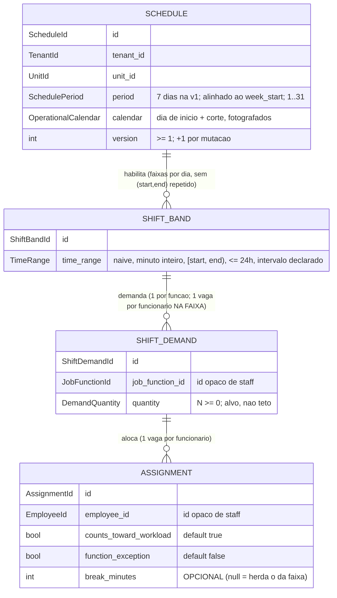

# Concept — Stage 4.1 — Domínio da escala

> **Escopo deste documento:** o que será feito nesta Stage, por quê, e as
> decisões de modelagem relevantes. O plano executável fica no
> [`technical.md`](./technical.md).
>
> **Base teórica obrigatória:** este concept **aplica** a teoria canônica de
> [`docs/domain/scheduling/shift-scheduling.md`](../../domain/scheduling/shift-scheduling.md)
> (`accepted`, gate do Step 4 — issue #52) ao recorte da Stage — não re-deriva
> nem contradiz (hierarquia: Overview > Roadmap > Domain > Concept). As decisões
> do sponsor de 2026-09-13/14/26 chegam aqui pelos **ADRs 4.1.0001–4.1.0006** e
> são consumidas, não reabertas.
>
> **As quatro lacunas que o doc de domínio endereçou a esta Stage** (tabela consolidada,
> `shift-scheduling.md` §6 › "forma interna do TimeRange; faixa que ultrapassa o corte seguinte", "cardinalidade da demanda por (dia, faixa, função)", "Schedule como raiz do agregado — confirmar") são fechadas aqui, cada uma com ADR: forma
> interna do `TimeRange` (4.1.0007); faixa que ultrapassa o corte seguinte
> (4.1.0008); `Schedule` como raiz do agregado, com o lugar das marcas da
> alocação e da contagem de horas (4.1.0009); cardinalidade da demanda
> (4.1.0010). A quinta linha da tabela — incluir `scheduling` em
> `bc-independence` — é do `technical.md`, e já está declarada em §1.
>
> **As três questões de produto que este concept devolveu ao sponsor foram
> respondidas em 2026-09-26** e já vivem no corpo: guardas de remoção que
> **recusam** com alocação pendente (§5.21, §7), reagendamento de faixa que
> **preserva** demandas e alocações no mesmo dia operacional (§5.22, §7), e o
> intervalo de refeição declarável **na faixa e na alocação**, com a divergência
> representada e apontada (§5.6, §5.13, §7, [ADR 4.1.0011](../../adr/4_1_0011-declared-break-on-band-and-allocation.md)).
>
> **As duas questões que o Checkpoint A levantou foram respondidas em
> 2026-09-27** e também vivem no corpo: a mesma pessoa **não** ocupa duas vagas
> da **mesma** faixa — passou a **invariante estrutural** com exceção própria
> (§5.23, §6, §7, [ADR 4.1.0012](../../adr/4_1_0012-one-record-occupies-at-most-one-slot-per-band.md)) —
> e o horário de corte segue **sem teto** no domínio, confirmando o
> ADR 4.1.0002 §2 (§4 `DayCutoff`, §7, CA4). O registro das **cinco** está em
> §13, que não carrega mais questão aberta.
>
> **Status (apenas dois estados).** `draft` desde a criação; `done` após o gate
> humano (Checkpoint A). Regressão `done → draft` é permitida quando a Fase 3B
> revela gap material aqui.

## 1. Escopo

### Dentro do escopo

- **Agregado `Schedule`** — raiz **única** do BC nesta Stage, com as entidades
  internas `ShiftBand` (faixa habilitada do dia), `ShiftDemand` (demanda por
  função) e `Assignment` (alocação), alcançadas **só pela raiz**
  (ADR 4.1.0009).
- **Value-objects:** `TimeRange` (a faixa, com intervalo declarado e a regra
  única de horas), `SchedulePeriod`, `DemandQuantity`, `Weekday`, `DayCutoff` e
  `OperationalCalendar` (as duas configurações por restaurante — dia de início e
  corte — e a derivação do dia operacional), mais os identificadores tipados
  **próprios do BC**.
- **Invariantes estruturais** da teoria (§3.1–§3.5) e as fixadas pelos ADRs desta
  Stage, cobertas por **testes unitários verdes, sem I/O**.
- **As duas marcas da alocação** — "conta para a carga" (default conta) e
  "exceção de função" (default falso) — como atributos de `Assignment`
  (ADR 4.1.0003 (d)/(f), §Implementation notes: *"Both flags … land on
  `Assignment` in 4.1"*).
- **O intervalo declarado nos dois níveis** — na faixa (default 0) e,
  **opcional**, na alocação (ausente = herda o da faixa) —, o **intervalo
  efetivo** da alocação como entrada do sítio único de horas e a **divergência
  de intervalo** como terceira marca da alocação, derivada (decisão do sponsor,
  2026-09-26; ADR 4.1.0011).
- **Contador de versão** na raiz, com a lei "toda mutação incrementa"
  (ADR 4.1.0001 §2; a coluna e a checagem otimista são da 4.4).
- **Hierarquia de exceções do BC** (`SchedulingError(DomainError)` + 20
  subclasses).
- **Enforcement estrutural** (precedente da 2.1/3.1): contrato import-linter de
  pureza de `scheduling.domain` e inclusão de `scheduling` no contrato
  `bc-independence`, mais os pacotes-placeholder
  `features/scheduling/{application,adapters}/` exigidos por
  `scripts/check_layout.py` (`REQUIRED_FEATURE_DIRS`, linha 130).

### Fora do escopo (explicitamente)

- **Políticas de validação, avaliador, `Violation`, modos `block`/`warn` e
  config por tenant** — Stage 4.2. Consequência dura, detalhada em §3 e §5.18:
  **nenhuma das oito situações da lista fechada é recusa estrutural aqui**
  (sobreposição de alocações do mesmo registro **em faixas distintas**,
  indisponibilidade, descanso entre jornadas, tetos, carga, função não detida,
  sobre-cobertura). A exceção é a **mesma** faixa duas vezes, que a decisão do
  sponsor de 2026-09-27 tornou invariante estrutural (§5.23, ADR 4.1.0012) — e que
  **não** tira escopo da política de sobreposição. Idem a **política
  de divergência de intervalo** criada pelo ADR 4.1.0011: a 4.1 **representa** a
  divergência; nomear a política, o modo e a pergunta "qual intervalo manter" é
  da 4.2 (+ borda 4.5).
- **As duas elegibilidades estruturais que dependem de dado de staff** — *"registro
  ativo da unidade da escala"* e *"mesma unidade"* (`shift-scheduling.md` §3.4 › "Registro ativo da unidade da escala", "Mesma unidade" —
  elegibilidades 1 e 2, esta última literalmente *"erro estrutural, não política"*).
  A 4.1 **não tem o dado**: `EmployeeId` é string opaca e o domínio não conhece a
  unidade nem o estado do registro. As duas são impostas na **4.3**, pela lei do
  `StaffReadPort` (o lookup exige a unidade — ADR 3.4.0007 57–64) antes de chamar
  `Schedule.assign`; ver §8. Estrutural, aqui, significa *impossível de
  representar com o que o agregado tem*.
- **A "semana de apuração"** como conceito próprio: na v1 ela **coincide** com o
  `SchedulePeriod` (ADR 4.1.0002 §1: *"the accounting week … is the same 7
  operational days; the two concepts stay distinct in the model"*), e quem soma
  por ela é a **4.2** (teto semanal e carga). A 4.1 entrega o período e
  `worked_minutes_of`; a distinção só ganha tipo próprio quando o período deixar
  de ser semanal — evolução aditiva declarada, não silêncio. Ver §5.2 e §8.
- **Forma do insumo do avaliador** (que projeção a 4.2 recebe, alocações
  vizinhas incluídas — doc §3.6.0) — é da 4.2; a 4.1 expõe o agregado imutável e
  `worked_minutes_of`.
- **Use cases, ports (`StaffReadPort`), DTOs, protocolo do aceite consciente e
  unidade de salvamento** — 4.3. **Persistência, coluna de versão, checagem
  otimista, trilha de auditoria e `Unit.timezone`** — 4.4. **Rotas, permissões e
  status da recusa** — 4.5. **E-mail** — 4.6. **Imagem** — 4.7.
- **Reconciliação na leitura / filtro de registros inativos** (ADR 4.1.0006) — é
  regra de **leitura**; a 4.1 não lê staff e **nada escreve** por causa de
  desligamento. Idem a **guarda de remoção por port de consulta reverso**.
- **Fuso horário:** nenhum objeto desta Stage guarda fuso. Faixas são wall-clock
  ingênuo da unidade; o fuso é `Unit.timezone`, de identity, lido por port
  (ADR 4.1.0005; ADR 3.1.0005 28–31).
- **Rascunho, versão publicada e evento de publicação** — não existem como
  estado (ADR 4.1.0001 §1). Ver §1 Divergências, item 4.
- **Ator, carimbo de tempo e histórico** no domínio — o histórico é a trilha de
  auditoria da 4.4; staff estabeleceu o precedente de domínio sem `Clock`
  (ADR 3.2.0006 155–157).
- **Mapa período nomeado → faixas concretas** (doc §3.2) — sem Stage dona;
  proposta do gate: 5.1, primeiro consumidor.
- **`domain/services/`** — não nasce nesta Stage. `LAYOUT.md` §2 marca o
  diretório como `[planejado]`, e `scripts/check_docs_claims.py` reprova
  **caminho anotado que já existe** (docstring do script, §"`[planejado]` é a
  válvula"): criá-lo aqui exigiria editar o LAYOUT sem consumidor. A contagem de
  horas mora no `TimeRange` (ADR 4.1.0007); a 4.2, que cria
  `domain/services/validation/`, é quem tira a anotação.

### Vínculo com o roadmap

Primeira Stage do **Step 4 — Escala manual publicável** e primeiro código do BC
`scheduling`. Entrega as entidades/VOs que a 4.2 (políticas) avalia, a 4.3 (use
cases) orquestra, a 4.4 persiste com auditoria e versão, a 4.5 expõe, e que o
Step 5 (auto-fill), o Step 7 (previsto × realizado) e o Step 8 (hub) consomem por
DTO. Ver `roadmap.md` §"Stage 4.1 — `4.1-scheduling-domain`", a nota
datada do Step 4 (§Step 4 › nota 2026-09-14) e `overview.md` §3 › "Escala com período configurável (default semanal)", "salvar = publicar"; §9.

### Divergências declaradas em relação ao bloco 4.1 do roadmap

Padrão da 2.5/3.4/3.6: as diferenças em relação ao bloco `#### Stage 4.1` são
declaradas aqui, e a nota datada no `roadmap.md` entra no commit de fechamento.

1. **`arquivos_a_modificar` deixa de ser `[]`.** Entra o `.importlinter`, com
   **dois** movimentos: o contrato novo `scheduling-domain-purity` (espelho de
   `staff-domain-purity`, linhas 197–217) e a inclusão de
   `restaurant_hub.features.scheduling` no contrato `bc-independence` (linhas
   271–277, antes da 4.1 só `identity` e `staff`) — a lacuna que o doc de domínio
   endereça ao `technical.md` da 4.1 (§3.10). Precedente literal: a 3.1 fez o
   mesmo par de movimentos para o BC staff.
2. **`arquivos_a_criar` cresce em quatro frentes.** (a) placeholders
   `features/scheduling/{application,adapters}/__init__.py`
   (`REQUIRED_FEATURE_DIRS` do `check_layout.py`); (b)
   `value_objects/identifiers.py` (identificadores próprios do BC — §7); (c)
   `value_objects/operational_calendar.py` (`Weekday`, `DayCutoff`,
   `OperationalCalendar`: as duas configurações que o ADR 4.1.0002 fixa e a
   derivação do dia operacional, sem as quais `SchedulePeriod` não é
   verificável); (d) `entities/shift_band.py` — a **quarta entidade** (item 3).
3. **Quatro entidades, não três.** O roadmap lista
   `{schedule,shift_demand,assignment}`. A faixa habilitada ganha entidade
   própria (`ShiftBand`) porque o exemplo **ratificado** do overview põe **duas
   funções na mesma faixa** — *"qua = 1 cozinheiro 16h–00h + 1 assistente
   18h–23h + 2 atendentes 16h–00h"* (`overview.md` §3 › "qua = 1 cozinheiro 16h–00h + 1 assistente 18h–23h + 2 atendentes 16h–00h") — e porque a mesma linha
   descreve **dois atos distintos**: *"por dia, habilitam-se faixas de horário
   livres **e** define-se a demanda por função × faixa"*. Com a faixa embutida em
   cada demanda, o `16h–00h` de quarta existiria em duas cópias, cada uma com o
   seu **intervalo declarado** — e o intervalo é da faixa (ADR 4.1.0002 §3), de
   onde sai a contagem de horas de todos os alocados. Ver ADR 4.1.0010.
4. **A "descrição humana" do bloco está superada em um ponto.** `roadmap.md`
   §Stage 4.1 › "Descrição humana" pede *"o evento de publicação (salvar=publicar, com registro de
   quem/quando)"* e o DoD (§Stage 4.1 › `definition_of_done`) fala em *"montagem e publicação"*; o
   **ADR 4.1.0001 §1** (posterior e `accepted`) aboliu rascunho e versão
   publicada — *"There is **no draft on the server** and **no published version
   separate from the schedule being edited**"* (linha 58) — e mandou o histórico
   para a trilha de auditoria da 4.4. Logo **não há entidade, estado nem método
   de publicação** nesta Stage: o que resta de F1/F8 no domínio é o **contador
   de versão**. O DoD lê-se como "montagem da escala com invariantes cobertas por
   testes unitários".
5. **`contratos_introduzidos` cresce:** identificadores próprios (`ScheduleId`,
   `ShiftBandId`, `ShiftDemandId`, `AssignmentId`, `TenantId`, `UnitId`,
   `EmployeeId`, `JobFunctionId`), `Weekday`, `DayCutoff`, `OperationalCalendar`,
   `DemandQuantity` (o roadmap o lista em arquivos, não em contratos),
   `ShiftBand`, as duas marcas de `Assignment`, o contador de versão e a
   hierarquia `SchedulingError`. **Depois das decisões do sponsor de 2026-09-26**
   entram também: `Assignment.break_minutes` (opcional), o **intervalo efetivo**
   e a **divergência de intervalo** como leituras da raiz, e as duas mutações
   novas `redeclare_band_break` e `declare_allocation_break` — 11 mutações, não 9
   (ADR 4.1.0011; ADR 4.1.0009 §Decision 3).
6. **`contratos_consumidos` é mais estreito do que parece.**
   `EmployeeId/JobFunctionId de staff` lê-se como **emitidos** por staff:
   scheduling **tipa os seus**, e importar os de staff é violação medida
   (doc §3.10; ADR 3.4.0001 106–113). Nenhuma linha de `features.staff` é
   importada. O único contrato consumido de fora do BC é `DomainError`
   (`shared/domain`).
7. **`depends_on` é `3.1-staff-domain`**, corrigido de `3.5-employee-login-link`
   pela nota de 2026-09-26 (`roadmap.md` §Stage 4.1 › nota 2026-09-26; §"Tabela de Stages" › `4.1-scheduling-domain` e grafo
   §"Visão geral" › `S31 --> S41`). E é dependência **de ordenação com consumo por
   valor**: nem um import, nem um contrato de código.
8. **Nota de glosa pendente no doc de domínio.** `ShiftBand` é glosa EN nova para
   "faixas de funcionamento" (`shift-scheduling.md` §2 › "Faixas de funcionamento", que não traz glosa própria); o
   doc `accepted` prevê glosa "proposta deste gate (†)" (§2). O **commit de
   fechamento** desta Stage leva a nota datada em `shift-scheduling.md` §2
   registrando o termo — precedente: a reconciliação de `workforce.md` com o gate
   da 3.x. Enquanto a nota não entrar, o doc canônico fica sem o termo central da
   4.1, e este item é o registro dessa pendência.
9. **O file-scope passa por dois testes fora de `features/scheduling/`.**
   `tests/unit/test_status_map.py` e `tests/unit/features/staff/test_bc_independence.py`
   fixam a lista dos dois bounded contexts de hoje e presumem que todo BC tem
   `application/errors.py`. O terceiro BC os reprova no primeiro commit, e por isso
   eles entram na Task 01: a lista explícita ganha `scheduling`, a importação dos
   módulos de erro tolera o sufixo ausente (com asserção de que ao menos um existe,
   para a varredura não virar verdade vácua) e o contrato de independência passa a
   ser cobrado contra a pasta, para o quarto BC não entrar em silêncio. São
   varreduras de **nível de repositório**, não de BC — o plano de execução declara
   o mesmo item no §1 do [`technical.md`](./technical.md).

## 2. Objetivo da Stage

Ao final, o BC `scheduling` tem um núcleo de domínio puro (sem I/O) em que a
escala de uma unidade para um período de dias operacionais é montada — faixas
habilitadas por dia, demanda por função em cada faixa, alocações com as duas
marcas declaradas — com todas as invariantes **estruturais** garantidas por
construção em todos os caminhos (inclusive reidratação) e provadas por testes
unitários, servindo de contrato para as políticas da 4.2 e para as camadas
seguintes do Step 4.

## 3. Contexto e premissas

### Contexto

- **Salvar = publicar** (ADR 4.1.0001): não há rascunho nem versão publicada. O
  agregado tem **um** estado, e a única "versão" é o contador de concorrência.
  Isso apaga do modelo o par saved/published e o método `publish`.
- **`block` recusa a mutação; `warn` é aceito ao salvar** (ADR 4.1.0001 §1).
  Nenhuma das oito políticas é invariante de domínio, por **duas** razões
  distintas — e a distinção importa, porque a primeira não vale para todas:
  - **sete** delas têm **modo configurável por restaurante** (ADR 4.1.0003 (a),
    coluna *Configurable*; (c)): a mesma regra que é `block` num tenant é `warn`
    noutro, e uma invariante estrutural tornaria o `warn` impossível;
  - **alocação × indisponibilidade** é **`block` fixo — *"Configurable:
    nothing"*** (ADR 4.1.0003 (a), linha 74; (c) confirma o bloqueio fixo). A razão
    de ela não ser invariante **aqui** não é o modo: é que **o dado não existe
    neste BC** — indisponibilidade é de staff e chega por `StaffReadPort` na 4.3.
    Quem sustenta a invariante do doc §3.6.6 (*"a escala vigente nunca contém
    alocação sobre indisponibilidade"*, `shift-scheduling.md` §3.6.6 › "a escala vigente nunca contém alocação sobre indisponibilidade") é o avaliador da 4.2 com modo
    fixo mais o use case da 4.3 que lhe entrega o insumo — e o próprio doc
    registra "onde vive (avaliador com modo fixo × use case)" como **lacuna da
    4.2** (§3.6.6).

  O que a 4.1 recusa é só o que é **impossível de representar com o que o
  agregado tem** (§5.18) — e a decisão do sponsor de 2026-09-27 acrescentou uma
  precisão a isso: o **sub-caso degenerado** da sobreposição, a mesma pessoa em
  duas vagas da **mesma** faixa, é impossibilidade física (*"one person in two
  places"*, ADR 4.1.0003 (c) linhas 95–97) e virou **invariante** (§5.23). A
  política de sobreposição **continua não sendo** invariante: o seu escopo são
  faixas **distintas**, inclusive parcialmente sobrepostas.
- **Dia operacional e faixa** (ADR 4.1.0002): o dia é uma janela de 24h a partir
  de um **corte configurável** (default 05:00) e a faixa pertence ao dia em que
  **começa** — "sexta 18h–sábado 02h" é sexta. Cruzar a meia-noite civil não é
  caso especial.
- **Horas** (ADR 4.1.0002 §3): `horas(a) = duração nominal − intervalo
  declarado`, regra **única** para as políticas que somam e para o hub. O
  intervalo que entra na fórmula é o **efetivo da alocação** — o dela, se
  declarado; senão o da faixa (decisão do sponsor, 2026-09-26; ADR 4.1.0011,
  errata no ADR 4.1.0002). O **sítio de cálculo continua um só** — e a fórmula
  única **basta**, porque o estado que a tornava errada (a mesma pessoa duas vezes
  na mesma faixa, 16h para 8h de relógio) deixou de ser representável com a
  invariante 23 (§5.7, §5.23; decisão do sponsor de 2026-09-27).
- **Cada mutação salva é a escala vigente** (ADR 4.1.0001 §1), e isso **precifica
  as guardas de remoção**: com as guardas de §5.21, remover uma faixa de quarta
  com 3 pessoas custa **4 mutações publicadas** (3 `unassign` + 1 `disable_band`),
  cada uma com entrada de auditoria (4.4), incremento de versão e — quando a 4.6
  existir — notificação. É **limite declarado**, não descuido; agrupar o passo a
  passo numa ação é **lacuna de UX da 4.5**, e o domínio não ganha batch por isso
  (§5.21, §10).
- **Tempo em dois regimes** (doc §3.9): faixas em wall-clock **ingênuo** da
  unidade (o mesmo regime da indisponibilidade de staff, para cruzar sem
  conversão — ADR 3.1.0005 41–46); carimbos de auditoria em instante absoluto
  UTC — estes últimos **na 4.4**, não aqui.
- **Fronteira com staff:** scheduling **lê** funcionário e função por id e por
  dados, via `StaffReadPort` da 4.3; o domínio da 4.1 só conhece **strings
  opacas**. Por isso a marca "exceção de função" é **declarada**, nunca
  verificada aqui (§5.14).

### Premissas

- A consistência `unit_id` ↔ `tenant_id` (a unidade pertence ao tenant) é
  garantida na borda (autorização da 4.5 + memberships de identity), como na 3.1;
  o domínio trata ambos como identificadores opacos não-vazios.
- Geração dos valores de id é da application/infra (`IdGenerator`, padrão
  2.1/3.1): toda mutação da raiz **recebe** o id do objeto que cria.
- O calendário operacional (dia de início, corte) é **configuração do tenant**,
  persistida na 4.4 e informada na criação da escala; a 4.1 fixa os **defaults**
  (segunda-feira, 05:00 — ADR 4.1.0002 §1/§2) num único sítio
  (`OperationalCalendar.default()`).
- Tenancy row-level por `tenant_id` (ROADMAP-3) é herdada da fundação — a Stage
  só carrega o campo tipado.
- O volume do piloto (ASSUM-4: **uma unidade** hoje, `overview.md` §3 › "ASSUM-4"; ASSUM-5:
  quadro de **dezenas de funcionários, não centenas**, `overview.md` §3 › "ASSUM-5") e o
  **período de 7 dias** (ADR 4.1.0002 §1 — não é ASSUM-5) tornam aceitável
  carregar o agregado inteiro por mutação; a estratégia de carga é decisão da 4.4.

### Dependências

- `3.1-staff-domain` (`done`, mergeada em `develop`): dependência de
  **ordenação**; o que atravessa são **valores** de
  `EmployeeId`/`JobFunctionId` como strings opacas. Nenhum import (contrato
  `bc-independence`).
- `1.1-bootstrap`/`1.2-ci` (transitivas): reusa `DomainError`
  (`shared/domain/exceptions/base.py`) como raiz da hierarquia de erros, e o gate
  `make check` (import-linter, `check_layout.py`, cobertura ≥ 90%).

## 4. Contratos

### Introduzidos

- **`ScheduleId`, `ShiftBandId`, `ShiftDemandId`, `AssignmentId`, `TenantId`,
  `UnitId`, `EmployeeId`, `JobFunctionId`** (`value-object`) — `NewType` sobre
  `str`, **próprios do BC** (independência entre BCs). Vazio ou só-whitespace →
  `InvalidIdentifierError`, validado nas entidades (padrão 3.1: o módulo de
  identificadores não tem lógica de runtime).

- **`TimeRange`** (`value-object`, frozen) — a faixa/turno: intervalo
  **semi-aberto** `[start, end)` de instantes **ingênuos** de **minuto inteiro**,
  com o intervalo declarado em minutos (ADR 4.1.0007):

  ```python
  @dataclass(frozen=True)
  class TimeRange:
      start: datetime         # naive; segundo/microssegundo zero
      end: datetime           # naive, minuto inteiro; start < end; end - start <= 24h
      break_minutes: int = 0  # 0 <= break_minutes < nominal_minutes

      @property
      def nominal_minutes(self) -> int: ...   # (end - start) em minutos
      def worked_minutes(self, break_minutes: int | None = None) -> int: ...
      # nominal_minutes - (break_minutes se dado, senão self.break_minutes)  [horas(a)]
      # SÍTIO ÚNICO da aritmética de horas (ADR 4.1.0002 §3; ADR 4.1.0011)
      @property
      def hours_key(self) -> tuple[datetime, datetime]: ...   # (start, end)
      # chave de unicidade da faixa — NÃO inclui o intervalo (ADR 4.1.0011)
      def overlaps(self, other: "TimeRange") -> bool: ...
      # start_A < end_B and start_B < end_A — adjacentes NÃO se sobrepõem
      def with_break(self, break_minutes: int) -> "TimeRange": ...
      def with_bounds(self, start: datetime, end: datetime) -> "TimeRange": ...
      # preserva break_minutes — é o que torna "reagendar não muda o intervalo"
      # estrutural, e não uma checagem (ADR 4.1.0011)
  ```

  > **Mudança em relação à versão pré-Checkpoint A:** `worked_minutes` deixa de
  > ser `@property` e passa a aceitar o **intervalo efetivo** da alocação, para
  > que o sítio de cálculo continue **um** depois de o intervalo passar a existir
  > nos dois níveis (decisão do sponsor, 2026-09-26: *"pode ser na alocacao e na
  > faixa, mas precisa apontar conflito, e perguntar qual horario quer manter"*).
  > Sem argumento, devolve as horas da própria faixa.

- **`Weekday`** (`value-object`) — `StrEnum` fechado dos 7 dias
  (`MONDAY`…`SUNDAY`), com `from_date(day: date)` (via `isoweekday()`) e
  `from_string(value: str)` → `InvalidWeekdayError` (espelho de
  `DayPeriod.from_string` de staff —
  `staff/domain/value_objects/shift_preference.py` 33, idem `Role.from_string` de
  identity, ADR 3.4.0003 §3: conversão de texto falha como erro de domínio, não
  como `ValueError` cru do `StrEnum`).

- **`DayCutoff`** (`value-object`, frozen) — o horário de corte e a geometria do
  dia operacional:

  ```python
  @dataclass(frozen=True)
  class DayCutoff:
      at: time  # naive (tzinfo None), minuto inteiro -> InvalidDayCutoffError

      def operational_day_of(self, instant: datetime) -> date: ...
      # instant.time() < at  ->  instant.date() - 1 dia;  senão  instant.date()
  ```

  `at` **não tem teto** na v1, e isto é **decisão do sponsor de 2026-09-27**
  (resposta literal: *"Sem teto (Recomendada)"*), confirmando o ADR 4.1.0002 §2
  (linhas 70–79: o corte é *"configured per restaurant"* e o default 05:00 é
  *"a default only, configurable, with no force of rule"*). Consequência real, e
  **limite/erro de configuração**, não regra do domínio: com `at = 23:00`, o
  jantar de sexta 22:00 tem dia operacional **quinta** — muda o rótulo do dia, a
  semana de apuração e a pertinência ao período de toda a casa, por uma edição de
  configuração. É comportamento **correto pela regra**; CA4 exercita esse corte
  tardio para que a implementação ingênua "sempre o dia civil" não passe. Avisar
  na borda ao configurar corte vespertino é lacuna de UX da 4.5 — não há teto no
  domínio (§7).

- **`OperationalCalendar`** (`value-object`, frozen) — as duas configurações por
  restaurante juntas, e a produção de períodos alinhados:

  ```python
  @dataclass(frozen=True)
  class OperationalCalendar:
      week_start: Weekday
      day_cutoff: DayCutoff

      @classmethod
      def default(cls) -> "OperationalCalendar": ...  # MONDAY + 05:00 (ADR 4.1.0002)
      def operational_day_of(self, instant: datetime) -> date: ...   # delega ao corte
      def period_starting_on(self, first_day: date, days: int = 7) -> SchedulePeriod: ...
      # first_day que não é o week_start -> InvalidSchedulePeriodError(reason="desalinhado")
      def is_aligned(self, period: SchedulePeriod) -> bool: ...
      # Weekday.from_date(period.first_day) == self.week_start — usado também
      # pelo Schedule.__post_init__, para a lei valer na reidratação da 4.4
  ```

- **`SchedulePeriod`** (`value-object`, frozen) — intervalo contíguo de dias
  operacionais (v1: 7, produzidos pelo calendário):

  ```python
  @dataclass(frozen=True)
  class SchedulePeriod:
      first_day: date
      days: int = 7   # 1 <= days <= 31 -> InvalidSchedulePeriodError

      @property
      def last_day(self) -> date: ...            # first_day + (days - 1)
      @property
      def operational_days(self) -> tuple[date, ...]: ...   # os `days` dias, em ordem
      def contains(self, operational_day: date) -> bool: ...
  ```

  O **teto 31** é declarado (não era, e `days = 100_000` passava): é o maior mês
  civil, logo o maior período que a forma "aberta para quinzena/mês"
  (ADR 4.1.0002 §1) precisa admitir como **evolução aditiva**, e limita o
  agregado que a 4.4 carrega inteiro (risco 7 da §10). Reversível: mudar o teto é
  uma checagem e um teste. `operational_days` existe porque a invariante 4 passou
  a ser formulada sobre **conjuntos de dias operacionais** (§5.4).

- **`DemandQuantity`** (`value-object`, frozen) — `value: int` com `>= 0`
  (`InvalidDemandQuantityError`); `0` é estado válido ("faixa habilitada sem
  demanda dessa função") e **N é alvo, não teto** (ADR 4.1.0003 (g)).

- **`Assignment`** (`entity`, interna) — a alocação; alcançada pela raiz:

  ```python
  @dataclass(frozen=True, eq=False)
  class Assignment:
      id: AssignmentId
      employee_id: EmployeeId
      counts_toward_workload: bool = True   # ADR 4.1.0003 (d) — default "conta"
      function_exception: bool = False      # ADR 4.1.0003 (f) — só por declaração explícita
      break_minutes: int | None = None      # ADR 4.1.0011 — None = herda o da faixa
      # __post_init__: ids não-vazios; break_minutes, se dado, >= 0
      # (InvalidAssignmentBreakError). O limite superior é da FAIXA (só ela
      # conhece nominal_minutes) e vive em ShiftBand.__post_init__.

      def declare_workload_counting(self, counts: bool) -> "Assignment": ...
      def declare_break(self, break_minutes: int | None) -> "Assignment": ...
      # None limpa a declaração e volta a herdar (ADR 4.1.0011)
  ```

- **`ShiftDemand`** (`entity`, interna) — a demanda de **uma** função na faixa
  que a contém; agrega as suas alocações:

  ```python
  @dataclass(frozen=True, eq=False)
  class ShiftDemand:
      id: ShiftDemandId
      job_function_id: JobFunctionId
      quantity: DemandQuantity
      assignments: tuple[Assignment, ...] = ()
      # __post_init__: ids não-vazios; employee_id distinto par a par
      # (DuplicateAssignmentError); ids de alocação distintos par a par
      # (DuplicateEntityIdError)

      @property
      def allocated(self) -> int: ...        # len(assignments)
      def with_quantity(self, quantity: DemandQuantity) -> "ShiftDemand": ...
      def with_assignment(self, assignment: Assignment) -> "ShiftDemand": ...
      def without_assignment(self, assignment_id: AssignmentId) -> "ShiftDemand": ...
  ```

- **`ShiftBand`** (`entity`, interna) — a **faixa habilitada** de um dia da
  escala ("faixa de funcionamento", `shift-scheduling.md` §2 › "Faixas de funcionamento"); agrega as demandas:

  ```python
  @dataclass(frozen=True, eq=False)
  class ShiftBand:
      id: ShiftBandId
      time_range: TimeRange
      demands: tuple[ShiftDemand, ...] = ()
      # __post_init__: id não-vazio; job_function_id distinto par a par
      # (DuplicateShiftDemandError); ids de demanda distintos par a par
      # (DuplicateEntityIdError); TODA alocação com break_minutes declarado
      # satisfaz break_minutes < time_range.nominal_minutes
      # (InvalidAssignmentBreakError) — a faixa é o único nível que conhece
      # nominal_minutes e as alocações ao mesmo tempo (ADR 4.1.0011);
      # employee_id distinto par a par entre TODAS as alocações de TODAS as
      # demandas da faixa (DuplicateAssignmentInBandError) — a faixa é o nível
      # que possui as demandas, logo o único que vê o par (ADR 4.1.0012)

      @property
      def assignment_count(self) -> int: ...
      def effective_break_of(self, assignment: Assignment) -> int: ...
      # assignment.break_minutes se declarado, senão time_range.break_minutes
      def has_break_divergence(self, assignment: Assignment) -> bool: ...
      # break_minutes declarado E diferente do da faixa — DERIVADO, não campo
      def rescheduled_to(self, start: datetime, end: datetime) -> "ShiftBand": ...
      # preserva time_range.break_minutes (with_bounds)
      def with_band_break(self, break_minutes: int) -> "ShiftBand": ...
      def with_demand(self, demand: ShiftDemand) -> "ShiftBand": ...
      def with_demands(self, demands: tuple[ShiftDemand, ...]) -> "ShiftBand": ...
      def without_demand(self, demand_id: ShiftDemandId) -> "ShiftBand": ...
  ```

- **`Schedule`** (`entity`, **raiz única do agregado**) — a escala de uma unidade
  para um período; único caminho de escrita (ADR 4.1.0009):

  ```python
  @dataclass(frozen=True, eq=False)
  class Schedule:
      id: ScheduleId
      tenant_id: TenantId
      unit_id: UnitId
      period: SchedulePeriod
      calendar: OperationalCalendar          # fotografado na criação (ADR 4.1.0009)
      bands: tuple[ShiftBand, ...] = ()
      version: int = 1                       # >= 1; +1 por mutação
      # __post_init__: ids; version >= 1;
      #   calendar.is_aligned(period) — o period.first_day cai no week_start
      #     fotografado (InvalidSchedulePeriodError);
      #   (start, end) distinto par a par entre as faixas
      #     (DuplicateShiftBandError) — a chave NÃO inclui o intervalo;
      #   toda faixa começa num dia operacional do período
      #     (TimeRangeOutsidePeriodError);
      #   ids internos únicos no agregado, par a par por tipo
      #     (DuplicateEntityIdError)

      # --- mutações (cada uma devolve nova instância com version + 1) ---
      def enable_band(self, band_id: ShiftBandId, time_range: TimeRange) -> "Schedule": ...
      def reschedule_band(self, band_id: ShiftBandId,
                          start: datetime, end: datetime) -> "Schedule": ...
      # mesmo dia operacional (ShiftBandDayChangeError); dentro do período;
      # preserva demandas, alocações E o intervalo da faixa; idempotente
      def redeclare_band_break(self, band_id: ShiftBandId,
                               break_minutes: int) -> "Schedule": ...
      # verbo próprio: muda as horas de TODOS os alocados sem intervalo próprio
      def disable_band(self, band_id: ShiftBandId) -> "Schedule": ...
      def declare_demand(self, demand_id: ShiftDemandId, band_id: ShiftBandId,
                         job_function_id: JobFunctionId,
                         quantity: DemandQuantity) -> "Schedule": ...
      def change_demand_quantity(self, demand_id: ShiftDemandId,
                                 quantity: DemandQuantity) -> "Schedule": ...
      def withdraw_demand(self, demand_id: ShiftDemandId) -> "Schedule": ...
      def assign(self, assignment_id: AssignmentId, demand_id: ShiftDemandId,
                 employee_id: EmployeeId, *, counts_toward_workload: bool = True,
                 function_exception: bool = False) -> "Schedule": ...
      # DuplicateAssignmentError se o registro já ocupa vaga DESTA demanda;
      # DuplicateAssignmentInBandError se ocupa vaga de OUTRA demanda da MESMA
      # faixa (§5.23, ADR 4.1.0012) — faixas distintas seguem aceitas
      def unassign(self, assignment_id: AssignmentId) -> "Schedule": ...
      def declare_workload_counting(self, assignment_id: AssignmentId,
                                    counts: bool) -> "Schedule": ...
      def declare_allocation_break(self, assignment_id: AssignmentId,
                                   break_minutes: int | None) -> "Schedule": ...
      # None volta a herdar o da faixa (ADR 4.1.0011)

      # --- leituras (sem mutação; só tuplas imutáveis, nunca coleção interna) ---
      def band(self, band_id: ShiftBandId) -> ShiftBand: ...           # ShiftBandNotFoundError
      def locate_demand(self, demand_id: ShiftDemandId) -> tuple[ShiftBand, ShiftDemand]: ...
      def locate_assignment(self, assignment_id: AssignmentId
                            ) -> tuple[ShiftBand, ShiftDemand, Assignment]: ...
      def bands_of(self, operational_day: date) -> tuple[ShiftBand, ...]: ...
      def operational_day_of(self, band: ShiftBand) -> date: ...
      def worked_minutes_of(self, assignment_id: AssignmentId) -> int: ...  # horas(a)
      def effective_break_minutes_of(self, assignment_id: AssignmentId) -> int: ...
      def has_break_divergence(self, assignment_id: AssignmentId) -> bool: ...
      # a TERCEIRA marca da alocação, derivada dos dois intervalos (ADR 4.1.0011)
  ```

  **Superfície pública enumerada** (a §11 deriva critérios dela, em vez de testar
  um representante): **11 mutações** e **8 leituras**. Destas, exatamente **duas**
  devolvem minutos — `worked_minutes_of` e `effective_break_minutes_of` — e só a
  primeira devolve horas trabalhadas; nenhuma outra membro público de `Schedule`,
  `ShiftBand`, `ShiftDemand` ou `Assignment` devolve minutos trabalhados (CA16).

- **Exceções** (`SchedulingError(DomainError)` e **20** subclasses):
  `InvalidIdentifierError`, `InvalidTimeRangeError`, `InvalidWeekdayError`,
  `InvalidDayCutoffError`, `InvalidSchedulePeriodError`,
  `InvalidDemandQuantityError`, `InvalidScheduleVersionError`,
  `InvalidAssignmentBreakError`, `DuplicateEntityIdError`,
  `DuplicateShiftBandError`, `ShiftBandNotFoundError`, `ShiftBandInUseError`,
  `ShiftBandDayChangeError`, `TimeRangeOutsidePeriodError`,
  `DuplicateShiftDemandError`, `ShiftDemandNotFoundError`,
  `ShiftDemandInUseError`, `DuplicateAssignmentError`,
  `DuplicateAssignmentInBandError`, `AssignmentNotFoundError`.

  As **quatro** últimas a entrar são consequência do Checkpoint A e das decisões
  do sponsor: `DuplicateEntityIdError` nomeia a invariante 15, que era declarada sem
  exceção (e portanto sem critério); `ShiftBandDayChangeError` é a recusa do
  reagendamento para **outro dia operacional** (§5.22); `InvalidAssignmentBreakError`
  é o intervalo da alocação fora dos limites (§5.6); e
  `DuplicateAssignmentInBandError` é a invariante 23 — o mesmo registro em duas
  vagas da **mesma** faixa (decisão do sponsor de 2026-09-27, ADR 4.1.0012). Antes
  eram 16, e o mapa de erros de §6 não era totalidade.

### Consumidos

- **`DomainError`** — declarado em `shared/domain/exceptions/base.py`
  (Stage 1.1); raiz da hierarquia de erros de negócio.
- **Valores** de `EmployeeId`/`JobFunctionId` emitidos por `staff` (Stage 3.1) —
  atravessam como **strings opacas**; nenhum import (doc §3.10).

## 5. Invariantes e regras

Numeração com a âncora na teoria (`shift-scheduling.md` §3.x) ou no ADR:

1. **Escala por unidade:** toda `Schedule` pertence a exatamente **uma** unidade
   de exatamente **um** tenant; `tenant_id`/`unit_id` não-vazios (não-vazio = ao
   menos um caractere não-whitespace, predicado `.strip()`, padrão
   identity/staff). Nenhuma operação de domínio atravessa unidades (doc §3.1).
2. **Período não vazio, contíguo e alinhado ao dia de início:** `1 <= days <= 31`
   (`InvalidSchedulePeriodError`) **e**
   `calendar.is_aligned(period)` — `Weekday.from_date(period.first_day)` é o
   `week_start` do calendário fotografado. O alinhamento é imposto **no
   `Schedule.__post_init__`**, não só na fábrica `period_starting_on`: é a única
   forma de a lei ratificada (`shift-scheduling.md` §3.1 › "O período é não vazio, contíguo e alinhado": *"O período é não vazio,
   contíguo e alinhado ao dia de início configurado (7 dias operacionais)"*;
   ADR 4.1.0002 §1: *"the sequence of **7 operational days** starting on the
   **week start day configured per restaurant**"*) valer também na **reidratação**
   do mapper da 4.4, como §2 e §5.17 prometem. É também o que torna
   `calendar.week_start` dado **vivo** dentro do agregado, em vez de campo que
   ninguém lê.
   **O que NÃO é imposto, e por quê:** `days == 7` não é invariante do agregado. O
   ADR 4.1.0002 §1 mantém quinzena/mês como **evolução aditiva**, e fixar 7 no
   `__post_init__` seria decidi-la agora pela negativa; o 7 é o **default da
   fábrica** (`period_starting_on(first_day, days=7)`), e o teto 31 é o limite
   estrutural. Consequência declarada: a 4.4 pode reidratar um período de 3 dias
   **alinhado** sem invariante disparar — estado que nenhuma escrita da v1 produz,
   porque só a fábrica cria períodos.
   A **semana de apuração** (`shift-scheduling.md` §2 › "Semana de apuração") não ganha tipo aqui: na v1 ela
   **é** este período (ADR 4.1.0002 §1), e quem soma por ela é a 4.2 (§1 Fora do
   escopo, §8).
3. **Identidade natural `(tenant, unidade, período)`** (doc §3.1) — declarada
   aqui, **imposta na 4.4** (índice único), como a 3.1 fez com a unicidade de
   nome de função. O `ScheduleId` é surrogate e endereçável.
4. **Os conjuntos de dias operacionais de duas escalas da mesma unidade são
   disjuntos** — invariante **cross-agregado**: declarada aqui, imposta na
   4.3/4.4 (índice/checagem sobre `period`, não sobre instantes).
   **Reformulação deliberada.** O doc (`shift-scheduling.md` §3.1 › "As escalas de uma mesma unidade não se sobrepõem no tempo") enuncia *"as escalas de
   uma mesma unidade **não se sobrepõem no tempo**"* e a deriva de "com períodos
   alinhados ao dia de início, decorre da forma". Essa derivação **deixou de valer**
   com o ADR 4.1.0008 §3: uma faixa que começa no **último** dia operacional do
   período pode terminar depois dele (até 24h adentro do período seguinte), logo
   duas escalas consecutivas da mesma unidade **se sobrepõem no relógio** por
   desenho — domingo 22:00–segunda 06:00 na escala A e segunda 05:00–09:00 na
   escala B coexistem legitimamente. Mandar a 4.3/4.4 impor não-sobreposição *no
   tempo* seria mandar impor o impossível, e um índice único sobre instantes não
   cobriria o caso. O que se impõe é a **partição dos dias operacionais**: nenhum
   dia operacional pertence a duas escalas da mesma unidade — que é o que a
   derivação do doc de fato garante ("dois quadros para o mesmo dia tornariam a
   alocação ambígua") e o que a ambiguidade temida exige. A sobreposição de
   **relógio** entre escalas vizinhas é limite declarado: quem a avalia é a
   política de sobreposição/descanso, que compara **instantes** e não precisa de
   rótulo de dia (ADR 4.1.0008 §4) — e **se o avaliador da 4.2 recebe as
   alocações da escala vizinha** é exatamente a lacuna "forma do insumo do
   avaliador" que o doc §3.6.0 endereça à 4.2. A 4.1 registra a necessidade; não a
   resolve.
5. **Faixa:** `start < end`; instantes **ingênuos** (tz-aware é recusado) e de
   **minuto inteiro**; duração nominal **≤ 24h**; semântica **semi-aberta**
   `[start, end)` — adjacentes não se sobrepõem, o instante `end` não é
   trabalhado (doc §3.2; ADR 3.1.0001 47–51, decisão (i), com o literal
   *"adjacent intervals do not conflict"* na linha 50; ADR 4.1.0007/4.1.0008).
6. **Intervalo declarado nos dois níveis** (decisão do sponsor, 2026-09-26:
   *"pode ser na alocacao e na faixa, mas precisa apontar conflito, e perguntar
   qual horario quer manter"* — ADR 4.1.0011; errata no ADR 4.1.0002):
   - **faixa:** `0 <= break_minutes < nominal_minutes`, default `0`
     (`InvalidTimeRangeError`) — alocação de zero horas não é trabalho (doc §3.2);
   - **alocação:** `break_minutes` é **opcional**; ausente (`None`) = **herda** o
     da faixa. Quando declarado, `0 <= break_minutes < nominal_minutes da faixa
     que a contém` (`InvalidAssignmentBreakError`), validado em
     `ShiftBand.__post_init__` — o único nível que vê os dois dados;
   - **intervalo efetivo da alocação** = o dela, se declarado; senão o da faixa.
     É **este** que entra na contagem de horas.
   Consequência que a regra existe para permitir: cozinheiro 16h–00h com 1h de
   pausa conta **7h** e atendente na **mesma faixa** sem pausa conta **8h**, sem
   duas faixas gêmeas — a patologia que o ADR 4.1.0010 rejeitou na Alternativa A.
   Encurtar a faixa abaixo de um intervalo já declarado (por `reschedule_band`) é
   recusado pela mesma invariante, não silenciado.
7. **Contagem de horas — sítio único:** `worked_minutes(intervalo efetivo) =
   nominal_minutes − intervalo efetivo`, em **minutos inteiros**
   (ADR 4.1.0002 §3; ADR 4.1.0007; ADR 4.1.0011). Uma única expressão aritmética,
   em `TimeRange.worked_minutes`, para as políticas que somam (4.2) e para o hub
   (Step 8); `Schedule.worked_minutes_of` é o único caminho por alocação.
   **A contagem é por alocação e as alocações somam** — e a fórmula única
   **basta**, sem segunda definição, porque o estado que a quebrava deixou de ser
   representável: a mesma pessoa em duas vagas da **mesma** faixa é agora
   invariante estrutural (§5.23, `DuplicateAssignmentInBandError`, decisão do
   sponsor de 2026-09-27 — ADR 4.1.0012). Era nesse estado — e **só** nele — que
   `Σ horas(alocações do dia)` devolvia **16h para 8h de relógio** sobre o
   **mesmo** intervalo, o número dobrado que ia para o teto diário, o teto semanal,
   a carga e as "horas escaladas" do hub. A 4.1 continua **não** deduplicando
   geometricamente: a dedução exigiria união de intervalos, isto é, uma segunda
   definição de horas ao lado da ratificada (doc §3.6.3 soma **por alocação**:
   *"toda alocação `a` … cuja faixa pertence ao dia operacional `d`"*).
   **Resíduo declarado, que a invariante não cobre:** faixas **distintas** que se
   sobrepõem parcialmente (`16h–00h` e `18h–23h` da mesma quarta) continuam
   podendo levar duas alocações do mesmo registro, e aí a soma por alocação conta
   a interseção duas vezes. Isso **não** é estado degenerado do agregado: são dois
   turnos distintos, e quem o governa é a **política de sobreposição** (default
   `block`, reservado à impossibilidade física; em `warn`, o tenant o aceita
   ciente — ADR 4.1.0003 (a) linha 73 e (c) linhas 95–97).
   **Lacuna endereçada à 4.2:** como o teto diário/semanal, a carga e as "horas
   escaladas" do hub tratam a interseção de **faixas distintas** sobrepostas
   aceitas em `warn`. Ver §10.
8. **Dia operacional:** o dia de uma faixa é o dia do corte que contém o seu
   `start`; cruzar a meia-noite civil **não é caso especial**; a faixa que
   ultrapassa o **corte seguinte** é permitida e continua pertencendo ao dia do
   `start` (ADR 4.1.0002 §2; ADR 4.1.0008).
9. **Faixa dentro do período:**
   `period.contains(calendar.operational_day_of(band.time_range.start))` — a
   contenção é medida no **início** (ADR 4.1.0008). É a leitura estrutural de
   "toda alocação está **dentro do período** da escala" (`roadmap.md` §Stage 4.1 › "Descrição humana", a
   mesma linha que o doc de domínio cita — `shift-scheduling.md` §3.1 › "Toda alocação está dentro do período"), já que a
   alocação herda a faixa por contenção. Corolário **aceito**, não tolerado: a
   faixa que começa no último dia operacional e **termina depois** dele é válida
   (ADR 4.1.0008 §3), e é o único corte que não trunca o turno de domingo à noite
   fora da semana a que pertence.
10. **Sem faixa duplicada; faixas sobrepostas são legítimas:** duas faixas do
    agregado não têm o mesmo par **`(start, end)`** — a chave de unicidade
    **exclui** o `break_minutes` (decisão do sponsor, 2026-09-26; ADR 4.1.0011).
    Era o valor inteiro do `TimeRange`, e com o intervalo dentro da chave duas
    faixas `16h–00h` com intervalos 0 e 60 eram legítimas: exatamente a patologia
    ("*the same visual band can count 8h for the cozinheiro and 7h for the
    atendentes*") pela qual o ADR 4.1.0010 rejeitou a Alternativa A. Com o
    intervalo por alocação (§5.6), o caso real que a chave larga servia deixou de
    precisar dela. Faixas **distintas** continuam podendo se sobrepor — o exemplo
    ratificado tem `16h–00h` e `18h–23h` na mesma quarta (`overview.md` §3 › "qua = 1 cozinheiro 16h–00h + 1 assistente 18h–23h + 2 atendentes 16h–00h").
11. **Demanda:** no máximo **uma por (faixa, função)** — garantido por
    construção, porque as demandas vivem **dentro** da faixa e o
    `job_function_id` é distinto par a par; `N >= 0`; `N` é **alvo, não teto**
    (ADR 4.1.0003 (g)), logo reduzir `N` abaixo do número de alocados **não é
    recusado aqui** (a consequência é a política de sobre-cobertura, 4.2).
12. **Alocação:** pertence a exatamente **uma** demanda **da mesma escala** —
    garantido por **contenção**, não por validação; referencia **um**
    `EmployeeId`; o **mesmo funcionário não ocupa duas vagas da mesma demanda**
    (`DuplicateAssignmentError` — doc §3.4). A extensão dessa regra para **duas
    demandas da mesma faixa** é a invariante 23.
13. **Três marcas da alocação, duas armazenadas e uma derivada:**
    - `counts_toward_workload` existe em toda alocação, default **verdadeiro**, e
      é **re-declarável** (`declare_workload_counting` — ADR 4.1.0003 (d));
    - `function_exception` default **falso**, verdadeiro **só** por declaração
      explícita no ato de alocar (é o resíduo do aceite consciente —
      ADR 4.1.0003 (f));
    - **divergência de intervalo** — irmã das duas, e **derivada**, não campo:
      verdadeira quando a alocação declara `break_minutes` **diferente** do da
      faixa (`has_break_divergence`). O domínio **representa** o conflito e não
      escolhe sozinho; apontar e perguntar "qual manter" é política (4.2, `warn`
      proposto) mais borda (4.5) — decisão do sponsor, 2026-09-26; ADR 4.1.0011.
      É derivada porque os dois intervalos já são a verdade: um `bool` armazenado
      poderia contradizê-los (ver a alternativa rejeitada no ADR 4.1.0011).

    **A v1 não expõe mutação para `function_exception`** — e a razão é atribuição,
    não regra: o ADR 4.1.0003 (f) manda para a **4.2** a pergunta "a exceção é
    reavaliada quando o registro ganha ou perde a função" (*"is a Stage 4.2
    concept gap"*, linhas 125–126), e inventar aqui uma mutação (ou declarar a
    marca **irrevogável**, como este concept fazia) seria decidir a lacuna alheia.
    Consequência declarada enquanto a 4.2 não decidir: corrigir uma marca errada é
    desalocar e alocar de novo — sob salvar = publicar, isso publica a remoção do
    turno da pessoa e a recriação, com auditoria e (4.6) e-mail. Limite conhecido,
    **lacuna de UX da 4.5**, e a mutação nasce aditivamente quando a 4.2 decidir.
14. **O domínio não valida as marcas contra staff:** as funções do registro vivem
    em staff e chegam por port na 4.3; a "exceção de função" é **declarada**,
    nunca verificada aqui. Idem "conta para a carga" (só a política de carga a
    lê — doc §3.4).
15. **Identificadores internos únicos no agregado:** `ShiftBandId`,
    `ShiftDemandId` e `AssignmentId` não se repetem dentro de uma `Schedule`
    (pré-requisito de `locate_*` ser função). Violação →
    **`DuplicateEntityIdError`** (`reason` nomeia o tipo de id), verificada par a
    par sobre a coleção inteira, **em cada nível** que possui coleção: ids de
    alocação em `ShiftDemand`, ids de demanda em `ShiftBand`, e a varredura do
    agregado inteiro em `Schedule` (ids de faixa, e os ids de demanda/alocação
    **entre** faixas e demandas distintas, que nenhum nível inferior vê).
16. **Versão:** `version >= 1` (`InvalidScheduleVersionError`) e **toda** mutação
    que muda estado devolve nova instância com `version + 1` (ADR 4.1.0001 §2); a
    comparação otimista e a coluna são da 4.4.
    **Cláusula de no-op (idempotência de valor).** Mutação cujo argumento é o valor
    corrente devolve **`self`** — não incrementa a versão e não levanta erro de
    duplicidade: `reschedule_band` para o próprio `(start, end)`,
    `redeclare_band_break` para o próprio intervalo, `declare_workload_counting` e
    `declare_allocation_break` para o valor corrente. Sem isso, sob controle
    otimista (4.4), uma mutação que não mudou nada faria o outro editor perder o
    trabalho. Precedente: `workforce.md` §3.1 (*"Ambas são **idempotentes no
    valor**"*) e a idempotência de transição fixada na 3.1
    (`3.1-staff-domain/technical.md` §7). A checagem de duplicidade de faixa
    **exclui a própria faixa** da comparação, para que o no-op não vire
    `DuplicateShiftBandError` espúrio.
17. **Igualdade e proteção de estado:** as quatro entidades são **frozen** e
    comparam por **identidade** (`eq=False` + `__eq__`/`__hash__` por id); toda
    transição devolve nova instância revalidada pelo `__post_init__` — as
    invariantes valem em **todos** os caminhos, inclusive a **reidratação** do
    mapper da 4.4 (precedente 2.1/3.1 e a lição do Checkpoint C da 3.1 sobre
    validar a coleção inicial **par a par**, registrada como `[decision]` em
    `3.1-staff-domain/technical.md` §7, 2026-07-29). VOs comparam por valor.
18. **Nenhuma das oito situações da lista fechada é recusa estrutural.** A lista é
    a do ADR 4.1.0003 (a): sobreposição de alocações do mesmo registro (em faixas
    **distintas**, inclusive parcialmente sobrepostas e de funções diferentes — a
    **mesma** faixa duas vezes é a invariante 23, e a política de sobreposição
    **não** perde escopo com isso), alocação × indisponibilidade, descanso entre
    jornadas, teto diário, teto semanal, carga contratada, função não detida e
    sobre-cobertura. **As razões são duas** (§3 Contexto): sete têm **modo
    configurável**, e a de indisponibilidade — `block` **fixo** — fica fora porque
    **o dado não existe neste BC**. A nona situação, a **divergência de intervalo**
    do ADR 4.1.0011, entra na mesma família: a 4.1 a representa, a 4.2 a nomeia e
    lhe dá modo. A 4.1 recusa **só** o que é impossível de representar com o que o
    agregado tem (invariantes 1–17 e 21–23) — e "estrutural" **não** é sinônimo de
    "ratificado como erro": *"alocar registro de outra unidade é erro estrutural,
    não política"* (doc §3.4) é lei imposta na **4.3**, porque a unidade do
    registro não está aqui (§1 Fora do escopo, §8).
19. **Sem fuso, sem ator, sem carimbo, sem estado de publicação** no domínio
    (ADR 4.1.0005; ADR 4.1.0001 §1; precedente ADR 3.2.0006 155–157).
20. **Sem texto livre:** nenhum contrato desta Stage carrega nome ou rótulo — não
    há `InvalidNameError` nem a regra do byte NUL (ADR 3.4.0003), cuja hipótese é
    um nome persistido, sujeito que aqui não existe.
21. **Remoção guardada (decisão do sponsor, 2026-09-26 — resposta literal:**
    *"Recusa, desaloque primeiro (Recomendada)"***).** `disable_band` recusa com
    `ShiftBandInUseError` e `withdraw_demand` recusa com `ShiftDemandInUseError`
    **enquanto houver alocação** dependente. O domínio **não cascateia**: o caminho
    de dois passos (desalocar → remover) é orquestração da 4.3, e agrupá-lo num
    botão é da 4.5. Mesmo padrão da remoção guardada de staff (ADR 3.1.0003; guarda
    L-E5 de `EmployeeInUseError`, ADR 3.2.0006 177–178).
    **Sem alocação, remove sem cerimônia** — e isto é declaração, não omissão:
    `disable_band` numa faixa com **demandas** mas **sem alocação** passa e descarta
    as demandas junto (são contidas na faixa, não têm vida própria); idem
    `withdraw_demand` numa demanda de `N > 0` sem alocados. Não há nada a recusar:
    a guarda protege **pessoas escaladas**, não vagas vazias. CA20 fixa os dois
    lados.
22. **Reagendamento preservador (decisão do sponsor, 2026-09-26 — resposta
    literal:** *"Permite mover (Recomendada)"***).** `reschedule_band` muda os
    limites da faixa **preservando** demandas, alocações e o intervalo declarado, com
    cinco restrições, cada uma com a sua âncora em §7: mesmo **dia
    operacional** (`ShiftBandDayChangeError`); dentro do **período**
    (`TimeRangeOutsidePeriodError`); **não** altera o intervalo declarado (por
    assinatura — recebe `start`/`end`, não um `TimeRange`); **idempotente** no
    próprio par `(start, end)` (invariante 16); colisão com outra faixa do agregado
    = `DuplicateShiftBandError`.
23. **Uma vaga por registro em cada faixa (decisão do sponsor, 2026-09-27 —
    resposta literal:** *"como ela é alocada 2 vezes? nao faz sentido"***).** O
    mesmo `EmployeeId` não aparece em **duas** alocações da **mesma** faixa, ainda
    que em demandas de funções diferentes: `DuplicateAssignmentInBandError`, na
    construção de `ShiftBand` (logo também na reidratação da 4.4) e em
    `Schedule.assign`. É invariante **estrutural**, não política — a pessoa
    ocupando duas vagas do mesmo turno é **impossibilidade física**, e `block` é
    exatamente o que o ADR 4.1.0003 (c) (linhas 95–97: *"`block` for overlap (one
    person in two places)"*) reserva para ela; tratá-la como aviso configurável
    seria deixar o tenant ligar o impossível. É também o que devolve a
    **correção** à fórmula única de horas (§5.7), sem segunda definição.
    **A política de sobreposição mantém o seu escopo:** faixas **distintas**,
    inclusive parcialmente sobrepostas e de funções diferentes, continuam aceitas
    pelo domínio e governadas por ela (invariante 18, CA13 itens 1 e 2).
    **Estreitamento declarado em relação ao doc de domínio.** O doc §3.6.1 define a
    sobreposição como *"o mesmo registro com duas alocações cujas faixas se
    sobrepõem"* (`shift-scheduling.md` §3.6.1 › "o mesmo registro com duas alocações cujas faixas se sobrepõem") com modo **configurável** (*"tolerar sobreposição
    deliberada de troca 'na porta'"*, `shift-scheduling.md` §3.6.1 › "Configurável: só o modo"). Lido ao pé da letra, o predicado é
    trivialmente verdadeiro quando as **duas** alocações estão na **mesma** faixa,
    logo esse sub-caso caía na política e um tenant em `warn` poderia ligá-lo. A
    decisão do sponsor de 2026-09-27 o **retira** da superfície configurável: a troca
    "na porta" que o modo existe para permitir acontece entre **faixas distintas**
    (uma sai 16h–00h, outra entra 22h–02h), não entre duas vagas do **mesmo**
    intervalo, onde não há segunda pessoa. O estreitamento é **declarado**, não
    silencioso, e a fonte é o próprio sponsor — a mesma fonte de que o doc é
    registro. Junto com a invariante 4, é o **segundo** ponto em que este concept se
    afasta da letra do doc (§12).
    **Consequência de produto, declarada:** quem cobre **duas funções no mesmo
    turno** preenche **uma** vaga, e a outra fica **descoberta**. Ana, sexta
    16h–00h, com uma vaga de cozinheiro e uma de atendente na mesma faixa: ela
    ocupa uma das duas, a outra permanece vazia, e a cobertura do dia fica **abaixo
    de 100%** — estado **legítimo** e visível (`shift-scheduling.md` §3.3 › "Cobertura < 100% é estado legítimo":
    *"Cobertura **< 100% é estado legítimo**"*; `N` é alvo, não teto —
    ADR 4.1.0003 (g)). É mais honesto do que declarar as duas vagas preenchidas por
    uma pessoa e mandar 16h para o hub. Se o negócio quiser representar "uma pessoa,
    duas funções, um turno" como cobertura cheia, isso é **demanda de produto para a
    4.2/4.5** (vaga multifunção ou cobertura por pessoa), não um estado que a 4.1
    aceita em silêncio.

## 6. Casos de erro e exceções

| Cenário | Exceção |
|---|---|
| Identificador vazio **ou só whitespace** (qualquer um dos 8 tipos, em qualquer entidade) | `InvalidIdentifierError` |
| `TimeRange` com `start`/`end` tz-aware, com segundo/microssegundo não zero, com `start >= end` ou com duração nominal > 24h | `InvalidTimeRangeError` |
| `TimeRange` com `break_minutes < 0` ou `break_minutes >= nominal_minutes` | `InvalidTimeRangeError` |
| Texto fora do conjunto fechado de `Weekday` | `InvalidWeekdayError` |
| `DayCutoff` com `time` tz-aware ou com segundo/microssegundo não zero | `InvalidDayCutoffError` |
| `SchedulePeriod` com `days < 1` ou `days > 31`; `period_starting_on` com dia inicial que não é o dia de início configurado; **`Schedule` cujo `period.first_day` não cai no `week_start` do calendário fotografado** (construção direta e reidratação) | `InvalidSchedulePeriodError` |
| `DemandQuantity` com valor negativo | `InvalidDemandQuantityError` |
| `Schedule` com `version < 1` | `InvalidScheduleVersionError` |
| `Assignment.break_minutes` negativo, ou `>= nominal_minutes` da faixa que a contém (construção direta/reidratação, `declare_allocation_break` — a **única** mutação que declara o intervalo da alocação —, ou `reschedule_band` que encurta a faixa abaixo de um intervalo já declarado) | `InvalidAssignmentBreakError` |
| Dois `ShiftBandId`, dois `ShiftDemandId` ou dois `AssignmentId` iguais dentro de uma `Schedule` (construção direta e reidratação; par a par, em qualquer nível), inclusive por `enable_band`/`declare_demand`/`assign` com id já usado no agregado | `DuplicateEntityIdError` |
| `enable_band` com faixa cujo par `(start, end)` já existe na escala; `reschedule_band` cujo destino colide com o par de **outra** faixa | `DuplicateShiftBandError` |
| `enable_band`/`reschedule_band` com faixa que começa fora dos dias operacionais do período | `TimeRangeOutsidePeriodError` |
| `band`/`reschedule_band`/`redeclare_band_break`/`disable_band`/`declare_demand` com `ShiftBandId` inexistente | `ShiftBandNotFoundError` |
| `disable_band` de faixa que ainda tem alocação (§5.21) | `ShiftBandInUseError` |
| `reschedule_band` cujo destino cai em **outro dia operacional** (§5.22) | `ShiftBandDayChangeError` |
| `declare_demand` de segunda demanda da **mesma função** na mesma faixa | `DuplicateShiftDemandError` |
| `change_demand_quantity`/`withdraw_demand`/`assign`/`locate_demand` com `ShiftDemandId` inexistente | `ShiftDemandNotFoundError` |
| `withdraw_demand` de demanda que ainda tem alocação (§5.21) | `ShiftDemandInUseError` |
| Alocar funcionário que já ocupa uma vaga da **mesma** demanda (construção ou `assign`) | `DuplicateAssignmentError` |
| Alocar funcionário que já ocupa uma vaga de **outra** demanda da **mesma faixa** (construção de `ShiftBand`, reidratação, ou `assign` — §5.23) | `DuplicateAssignmentInBandError` |
| `unassign`/`declare_workload_counting`/`declare_allocation_break`/`locate_assignment`/`worked_minutes_of`/`effective_break_minutes_of`/`has_break_divergence` com `AssignmentId` inexistente | `AssignmentNotFoundError` |
| `redeclare_band_break` com valor fora de `0 <= break < nominal_minutes`; `reschedule_band` cujo destino não é par válido (`start >= end`, duração > 24h) ou encurta a faixa abaixo do próprio intervalo | `InvalidTimeRangeError` |

Todas subclasses de `SchedulingError` → `DomainError`. O mapeamento para status
HTTP é da 4.5 (precedente ADR 3.4.0002 e 3.6.x); aqui só se garante a hierarquia.

**Esta tabela é totalidade, e CA12 deriva dela.** Cada célula da esquerda que
nomeia métodos é uma **matriz (método × exceção)** que o teste parametrizado
percorre inteira — não um representante. Era a lacuna que o Checkpoint A mediu: a
tabela listava 4 métodos para `ShiftBandNotFoundError` e 3 para cada um dos outros
dois `…NotFoundError`, e CA12 exercitava **um** de cada. Agora nenhuma regra
declarada em §4/§5 fica sem linha, e nenhuma das 20 exceções de §4 fica sem
cenário: **21 linhas para 20 exceções**, porque `InvalidTimeRangeError` aparece em
**três** (defeitos do par de instantes, intervalo da faixa na construção, e
intervalo da faixa por `redeclare_band_break`). As duas linhas de duplicidade de
alocação são **disjuntas por nível**: a mesma demanda é `DuplicateAssignmentError`
(nível que possui as alocações), outra demanda da mesma faixa é
`DuplicateAssignmentInBandError` (nível que possui as demandas) — §5.23.

## 7. Decisões técnicas relevantes

### `TimeRange` como par de instantes ingênuos de minuto inteiro, com o intervalo declarado e o sítio único de horas (lacuna doc §3.2 (a))
- **O quê:** a faixa é `(start, end)` de `datetime` **sem tzinfo** e de minuto
  inteiro, mais `break_minutes`; `worked_minutes(intervalo efetivo)` é o único
  sítio de `horas(a)`; o **dia operacional é derivado** pelo corte, nunca
  armazenado na faixa. A unicidade da faixa é chaveada em `(start, end)`, não no
  valor inteiro (ADR 4.1.0011).
- **Por quê:** a forma alternativa `(dia, hora_início, hora_fim)` exigiria
  reintroduzir o caso especial "fim < início ⇒ dia seguinte" que o ADR 4.1.0002
  aboliu, e uma conversão a cada comparação com a indisponibilidade de staff —
  que é exatamente um par de `datetime` ingênuos
  (`staff/domain/value_objects/unavailability_period.py` 31–32). Minuto inteiro
  mantém **exata** toda soma de horas (1/3 de hora não é exato em `Decimal`) e o
  intervalo já é declarado em minutos.
- **Fonte:** doc §3.2 (lacuna (a)), §3.9, §3.6.10; ADR 3.1.0001 47–51 (decisão
  (i); o literal *"adjacent intervals do not conflict"* na linha 50);
  ADR 3.1.0005 41–46; `unavailability_period.py` 23–49.
- **ADR:** [`../../adr/4_1_0007-time-range-as-naive-minute-instants.md`](../../adr/4_1_0007-time-range-as-naive-minute-instants.md)

### Faixa que ultrapassa o corte seguinte: permitida, do dia em que começa (lacuna doc §3.2 (b))
- **O quê:** `22h–06h` com corte `05:00` é **aceita** e pertence ao dia do
  `start`; a duração nominal é limitada a **24h**; a contenção no período é
  medida no `start`.
- **Por quê:** proibir rejeitaria uma jornada noturna legítima de 8h, abaixo do
  teto diário default; dividir é a alternativa E que o ADR 4.1.0002 **rejeitou**
  (uma faixa viraria dois pedaços em UI, demanda e hub) e contraria o sponsor
  ("conta como um dia só"). A regra geral do ADR 4.1.0002 §2 não tem exceção — e
  a sobreposição com faixas do dia seguinte continua **geométrica**, caindo na
  política de sobreposição (4.2).
- **Fonte:** ADR 4.1.0002 §2, §4 (onde a lacuna é enunciada) e Alternativas E/F;
  doc §3.2, §3.6.1.
- **ADR:** [`../../adr/4_1_0008-band-crossing-the-next-cutoff.md`](../../adr/4_1_0008-band-crossing-the-next-cutoff.md)

### `Schedule` é a raiz única; internas por contenção; versão e calendário na raiz (lacuna doc §3.1 e "onde vivem as marcas")
- **O quê:** confirma-se `Schedule` como raiz do agregado; `ShiftBand`,
  `ShiftDemand` e `Assignment` são **entidades internas** contidas em árvore
  (sem referência por id entre elas) e só alcançadas pela raiz; a raiz carrega o
  **contador de versão** e uma **fotografia** do `OperationalCalendar`; as duas
  marcas vivem em `Assignment`.
- **Por quê:** as invariantes 10–12 e 15 são todas **entre** elementos de uma
  mesma escala — a fronteira de consistência transacional é a escala (1 transação
  = 1 agregado). A contenção torna "a alocação é de uma demanda desta escala"
  verdade **por construção**, não por validação. A fotografia do calendário
  impede que mudar o corte no tenant **re-fatie** uma escala já publicada, sem
  decidir a migração (que continua lacuna da 4.3).
- **Fonte:** doc §3.1 (proposta do gate a confirmar), §3.4, §3.5;
  ADR 4.1.0001 §2; ADR 4.1.0003 §Implementation notes; skill
  `ddd-tactical-patterns` (§Aggregate); precedente `Employee` + coleção agregada
  (concept 3.1 §7).
- **ADR:** [`../../adr/4_1_0009-schedule-is-the-single-aggregate-root.md`](../../adr/4_1_0009-schedule-is-the-single-aggregate-root.md)

### A faixa habilitada é elemento do dia; demanda única por (faixa, função) (lacuna doc §3.3)
- **O quê:** `ShiftBand` é entidade do agregado; a demanda é **única por (faixa,
  função)**; faixas **distintas**, inclusive da mesma função, podem se sobrepor.
- **Por quê:** o overview descreve **dois atos** ("habilitam-se faixas … e
  define-se a demanda") e o seu exemplo põe duas funções na **mesma** faixa — com
  a faixa dentro da demanda, o mesmo `16h–00h` existiria em cópias com intervalos
  declarados possivelmente divergentes, e a contagem de horas do cozinheiro e do
  atendente na mesma faixa poderia diferir. Duas demandas da **mesma** função na
  mesma faixa seriam só `N₁+N₂` e tornariam `alocados(demanda) > N` ambíguo;
  proibir faixas sobrepostas, no outro extremo, impediria o reforço de pico que o
  exemplo ratificado já insinua.
- **Fonte:** `overview.md` §3 › "qua = 1 cozinheiro 16h–00h + 1 assistente 18h–23h + 2 atendentes 16h–00h", "horas contratadas × escaladas × cumpridas"; `shift-scheduling.md` §2 › "Intervalo declarado", §3.3 (lacuna), §3.6.8
  (que **antecipa** a 4.1 admitir faixas sobrepostas da mesma função).
- **ADR:** [`../../adr/4_1_0010-enabled-band-is-an-element-of-the-day.md`](../../adr/4_1_0010-enabled-band-is-an-element-of-the-day.md)

### O alinhamento do período é invariante da raiz, não só da fábrica
- **O quê:** `Schedule.__post_init__` exige `calendar.is_aligned(period)`. O
  `days == 7` **não** é imposto (é default da fábrica); o teto 31 é o limite.
- **Por quê:** a lei ratificada é *"o período é … alinhado ao dia de início
  configurado"* (`shift-scheduling.md` §3.1 › "O período é não vazio, contíguo e alinhado"; ADR 4.1.0002 §1), e §2/§5.17 prometem
  invariantes válidas em **todos** os caminhos, inclusive a reidratação. Com a
  checagem só em `period_starting_on`, o mapper da 4.4 podia montar uma escala
  desalinhada sem invariante disparar, e `calendar.week_start` era **dado morto**
  dentro do agregado — nenhum método o lia. Impor `days == 7` seria decidir pela
  negativa a evolução quinzena/mês que o mesmo ADR mantém aberta.
- **Alternativa descartada:** declarar o alinhamento como "regra de fábrica" e
  aceitar que a reidratação o viole. Descartada porque o repo já tratou o mesmo
  caso em staff — a validação par a par da coleção inicial foi endurecida no
  `__post_init__` justamente por uma mutação sobrevivente (`employee.py` 113–116;
  `3.1/technical.md` §7, 2026-07-29).
- **Fonte:** `shift-scheduling.md` §3.1 › "O período é não vazio, contíguo e alinhado"; ADR 4.1.0002 §1; ADR 4.1.0009 §Decision 6;
  §5.2; CA8 e CA10.

### Identificadores tipados próprios do BC e ativação do enforcement estrutural
- **O quê:** scheduling declara os seus 8 `NewType`; a Stage cria o contrato
  `scheduling-domain-purity` e acrescenta `restaurant_hub.features.scheduling` ao
  `bc-independence`, além dos placeholders `application/`/`adapters/`.
- **Por quê:** BCs se comunicam por ports, nunca por import; importar os ids de
  staff é violação medida. Sem o contrato, a violação é possível e invisível.
- **Fonte:** doc §3.10 (lacuna endereçada ao technical da 4.1);
  ADR 3.4.0001 106–113; `.importlinter` 197–277; `check_layout.py` 130;
  LAYOUT §3–§4; precedente: concept 3.1 §7.

### `Weekday` e `DayCutoff` co-locados em `operational_calendar.py`
- **O quê:** os três tipos do calendário num módulo só.
- **Por quê:** `Weekday` e `DayCutoff` só existem como partes do
  `OperationalCalendar` nesta Stage; co-locar mantém o file-scope menor sem custo
  de import — a mesma decisão que a 3.1 tomou para `DayPeriod` dentro de
  `shift_preference.py`. Reversível (mover módulo não muda contrato).
- **Fonte:** `docs/stages/3.1-staff-domain/technical.md` §7, entrada
  `[decision] Task 04 — colocação de DayPeriod`.

### Defaults do calendário num único sítio (`OperationalCalendar.default()`)
- **O quê:** segunda-feira e 05:00 aparecem **uma** vez no `src/`, num construtor
  nomeado; nenhum campo do calendário tem default.
- **Por quê:** os dois valores são **defaults de configuração de tenant**
  (ADR 4.1.0002), não regra: a 4.4 os persiste por restaurante e a 4.5 os edita.
  Default espalhado em campo de dataclass viraria regra silenciosa — exatamente o
  que `overview.md` §6 › "Regras trabalhistas (CLT) não são hard-coded" proíbe para valor de origem trabalhista.
- **Fonte:** ADR 4.1.0002 §1/§2; `overview.md` §6 › "Regras trabalhistas (CLT) não são hard-coded".

### `DemandQuantity` como value-object, não `int` cru
- **O quê:** `N` é um VO frozen que valida `>= 0`.
- **Por quê:** o roadmap já nomeia o contrato; com `int` cru a validação se
  espalharia por `declare_demand`, `change_demand_quantity` e pela reidratação.
- **Fonte:** `roadmap.md` §Stage 4.1 › `arquivos_a_criar`; doc §3.3; skill `ddd-tactical-patterns`.

### Nada de publicação, auditoria ou carimbo no domínio
- **O quê:** sem `publish()`, sem estado rascunho/publicado, sem ator, sem
  `Clock`, sem `created_at`/`updated_at`.
- **Por quê:** ADR 4.1.0001 §1 aboliu os dois primeiros e mandou o histórico para
  a trilha de auditoria da 4.4; staff estabeleceu o precedente de domínio sem
  `Clock`. O contador de versão é o que sobra de F8 no domínio, e é o que permite
  testar a lei "toda mutação incrementa" sem banco.
- **Fonte:** ADR 4.1.0001 §1 (linha 58) e §2; ADR 3.2.0006 155–157; divergência 4
  da §1.

### Guardas de remoção: recusa, sem cascata no domínio (Q1 — decisão do sponsor)
- **O quê:** `disable_band` e `withdraw_demand` **recusam** enquanto houver
  alocação dependente (`ShiftBandInUseError` / `ShiftDemandInUseError`). O domínio
  **não cascateia**. Faixa ou demanda **sem** alocação é removida sem cerimônia —
  as demandas contidas vão com a faixa, e isso é declarado, não omitido (§5.21).
- **Por quê:** remoção guardada é o padrão do repo (ADR 3.1.0003; guarda L-E5 de
  `EmployeeInUseError`, ADR 3.2.0006 177–178) e, sob salvar = publicar, a cascata
  apagaria o turno de várias pessoas com um clique e sem trilha de intenção. O
  caminho de dois passos é orquestração da 4.3; agrupá-lo num botão é da 4.5.
- **Custo declarado da opção escolhida** (o achado que faltava na pergunta):
  remover uma faixa com 3 pessoas custa **4 mutações publicadas** (3 `unassign` +
  1 `disable_band`) — 4 escalas vigentes intermediárias, 4 entradas de auditoria,
  4 incrementos de versão e, quando a 4.6 existir, notificação por e-mail. É
  **limite declarado** e **lacuna de UX para a 4.5** (uma ação que agrupe o passo
  a passo), **sem** batch no domínio. Ver §10.
- **Fonte:** **decisão do sponsor (2026-09-26, via sessão mestra)** — resposta
  literal: *"Recusa, desaloque primeiro (Recomendada)"*. Registro em §13; contrato
  em §4, invariante em §5.21, exceções em §6, critério em CA20.

### Reagendamento de faixa que preserva o que está pendurado nela (Q2 — decisão do sponsor)
- **O quê:** `reschedule_band(band_id, start, end)` muda os limites da faixa
  **preservando** demandas, alocações e o intervalo declarado, com cinco
  restrições:
  1. **mesmo dia operacional** — destino em outro dia levanta
     `ShiftBandDayChangeError`. Mover de dia equivale a remover + criar, e com
     gente alocada Q1 manda recusar. Âncora: ADR 4.1.0002 §2 (a faixa pertence ao
     dia em que começa) + Q1;
  2. **dentro do período** — `TimeRangeOutsidePeriodError`, a mesma regra de
     construção (ADR 4.1.0008 §3);
  3. **não é o caminho para mudar o intervalo declarado** — e isto é **estrutural,
     não checagem**: o método recebe `start`/`end`, nunca um `TimeRange`, e
     `TimeRange.with_bounds` preserva o intervalo. Mudar o intervalo tem verbo
     próprio, `redeclare_band_break`, para que "mudei as horas de todos" não se
     esconda dentro de "mudei o horário" — e para a auditoria da 4.4 ter dois
     nomes;
  4. **idempotente** no próprio par `(start, end)`: devolve `self`, não incrementa
     versão, não levanta `DuplicateShiftBandError` (invariante 16; precedente de
     idempotência de transição da 3.1);
  5. **colisão** com o par de outra faixa = `DuplicateShiftBandError` (a regra de
     unicidade de Q3/§5.10).
- **Por quê:** a faixa ser entidade com identidade existe justamente para ser
  ajustada sem perder o que está pendurado nela (ADR 4.1.0010, Alternativa B); a
  alternativa é reconstruir a demanda e realocar todos. A mudança é publicada e as
  políticas da 4.2 reavaliam — inclusive descanso entre jornadas, que pode passar
  a avisar. Encurtar a faixa abaixo de um intervalo já declarado (da faixa ou de
  uma alocação) é recusado pelas invariantes 6, não silenciado.
- **Fonte:** **decisão do sponsor (2026-09-26, via sessão mestra)** — resposta
  literal: *"Permite mover (Recomendada)"*; as cinco restrições foram fechadas
  pela sessão mestra sobre âncoras existentes (ADR 4.1.0002 §2, ADR 4.1.0008 §3,
  ADR 4.1.0010, `3.1/technical.md` §7). Registro em §13; contrato em §4,
  invariante em §5.22, exceções em §6, critério em CA21.

### O intervalo de refeição vive na faixa **e** na alocação (Q3 — decisão do sponsor)
- **O quê:** a faixa carrega `break_minutes` (default 0) e a alocação pode
  carregar o **seu**, opcional (ausente = herda). O domínio expõe o **intervalo
  efetivo** da alocação, que é o que entra no sítio único de horas, e a
  **divergência** como marca derivada. A **unicidade da faixa passa a `(start,
  end)`**.
- **Por quê:** o caso real que nenhuma das duas formas puras representava —
  cozinheiro 16h–00h com 1h de pausa (7h) e atendente na **mesma** faixa sem pausa
  (8h) — sem duas faixas gêmeas, que é a patologia pela qual o ADR 4.1.0010
  rejeitou a Alternativa A. Com o intervalo na alocação, a chave larga (que
  admitia as gêmeas) deixa de ser necessária **e** deixa de ser aceitável.
- **O que o domínio NÃO faz:** escolher. Apontar o conflito e perguntar "qual
  horário quer manter" é política (4.2, `warn` proposto) mais borda (4.5).
  **Lacuna endereçada à 4.2:** o nome e o modo da política de divergência
  (`warn` proposto, `block` configurável), e se a escolha "manter o da faixa" apaga
  o valor da alocação ou o mantém com a marca.
- **Fonte:** **decisão do sponsor (2026-09-26, via sessão mestra)** — resposta
  literal: *"pode ser na alocacao e na faixa, mas precisa apontar conflito, e
  perguntar qual horario quer manter"*. É **extensão** do fork F3/ADR 4.1.0002 §3,
  que só previa o intervalo na faixa — daí a **errata datada** no ADR 4.1.0002
  (CONVENTIONS §5: a decisão se mantém, a premissa "o intervalo é da faixa" foi
  ampliada).
- **ADR:** [`../../adr/4_1_0011-declared-break-on-band-and-allocation.md`](../../adr/4_1_0011-declared-break-on-band-and-allocation.md)

### Uma vaga por registro em cada faixa — invariante, não política (Q4 — decisão do sponsor)
- **O quê:** o mesmo registro **não** ocupa duas vagas da **mesma** faixa
  (`DuplicateAssignmentInBandError`, §5.23), e por isso `worked_minutes_of`
  continua sendo **por alocação**, com a fórmula única do ADR 4.1.0002 §3 e **sem**
  segunda definição de horas.
- **Por quê:** (1) o ADR 4.1.0003 (c) (linhas 95–97) reserva `block` à
  **impossibilidade física** — *"one person in two places"* —, e a mesma pessoa
  duas vezes na mesma faixa é exatamente isso: não há segunda pessoa para ocupar a
  segunda vaga; (2) a política de **sobreposição** continua governando faixas
  **distintas**, inclusive parcialmente sobrepostas, logo não perde escopo nem fica
  contradita; (3) elimina na raiz a contagem dobrada de horas sobre o **mesmo**
  intervalo, que era o único motivo para alguém propor uma segunda fórmula.
- **Consequência de produto, escrita com o cenário:** quem cobre duas funções no
  mesmo turno preenche **uma** vaga e a outra fica **descoberta** — Ana, sexta
  16h–00h, vaga de cozinheiro + vaga de atendente: uma delas fica vazia e a
  cobertura do dia fica **abaixo de 100%**, estado legítimo (doc §3.3). É mais
  honesto do que declarar as duas vagas preenchidas por uma pessoa e mandar 16h
  para o hub. "Vaga multifunção" é demanda de produto para a 4.2/4.5.
- **Alternativas descartadas** (detalhe no ADR): somar por alocação e declarar o
  número dobrado como limite — **recusada pelo sponsor**; somar por registro com
  união geométrica — cria segunda definição de horas; permitir e deixar só a
  política de sobreposição avisar — deixa número errado no hub.
- **Fonte:** **decisão do sponsor (2026-09-27, via sessão mestra)** — resposta
  literal: *"como ela é alocada 2 vezes? nao faz sentido"*; âncoras em
  ADR 4.1.0003 (a) linha 73 e (c) linhas 95–97, ADR 4.1.0002 §3, doc §3.3/§3.6.3;
  invariante §5.23; exceção em §6; critérios CA25 e CA13 item 2.
- **ADR:** [`../../adr/4_1_0012-one-record-occupies-at-most-one-slot-per-band.md`](../../adr/4_1_0012-one-record-occupies-at-most-one-slot-per-band.md)

### Corte do dia sem teto (Q5 — decisão do sponsor)
- **O quê:** `DayCutoff.at` aceita qualquer hora de minuto inteiro; **nenhum teto**
  no domínio.
- **Por quê:** é o literal do ADR 4.1.0002 §2 (linhas 70–79 — *"configured per
  restaurant"*, default 05:00 *"with no force of rule"*), e inventar um limite
  trabalhista sem fonte é o que `overview.md` §6 › "Regras trabalhistas (CLT) não são hard-coded" proíbe. A casa que abre só à
  noite continua representável.
- **Limite/erro de configuração declarado:** com `at = 23:00`, o jantar de sexta
  22:00 passa a ter dia operacional **quinta** — muda o rótulo do dia, a semana de
  apuração e a pertinência ao período de toda a operação. É comportamento correto
  pela regra e **erro de configuração** quando não é o que o tenant queria; CA4 o
  exercita. Avisar ao configurar corte vespertino é lacuna de UX da **4.5**, não
  regra do domínio.
- **Sem ADR novo, e por quê:** é **confirmação** do ADR 4.1.0002 §2, não decisão
  nova nem premissa corrigida — logo não cabe ADR próprio nem banner de errata
  (CONVENTIONS §5 reserva a errata ao fato declarado que se revelou **incorreto**;
  aqui o fato declarado se manteve). O registro vive aqui, em §4 `DayCutoff` e em
  §13 Q5.
- **Fonte:** **decisão do sponsor (2026-09-27, via sessão mestra)** — resposta
  literal: *"Sem teto (Recomendada)"*; ADR 4.1.0002 §2 linhas 70–79;
  `overview.md` §6 › "Regras trabalhistas (CLT) não são hard-coded"; CA4.

### `function_exception` sem mutação na v1 — por atribuição, não por regra
- **O quê:** a v1 não expõe caminho para alterar `function_exception` numa alocação
  existente. O concept **não** declara mais a marca "irrevogável".
- **Por quê:** o ADR 4.1.0003 (f) manda para a **4.2** a pergunta "a exceção é
  reavaliada quando o registro ganha ou perde a função" (linhas 125–126); declarar
  aqui a irrevogabilidade seria fechar, sem fonte, a lacuna alheia — e a marca é
  assimétrica com `counts_toward_workload`, que é re-declarável, sem que nada
  ratificado peça a assimetria. A mutação nasce **aditivamente** quando a 4.2
  decidir.
- **Custo declarado enquanto isso:** corrigir uma marca errada é desalocar e alocar
  de novo — sob salvar = publicar, publica a remoção do turno e a recriação, com
  auditoria e e-mail. Lacuna de UX da 4.5.
- **Fonte:** ADR 4.1.0003 (f), linhas 125–126; §5.13; CA14 (que afirma **ausência
  na superfície pública da v1**, não irrevogabilidade).

### Teto declarado para `SchedulePeriod.days`
- **O quê:** `1 <= days <= 31`.
- **Por quê:** `days` não tinha teto e `days = 100_000` era aceito, com o agregado
  da 4.4 arbitrariamente grande (risco 7 da §10) e nada o limitando. 31 é o maior
  mês civil, logo o maior período que a evolução "quinzena/mês" (ADR 4.1.0002 §1)
  precisa admitir. Reversível: uma checagem e um teste.
- **Fonte:** ADR 4.1.0002 §1; §5.2; CA8.

## 8. Integrações

### Internas (com outras Stages/módulos)

- **Stage 4.2 (políticas):** consome as entidades desta Stage e
  `worked_minutes`/`overlaps`/`operational_day_of`/`worked_minutes_of` como
  insumos das oito políticas; define por si a forma da `Violation` e o que o
  avaliador recebe. **Cinco lacunas que esta Stage lhe endereça, explicitamente:**
  (a) o nome e o modo da **política de divergência de intervalo**
  (ADR 4.1.0011), e se "manter o da faixa" apaga o valor da alocação;
  (b) como o somatório de horas trata a **interseção de faixas distintas
  sobrepostas** aceitas em `warn` pela política de sobreposição — a soma é por
  **alocação** (§5.7) e o caso degenerado da **mesma** faixa deixou de existir
  (§5.23, ADR 4.1.0012), mas duas faixas que se cruzam ainda contam a interseção
  duas vezes; (c) onde vive a avaliação de **indisponibilidade**,
  cujo modo é fixo e cujo dado é de staff (§3 Contexto; doc §3.6.6);
  (d) se o avaliador recebe alocações da **escala vizinha**, necessário para
  descanso/sobreposição na virada do período (§5.4; doc §3.6.0);
  (e) `cobertura = alocados ÷ N` com **`N = 0`**, que é estado válido
  (invariante 11) e divisão por zero — a 4.1 não expõe cobertura, mas o estado
  existe e a 4.2 precisa decidir a leitura.
  A **semana de apuração** é somada por ela e, na v1, **é** o `SchedulePeriod`
  (ADR 4.1.0002 §1).
- **Stage 4.3 (use cases):** cria ids (`IdGenerator`), lê o calendário do tenant
  e os dados de staff (`StaffReadPort`), orquestra mutação + avaliação + aceite, e
  impõe as invariantes **cross-agregado** 3 e 4 (esta última na forma
  reformulada: **dias operacionais disjuntos**, §5.4). É também a dona das **duas
  elegibilidades estruturais** que dependem de dado de staff — *"registro ativo da
  unidade da escala"* e *"mesma unidade"* (`shift-scheduling.md` §3.4 › "Registro ativo da unidade da escala", "Mesma unidade") —, impostas antes de
  chamar `Schedule.assign`, pela lei do port que **exige a unidade** no lookup
  (ADR 3.4.0007 57–64; `staff/application/ports/out/employee_repository.py` 38–41).
  A 4.1 aceita qualquer `EmployeeId` opaco, e isso é declaração, não descuido: sem
  o dado, a regra não tem como ser invariante aqui.
  Herda também o **caminho de dois passos** da remoção guardada (§5.21) e a
  migração de escalas existentes quando o tenant muda dia de início ou corte
  (lacuna do doc §3.1, enquadrada pelo ADR 4.1.0009).
- **Stage 4.4 (persistência):** mapper que reidrata o agregado (a validação de
  `__post_init__` é a rede de segurança), coluna de versão + checagem otimista,
  trilha de auditoria, e as colunas do calendário por tenant.
- **`shared/domain`:** `SchedulingError` herda de `DomainError`.
- **BC `staff`:** nenhuma integração de código nesta Stage — só **valores** de id.
  O contrato `bc-independence` passa a medir isso.
- **BC `identity`:** nenhuma. `Unit.timezone` é lido por port na 4.3
  (ADR 4.1.0005).

## 9. Modelo de dados



> Diagrama estrutural do **domínio** (não é schema de banco — persistência é a
> 4.4). As arestas são **contenção** dentro de um único agregado: não há
> referência por id entre as entidades internas, e nenhuma delas é alcançada fora
> da raiz. `EmployeeId`/`JobFunctionId` são strings opacas emitidas por staff,
> sem FK entre BCs (ADR 3.3.0002).

## 10. Riscos e mitigações

| Risco | Prob. | Impacto | Mitigação |
|---|---|---|---|
| A quarta entidade (`ShiftBand`) ser lida como scope creep sobre o bloco do roadmap | A | M | Divergência 3 da §1 com as duas âncoras ratificadas (`overview.md` §3 › "habilitam-se faixas de horário livres"); ADR 4.1.0010 com a alternativa descartada e o custo dela (intervalo declarado em duas cópias) |
| Alguma das oito políticas virar invariante estrutural por descuido, tornando impossível o modo `warn` do tenant | M | A | Invariante 18 enumera a lista fechada **com as duas razões distintas** (modo configurável × dado ausente); CA13 exige que cada uma das **oito** (incluindo descanso entre jornadas) seja **aceita** pelo domínio, derivando a lista de §5.18 |
| Remover uma faixa montada custar **4 mutações publicadas** (3 desalocações + desabilitar), cada uma auditada, versionada e notificada — o editor percebe como "o sistema me fez avisar 4 vezes" | A | M | Limite **declarado** em §3, §5.21 e §7 (custo da opção escolhida por Q1); a agregação do passo a passo numa ação é **lacuna de UX da 4.5**, e a cascata, se vier, nasce como use case da 4.3 — nunca como batch no domínio |
| Horas dobradas na **interseção de faixas distintas sobrepostas** do mesmo registro (`16h–00h` + `18h–23h`): teto diário, teto semanal, carga e "horas escaladas" do hub contam a interseção duas vezes | B | A | O caso degenerado da **mesma** faixa foi **eliminado** por invariante (§5.23, `DuplicateAssignmentInBandError`, ADR 4.1.0012), e com ele o dobro sobre o **mesmo** intervalo; o que resta são dois turnos distintos, governados pela política de sobreposição (default `block`, ADR 4.1.0003 (c)) — só existe quando o tenant a põe em `warn` e aceita ciente; o tratamento da interseção é lacuna declarada da 4.2 (§8 (b)) |
| Ler a invariante 23 como se ela tirasse escopo da política de sobreposição (e reabrir "isto não deveria ser `warn` configurável?") | M | M | §5.23 e §5.18 declaram os dois escopos lado a lado (mesma faixa = estrutural; faixas distintas, inclusive parcialmente sobrepostas = política); ADR 4.1.0012 o repete na Decision e nas Consequences; CA13 itens 1 e 2 fixam o lado **aceito** e CA25 o lado **recusado** |
| A vaga que fica **descoberta** quando uma pessoa cobre duas funções no mesmo turno ser lida como bug ("marquei a Ana e a escala diz que falta gente") | A | M | Consequência **declarada** em §5.23 e §7 com o cenário da Ana; cobertura < 100% é estado legítimo do doc §3.3 e `N` é alvo, não teto (ADR 4.1.0003 (g)); "vaga multifunção" fica registrada como demanda de produto da 4.2/4.5, não como estado que a 4.1 aceita em silêncio |
| Divergência de intervalo ser lida como erro do editor em vez de escolha legítima (cozinheiro 7h × atendente 8h na mesma faixa) | M | M | A marca é **derivada** (`has_break_divergence`), nunca silenciosa; o domínio não escolhe; nomear a política e perguntar "qual manter" é 4.2 + 4.5, com a lacuna registrada em §7/§8 |
| A 4.2 precisar de uma projeção (alocação + faixa + função) que a árvore não entrega direto | M | M | `locate_assignment`/`worked_minutes_of` na raiz; a forma do insumo do avaliador é non-goal declarado e fica com a 4.2 |
| Reidratação do mapper da 4.4 montar agregado inválido | M | A | Toda validação vive em `__post_init__`, par a par sobre as coleções (lição do Checkpoint C da 3.1, `[decision]` em `3.1/technical.md` §7, 2026-07-29); CA10 testa a construção direta com coleção inválida, com par não consecutivo, **e** inclui o alinhamento do período e os ids internos duplicados |
| Semântica naive-datetime mal interpretada na fronteira com a 4.4/4.5 | M | M | Invariante 5 recusa tz-aware; docstring fixa "wall-clock do fuso da unidade"; precedente de borda ADR 3.6.0003 |
| Fotografia do calendário divergir da configuração do tenant após edição | M | B | Decisão declarada em §7/ADR 4.1.0009 como **enquadramento** da lacuna da 4.3 (não decide migração); o risco é de dado velho, não de invariante violada |
| Agregado grande quando o período crescer (quinzena/mês, evolução) | B | M | v1 tem 7 dias; carga e granularidade são decisão da 4.4 |

## 11. Critérios de aceitação

> **Dois rótulos.** `[teste]` = asserção unitária, sem I/O; `[gate]` = verificação
> de processo (`make check`, import-linter, `check_layout.py`, cobertura, grep).
> Gate **não** conta como cobertura de comportamento, e a distinção existe para
> que CA18/CA19 não inflem a sensação de cobertura.
>
> **Totalidades de onde os critérios são derivados** (não representantes): as
> **20 exceções** de §4; as **21 linhas** da tabela §6, lida como matriz (método ×
> exceção); a superfície pública enumerada em §4 (**11 mutações**, **8 leituras**);
> as **8 políticas** de §5.18; os **8 tipos de identificador** de §4. Se uma dessas
> listas mudar, o critério derivado muda com ela — foi a lição de "teste trava o
> caso, não a propriedade".

- [x] **CA1 — `TimeRange` rejeita os 6 defeitos enumerados, e a lista de aceites
      é explícita** `[teste]`: recusa com `InvalidTimeRangeError` para `start`
      tz-aware; `end` tz-aware; segundo/microssegundo não zero em `start` ou em
      `end`; `start == end`; `start > end`; duração nominal > 24h. **Aceita**
      (lista fechada de aceites-limite, no lugar do "e só eles", que era
      fechamento sobre universo aberto): 24h exatas; `break_minutes = 0`;
      `break_minutes = nominal_minutes - 1`; faixa que cruza a meia-noite civil;
      faixa que cruza o corte.
- [x] **CA2 — intervalo declarado da faixa:** `break_minutes` negativo e
      `break_minutes == nominal_minutes` são recusados
      (`InvalidTimeRangeError`); `0` (default) e `nominal_minutes - 1` são
      aceitos; `worked_minutes() == nominal_minutes - break_minutes` nos três
      casos aceitos `[teste]`.
- [x] **CA3 — `overlaps` cobre a tabela-verdade semi-aberta:** sobreposição
      parcial, contenção total, identidade e **adjacência (`end == start`) não
      sobrepõe**; simetria `a.overlaps(b) == b.overlaps(a)` nos 4 casos; faixa que
      cruza a meia-noite civil não recebe tratamento especial `[teste]`.
- [x] **CA4 — dia operacional, inclusive com corte tardio:** para cada um dos 3
      casos do corte `05:00` (instante antes do corte → dia anterior; exatamente
      no corte → mesmo dia; depois → mesmo dia), `DayCutoff.operational_day_of`
      devolve o dia esperado; com corte `00:00` o dia operacional coincide com o
      civil; **com corte `23:00`, o jantar de sexta 22:00 tem dia operacional
      quinta** — o caso em que a implementação ingênua "sempre o dia civil" passa
      nos dois primeiros e falha aqui `[teste]`.
- [x] **CA5 — faixa que ultrapassa o corte seguinte:** `22:00–06:00` com corte
      `05:00` é **aceita** e o seu dia operacional é o do `start`; **e a faixa que
      começa no último dia operacional do período e termina depois dele é
      aceita** por `enable_band` (o caso que o ADR 4.1.0008 §3 declara **válido**,
      e que nenhum critério exercitava) `[teste]`.
- [x] **CA6 — `Weekday`:** o conjunto é exatamente
      `{MONDAY, TUESDAY, WEDNESDAY, THURSDAY, FRIDAY, SATURDAY, SUNDAY}` (nomes
      **e** valores); `from_date` bate com `isoweekday()` nos 7 dias; texto fora
      do conjunto → `InvalidWeekdayError` via `from_string` `[teste]`.
- [x] **CA7 — `DayCutoff`/`OperationalCalendar`:** `time` tz-aware e com
      segundo/microssegundo não zero → `InvalidDayCutoffError`;
      `OperationalCalendar.default()` é `MONDAY` + `05:00` `[teste]`. E os dois
      valores aparecem **uma** vez em `src/` `[gate]`, com o comando literal e o
      escopo fixados (sem isto o critério não podia passar nem falhar):
      `rg -n --glob 'src/restaurant_hub/features/scheduling/**/*.py' -e 'time\(\s*5\s*,\s*0' -e '"05:00"' -e 'Weekday\.MONDAY'`
      deve devolver **exatamente** as linhas de `OperationalCalendar.default()`.
      Escopo: só `src/` do BC `scheduling`; **fora** do escopo os testes, as
      docstrings e a definição dos 7 membros do `StrEnum` `Weekday`.
- [x] **CA8 — `SchedulePeriod`:** `days < 1` e `days > 31` →
      `InvalidSchedulePeriodError`; `days = 1` e `days = 31` aceitos;
      `last_day == first_day + 6` com `days=7`; `operational_days` tem `days`
      elementos, em ordem, sem repetição; `contains` é verdadeiro nos 7 dias e
      falso no anterior ao primeiro e no seguinte ao último; `period_starting_on`
      com dia inicial diferente do `week_start` configurado →
      `InvalidSchedulePeriodError` `[teste]`.
- [x] **CA9 — `DemandQuantity`:** `-1` → `InvalidDemandQuantityError`; `0` e
      valores positivos aceitos `[teste]`.
- [x] **CA10 — as invariantes do agregado valem na construção direta** (caminho
      da reidratação da 4.4), e não só nas mutações `[teste]`: `Schedule` com duas
      faixas de `(start, end)` igual → `DuplicateShiftBandError`; com faixa fora
      do período → `TimeRangeOutsidePeriodError`; com `version=0` →
      `InvalidScheduleVersionError`; **com `period.first_day` que não cai no
      `week_start` do `calendar` fotografado → `InvalidSchedulePeriodError`**;
      **com dois `ShiftBandId` iguais, dois `ShiftDemandId` iguais em faixas
      distintas e dois `AssignmentId` iguais em demandas distintas →
      `DuplicateEntityIdError`** (os três casos, cada um em coleção de 3 com o par
      **não consecutivo**); `ShiftBand` com duas demandas da mesma função →
      `DuplicateShiftDemandError`; **`ShiftBand` com alocação cujo
      `break_minutes >= nominal_minutes` → `InvalidAssignmentBreakError`**;
      `ShiftDemand` com o mesmo `employee_id` duas vezes →
      `DuplicateAssignmentError`; **`ShiftBand` com o mesmo `employee_id` em
      alocações de duas demandas distintas → `DuplicateAssignmentInBandError`**
      (§5.23; é o caminho da reidratação da 4.4, que nenhuma mutação atravessa).
      Cada checagem de duplicata é **par a par sobre a
      coleção inteira**, provada com um par **não consecutivo** em coleção de 3
      (lição do Checkpoint C da 3.1, `[decision]` em
      `3.1-staff-domain/technical.md` §7, 2026-07-29).
- [x] **CA11 — cada uma das 11 mutações da raiz** (`enable_band`,
      `reschedule_band`, `redeclare_band_break`, `disable_band`,
      `declare_demand`, `change_demand_quantity`, `withdraw_demand`, `assign`,
      `unassign`, `declare_workload_counting`, `declare_allocation_break`)
      devolve **nova instância** com `version == anterior + 1` e deixa a instância
      original intacta — teste parametrizado sobre as 11, derivado da enumeração
      de §4 `[teste]`.
- [x] **CA11b — cláusula de no-op:** `reschedule_band` para o próprio
      `(start, end)`, `redeclare_band_break` para o próprio intervalo,
      `declare_workload_counting` e `declare_allocation_break` para o valor
      corrente devolvem **`self`**, com `version` **inalterada** e **sem**
      `DuplicateShiftBandError` `[teste]`. *Errata 2026-11-01 (Stage 4.3, D2, ADR
      4.3.0001 §4): são **cinco** — `change_demand_quantity` para o próprio N também
      devolve `self`; a enumeração de quatro era sub-inclusiva frente ao ADR 4.1.0009
      Decision 3.*
- [x] **CA12 — caminho negativo de cada transição, derivado da matriz da §6**
      `[teste]`: o teste é parametrizado pelo produto **(método × exceção)** que a
      tabela declara — os 5 métodos de `ShiftBandNotFoundError`, os 4 de
      `ShiftDemandNotFoundError`, os 7 de `AssignmentNotFoundError`, os 2 caminhos
      de `TimeRangeOutsidePeriodError` (`enable_band` **e** `reschedule_band`, além
      da construção de CA10), os 2 de `DuplicateShiftBandError` (`enable_band` e
      `reschedule_band` colidindo com **outra** faixa), `DuplicateShiftDemandError`
      em `declare_demand`, `DuplicateAssignmentError` em `assign` (mesma demanda) e
      `DuplicateAssignmentInBandError` em `assign` (outra demanda da **mesma**
      faixa). Nenhuma célula da tabela fica sem asserção; se a §6 crescer, o teste
      cresce com ela.
- [x] **CA13 — o domínio NÃO recusa nenhuma das oito situações de política, e a
      lista é derivada de §5.18** `[teste]`: (1) mesmo registro em duas faixas
      **distintas** sobrepostas da **mesma** função (`16h–00h` e `18h–23h` da
      mesma quarta, `overview.md` §3 › "qua = 1 cozinheiro 16h–00h + 1 assistente 18h–23h + 2 atendentes 16h–00h"); (2) mesmo registro em duas **funções
      diferentes**, em faixas **distintas** parcialmente sobrepostas — o domínio
      não se importa com a diferença de função, e este é o caminho que **substituiu**
      "duas funções na mesma faixa", que a invariante 23 passou a recusar (§5.23;
      o lado negativo é CA25);
      (3) alocação em faixa que cobre um período de indisponibilidade (sem
      qualquer consulta a staff); (4) **descanso entre jornadas abaixo de 11h** —
      faixa terminando 23:00 de segunda e faixa começando 06:00 de terça, com
      alocações da mesma pessoa, **salva** (era o item que faltava: CA13 listava
      sete e §10 afirmava oito); (5) soma acima de 10h no dia; (6) soma acima de
      44h na semana; (7) soma acima da carga contratada; (8) alocação de função
      não detida (marca declarada) e alocados acima de `N`, inclusive
      `change_demand_quantity` reduzindo `N` abaixo do número de alocados —
      **todas salvam**.
      **Rótulo honesto de testabilidade:** para (3), (7) e o lado "carga" de (8) o
      domínio não tem sujeito capaz de expressar a condição, logo a asserção é de
      **superfície** — "o agregado não tem campo nem port que expresse
      indisponibilidade, carga contratada ou conjunto de funções do registro"
      (derivada do conjunto público de §4, irmã de CA18) — mais o aceite do estado
      que as representa. Os itens (1), (2), (4), (5), (6) e o lado "sobre-cobertura"
      de (8) discriminam de fato, com estado observável.
- [x] **CA14 — as três marcas da alocação** `[teste]`: default de
      `counts_toward_workload` é `True`, de `function_exception` é `False` e de
      `break_minutes` é `None`; **`assign` grava na alocação criada as duas marcas
      que recebe por keyword** (`counts_toward_workload` e `function_exception`,
      inclusive quando o valor passado é o mesmo do default) **e a terceira nasce
      `None`** — a assinatura de `assign` (§4) não recebe intervalo, que é sempre
      herdado da faixa até `declare_allocation_break` declarar o seu;
      `declare_workload_counting` alterna a primeira;
      `declare_allocation_break` declara e **limpa** (`None`) a terceira; e **na
      superfície pública da v1 não existe** método que altere `function_exception`
      numa alocação existente — asserção sobre o conjunto público enumerado de §4,
      rotulada como **estado da v1** (a mutação é lacuna da 4.2, §7), não como
      irrevogabilidade.
- [x] **CA15 — entidades e VOs, sobre o conjunto público enumerado** `[teste]`: as
      4 entidades são **frozen** (atribuição direta levanta `FrozenInstanceError`)
      e comparam por id (duas instâncias de id igual e conteúdo diferente são
      iguais e têm o mesmo `hash`); os 6 VOs comparam por valor; e **cada uma das
      8 leituras de `Schedule` enumeradas em §4** devolve `tuple`/valor imutável —
      nenhuma devolve `list`, `dict`, `set` nem a coleção interna (o teste itera a
      lista de §4, não um representante).
- [x] **CA16 — o sítio de horas é único, sobre a superfície enumerada** `[teste]`:
      `Schedule.worked_minutes_of` devolve `nominal_minutes − intervalo efetivo` da
      faixa que contém a alocação; id inexistente → `AssignmentNotFoundError`; e
      **nenhum outro membro público de `Schedule`, `ShiftBand`, `ShiftDemand` ou
      `Assignment` devolve minutos trabalhados** — asserção sobre o conjunto
      público enumerado em §4 (`effective_break_minutes_of` devolve minutos de
      **intervalo**, não trabalhados, e é a única outra leitura em minutos), no
      padrão de CA17 (conjunto derivado, não representante).
- [x] **CA17 — hierarquia de erros:** as **20** exceções declaradas em §4 herdam de
      `SchedulingError` → `DomainError`, e o conjunto público do módulo de
      exceções é **exatamente** essas 20 mais a raiz (teste sobre o conjunto
      derivado, não sobre um representante) `[teste]`.
- [x] **CA18 — domínio puro** `[gate]`: sem I/O e sem import de
      application/adapters/frameworks/outros BCs — `make check` verde, incluindo o
      contrato novo `scheduling-domain-purity` e `scheduling` dentro de
      `bc-independence`; `python scripts/check_layout.py` verde com os
      placeholders `application/`/`adapters/`; nenhum arquivo novo em
      `domain/services/` (o `[planejado]` do LAYOUT §2 continua verdadeiro em
      `check_docs_claims.py`).
- [x] **CA19 — cobertura ≥ 90%** em cada arquivo `src/` tocado `[gate]`.
- [x] **CA20 — as duas guardas de remoção e o caso sem alocação** (Q1 — decisão do
      sponsor) `[teste]`: `disable_band` numa faixa com alocação →
      `ShiftBandInUseError`; `withdraw_demand` numa demanda com alocação →
      `ShiftDemandInUseError`; **`disable_band` numa faixa com demandas e sem
      alocação passa**, e as demandas contidas saem com ela (estado observável:
      `locate_demand` do id removido → `ShiftDemandNotFoundError`);
      **`withdraw_demand` numa demanda de `N > 0` sem alocados passa**. Os dois
      últimos fixam a cascata **declarada** em §5.21, que nenhum critério cobria.
- [x] **CA21 — reagendamento preservador e as suas cinco restrições** (Q2 —
      decisão do sponsor) `[teste]`: `reschedule_band` de `16h–00h` para
      `17h–01h` **preserva** os ids, as demandas, as alocações e o
      `break_minutes` da faixa (comparação do conteúdo antes/depois, não só do
      id); destino em **outro dia operacional** → `ShiftBandDayChangeError`;
      destino **fora do período** → `TimeRangeOutsidePeriodError`; destino que
      colide com o par de outra faixa → `DuplicateShiftBandError`; destino igual
      ao atual → `self`, versão inalterada (CA11b); e **encurtar a faixa abaixo de
      um intervalo já declarado** (da faixa → `InvalidTimeRangeError`; de uma
      alocação → `InvalidAssignmentBreakError`).
- [x] **CA22 — os 8 identificadores recusam vazio e só-whitespace** `[teste]`:
      teste parametrizado sobre os **8 tipos** (`ScheduleId`, `ShiftBandId`,
      `ShiftDemandId`, `AssignmentId`, `TenantId`, `UnitId`, `EmployeeId`,
      `JobFunctionId`), em **cada** entidade que os carrega, com `""` e `"   "` →
      `InvalidIdentifierError`. É o critério que a 3.1 tinha (*"Construção de
      `Employee`/`JobFunction` com **cada** identificador vazio ou só-whitespace
      lança `InvalidIdentifierError`"*) e que faltava aqui.
- [x] **CA23 — o intervalo nos dois níveis e a divergência** (Q3 — decisão do
      sponsor; ADR 4.1.0011) `[teste]`: numa faixa `16h–00h` com
      `break_minutes=0`, a alocação do cozinheiro com `break_minutes=60` tem
      `effective_break_minutes_of == 60`, `worked_minutes_of == 420` e
      `has_break_divergence is True`; a alocação do atendente sem declaração tem
      `effective_break_minutes_of == 0`, `worked_minutes_of == 480` e
      `has_break_divergence is False` — **o cenário do sponsor, 7h e 8h na mesma
      faixa**; `declare_allocation_break(a, None)` volta a herdar e zera a
      divergência; alocação com `break_minutes` negativo ou
      `>= nominal_minutes` → `InvalidAssignmentBreakError`; e **duas faixas
      `16h–00h` com intervalos 0 e 60 no mesmo dia → `DuplicateShiftBandError`**
      (a chave é `(start, end)`).
- [x] **CA24 — leituras da raiz no caminho positivo** `[teste]`:
      `bands_of(operational_day)` agrupa pelo **dia operacional**, não pelo civil —
      a faixa de sábado `02:00–06:00` com corte `05:00` aparece em
      `bands_of(sexta)` e **não** em `bands_of(sábado)` (o caso que uma
      implementação ingênua erra, e de que o calendário da 4.5/hub depende);
      `locate_demand` devolve o par `(faixa, demanda)` correto e `locate_assignment`
      a tripla `(faixa, demanda, alocação)` correta, em agregado com 2 faixas e 2
      demandas por faixa.
- [x] **CA25 — uma vaga por registro em cada faixa, nos dois sentidos** (Q4 —
      decisão do sponsor; ADR 4.1.0012) `[teste]`:
      **negativo** — numa faixa `16h–00h` de sexta com uma demanda de cozinheiro e
      uma de atendente, `assign` da Ana à vaga de cozinheiro passa e o segundo
      `assign` da **mesma** Ana à vaga de atendente levanta
      `DuplicateAssignmentInBandError`; a versão **não** incrementa e o agregado
      anterior fica intacto; a construção direta de `ShiftBand` com esse par
      (caminho de reidratação) levanta a mesma exceção, com o par **não
      consecutivo** em coleção de 3 alocações; o segundo `assign` **na mesma**
      demanda continua levantando `DuplicateAssignmentError` (as duas linhas de §6
      são disjuntas, e o teste prova qual sai em cada caso); **e** o estado
      resultante é a consequência de produto declarada em §5.23 — a demanda de
      cozinheiro fica com `allocated == 1` e a de atendente com `allocated == 0`,
      isto é, a segunda vaga **descoberta**;
      **positivo** — a mesma Ana em **faixas distintas** da mesma sexta
      (`16h–00h` de cozinheiro e `18h–23h` de atendente, parcialmente sobrepostas)
      é **aceita**, porque é caso da política de sobreposição e não da invariante
      (§5.18, §5.23): as duas alocações coexistem, `assignment_count == 1` em cada
      faixa, e nenhuma exceção é levantada.

## 12. Checklist de validação interna

- [x] Todos os contratos introduzidos têm assinatura definida? (§4 — **10
      contratos de código** (4 entidades + 6 VOs) + o **módulo de 8
      identificadores** + **20 exceções**; a contagem anterior dizia "10 contratos
      + 16 exceções" e listava 11 bullets, porque os identificadores ficavam fora
      da conta de VOs e dentro do rótulo `value-object`)
- [x] Toda decisão em §7 tem fonte rastreável? (doc de domínio por §,
      ADRs 4.1.0001–4.1.0003, `overview.md` por linha,
      `.importlinter`/`check_layout.py`/`check_docs_claims.py` por linha,
      precedentes 2.1/3.1, e as **cinco decisões do sponsor** — três de 2026-09-26
      e duas de 2026-09-27 — com a resposta literal citada)
- [x] Toda integração externa tem contrato definido? (não há: domínio puro; §8 só
      integrações internas)
- [x] Decisões com alternativa real descartada têm ADR escrito?
      (4.1.0007–4.1.0012, `status: accepted`; 4.1.0001–4.1.0006 herdados do gate;
      **errata datada** no 4.1.0002, por CONVENTIONS §5. A decisão Q5 (corte **sem
      teto**) não ganha ADR porque **não** tem alternativa nova descartada: é
      confirmação do ADR 4.1.0002 §2, registrada em §7 e §13)
- [x] Dependências de Stages anteriores estão satisfeitas (`done`)?
      (`3.1-staff-domain` `done` e mergeada; base `origin/develop` `b69ab6e`)
- [x] Stage cabe em ~3–12 Tasks? **Medição honesta: 10 Tasks** — (1) esqueleto da
      feature + placeholders + contratos `.importlinter` + `identifiers` + a
      hierarquia de exceções (20 + raiz) + as varreduras de nível de repositório
      que o terceiro BC passa a alimentar; (2) `TimeRange` (incluindo
      `worked_minutes` parametrizado e `with_bounds`/`with_break`); (3) `Weekday` +
      `DayCutoff`; (4) `SchedulePeriod` + `OperationalCalendar` (teto, alinhamento,
      `operational_days`); (5) `DemandQuantity` + `Assignment` (três marcas,
      intervalo opcional); (6) `ShiftDemand`; (7) `ShiftBand` (intervalo efetivo,
      divergência, validação do intervalo das alocações, **uma vaga por registro na
      faixa**); (8) `Schedule` — construção, invariantes do agregado (alinhamento,
      `(start, end)`, ids internos) e as 8 leituras; (9) `Schedule` — as 9 mutações
      estruturais e a lei da versão; (10) `Schedule` — as 2 mutações de intervalo
      (`redeclare_band_break`, `declare_allocation_break`), a cláusula de no-op e as
      restrições de `reschedule_band`.
      **Por que 10, e não as 11 medidas no Checkpoint A:** a Fase 3B mostrou que
      esqueleto e hierarquia de exceções **não podem** ser dois commits — criar
      `features/scheduling/` e registrar o BC em `bc-independence` reprova três
      varreduras de nível de repositório que só ficam verdes quando a raiz de erro
      do BC já existe (`_raiz_de_erro`, `_TOTAIS_MINIMOS`, a cobrança da lista de
      BCs contra a pasta). O corte é ditado pelas totalidades, como na 3.6. Antes
      disso, o Checkpoint A recontou a medição original em 11–12
      (a Task 1 empacota 4 frentes e a Task 10 empacotava 9 mutações + a lei da
      versão); as decisões do sponsor acrescentaram 2 mutações, 3 exceções e o
      intervalo em dois níveis, e empacotá-las na Task 10 a tornaria maior do que
      qualquer outra Task da Stage.
      **Por que continua 10 depois das decisões de 2026-09-27:** a invariante 23
      entra na Task 07 (é uma checagem par a par em `ShiftBand.__post_init__`, ao lado
      das duas que já estão lá), a 20ª exceção na Task 01 e o caminho de `assign` na
      Task 09 — nenhuma Task nasce, nenhuma passa a empacotar frente nova, e a Q5
      não move linha de código (é confirmação do comportamento que a Task 03 já
      implementa). **10 está dentro do teto de 12 — a Stage não precisa ser
      cortada.** Se a Fase 3B medir 13+, a **linha de corte** é a
      raiz: VOs + entidades-folha (Tasks 01–07) numa Stage, `Schedule` + mutações
      (Tasks 08–10) na seguinte — é o único corte que deixa o build verde entre as
      duas, porque nada antes da Task 08 importa a raiz.
- [x] Riscos críticos têm mitigação plausível? (§10 — 12 riscos, cada um com
      critério de aceitação ou ADR correspondente)
- [x] O concept aplica a teoria canônica sem re-derivar nem contradizer
      (`shift-scheduling.md` `accepted`; ADRs 4.1.0001–4.1.0006 honrados em §3 e
      §5)? **Dois** pontos se afastam da letra do doc, os dois declarados,
      justificados e ancorados: a **invariante 4**, reformulada porque a formulação
      original virou falsa por construção depois do ADR 4.1.0008 §3 (§5.4); e a
      **invariante 23**, que **estreita** a política de sobreposição do doc
      (`shift-scheduling.md` §3.6.1 › "o mesmo registro com duas alocações cujas faixas se sobrepõem", "Configurável: só o modo") tirando do modo configurável o sub-caso degenerado da
      **mesma** faixa — por decisão do sponsor de 2026-09-27, que é a mesma fonte de
      que o doc é registro (§5.23, ADR 4.1.0012).
- [x] As quatro lacunas que o doc de domínio endereça à 4.1 estão fechadas com
      ADR, e a quinta (import-linter) declarada como divergência? (§1, §7)
- [x] As **cinco** questões devolvidas ao sponsor foram respondidas e escritas no
      corpo, e a §13 não carrega mais questão aberta? (§13; §5.6, §5.13, §5.21,
      §5.22, §5.23; §4 `DayCutoff`; §7; ADR 4.1.0011 e ADR 4.1.0012 + errata no
      4.1.0002)

## 13. Questões em aberto

**As cinco questões de produto que estavam aqui foram respondidas pelo sponsor —
três em 2026-09-26 e duas em 2026-09-27** — e vivem no corpo. Registro (padrão da
3.1 §13), cada uma com a resposta **literal**:

- [x] **Q1 — Desabilitar faixa (ou retirar demanda) que já tem gente alocada.**
  Resposta literal: *"Recusa, desaloque primeiro (Recomendada)"* — opção **A**. O
  domínio **recusa** (`ShiftBandInUseError` / `ShiftDemandInUseError`) e **não**
  cascateia; o caminho de dois passos é da 4.3 e o botão único é da 4.5. Custo
  declarado: **4 mutações publicadas** para remover uma faixa com 3 pessoas —
  limite de §3/§5.21/§10 e lacuna de UX da 4.5. Faixa ou demanda **sem** alocação
  sai sem cerimônia. Registro: §5.21; contrato em §4; exceções em §6; critério em
  CA20; decisão em §7.
- [x] **Q2 — Mover o horário de uma faixa já montada.** Resposta literal:
  *"Permite mover (Recomendada)"* — opção **A**. `reschedule_band` **preserva**
  demandas, alocações e intervalo, com as cinco restrições fechadas pela sessão
  mestra sobre âncoras existentes (mesmo dia operacional; dentro do período; não é
  o caminho do intervalo; idempotente; colisão = duplicidade). Registro: §5.22;
  contrato em §4; exceções em §6 (`ShiftBandDayChangeError`); critério em
  CA21/CA11b; decisão em §7.
- [x] **Q3 — Onde vive a pausa de refeição.** Resposta literal: *"pode ser na
  alocacao e na faixa, mas precisa apontar conflito, e perguntar qual horario quer
  manter"* — **nos dois níveis**. Faixa com `break_minutes` (default 0) e alocação
  com o seu, **opcional**; intervalo **efetivo** no sítio único de horas;
  divergência como **marca derivada**; **unicidade da faixa passa a `(start,
  end)`**. Registro: §5.6, §5.7, §5.10, §5.13; contrato em §4; exceções em §6
  (`InvalidAssignmentBreakError`); critério em CA23; decisão em §7;
  [ADR 4.1.0011](../../adr/4_1_0011-declared-break-on-band-and-allocation.md) +
  **errata datada** no ADR 4.1.0002.

**As duas questões que o Checkpoint A levantou foram respondidas pelo sponsor em
2026-09-27** e também vivem no corpo. **Não há questão aberta nesta Stage.**

- [x] **Q4 — Horas de quem tem duas alocações na mesma faixa.** Resposta literal:
  *"como ela é alocada 2 vezes? nao faz sentido"* — o sponsor **recusou** a opção
  recomendada (A, somar por alocação com o número dobrado como limite declarado).
  **Decisão, ancorada pela sessão mestra:** o mesmo registro **não pode ocupar duas
  vagas da mesma faixa** — virou **invariante estrutural** do agregado, com exceção
  nomeada própria (`DuplicateAssignmentInBandError`). Âncoras: ADR 4.1.0003 (c)
  (linhas 95–97) reserva `block` à **impossibilidade física** — *"one person in two
  places"* —, e a mesma pessoa duas vezes na mesma faixa é exatamente isso; a
  política de **sobreposição** continua governando faixas **distintas** (inclusive
  parcialmente sobrepostas), logo **não** perde escopo; e a fórmula única de
  `horas(alocação)` do ADR 4.1.0002 §3 volta a ser correta **sem** segunda
  definição. Consequência de produto declarada: quem cobre duas funções no mesmo
  turno preenche **uma** vaga e a outra fica **descoberta** — cobertura < 100% é
  estado legítimo (doc §3.3). Registro: §5.7, §5.12, §5.18, §5.23; contrato em §4
  (`assign`, `ShiftBand.__post_init__`); exceção em §6; critérios CA10, CA12, CA13
  (item 2) e **CA25**; decisão em §7; risco em §10;
  [ADR 4.1.0012](../../adr/4_1_0012-one-record-occupies-at-most-one-slot-per-band.md).
- [x] **Q5 — O horário de corte deve ter teto?** Resposta literal: *"Sem teto
  (Recomendada)"* — opção **A**. `DayCutoff.at` aceita qualquer hora de minuto
  inteiro; **nenhum teto no domínio**. É **confirmação** do ADR 4.1.0002 §2 (linhas
  70–79: *"configured per restaurant"*; o default 05:00 é *"a default only,
  configurable, with no force of rule"*), logo **sem ADR novo** e sem errata — a
  premissa declarada lá se manteve (CONVENTIONS §5 reserva a errata ao fato que se
  revelou incorreto). O cenário do corte tardio (`at = 23:00` move o jantar de sexta
  22:00 para o dia operacional **quinta**) fica declarado como **limite/erro de
  configuração**, não como regra do domínio; avisar na borda ao configurar corte
  vespertino é lacuna de UX da 4.5. Registro: §4 `DayCutoff`; decisão em §7;
  critério CA4.

## 14. Referências

- [`../../domain/scheduling/shift-scheduling.md`](../../domain/scheduling/shift-scheduling.md)
  — teoria canônica consumida (§2, §3.1–§3.5, §3.6.0/§3.6.8/§3.6.10, §3.9, §3.10,
  §5, §6 › "forma interna do TimeRange; faixa que ultrapassa o corte seguinte", "cardinalidade da demanda por (dia, faixa, função)", "Schedule como raiz do agregado — confirmar" — a tabela de lacunas).
- [`../../overview.md`](../../overview.md) §3 › "Escala com período configurável (default semanal)", "salvar = publicar", "visão principal é o calendário";
  §6 › "Regras trabalhistas (CLT) não são hard-coded"; §9.
- [`../../roadmap.md`](../../roadmap.md) — §Stage 4.1
  (`4.1-scheduling-domain`), nota do Step 4 (§Step 4 › nota 2026-09-14), nota do `depends_on` (§Stage 4.1 › nota 2026-09-26),
  §"Tabela de Stages" › `4.1-scheduling-domain`, grafo (§"Visão geral" › `S31 --> S41`), ROADMAP-1/ROADMAP-3.
- ADRs desta Stage: [`../../adr/`](../../adr/) (prefixo `4_1_`) — do **gate**:
  4.1.0001 (salvar = publicar + concorrência), 4.1.0002 (período, dia
  operacional, horas), 4.1.0003 (oito políticas e as duas marcas), 4.1.0004 (hr
  lê), 4.1.0005 (fuso em identity), 4.1.0006 (reconciliação na leitura); **desta
  Stage**: 4.1.0007 (forma do `TimeRange`), 4.1.0008 (faixa além do corte),
  4.1.0009 (raiz do agregado), 4.1.0010 (faixa habilitada e cardinalidade da
  demanda), 4.1.0011 (intervalo declarado na faixa **e** na alocação — decisão do
  sponsor de 2026-09-26, com a **errata datada** correspondente no 4.1.0002),
  4.1.0012 (uma vaga por registro em cada faixa — decisão do sponsor de
  2026-09-27).
- ADRs herdados que restringem o domínio: 0.0.0005 (tenant do token), 0.0.0006
  (ports primários são as classes de use case — nenhuma `ports/in/` nasce aqui),
  3.1.0001 (semi-aberto; carga ≠ teto), 3.1.0005 (wall-clock ingênuo), 3.1.0006
  (casa vagas de qualquer função detida), 3.2.0006 (domínio sem `Clock`),
  3.3.0002 (sem FK entre BCs), 3.4.0001 (import entre BCs é violação medida),
  3.4.0003 (byte NUL — sem sujeito nesta Stage), 3.4.0007 (unidade no endereço).
- [`../3.1-staff-domain/concept.md`](../3.1-staff-domain/concept.md) — modelo de
  forma (Stage irmã: mesma camada, mesmo tipo de recorte), inclusive o padrão de
  §13 (questão respondida vira `[x]` com registro); `technical.md` §7
  (co-locação de VO; idempotência de transição; validação par a par — esta última
  registrada como `[decision] Checkpoint C`, 2026-07-29, e **não** como
  `[finding]`: a §7 da 3.1 não tem nenhuma entrada `[finding]`).
- [`../../LAYOUT.md`](../../LAYOUT.md) §2–§4, §7; `.importlinter`
  (`staff-domain-purity` 197–217, `bc-independence` 271–277);
  `scripts/check_layout.py` (130); `scripts/check_docs_claims.py`;
  [`../../CONVENTIONS.md`](../../CONVENTIONS.md) §1, §2, §5 (errata de ADR), §6.
- Skills: `ddd-tactical-patterns`, `hex-arch-python`.
