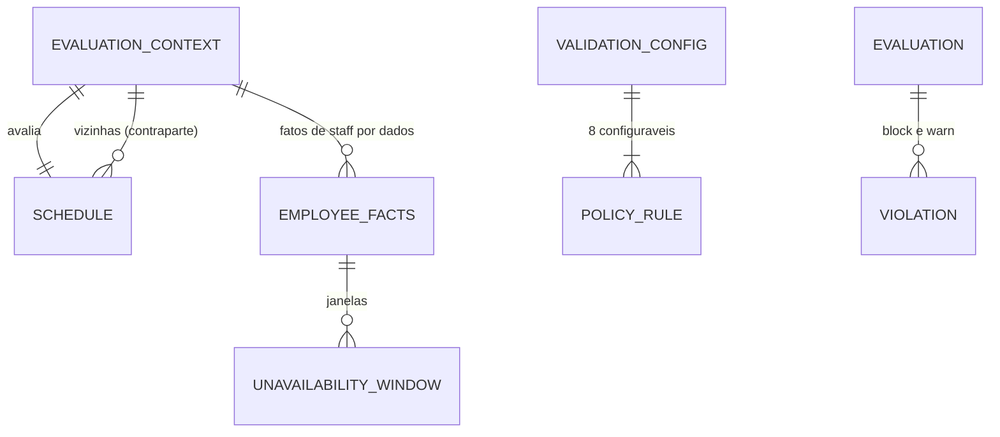

# Concept — Stage 4.2 — Políticas de validação configuráveis

> **Escopo deste documento:** o que será feito nesta Stage, por quê, e as decisões que
> fecham as lacunas endereçadas a ela. O plano executável fica no
> [`technical.md`](./technical.md).
>
> **Base teórica obrigatória:** este concept **aplica** a teoria de
> [`shift-scheduling.md`](../../domain/scheduling/shift-scheduling.md) §3.6 (`accepted`) e o
> conjunto de políticas, defaults e modos do
> [ADR 4.1.0003](../../adr/4_1_0003-v1-validation-policy-set-defaults-and-modes.md) — consome,
> não reabre. O agregado avaliado é o da Stage 4.1
> ([`concept.md`](../4.1-scheduling-domain/concept.md) §4–§5).
>
> **Lacunas que chegam a esta Stage** (doc §6, tabela consolidada; concept 4.1 §8 (a)–(e) e
> §5.13): forma da `Violation`, ordem de avaliação e onde vive a indisponibilidade; exceção de
> função × mudança posterior do cadastro; sobre-cobertura (granularidade e redução de `N`);
> identidade da violação para o aceite (com a 4.3); nome e modo da política de divergência de
> intervalo; horas na interseção de faixas distintas sobrepostas; escalas vizinhas no insumo;
> `N = 0`. Todas fecham em §7. **Uma** era de produto e foi respondida pelo sponsor em
> 2026-10-18 (§7 "Exceção de função segue o cadastro atual", ADR 4.2.0001); as demais foram
> resolvidas por evidência interna ou convenção (skill `evidence-resolution`), com o degrau
> registrado.

## 1. Escopo

### Dentro do escopo

- **Nove políticas** como estratégias plugáveis de domínio, cada uma uma classe com o mesmo
  protocolo: as oito do ADR 4.1.0003 (a) — sobreposição, alocação × indisponibilidade,
  descanso entre jornadas, teto diário, teto semanal, carga contratada, função não detida e
  sobre-cobertura — mais a **divergência de intervalo** que o ADR 4.1.0011 (Decision 4)
  mandou nomear aqui.
- **`ValidationConfig`** — a configuração por restaurante: por política configurável,
  habilitada, modo (`block`/`warn`) e parâmetros; os defaults legais num **sítio único**
  (`ValidationConfig.default()`).
- **`Violation`** — o resultado de uma política, com identidade estável (`key`) para o aceite
  consciente, medida (`observed`/`limit`) e as alocações envolvidas.
- **Insumo do avaliador** (`EvaluationContext`): a escala avaliada, as escalas vizinhas da mesma
  unidade e os **fatos de staff por dados** (`EmployeeFacts`), sem import de outro BC.
- **Avaliador** — aplica só as políticas habilitadas e devolve as violações em ordem
  determinística, separando `block` de `warn`.
- **Duas exceções novas** no BC: `InvalidValidationConfigError` e
  `InvalidEvaluationInputError`.
- Testes unitários sem I/O de cada política, da config, do insumo e do avaliador.

### Fora do escopo (explicitamente)

- **Persistir a config** por restaurante e editá-la (4.4/4.5).
- **Use cases**, `StaffReadPort`, o **protocolo do aceite** (quando um `warn` é perguntado e o que
  o aceite grava) e a **diferença antes × depois** da mutação — 4.3. A 4.2 entrega o que o
  protocolo precisa (identidade e medida da violação); não decide quando se re-pergunta.
- **Mutação nova no agregado.** A marca `function_exception` continua sem mutação: com a
  decisão do sponsor (§7), nenhuma política da 4.2 a lê (ADR 4.2.0001).
- **Cobertura como razão** (`alocados ÷ N`) — grandeza do hub (8.1); a 4.2 só compara
  `alocados > N`.
- **Políticas adiadas** pelo ADR 4.1.0003 (DSR, domingo, intrajornada, 12x36, banco de horas,
  convocação de intermitente) — entram depois como uma classe a mais no mesmo protocolo.
- **Avaliar a pessoa entre unidades** — limite v1 do ADR 4.1.0003 (e): o sujeito é o registro
  por unidade.
- **"Uma pessoa, duas funções, um turno" como cobertura cheia** (vaga multifunção ou cobertura
  por pessoa) — o ADR 4.1.0012 Decision 6 o deixou como pedido de produto para a "4.2/4.5". Não
  muda nenhuma das nove fórmulas (a sobre-cobertura é por demanda), logo vai para a **4.5** (é
  apresentação da vaga) ou para o backlog de produto — [finding].
- **Como os invariantes do doc sobrevivem a mudanças de staff** (divergência 5 abaixo) — a 4.2
  reporta; a decisão é da 4.3.
- HTTP, texto de tela, auto-fill.

### Vínculo com o roadmap

Segunda Stage do **Step 4 — Escala manual publicável**: entrega a parte "validação ao vivo
(bloquear/avisar configurável)" do resultado de negócio (`roadmap.md` §Step 4) e o critério
"proposta nasce sem violações block" que o Step 5 reutiliza. Ver `roadmap.md` §"Stage 4.2 —
`4.2-validation-policies`" e `overview.md` §3 ("Validações parametrizáveis por restaurante…")
e §7 ("estratégias plugáveis").

### Divergências declaradas em relação ao bloco 4.2 do roadmap

1. **Nove políticas, não quatro.** O bloco lista sobreposição, descanso, teto e carga; o ADR
   4.1.0003 (a) fixou oito (o teto conta em dia **e** em semana, mais indisponibilidade, função
   não detida e sobre-cobertura), e o ADR 4.1.0011 acrescentou a divergência de intervalo. A
   nota datada do Step 4 no roadmap (item (d)) já anunciava esta divergência.
2. **`arquivos_a_criar` cresce:** além do protocolo, das quatro políticas listadas, do avaliador
   e de `validation_config.py`, entram `unavailability_policy`, `function_mismatch_policy`,
   `over_coverage_policy`, `break_divergence_policy`, `context.py` (o insumo do serviço),
   `value_objects/violation.py` e `value_objects/employee_facts.py`. `max_hours_policy` abriga **duas** classes (dia e semana), uma
   por linha do ADR 4.1.0003 (a), cada uma com entrada própria na config.
3. **`arquivos_a_modificar` deixa de ser `[]`:** `domain/exceptions/errors.py` (duas exceções),
   os dois testes de totalidade de exceções (`test_exceptions.py` do BC e
   `tests/unit/test_status_map.py`), `docs/LAYOUT.md` (o `services/` deixa de ser
   `[planejado]` — `scripts/check_docs_claims.py` reprova caminho anotado que já existe; o
   concept 4.1 §1 já previa que seria esta Stage), e no fechamento a nota datada em
   `shift-scheduling.md` §6 e no roadmap.
4. **`contratos_consumidos`:** "WorkloadProfile de staff (por dados)" lê-se como **carga semanal
   em horas (`Decimal`) ou ausência**, mais funções, indisponibilidades e estado ativo — todos
   por dados, em `EmployeeFacts`, que é tipo **deste** BC.

### Divergências declaradas em relação ao doc de domínio e aos ADRs

5. **Quatro invariantes do doc não são garantidos sob mudança de staff.** O doc diz: a escala
   vigente "nunca contém violação `block`" e toda `warn` presente "foi aceita conscientemente"
   (§3.5); "nunca contém alocação sobre indisponibilidade" (§3.6.6); toda alocação de função não
   detida "carrega a marca … e um aceite na trilha" (§3.6.7). Com a reconciliação na leitura do
   ADR 4.1.0006 (desligamento sem escrita em scheduling — o mesmo mecanismo vale para férias
   lançadas e funções retiradas depois) e com a decisão do sponsor do ADR 4.2.0001, o staff pode
   mudar e tornar violada uma escala que nenhuma mutação de escala alterou. **A 4.2 não afrouxa
   nada sozinha:** o avaliador reporta essas violações como qualquer outra. Os invariantes
   continuam valendo para o que a **escala** introduz; para o que o **staff** introduz, há duas
   saídas de produto — guarda em staff (recusar férias/retirada de função sobre turno alocado,
   pelo port de consulta reverso que o ADR 4.1.0006 já prevê) ou mostrar e deixar a gerente
   corrigir. É pergunta **P** para o concept da **4.3** ([finding]); a nota datada no doc entra no
   fechamento desta Stage.
6. **`enabled` em toda política configurável.** O ADR 4.1.0003 (a) lista só "mode" como
   configurável em sobreposição, função não detida e sobre-cobertura; o doc §3.6.0 dá a toda
   política "habilitada?, modo, parâmetros" no texto, mas a tabela do mesmo §3.6.0 repete o
   "modo" do ADR — o doc tem as duas leituras. Desempata o roadmap 4.2, acima do doc ("aplica só
   políticas habilitadas na config do restaurante"); a indisponibilidade fica sem `enabled` (ADR:
   "Configurable: nothing").
7. **Período de 7 dias exigido no insumo.** O ADR 4.1.0003 (a) diz que as vizinhas existem "so
   that rest **and the accounting week** cross the period boundary"; o ADR 4.1.0002 §1, ao qual o
   próprio 4.1.0003 remete as definições, fixou a semana de apuração como os 7 dias do período e manteve período ≠ 7 como evolução. A 4.2
   segue o 4.1.0002 e **recusa** período ≠ 7 dias (§5.4): somar 14 dias contra 44h daria violação
   falsa, e a evolução quinzena/mês redefine a semana de apuração junto.

## 2. Objetivo da Stage

Ao final, dado uma escala, as escalas vizinhas da unidade, os fatos de staff dos registros e a
configuração do restaurante, o domínio de scheduling responde — sem I/O e de forma
determinística — **quais violações a escala contém**, cada uma com política, modo, sujeito,
alocações envolvidas, medida e uma identidade estável, aplicando só as políticas habilitadas e
distinguindo `block` de `warn`.

## 3. Contexto e premissas

### Contexto

- **`block` recusa a mutação; `warn` é salvo com aceite** (ADR 4.1.0001 §1). O avaliador não
  recusa nada: **descreve** o estado. Quem recusa (`block`) e quem pergunta (`warn`) é o use
  case da 4.3, que compara o antes e o depois.
- **CLT não é hard-coded** (`overview.md` §6): cada valor legal é default de parâmetro livre.
- **A escala vive em wall-clock ingênuo** da unidade, o mesmo regime da indisponibilidade de
  staff — cruzam sem conversão (doc §3.9; ADR 3.1.0005).
- **Horas têm um sítio só** (`TimeRange.worked_minutes`, via `Schedule.worked_minutes_of` — ADR
  4.1.0002 §3, 4.1.0011). Nenhuma política conta horas por conta própria.
- **Reconciliação na leitura** (ADR 4.1.0006): registro inativo não aparece em leitura alguma,
  nem as suas alocações; a vaga que ele ocupava lê-se como descoberta.

### Premissas

- A 4.3 entrega ao avaliador os fatos de **todo** registro alocado na escala e nas vizinhas
  (ativo ou não) e do quadro ativo da unidade. O avaliador recusa fato faltando de **alocado**
  (§5.4); a completude do quadro sem alocação não é verificável aqui e é contrato da 4.3.
- A config é do **tenant** (restaurante), igual para todas as unidades (ADR 4.1.0003; doc
  §3.6.0).
- Volume do piloto (ASSUM-4/5: uma unidade, dezenas de registros, 7 dias) torna aceitável
  avaliar a escala inteira a cada mudança; algoritmos são quadráticos por registro, sem índice.

### Dependências

- `4.1-scheduling-domain` (`done`, mergeada — PR #63): `Schedule`, `ShiftBand`, `ShiftDemand`,
  `Assignment`, `TimeRange`, `OperationalCalendar`, `SchedulePeriod`, ids e `SchedulingError`.
  Leituras usadas: `bands`, `operational_day_of`, `worked_minutes_of`,
  `effective_break_minutes_of`, `has_break_divergence`, `TimeRange.overlaps`, `period`.

## 4. Contratos

### Introduzidos

Todos em `features/scheduling/domain/`. Nomes em inglês; valores de enum em minúsculas
(precedente `Weekday`, `DayPeriod`).

- **`PolicyKind`** (`value-object`, `StrEnum`, `value_objects/validation_config.py`) — conjunto
  fechado de 9, nesta ordem (é a ordem de avaliação, §5.10): `overlap`, `unavailability`,
  `rest_between_shifts`, `daily_cap`, `weekly_cap`, `workload`, `function_mismatch`,
  `over_coverage`, `break_divergence`.
- **`EnforcementMode`** (`StrEnum`) — `block`, `warn`.
- **`WorkloadDirection`** (`StrEnum`) — `excess`, `both`.
- **`PolicyRule`** (`value-object`, frozen) — `enabled: bool`, `mode: EnforcementMode`.
- **`ValidationConfig`** (`value-object`, frozen):

  ```python
  @dataclass(frozen=True)
  class ValidationConfig:
      overlap: PolicyRule
      rest_between_shifts: PolicyRule
      daily_cap: PolicyRule
      weekly_cap: PolicyRule
      workload: PolicyRule
      function_mismatch: PolicyRule
      over_coverage: PolicyRule
      break_divergence: PolicyRule
      min_rest_minutes: int            # >= 0
      daily_cap_minutes: int           # > 0
      weekly_cap_minutes: int          # > 0
      workload_tolerance_minutes: int  # >= 0
      workload_direction: WorkloadDirection

      @classmethod
      def default(cls) -> "ValidationConfig": ...      # sítio único dos defaults (§5.2)
      def rule_for(self, kind: PolicyKind) -> PolicyRule: ...
  ```

  `unavailability` **não tem campo**: `rule_for(PolicyKind.UNAVAILABILITY)` devolve sempre
  `PolicyRule(enabled=True, mode=BLOCK)` (§7 D1).
- **`Violation`** (`value-object`, frozen, `value_objects/violation.py`):

  ```python
  @dataclass(frozen=True)
  class Violation:
      policy: PolicyKind
      mode: EnforcementMode
      employee_id: EmployeeId | None       # None só em over_coverage
      demand_id: ShiftDemandId | None      # só em over_coverage
      operational_days: tuple[date, ...]  # recorte do sujeito (§5.8), ordenado
      assignment_ids: frozenset[AssignmentId]
      observed: Decimal                    # medida, na unidade da política (§5.9)
      limit: Decimal

      @property
      def key(self) -> ViolationKey: ...   # identidade para o aceite (§5.8)
  ```

  `ViolationKey` é um `NamedTuple` `(policy, employee_id, demand_id, operational_days,
  assignment_ids)` — com `assignment_ids` vazio nas políticas de recorte agregado (§5.8).
- **`EmployeeFacts`** (`value-object`, frozen, `value_objects/employee_facts.py`) —
  `employee_id`, `active: bool`, `job_function_ids: frozenset[JobFunctionId]`,
  `contracted_weekly_hours: Decimal | None` (`None` = sob demanda),
  `unavailabilities: tuple[UnavailabilityWindow, ...]`.
- **`UnavailabilityWindow`** (`value-object`, frozen, mesmo módulo) — `start`, `end` ingênuos,
  `start < end`; sem exigência de minuto inteiro nem teto de duração (espelha
  `UnavailabilityPeriod` de staff, que admite férias de semanas e segundos).
- **`EvaluationContext`** (objeto imutável do **serviço**, não VO de modelo —
  `services/validation/context.py`) — `schedule: Schedule`, `facts: tuple[EmployeeFacts, ...]`,
  `previous: Schedule | None = None`, `next: Schedule | None = None`; valida o insumo na
  construção (§5.4) e oferece a projeção `AllocationView` (alocação + faixa + demanda + dia
  operacional + minutos trabalhados + escala de origem) das alocações **de registros ativos**.
  Fica junto do serviço porque só o avaliador o consome; não é conceito do modelo.
- **`ValidationPolicy`** (`Protocol`, `services/validation/policy_protocol.py`):

  ```python
  class ValidationPolicy(Protocol):
      @property
      def kind(self) -> PolicyKind: ...
      def evaluate(
          self, context: EvaluationContext, config: ValidationConfig
      ) -> tuple[Violation, ...]: ...
  ```

- **Nove políticas** (classes sem estado, uma por `PolicyKind`) em
  `services/validation/{overlap,unavailability,rest_between_shifts,max_hours,workload,function_mismatch,over_coverage,break_divergence}_policy.py`
  (`max_hours_policy.py` com `DailyCapPolicy` e `WeeklyCapPolicy`).
- **Avaliador** (`services/validation/evaluator.py`): `DEFAULT_POLICIES:
  tuple[ValidationPolicy, ...]` (uma por `PolicyKind`, na ordem do enum) e

  ```python
  def evaluate(
      context: EvaluationContext,
      config: ValidationConfig,
      policies: tuple[ValidationPolicy, ...] = DEFAULT_POLICIES,
  ) -> Evaluation: ...

  @dataclass(frozen=True)
  class Evaluation:
      violations: tuple[Violation, ...]
      @property
      def blocking(self) -> tuple[Violation, ...]: ...   # mode == BLOCK
      @property
      def warnings(self) -> tuple[Violation, ...]: ...   # mode == WARN
  ```

- **Exceções** (`exceptions/errors.py`, filhas de `SchedulingError`, com `reason`):
  `InvalidValidationConfigError` e `InvalidEvaluationInputError`.

### Consumidos

- `Schedule` e internas, `TimeRange`, `OperationalCalendar`, `SchedulePeriod`, ids e
  `SchedulingError` — Stage 4.1.
- **Dados** de staff (nunca tipos): funções, carga semanal (`Decimal` horas, como
  `FixedSchedule.weekly_hours`), indisponibilidades e estado ativo — chegam pela 4.3.

## 5. Invariantes e regras

1. **O avaliador descreve, não recusa.** Escala com violação `block` é avaliada normalmente;
   recusar é da 4.3 (ADR 4.1.0001 §1).
2. **Defaults num sítio só:** `ValidationConfig.default()` é o único lugar dos valores do ADR
   4.1.0003 (a): todas habilitadas; `overlap` `block`; demais `warn`; descanso **660** min
   (11h, CLT art. 66); teto diário **600** (10h, CLT arts. 58 + 59 § 2º); teto semanal **2640**
   (44h, CF art. 7º XIII); tolerância **0**, direção `excess`. Divergência de intervalo:
   habilitada, `warn` (ADR 4.1.0011 Decision 4). Parâmetros em **minutos inteiros** (ADR
   4.1.0007 §3).
3. **Config válida:** descanso ≥ 0 (doc §3.6.2: "livre ≥ 0"); tetos > 0; tolerância ≥ 0.
   Violação → `InvalidValidationConfigError` com o parâmetro no `reason`.
4. **Insumo válido** (`InvalidEvaluationInputError`, com o motivo):
   - a escala avaliada e as vizinhas têm período de **7 dias** (divergência 7);
   - `previous` e `next`, quando presentes, têm o **mesmo** `tenant_id` e `unit_id` da avaliada,
     ids distintos entre as três, e são **adjacentes**: `previous.period.last_day + 1 ==
     schedule.period.first_day` e `schedule.period.last_day + 1 == next.period.first_day` —
     fail-closed: misturar tenant é vazamento; vizinha errada esconderia a sobreposição da virada;
     no máximo uma de cada lado, por construção dos campos;
   - nenhum `AssignmentId` se repete entre a avaliada e as vizinhas (a unicidade da 4.1 é por
     agregado; aqui a `key` e a projeção precisam dela entre as três);
   - `facts` sem `employee_id` repetido;
   - **todo** `employee_id` alocado na escala ou nas vizinhas tem fatos — fato faltando é
     defeito do orquestrador, e pular a alocação deixaria passar `block` em silêncio;
   - `contracted_weekly_hours`, quando presente, é finito e > 0 (mesma lei de `FixedSchedule`).
   **Limite verificável:** a completude do **quadro** (registros fixos ativos **sem** alocação,
   sujeitos da carga em `both`) não é detectável aqui; é contrato da 4.3 ([finding]).
5. **Registro inativo não é avaliado:** alocações de fatos com `active = False` somem de toda
   política — inclusive da contagem da sobre-cobertura (a vaga lê-se descoberta — ADR 4.1.0006,
   limite (1)) — e o registro inativo não é sujeito da carga.
6. **Só a escala avaliada gera violação.** As vizinhas entram só como **contraparte**: uma
   violação é reportada se envolve ao menos uma alocação (ou um dia operacional) da escala
   avaliada. Só sobreposição e descanso leem as vizinhas; dia, semana, carga, função, cobertura
   e divergência são recortes internos da escala avaliada (os dias operacionais são partição
   entre escalas — invariante 4 da 4.1; a semana de apuração **é** o período — ADR 4.1.0002 §1).
   **Consequência declarada:** a violação da virada (domingo da anterior × segunda da avaliada)
   aparece, com a **mesma** `key`, ao avaliar qualquer uma das duas; em qual escala o aceite é
   gravado é do protocolo da 4.3 ([finding]).
7. **Fórmulas** (doc §3.6.1–§3.6.8; `horas(a)` = `worked_minutes_of`):
   - **overlap:** par de alocações do **mesmo** registro em faixas distintas (inclusive entre
     escalas) com `TimeRange.overlaps`; uma violação por par.
   - **unavailability:** alocação cuja faixa `[start, end)` se sobrepõe a alguma janela de
     indisponibilidade do registro (semi-aberto; adjacente não viola); uma por alocação.
   - **rest_between_shifts:** por registro, os dias operacionais com alocação em ordem
     (escalas vizinhas incluídas); para cada par consecutivo-com-alocação `(dᵢ, dⱼ)`,
     `descanso = min(start de dⱼ) − max(end de dᵢ)`; viola se `descanso < min_rest_minutes`
     (pode ser negativo, quando também há sobreposição — as duas são reportadas). Lacunas
     dentro do mesmo dia operacional não contam (limite do doc §3.6.2). **Limite declarado da
     v1:** alocações contíguas que atravessam o **corte** (sex 21:00–sáb 05:00 seguida de sáb
     05:00–13:00, corte 05:00) caem em dias operacionais distintos — o descanso sai **0** e viola,
     e o teto diário vê 8h + 8h, não a jornada de 16h. É a consequência literal da fórmula por dia
     operacional (ADR 4.1.0002 §2); travado em CA5.
   - **daily_cap:** por registro e dia operacional, `Σ horas > daily_cap_minutes`.
   - **weekly_cap:** por registro, `Σ horas` na escala `> weekly_cap_minutes`.
   - **workload:** por registro **ativo de jornada fixa** nos fatos (com ou sem alocação),
     `desvio = Σ horas das alocações com counts_toward_workload − contracted_weekly_hours × 60`;
     viola se `desvio > tolerância` (`excess`) ou `|desvio| > tolerância` (`both`). Sob demanda
     não é sujeito. Aritmética em `Decimal`, exata. **Limite declarado:** a indisponibilidade
     não abate a carga — em `both`, um fixo de férias a semana inteira viola com desvio
     `−carga`; abatimento é evolução.
   - **function_mismatch:** alocação cuja `job_function_id` da demanda **não** está em
     `job_function_ids` do registro **hoje**; a marca `function_exception` **não é lida**
     (ADR 4.2.0001).
   - **over_coverage:** demanda com `alocados ativos > N` (por demanda — a demanda já é única por
     `(faixa, função)`, ADR 4.1.0010); `N = 0` com alocado viola; sem divisão.
   - **break_divergence:** alocação com `has_break_divergence`; uma por alocação.
8. **Identidade (`key`)** = `(policy, employee_id, demand_id, operational_days, assignment_ids)`,
   com `assignment_ids` **vazio** nas políticas de recorte agregado. `operational_days` é sempre
   **distinto e ordenado** (duas alocações do mesmo dia dão `(d,)`). Recorte por política, e o que
   vai em `Violation.assignment_ids`:

   | Política | `employee_id` / `demand_id` | `operational_days` | `assignment_ids` (na `Violation`) | na `key`? |
   |---|---|---|---|---|
   | overlap | registro / — | dias das duas | o par | sim |
   | unavailability | registro / — | dia da alocação | a alocação | sim |
   | rest_between_shifts | registro / — | `(dᵢ, dⱼ)` | as que dão `max(end)` e `min(start)` | não |
   | daily_cap | registro / — | `(d,)` | as do dia | não |
   | weekly_cap | registro / — | dias do período | as da escala | não |
   | workload | registro / — | dias do período | as que contam (pode ser vazio) | não |
   | function_mismatch | registro / — | dia da alocação | a alocação | sim |
   | over_coverage | — / demanda | dia da faixa | **todas** as ativas da demanda | **sim** |
   | break_divergence | registro / — | dia da alocação | a alocação | sim |

   **Sobre-cobertura é por alocação** porque o aceite do ADR 4.1.0003 (g) é da *alocação
   excedente* ("the acknowledgement saves the surplus allocation") e o doc §3.6.8 exige que
   "nenhuma alocação excedente exist[a] … sem um aceite". O que a `key` faz, e só isso: alocar
   mais uma, retirar uma ou um registro do conjunto ficar inativo **mudam** a `key`; reduzir `N`
   com o mesmo conjunto **não** muda (a medida piora); reduzir `N` onde não havia violação cria
   `key`. Quando a 4.3 pergunta é do protocolo dela (§7 D3), com **uma restrição** que o doc
   impõe e esta Stage registra: em sobre-cobertura, reduzir `N` sobre excedente já aceito
   aumenta o número de alocações excedentes, e o invariante de §3.6.8 exige aceite para elas —
   logo a regra "só por `key`" não basta ali; a 4.3 precisa re-perguntar quando a medida piora,
   ao menos nessa política ([finding]). Nas demais agregadas, mudar a medida mantém a `key`, e a
   regra de piora é escolha livre da 4.3.
9. **Medida (`observed` / `limit`)**, `Decimal`, unidade por política: overlap — minutos de
   interseção / 0; unavailability — minutos da faixa dentro de indisponibilidade, com as janelas
   **unidas** (não somadas) e exatos ao microssegundo (`Decimal(µs) / 60_000_000`, nunca via
   `float`) / 0; descanso — minutos de descanso (negativo se há sobreposição) / mínimo; tetos —
   minutos somados / teto; workload — minutos que contam / carga × 60; function_mismatch — 1 / 0;
   over_coverage — alocados ativos / `N`; break_divergence — intervalo da alocação / intervalo da
   faixa. **Ordinais** (maior distância de `limit` = pior): descanso (abaixo), tetos, carga,
   sobre-cobertura, sobreposição, indisponibilidade. **Não ordinais:** function_mismatch e
   break_divergence — são por alocação, e a `key` já muda quando o fato muda.
10. **Ordem determinística:** políticas na ordem de `PolicyKind`; dentro de cada uma, ordenadas
    por `(operational_days, employee_id, demand_id, assignment_ids ordenados)`. Todas as
    habilitadas rodam — sem curto-circuito no primeiro `block` (a UI mostra tudo ao vivo).
11. **Só habilitadas:** política com `rule_for(kind).enabled = False` não é chamada; o `mode` de
    cada violação é o de `rule_for(kind)`.
12. **Sem texto livre:** a `Violation` não carrega mensagem; o texto é da borda (precedente
    concept 4.1 §5.20).
13. **Pureza:** nenhum módulo importa fora de `scheduling.domain` e `shared.domain` (contratos
    `scheduling-domain-purity` e `bc-independence`); políticas sem estado.

## 6. Casos de erro e exceções

| Cenário | Exceção |
|---|---|
| Config com descanso < 0, teto ≤ 0 ou tolerância < 0 | `InvalidValidationConfigError` (`reason` nomeia o parâmetro) |
| Escala avaliada ou vizinha com período ≠ 7 dias | `InvalidEvaluationInputError` |
| Vizinha de outro tenant ou unidade, com id repetido, ou não adjacente ao período avaliado | `InvalidEvaluationInputError` |
| `AssignmentId` repetido entre a avaliada e uma vizinha | `InvalidEvaluationInputError` |
| `facts` com `employee_id` repetido | `InvalidEvaluationInputError` |
| Registro alocado sem fatos | `InvalidEvaluationInputError` |
| `contracted_weekly_hours` não finito ou ≤ 0 | `InvalidEvaluationInputError` |
| `UnavailabilityWindow` tz-aware ou com `start >= end` | `InvalidEvaluationInputError` |

Violação de política **não é exceção**: é dado de retorno.

## 7. Decisões técnicas relevantes

> Registro no formato da skill `evidence-resolution` §5. Âncoras por seção; nenhuma fonte
> externa nova (os valores legais já estão verificados no ADR 4.1.0003 e no doc §7).

### Exceção de função segue o cadastro atual (P — sponsor, 2026-10-18)
- **O quê:** `function_mismatch` avalia as funções do registro **no momento da avaliação**; a
  marca `function_exception` não é lida por política alguma. Ana (exceção aceita) que ganha a
  função deixa de violar; Bruno (alocação comum) que perde a função passa a violar.
- **Resposta literal:** *"Segue o cadastro atual (Recomendada)"* — contra "congela ao alocar" e
  "misto".
- **Consequências:** a marca armazenada fica como **registro do aceite no ato de alocar**;
  nenhuma mutação nova da marca é necessária na 4.2. **Não** se decide aqui de onde a 4.5 tira a
  etiqueta "exceção" nem como o hub (8.1) conta exceções — com a política **desabilitada** não há
  violação viva, e a etiqueta não pode depender dela sem perder o sinal que o ADR 4.1.0003 (f)
  exige ("visible on the schedule") — [finding] para a 4.5 e a 8.1. Violação induzida por
  mudança de staff: divergência 5 (§1).
- **ADR:** [`4.2.0001`](../../adr/4_2_0001-function-mismatch-follows-current-staff-record.md).

### [decision:C] D1 — onde vive a indisponibilidade
Escolha: no avaliador, como política sempre habilitada, `block` fixo, sem campo na config ·
Alternativas: checagem no use case da 4.3 · Degrau: 1 · Base: roadmap 4.2 ("avaliador que
devolve lista de violações para a UI exibir ao vivo") e Step 5 ("proposta nasce sem violações
block") — um avaliador só serve os dois; ADR 4.1.0003 (a) "Configurable: nothing" ·
Configuração candidata: nenhuma · Reversível: sim. ADR 4.2.0002.

### [decision:C] D2 — escalas vizinhas no insumo e só a avaliada gera violação
Escolha: campos `previous`/`next`, opcionais e adjacentes, só como contraparte (§5.4, §5.6) ·
Alternativas: avaliar só a escala corrente (perde a virada da semana); reportar também violações
internas às vizinhas (a tela da semana mostraria problema que não toca nenhuma alocação dela) ·
Degrau: 1 · Base: ADR 4.1.0003 (a) "Every policy receives the record's neighbouring allocations
(previous/next schedule)"; doc §3.6.0 · Reversível: sim. ADR 4.2.0002.

### [decision:C] D3 — `Violation` com identidade sem medida
Escolha: §5.8–§5.9 · Alternativas: identidade com a medida (todo número novo vira violação nova:
aceitar 46h e chegar a 47h re-pergunta sempre); identidade com todas as alocações envolvidas em
toda política (remover um turno que **melhora** o dia vira violação nova a aceitar) · Degrau: 4
(o mais reversível: a medida e as alocações estão na `Violation`, e a 4.3 escolhe a regra de
re-pergunta sem mudar a forma) · Reversível: sim. ADR 4.2.0002.

### [decision:C] D4 — registro inativo e fato faltando
Escolha: inativo é pulado em toda política (§5.5); fato faltando é recusa (§5.4) · Alternativas:
tratar fato faltando como inativo · Degrau: 1 (ADR 4.1.0006: inativo some de toda leitura, a vaga
lê-se descoberta) + 2 (fail-closed: pular em silêncio deixaria `block` passar) · Reversível: sim.
ADR 4.2.0002.

### [decision:E] D5 — horas na interseção de faixas distintas sobrepostas
Escolha: soma **por alocação**, sem união de intervalos; a interseção conta duas vezes · Base:
doc §3.6.3 ("toda alocação `a` … cuja faixa pertence ao dia operacional `d`") e §3.6.10 ("Uma
definição"); ADR 4.1.0012 Decision 5 · Consequência declarada: o dobro só existe se o tenant pôs
a sobreposição em `warn` ou a desabilitou, e o aceite dela é consciente (§10).

### [decision:C] D6 — sobre-cobertura por demanda, identidade por conjunto de alocações
Escolha: `alocados ativos > N` **por demanda**, com o conjunto das alocações ativas na `key`
(§5.8); a restrição sobre reduzir `N` é registrada para a 4.3 (§5.8) · Alternativas:
agregar por função entre faixas **sobrepostas** da mesma função (o caso do ADR 4.1.0010 Decision 4,
"2 atendentes 16h–00h + 1 atendente 18h–22h") — descartada: `N` é alvo **da faixa declarada**, e
agregar exigiria fatiar o tempo em intervalos e uma segunda noção de "alocados", sem fonte;
identidade sem as alocações — descartada: o aceite do ADR 4.1.0003 (g) é por alocação excedente ·
Degrau: 1 (ADR 4.1.0003 (g) "the acknowledgement saves the surplus allocation" e "with `block` …
requires raising `N` first"; doc §3.6.8, invariante) · Reversível: sim. ADR 4.2.0002
(Alternative F). **Custo declarado:** retirar uma alocação de uma demanda ainda sobre-coberta
muda a `key` — uma melhora vira `key` nova; o protocolo da 4.3 decide se isso pergunta.

### [decision:C] D7 — `N = 0`
Escolha: a 4.2 não calcula razão; `N = 0` com alocado é sobre-cobertura (`observed` = alocados,
`limit` = 0) · Degrau: 5 · A razão com `N = 0` é do hub — [finding] para a 8.1.

### [decision:C] D8 — divergência de intervalo
Escolha: política `break_divergence`, habilitada, `warn`, `block` configurável; "manter o da
faixa" = `declare_allocation_break(None)` (volta a herdar), não fixar uma cópia · Degrau: 1 (ADR
4.1.0011 Decision 4 "`warn` proposed, `block` configurable"; Decision 2 "`None` … means it
**inherits** the band's" — uma cópia fixada voltaria a divergir no próximo
`redeclare_band_break`, sem ninguém ter escolhido) · A ação "qual manter" é da 4.5.

### [decision:C] D9 — unidades e tipos
Escolha: parâmetros em minutos `int`; carga contratada em `Decimal` horas, como staff a emite
(`NUMERIC` sem precisão — `staff/adapters/out/postgres/tables.py`); comparação exata em
`Decimal`; `Violation.observed/limit` em `Decimal` para uma forma só · Alternativas: converter a
carga para minutos inteiros na 4.3 (exigiria arredondar 22,33h) · Degrau: 1 (ADR 4.1.0007 §3
minutos inteiros para **contar**; a carga é referência, não contagem) · Reversível: sim.

### [decision:C] D10 — avaliador como função e registro fechado
Escolha: função `evaluate(context, config, policies=DEFAULT_POLICIES)`, sem estado;
`DEFAULT_POLICIES` com exatamente uma política por `PolicyKind`, travado por teste · Degrau: 5 ·
Política nova = classe + membro do enum + entrada na config (overview §7).

### [decision:C] D11 — `max_hours_policy` com duas classes
Escolha: `DailyCapPolicy` e `WeeklyCapPolicy` no mesmo módulo, entradas próprias na config
(duas linhas no ADR 4.1.0003 (a), configuráveis separadamente) · Degrau: 1.

## 8. Integrações

### Internas (com outras Stages/módulos)

- **4.3 (use cases):** monta o `EvaluationContext` (escala, vizinhas por `period`, fatos via
  `StaffReadPort` — ativos e os alocados inativos), lê a config (4.4) e decide pela diferença
  antes × depois quais violações a mutação **introduziu**: `block` recusa, `warn` pede aceite.
  Herda deste concept, para registro como `[finding]` na §7 do technical: (1) re-pergunta
  quando a medida piora — obrigatória em sobre-cobertura (§5.8); (2) violação induzida por
  mudança de staff — pergunta P (divergência 5); (3) em qual escala se grava o aceite da
  violação da virada (§5.6); (4) completude do quadro sem alocação no insumo (§5.4).
- **4.4:** persiste a config por tenant (as 13 entradas de `ValidationConfig`); a reidratação
  passa pela validação de §5.3.
- **4.5:** texto de cada violação, a origem da etiqueta "exceção" (inclusive com a política
  desabilitada), a ação "qual intervalo manter" e a vaga multifunção.
- **Step 5:** reutiliza o avaliador ("proposta nasce sem violações block").
- **8.1:** cobertura como razão (`N = 0`) e a contagem de exceções de função.
- **staff / identity:** nenhuma integração de código; só dados.

## 9. Modelo de dados



> Estrutura de **domínio**, não schema (persistência da config é a 4.4).

## 10. Riscos e mitigações

| Risco | Prob. | Impacto | Mitigação |
|---|---|---|---|
| Fórmula com `>` × `≥` ou semi-aberto errado (adjacente violando) | M | A | CA de fronteira por política (CA3); mutação real na auditoria |
| Vizinha de outro tenant entrando no insumo | B | A | Recusa fail-closed (§5.4), teste dedicado |
| Fato faltando silenciar `block` | M | A | Recusa (§5.4) em vez de pular |
| Horas contadas em dobro em faixas distintas sobrepostas aceitas em `warn` | B | M | Declarado (D5); só existe com sobreposição desligada ou aceita |
| Política nova esquecida no registro | M | M | Teste de totalidade `DEFAULT_POLICIES` × `PolicyKind` × `ValidationConfig` (CA13) |
| Violação induzida por mudança de staff (função perdida, férias lançadas) aparecer na escala vigente sem mutação que a introduza — inclusive `block` | A | M | O avaliador a mostra (é o "aviso ao vivo"); divergência 5 declarada; guarda em staff × mostrar-e-corrigir é pergunta P do concept da 4.3 |
| Vizinha errada (não adjacente, de outra unidade) esconder a sobreposição da virada | B | A | Adjacência e unidade validadas (§5.4) |

## 11. Critérios de aceitação

> `[teste]` = asserção unitária sem I/O; `[gate]` = verificação de processo.

- [x] **CA1** `ValidationConfig.default()` devolve exatamente os valores e modos de §5.2, e é o
      único sítio de 660/600/2640 no pacote `features/scheduling` — varredura AST de literais
      inteiros sobre todo `.py` do pacote, exigindo que toda ocorrência caia nas linhas de
      `default()`, com asserção anti-vácuo (precedente: CA7 da 4.1) `[teste]`.
- [x] **CA2** Config recusa cada parâmetro fora de §5.3 e aceita as fronteiras (descanso 0,
      teto 1, tolerância 0); `rule_for` cobre os 9 `PolicyKind`, com `unavailability` sempre
      `block` habilitada `[teste]`.
- [x] **CA3** Cada uma das nove políticas tem teste do caso que viola, do que não viola e da
      fronteira (adjacência semi-aberta; igualdade ao limite não viola) `[teste]`.
- [x] **CA4** Sobreposição e descanso detectam violação contra escala vizinha anterior **e**
      seguinte, e não reportam violação interna à vizinha; as outras sete políticas ignoram as
      vizinhas (indisponibilidade sobre alocação da vizinha, teto num dia da vizinha) `[teste]`.
- [x] **CA5** Descanso usa `max(end)` do dia anterior e `min(start)` do seguinte, pula dias sem
      alocação, ignora lacuna dentro do mesmo dia operacional, reporta descanso negativo junto
      com a sobreposição, e trava o limite das contíguas que atravessam o corte (§5.7) — descanso
      0 viola e o teto diário vê 8h + 8h sem violar `[teste]`.
- [x] **CA6** Carga: só jornada fixa ativa; `excess` × `both` (inclusive registro fixo sem
      alocação em `both`); alocação "não conta" fora da soma; carga fracionária exata `[teste]`.
- [x] **CA7** Função não detida segue os fatos atuais e ignora `function_exception` (os dois
      cenários de Ana e Bruno) `[teste]`.
- [x] **CA8** Sobre-cobertura por demanda, com `N = 0` e com alocação de inativo fora da conta;
      duas faixas sobrepostas da mesma função contadas separadamente `[teste]`.
- [x] **CA9** Registro inativo não aparece em violação alguma; fato faltando de alocado é recusado
      `[teste]`.
- [x] **CA10** Insumo inválido de §6 recusado, cada linha com o seu teste `[teste]`.
- [x] **CA11** `Violation.key` e `assignment_ids` seguem a tabela de §5.8 em cada política
      (agregadas sem alocações na `key`; sobre-cobertura com elas; `operational_days` distinto e
      ordenado) `[teste]`.
- [x] **CA16** A medida de §5.9 em cada política, incluindo janelas de indisponibilidade
      sobrepostas (unidas, não somadas), janela com segundos (minutos fracionários exatos),
      descanso negativo e `N = 0` `[teste]`.
- [x] **CA17** Soma por alocação em faixas distintas sobrepostas: a interseção conta duas vezes no
      teto diário (D5) `[teste]`.
- [x] **CA12** O avaliador chama só as habilitadas, carimba o modo da config, separa `blocking` e
      `warnings` e devolve a ordem de §5.10, estável entre execuções `[teste]`.
- [x] **CA13** `DEFAULT_POLICIES` tem exatamente uma política por `PolicyKind`, na ordem do enum,
      e toda política configurável tem campo em `ValidationConfig` `[teste]`.
- [x] **CA14** As duas exceções novas entram nas varreduras de totalidade do BC e do repositório
      `[teste]`.
- [x] **CA15** `make check` verde (lint, mypy strict, import-linter, `check_layout.py`,
      `check_docs_claims.py`, cobertura ≥ 90% e ≥ 90% por arquivo da Stage) `[gate]`.

## 12. Checklist de validação interna

- [x] Todos os contratos introduzidos têm assinatura definida? (§4)
- [x] Toda decisão em §7 tem fonte rastreável? (âncora + degrau)
- [x] Toda integração externa tem contrato definido? (não há integração externa)
- [x] Decisões com alternativa real descartada têm ADR escrito? (4.2.0001, 4.2.0002)
- [x] Dependências de Stages anteriores estão satisfeitas? (4.1 `done`, PR #63 mergeado)
- [x] Stage cabe em ~3–12 Tasks? (10 previstas)
- [x] Riscos críticos têm mitigação plausível? (§10)
- [x] As lacunas endereçadas à 4.2 têm decisão em §7?

## 13. Questões em aberto

Nenhuma. A única questão de produto (exceção de função × cadastro) foi respondida pelo sponsor
em 2026-10-18; as que pertencem a outras Stages (as quatro da 4.3 listadas em §8; etiqueta
"exceção" e vaga multifunção na 4.5; cobertura com `N = 0` e contagem de exceções na 8.1) ficam
como [finding] com Stage candidata, não como TODO desta Stage.

## 14. Referências

- [`../../overview.md`](../../overview.md) — §3, §6, §7
- [`../../roadmap.md`](../../roadmap.md) — Stage `4.2-validation-policies`, nota do Step 4
- [`../../domain/scheduling/shift-scheduling.md`](../../domain/scheduling/shift-scheduling.md) —
  §3.4–§3.6, §6
- [`../4.1-scheduling-domain/concept.md`](../4.1-scheduling-domain/concept.md) — §4, §5, §8
- ADRs: 4.1.0001, 4.1.0002, 4.1.0003, 4.1.0006, 4.1.0007, 4.1.0010, 4.1.0011, 4.1.0012;
  desta Stage: [`4.2.0001`](../../adr/4_2_0001-function-mismatch-follows-current-staff-record.md),
  [`4.2.0002`](../../adr/4_2_0002-evaluator-input-and-violation-identity.md)
