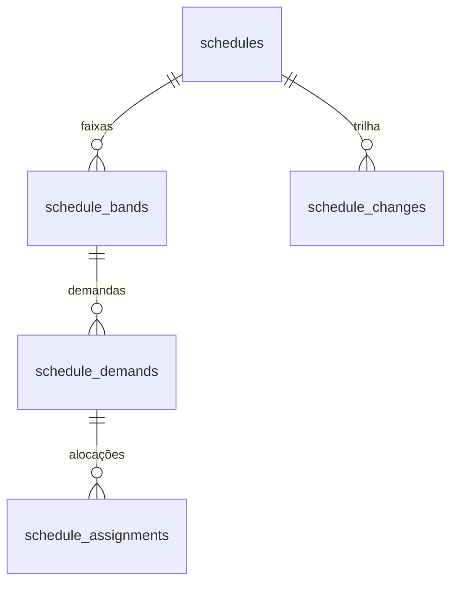

# Concept — Stage 4.4 — Persistência da escala

> **Escopo deste documento:** o que será feito nesta Stage, por quê, e as decisões que fecham as
> lacunas endereçadas a ela. O plano executável fica no [`technical.md`](./technical.md).
>
> **Base obrigatória:** este concept **implementa** os ports e as leis da Stage 4.3
> ([`concept.md`](../4.3-scheduling-application/concept.md) §4; ADRs 4.3.0001, 4.3.0003 e
> 4.3.0004) sobre a teoria de
> [`shift-scheduling.md`](../../domain/scheduling/shift-scheduling.md). Consome, não reabre. A
> forma segue as duas Stages de persistência anteriores
> ([`2.3-identity-persistence`](../2.3-identity-persistence/concept.md),
> [`3.3-staff-persistence`](../3.3-staff-persistence/concept.md)).
>
> **Lacunas que chegam a esta Stage** (tabela de lacunas do doc de domínio; §8 e §13 do concept
> 4.3; §7 dos technicals da 4.3 e da 2.6): granularidade e retenção da auditoria; o que o
> funcionário vê quando uma alocação dele muda; versão e checagem otimista em SQL; representação
> persistida dos dois regimes de tempo; localização do adapter entre BCs; quem serve as leituras
> em lote do `StaffReadPort`; escopo e índice do acesso por `user_id`; a guarda reversa de staff;
> o reparo do registro ausente; a mitigação do write skew de fronteira; o leitor da trilha na
> suíte de contrato; a dupla escrita diante da regra 10. Todas fecham em §7. Três são de produto
> ou de escopo (D-RET, D-EMP, D-REVERSE) e foram decididas por delegação do sponsor ao
> orquestrador, com a opção recomendada; as demais saíram por evidência ou convenção (skill
> `evidence-resolution`), com o degrau registrado.

## 1. Escopo

### Dentro do escopo

- **Esquema Postgres do BC scheduling** em SQLAlchemy Core (`adapters/out/postgres/tables.py`,
  `MetaData` próprio): `schedules`, `schedule_bands`, `schedule_demands`,
  `schedule_assignments`, `schedule_changes` (a trilha) e `scheduling_settings` (a configuração
  do tenant), com toda constraint nomeada.
- **Migration `0006_scheduling`** escrita à mão, com `down_revision` no head de `develop`, e o
  `MetaData` de scheduling somado ao `target_metadata` do Alembic.
- **`PostgresScheduleRepository`**: `add`, `save`, `find_by_id`, `list_in_range`,
  `list_ending_before`, obedecendo L-SC1 a L-SC8, com o estado e a entrada da trilha gravados
  na mesma transação.
- **`PostgresScheduleConfigRepository`**: `find_settings` (L-CF1). Só leitura; a tabela nasce
  completa para a escrita que a Stage 4.8 acrescenta.
- **Mappers puros** (`mappers.py`): agregado ↔ linhas, linha → `SchedulingSettings`, e o codec
  da trilha (`ScheduleChange` ↔ linha, com operações e aceites em JSON).
- **Fachada de leitura de staff** (`features/staff/application/facade.py`, classe
  `StaffReadFacade`): quatro leituras em primitivos sobre os dois repositórios de staff, sem
  autorizar. É o único arquivo criado em `features/staff/`; nenhum arquivo existente de staff
  muda.
- **`LocalStaffReadAdapter`** (`features/scheduling/adapters/out/staff/`): o `StaffReadPort`
  sobre a fachada, com o segundo par nomeado no contrato `bc-independence`.
- **Suítes de lei da 4.3 contra o real**: as três fixtures de
  `tests/contract/features/scheduling/conftest.py` passam a parametrizar `fake` e `postgres`,
  com um corpo de teste só, e ganham a guarda AST contra ramificação por implementação.
- **Testes de integração** exclusivos do banco: schema e migration, fidelidade, trilha,
  atomicidade, concorrência com duas conexões, garantias de constraint, e o fluxo
  criar → publicar → ler dos use cases da 4.3 sobre os adapters reais.
- **Wiring** no `composition_root.py`: os três adapters montados sobre o mesmo `Engine` e
  expostos no contêiner como ports.

### Fora do escopo (explicitamente)

- **HTTP**, permissões de escala no enum de identity, mapa de papéis e o adapter do
  `AccessGuard` de scheduling: Stage 4.5. Por isso os **sete use cases não são montados** aqui
  (§7 D-WIRING).
- **Escrita da configuração**: Stage 4.8. Nenhum método de escrita entra no port nem no adapter.
- **A guarda de remoção definitiva** (port reverso em staff) e o **reparo do registro
  ausente**: issue #194 (§7 D-REVERSE).
- **Leitura da trilha pelo produto**: nenhum port, use case ou rota lê `schedule_changes`
  (§7 D-TRAILREAD, `[finding]` em §10).
- **Coluna `Unit.timezone`** em identity (§7 D-TZ).
- **Expurgo ou retenção com prazo** da trilha (§7 D-RET).
- **Mitigação forte do write skew de fronteira** (§7 D-SKEW).
- E-mail (4.6), imagem (4.7), auto-preenchimento (Step 5).

### Vínculo com o roadmap

Quarta Stage do **Step 4 — Escala manual publicável**: dá persistência real ao que a 4.3
entregou com fakes e cumpre a parte "trilha de auditoria das alterações" do resultado de
negócio (`overview.md` §3 › "trilha de auditoria das alterações"). Ver `roadmap.md` §Stage 4.4
› "Descrição humana", `definition_of_done`.

### Divergências declaradas em relação ao bloco 4.4 do roadmap

1. **Nome da migration.** O bloco lista `0003_scheduling.py` como nome do arquivo
   (`roadmap.md` §Stage 4.4 › `arquivos_a_criar`). Esse número está ocupado desde a Stage 3.3,
   e o quinto é da Stage 3.11, em voo. O arquivo é `0006_scheduling.py` (§7 D-MIG).
2. **`arquivos_a_modificar` deixa de ser só o composition root**
   (`roadmap.md` §Stage 4.4 › `arquivos_a_modificar`): entram `migrations/env.py`,
   `tests/conftest.py` (lista de limpeza), `tests/integration/test_migration.py`,
   `.importlinter`, os dois `test_bc_independence.py` (staff e scheduling),
   `tests/contract/features/scheduling/` (conftest e a suíte de lei), o docstring do port
   `schedule_repository.py` e o fake dele (divergência 7), `docs/LAYOUT.md` §6 (nota da
   divergência 9), três ADRs com errata, o doc de domínio e o roadmap.
3. **Um arquivo novo em staff.** O bloco não lista `features/staff/application/facade.py`; ele
   é exigido pela forma única de travessia entre BCs (LAYOUT §3; ADR 3.5.0001) e foi decidido
   pela 4.3 (ADR 4.3.0003 › "Served by a non-authorizing staff facade"). É o lado fornecedor da
   aresta, como a fachada de identity nasceu numa Stage de staff (3.5).
4. **Wiring.** O bloco diz "wiring no composition root"; o que se monta são os três adapters
   como ports, não os use cases (§7 D-WIRING).

### Divergências declaradas em relação ao concept da 4.3 e à issue #189

5. **Concept 4.3 §7 D-REVERSE e §8** ("liga a guarda reversa de staff") e o escopo original da
   issue #189, que citava D-REVERSE: a ligação **não** entra nesta Stage (§7 D-REVERSE). O corpo
   da #189 foi editado (a guarda e o reparo do ausente foram para a #194), os ADRs 4.1.0006 e
   4.3.0003 ganham errata apontando para a #194, e a linha correspondente da tabela de lacunas
   do doc de domínio é reendereçada no fechamento.
6. **Concept 4.3 §8** ("o tradutor do `AccessGuard` no composition root"): fica na 4.5, com as
   permissões (§7 D-WIRING).
7. **O contrato da 4.3 é refinado, sem mudar assinatura** (§7 D-LAWS; precedente: a Stage 3.3
   acrescentou `L-ORD` aos ports de staff). O docstring de `ScheduleRepository` passa a dizer o
   que só o fake dizia ou o que ninguém dizia: no `add`, a ordem id da escala → período → ids
   internos e a recusa de id interno de outra escala; qual id o `IdentifierInUseError` relata;
   que período e calendário são da criação e o `save` não os troca; e que `occurred_at` é
   aware. O fake é alinhado (relato determinístico do id), e as suítes ganham casos:
   - `test_schedule_repository_laws.py`: `_QUANDO` passa a aware em UTC; casos novos de
     fidelidade depois de `save`, de id interno no `add`, de colisão com duas escalas e de
     ordem do `add`;
   - `conftest.py` do contrato: o mundo semeado do `StaffReadPort` deixa de dar a um registro
     do tenant `t2` uma função do catálogo de `t1`, estado que staff não representa (lei L-E4
     de staff; id de função global). O corpo das leis L-ST não muda. A semeadura do real
     vincula o login **antes** de desligar o registro (staff recusa vincular desligado).

### Divergências declaradas em relação ao PIPELINE e ao LAYOUT

8. **PIPELINE §4.2, critérios 1 e 4** ("uma camada-alvo"; "sem deliverables em mais de um
   bounded context"): `features/staff/application/facade.py` é um arquivo de outro BC e de
   outra camada. Passa porque é o lado fornecedor que a forma única de travessia exige para o
   adapter desta Stage existir (LAYOUT §3), é só leitura sobre ports que já existem e não muda
   comportamento de staff. A guarda reversa não passa pelo mesmo critério: muda dois use cases
   de staff e cria port, adapter e wiring lá (§7 D-REVERSE).
9. **LAYOUT §6, item 5** ("expõe os use cases montados") e o docstring de
   `ApplicationDependencies` ("Expõe **use cases**, não repositórios"): o contêiner ganha três
   campos anotados com ports de dados, provisórios até a 4.5 montar os use cases (§7 D-WIRING).

## 2. Objetivo da Stage

Ao final, as leis dos três ports de dados da 4.3 valem para o fake **e** para o adapter real
com um corpo de teste só, e toda escrita de escala (`add` ou `save`) deixa, na mesma
transação, uma entrada na trilha dizendo quem, quando, sobre qual versão, o quê e com quais
aceites.

## 3. Contexto e premissas

### Contexto

- **Uma escrita carrega a mudança** (ADR 4.3.0004 §2): `add` e `save` recebem a
  `ScheduleChange`; o adapter grava estado e trilha atomicamente (L-SC3). Cada use case escreve
  uma vez, logo scheduling não tem unidade de trabalho e a regra 10 do `check_layout` não é
  tocada. Isto fecha o `[finding]` do technical da 2.6 que previa duas escritas na 4.4.
- **Salvar = publicar, com controle otimista por versão** (ADR 4.1.0001 › "optimistic check on
  a schedule version counter"): o contador vive no domínio; a coluna e a comparação atômica são
  desta Stage.
- **Ids internos vêm do cliente e são únicos por (tenant, unidade)** (ADR 4.3.0004 §1): o
  repositório recusa no `save` o id usado por outra escala da unidade (L-SC4).
- **BCs independentes, sem FK entre eles** (ADR 3.3.0002 › "referential validity across
  bounded contexts is enforced at the boundary that knows both"; ADR 4.1.0006):
  `employee_id`, `job_function_id`, `tenant_id`, `unit_id` e `author_user_id` são texto opaco.
- **Dois regimes de tempo**: faixas em wall-clock ingênuo da unidade; carimbo da trilha em
  instante absoluto (`shift-scheduling.md` §3.9 › "representação persistida dos dois regimes").
- **Stages em voo.** A 3.11 (PR #188) acrescenta métodos aos ports de staff e a habilitação
  por unidade à função; a 2.7 (PR #187) mexe no wiring de identity. Esta Stage não edita
  arquivo existente de staff e restringe a mudança do composition root ao bloco de scheduling.

### Premissas

- Volume do piloto (concept 4.3 §3): uma unidade, dezenas de registros, escalas de 7 dias.
  Reescrever as filhas de uma escala a cada `save` e ler o quadro inteiro da unidade a cada
  leitura de staff são aceitáveis; nada além do medido é indexado.
- PostgreSQL 16 (compose e CI). A extensão `btree_gist` é instalável pelo dono do banco
  (§7 D-DISJOINT).
- Localmente só rodam os testes sem banco; integração, contrato real e `make check` rodam no
  GitHub Actions do PR (orquestração autônoma, ADR 0.0.0008).

### Dependências

- `4.3-scheduling-application` (`done`): os três ports, as leis, os fakes, as suítes de lei e
  os sete use cases.
- `3.3-staff-persistence` e `3.5-employee-login-link` (`done`): `EmployeeRepository`,
  `JobFunctionRepository` e a coluna `employees.user_id`, lidos pela fachada.
- `shared`: `build_engine` (sessão em UTC), `Clock`.

## 4. Contratos

### Introduzidos

Nenhum port. O bloco diz `contratos_introduzidos: []` e continua valendo para scheduling. O
que nasce é:

- **`StaffReadFacade`** (`features/staff/application/facade.py`), o *Open Host Service* de
  leitura de staff (LAYOUT §3). Assinaturas em primitivos; devolve dataclasses congeladas de
  primitivos:
  - `StaffRecord(employee_id: str, unit_id: str, name: str, active: bool,
    job_function_ids: frozenset[str], weekly_hours: Decimal | None,
    unavailabilities: tuple[tuple[datetime, datetime], ...])` — `weekly_hours` `None` é o
    perfil sob demanda; cada indisponibilidade é o par `(start, end)` ingênuo.
  - `StaffFunction(job_function_id: str, name: str)`.
  - `list_active_records(tenant_id: str, unit_id: str) -> tuple[StaffRecord, ...]`
  - `list_records(tenant_id: str, unit_id: str, employee_ids: frozenset[str]) ->
    tuple[StaffRecord, ...]` — ativos ou não.
  - `list_records_of_user(tenant_id: str, unit_id: str, user_id: str) ->
    tuple[StaffRecord, ...]` — ativos ou não.
  - `list_functions(tenant_id: str) -> tuple[StaffFunction, ...]`

  Construída sobre `EmployeeRepository` e `JobFunctionRepository` (os ports de staff), usando
  só métodos que já existem (`list_by_unit`, `list_by_tenant`). Não autoriza, não traduz
  exceção, não expõe `user_id`.
- **Esquema persistido** (§9) e o **formato JSON da trilha** (§5.6, campo a campo) — contrato
  de dados para a 4.8, a Stage da guarda reversa e o Step 7.
- **Leis refinadas de `ScheduleRepository`** (texto do docstring do port; nenhuma assinatura
  muda — §7 D-LAWS):
  - **L-SC1 (ordem do `add`)** — id da escala → período → ids internos.
  - **Período e calendário são da criação** — nenhuma mutação do domínio os muda (o
    calendário é fotografado, ADR 4.1.0009). O `save` grava as faixas e a versão; uma escala
    que chegue ao `save` com período ou calendário diferentes dos gravados está fora do
    contrato. A ordem do `save` continua endereço → versão → ids.
  - **L-SC4 (também no `add`, e qual id)** — id interno já usado por outra escala da unidade ⇒
    `IdentifierInUseError` no `add` e no `save`; o erro relata o primeiro tipo em conflito na
    ordem faixa → demanda → alocação e, dele, o menor id por codepoint, entre **todas** as
    outras escalas da unidade.
  - **`ScheduleChange.occurred_at`** é instante absoluto (aware); valor ingênuo está fora do
    contrato.
- **Três campos no contêiner** `ApplicationDependencies`, anotados com os ports:
  `scheduling_schedules: ScheduleRepository`, `scheduling_settings: ScheduleConfigRepository`,
  `scheduling_staff_read: StaffReadPort` — provisórios (§7 D-WIRING).
- **Segundo par do `bc-independence`**:
  `restaurant_hub.features.scheduling.adapters.out.staff.* ->
  restaurant_hub.features.staff.application.facade`.

### Consumidos

- **`ScheduleRepository`, `ScheduleChange`, `ScheduleConfigRepository`, `SchedulingSettings`,
  `StaffReadPort`, `StaffMember`, `JobFunctionEntry`** e os erros da application — Stage 4.3.
- **`Schedule` e internas, `OperationalCalendar`, `ValidationConfig`, `Violation`** — Stages 4.1
  e 4.2.
- **`EmployeeRepository`, `JobFunctionRepository`, `Employee`, `JobFunction`** — staff (só
  dentro da fachada).

## 5. Invariantes e regras

1. **Fake ≡ real para as leis.** L-SC1 a L-SC8, L-CF1 e L-ST1 a L-ST5 valem para as duas
   implementações com o mesmo corpo de teste. Onde a lei fixa ordem de checagem (no `add`: id
   da escala → período → ids internos; no `save`: endereço → versão → ids), o adapter
   checa **explicitamente** nessa ordem antes de escrever; a constraint do banco é a garantia,
   não a fonte do erro.
2. **Protocolo de escrita** (`add` e `save`), uma transação:
   (a) toma o **lock da unidade** — `pg_advisory_xact_lock` sobre o hash de
   `(tenant_id, unit_id)` —, que serializa os escritores de escala da mesma unidade;
   (b) roda as checagens da lei, na ordem;
   (c) grava a raiz, reescreve as filhas e insere a entrada da trilha;
   (d) comita. Qualquer recusa ou falha desfaz tudo: nem estado nem trilha (L-SC3).
3. **`add`**: id de escala já gravado **em qualquer tenant** ⇒ `IdentifierInUseError`
   (`"ScheduleId"`); período que cruza dia de outra escala da unidade ⇒
   `SchedulePeriodTakenError`; id interno usado por outra escala da unidade ⇒
   `IdentifierInUseError` com o primeiro tipo em conflito (faixa → demanda → alocação) e o
   menor id dele por codepoint (o `min` do Python sobre os ids em conflito, nunca a ordenação
   do banco).
4. **`save`**: lê a versão gravada no endereço de três partes; ausente ⇒
   `ScheduleNotFoundError`; diferente de `expected_version` ⇒ `ScheduleVersionConflictError`
   com a atual; depois os ids internos contra as **outras** escalas da unidade. Passando,
   grava a versão e **substitui todas as filhas**. Período e calendário não são regravados:
   são da criação (§4, "Leis refinadas"), e por isso o `save` não tem como violar L-SC2.
5. **Filhas por reescrita.** O `save` apaga as faixas da escala (as demandas e alocações caem
   em cascata) e reinsere o agregado. É seguro porque nenhuma filha é referenciada de fora do
   agregado e o lock da unidade exclui escritor concorrente; o custo é proporcional ao tamanho
   de uma escala.
6. **Trilha: uma linha por `ScheduleChange`.** `seq` (ordinal por escala: 1 na criação, depois
   2, 3…), `author_user_id`, `occurred_at` (instante absoluto, lido de volta aware em UTC),
   `previous_version`, `resulting_version` (a versão da escala gravada) e dois documentos
   JSON: `operations` (lista ordenada, um objeto por operação efetiva) e `acknowledged` (lista
   das violações aceitas). A trilha é só de inserção: o adapter nunca atualiza nem apaga linha
   dela.

   **Formato de cada objeto de `operations`** — a chave `kind` discrimina; instantes em ISO
   8601 ingênuo (`2026-11-02T10:00:00`):

   | `kind` | Demais chaves |
   |---|---|
   | `enable_band` | `band_id`, `start`, `end`, `break_minutes` (int) |
   | `reschedule_band` | `band_id`, `start`, `end` |
   | `redeclare_band_break` | `band_id`, `break_minutes` (int) |
   | `disable_band` | `band_id` |
   | `declare_demand` | `demand_id`, `band_id`, `job_function_id`, `quantity` (int) |
   | `change_demand_quantity` | `demand_id`, `quantity` (int) |
   | `withdraw_demand` | `demand_id` |
   | `assign_employee` | `assignment_id`, `demand_id`, `employee_id`, `counts_toward_workload` (bool), `function_exception` (bool, ou `null`) |
   | `unassign_employee` | `assignment_id` |
   | `declare_workload_counting` | `assignment_id`, `counts` (bool) |
   | `declare_allocation_break` | `assignment_id`, `break_minutes` (int, ou `null`) |

   `function_exception` de `assign_employee` **não** é campo da operação: é a marca que a
   alocação recebeu no ato (derivada pelo use case), lida da escala gravada junto. Recebe a
   marca só o **último** `assign_employee` de cada `assignment_id` no lote, e só se nenhum
   `unassign_employee` do mesmo id vier depois dele; nos demais ela é `null` (a alocação não
   está no estado gravado). Com ela, a linha da raiz (período e calendário, que são da
   criação) mais as operações reaplicadas desde a criação reproduzem o estado de cada versão
   **gravada**. O leitor a ignora ao remontar a `AssignEmployee`.

   **Formato de cada objeto de `acknowledged`:** `policy` e `mode` (os valores dos enums),
   `employee_id` e `demand_id` (texto ou `null`), `operational_days` (lista de datas ISO, na
   ordem), `assignment_ids` (lista ordenada), `observed` e `limit` (`Decimal` como texto).

   **Regra de evolução:** o leitor ignora chave que não conhece; campo novo de uma operação
   entra no leitor com o valor que as linhas antigas implicam. Trocar nome de chave ou valor
   de `kind` exige migration dos dados. Os literais acima são travados por teste.
7. **Fidelidade** (L-SC8): o lido é o gravado campo a campo, inclusive a **ordem** das tuplas
   de faixas, demandas e alocações (coluna `position`), `break_minutes` `None` × `0`, as duas
   marcas da alocação, o período (`first_day`, `days`) e o calendário fotografado.
8. **Reidratação pelo construtor.** Os mappers montam `Schedule`, `ShiftBand`, `ShiftDemand`,
   `Assignment`, `OperationalCalendar` e `ValidationConfig` pelos construtores do domínio; uma
   linha que viola invariante levanta ao ser lida, em vez de entrar como estado válido.
9. **Leitura de agregado em snapshot único.** `find_by_id`, `list_in_range` e
   `list_ending_before` leem raiz e filhas numa transação `REPEATABLE READ`: um `save`
   concorrente nunca produz uma escala com a versão de um estado e as faixas de outro.
10. **Endereço de três partes** (L-SC5): toda leitura filtra `tenant_id` **e** `unit_id`.
11. **Ordem das listagens**: `list_in_range` por `first_day` crescente; `list_ending_before`
    por `first_day` decrescente, com `LIMIT` no SQL. Os períodos de uma unidade são disjuntos,
    logo `first_day` é ordem total.
12. **Tempo.** `start_at`/`end_at` das faixas: `TIMESTAMP` sem fuso. `first_day`: `DATE`.
    `day_cutoff`: `TIME` sem fuso. `occurred_at`: `TIMESTAMP WITH TIME ZONE`.
13. **Nenhuma FK sai do `MetaData` de scheduling.** As FKs internas formam o cerco: toda filha
    carrega `tenant_id`, `unit_id` e `schedule_id` e referencia o pai pela chave composta, o
    que torna irrepresentável a demanda de uma escala presa à faixa de outra.
14. **Configuração.** `find_settings` devolve a linha do tenant reidratada ou `None`; nunca
    aplica default (L-CF1; os defaults são do use case). Toda coluna de `scheduling_settings`
    é `NOT NULL`, e as `CHECK` cobrem os conjuntos fechados (modo, direção, dia da semana) e
    as faixas numéricas dos limites: uma linha é sempre uma configuração completa. O que a
    `CHECK` não expressa (o corte em minuto inteiro) é barrado na reidratação (§5.8).
15. **Fachada de staff.** Não autoriza (o use case de scheduling já autorizou, com permissão
    de scheduling); não devolve registro de outra unidade ou tenant; `list_records` e
    `list_records_of_user` incluem inativos; não importa scheduling (o contrato
    `bc-independence` não tem par nessa direção).
16. **Adapter de staff.** Importa de staff **só** a fachada; traduz primitivos para os tipos
    de scheduling (`StaffMember`, `JobFunctionEntry`, `UnavailabilityWindow`); não nomeia
    vocabulário de decisão de staff (`Employee`, `JobFunction`, `WorkloadProfile`…).
17. **Composition root.** Os três adapters de scheduling são montados sobre o **mesmo**
    `Engine` dos demais, e a fachada de staff sobre as **mesmas** instâncias de repositório de
    staff que servem as rotas de staff.

## 6. Casos de erro e exceções

| Condição | Erro | Onde |
|---|---|---|
| `add` com id de escala já gravado (qualquer tenant) | `IdentifierInUseError("ScheduleId", …)` | checagem; `pk_schedules` traduzida na corrida entre unidades |
| `add` cujo período cruza outra escala da unidade | `SchedulePeriodTakenError` | checagem; `ex_schedules_unit_days_disjoint` traduzida |
| `add`/`save` com id interno de outra escala da unidade | `IdentifierInUseError(<tipo>, <id>)` | checagem sob o lock |
| `save` em endereço inexistente (outro tenant, outra unidade, id desconhecido) | `ScheduleNotFoundError` | checagem |
| `save` com versão vencida | `ScheduleVersionConflictError(expected, current)` | checagem sob o lock |
| linha gravada que viola invariante do domínio | a exceção de domínio do construtor | leitura |
| violação de constraint sem significado na operação | `IntegrityError` cru | sobe intacto |
| tenant sem configuração | `None` (não é erro) | `find_settings` |
| id pedido que não é da unidade | omitido (não é erro) | `list_members` |

Sob o lock da unidade, as constraints de id interno e de período não são alcançáveis por dois
escritores do adapter na mesma unidade; ficam como garantia contra escrita fora dele. Duas
traduções são mantidas, pelo nome da constraint e nunca pelo texto da mensagem (ADR 3.3.0004):
`pk_schedules`, **alcançável** pelo adapter (dois `add` com o mesmo id de escala em unidades
diferentes não disputam o mesmo lock), e a de período, só no mapa do `add`, que só responde a
escritor que contornou o lock — traduzi-la custa uma linha de mapa e evita que a garantia do
banco saia como erro sem nome. O `save` não escreve período, logo não tem mapa.

## 7. Decisões técnicas relevantes

> Registro no formato da skill `evidence-resolution` §5. As citações externas vêm do lote de
> pesquisa de fontes primárias de 2026-11-16 (documentação do PostgreSQL 16 e código das libs
> nas versões do `uv.lock`: SQLAlchemy 2.0.51, Alembic 1.18.5, psycopg 3.3.4).

### D-AUDIT — Granularidade e forma da trilha · C (degrau 5, depois do 4)

- **Escolha:** uma linha por `ScheduleChange` (a unidade que o port já entrega), com as
  operações efetivas em ordem e os aceites em dois documentos `JSONB`; diff, não snapshot.
- **Alternativas:** linha por operação em tabela filha; colunas tipadas por tipo de operação
  (11 formas esparsas); snapshot do agregado por versão.
- **Base:** ADR 4.3.0004 › "one row per operation or per batch is its granularity gap" — as
  duas formas cumprem "toda mutação gera entrada". As duas são reversíveis entre si por
  migration (`jsonb_array_elements`), então decide a mais simples: um objeto do port, uma
  linha. O precedente de staff contra JSONB (ADR 3.3.0001 › "live in child tables rather than
  JSONB") vale para **estado de agregado**, onde leis de guarda repousam em FKs; a trilha é
  registro de inserção, sem lei apoiada em FK, e carrega uma união de 11 formas.
- **Verificado:** psycopg 3.3.4 serializa `JSONB` com `json.dumps` e lê com `json.loads`
  (`types/json.py`); `Decimal`, `date` e `datetime` levantam `TypeError` no default e fração
  volta `float`. Por isso vão como texto (§5.6).
- **O que o diff não pode perder:** a trilha é a fonte de "o que valia naquele dia" para o
  Step 7 (ADR 4.1.0001 › "the source is the audit log (4.4)"), e dado não gravado não volta.
  O estado de uma escala tem três partes: período e calendário, que são da criação, não
  mudam e ficam na linha da raiz; as faixas, que as operações descrevem; e a marca
  `function_exception`, derivada no ato de alocar e ausente da operação — o objeto
  `assign_employee` a grava (§5.6). Raiz mais replay desde a criação dão o estado exato de
  cada versão gravada, para toda escala nascida por `create_schedule` (que nasce vazia).
  **Limite declarado:** o port aceita `add` de escala já com conteúdo e sem operações (a suíte
  de lei faz isso); nesse caso o estado inicial não está na trilha. Nenhum use case o alcança.
- **Configuração candidata:** snapshot por versão, se a Stage 7.2 preferir ler estado pronto
  a reaplicar operações (`[finding]`, §10). **Reversível:** sim entre as formas de linha
  (lote × operação); a escolha de diff não perde estado, pelo parágrafo acima.
  **ADR:** 4.4.0002.

### D-RET — Retenção da trilha · P delegado

- **Escolha:** a trilha vive enquanto a escala existir; **sem expurgo na v1**. Guarda só
  identificadores opacos (login do autor, registro, função), nunca nome nem e-mail.
- **Alternativas:** expurgo por prazo; anonimização do autor depois de N meses.
- **Motivo (recomendada):** nada apaga escala na v1 (o port não tem remoção) e o sponsor fixou
  que os dados históricos permanecem (ADR 4.1.0006); manter é o lado reversível — apagar não
  se desfaz. `overview.md` §6 › "aprofundar apenas se alguma feature exigir legalmente".
- **Configuração candidata:** prazo de retenção por tenant, com job de expurgo — Stage 6.3 ou
  a que trouxer o requisito legal (`[finding]`, §10). **ADR:** 4.4.0002.

### D-EMP — O que o funcionário vê quando uma alocação dele muda · P delegado

- **Escolha:** nada além da escala vigente. "Minha escala" lê sempre o estado atual
  (salvar = publicar); o aviso da mudança é o e-mail opcional da 4.6; a trilha não tem leitura
  do lado do funcionário.
- **Alternativas:** marca "mudou desde" em "minha escala"; histórico visível ao funcionário.
- **Motivo (recomendada):** o overview não lista histórico para o funcionário, e a notificação
  já tem Stage própria. **ADR:** 4.4.0002.

### D-DISJOINT — L-SC2 atômica · E

- **Escolha:** exclusion constraint
  `EXCLUDE USING gist (tenant_id WITH =, unit_id WITH =, daterange(first_day, first_day + days) WITH &&)`,
  com a extensão `btree_gist` criada na migration.
- **Alternativas:** tabela com uma linha por dia e PK `(tenant, unidade, dia)`; só o advisory
  lock com checar-e-inserir.
- **Base:** documentação do PostgreSQL 16, "Range Types", "Constraints on Ranges": *"an
  exclusion constraint is often more appropriate … Exclusion constraints allow the
  specification of constraints such as 'non-overlapping' on a range type"*, e *"You can use the
  btree_gist extension to define exclusion constraints on plain scalar data types, which can
  then be combined with range exclusions"*. `btree_gist` é *"trusted, that is, it can be
  installed by non-superusers who have CREATE privilege on the current database"* (apêndice
  F, btree_gist). `daterange(date, date)` assume `[)`, então a faixa cobre exatamente os `days`
  dias. A violação é SQLSTATE `23P01`, chega como `sqlalchemy.exc.IntegrityError` com
  `diag.constraint_name` preenchido — o tradutor por nome a cobre.
- **Ressalva verificada:** sob inserção concorrente, a exclusion constraint pode responder
  com deadlock em vez de violação (comentário de `execIndexing.c` do PostgreSQL 16). É a razão
  de D-LOCK: sob o lock da unidade, dois escritores da mesma unidade não inserem ao mesmo
  tempo.
- **Configuração candidata:** nenhuma. **Reversível:** sim (a constraint sai por migration).
  **ADR:** 4.4.0001.

### D-LOCK — Serialização por unidade e checagem otimista · C (degrau 2 e 5)

- **Escolha:** `add` e `save` começam por `pg_advisory_xact_lock` sobre o hash de
  `(tenant_id, unit_id)`. Sob ele, as checagens da lei são exatas e saem na ordem da lei; as
  constraints ficam como garantia do banco. A versão é comparada **dentro** do lock.
- **Alternativas:** (a) `SELECT … FOR UPDATE` na linha da escala (precedente de staff, ADR
  3.3.0006 › "the employee update takes a row lock on the lookup") mais tradução das
  constraints por nome; (b) `UPDATE … WHERE version = :expected` conferindo `rowcount`.
- **Base:** L-SC4 fala de ids de **outras** escalas da unidade, e L-SC2 de **outras** escalas:
  o lock de uma linha não serializa o que as leis comparam. Em (a), a corrida do id interno
  cairia na PK da filha, e a tradução precisaria do id em conflito, que o erro só traz no
  texto da mensagem — o projeto não lê mensagem (ADR 3.3.0004). A documentação do PostgreSQL
  avisa que advisory lock é convenção da aplicação (*"the system does not enforce their use"*,
  "Explicit Locking", "Advisory Locks"); por isso ele ordena os erros e as constraints
  garantem o dado — cinto e suspensório, como o projeto já faz com o fuso da sessão. Sob
  `READ COMMITTED`, cada comando depois de adquirir o lock vê o que o escritor anterior
  comitou ("Transaction Isolation", "Read Committed Isolation Level").
- **Limite declarado:** colisão de hash só serializa duas unidades sem necessidade. Escritor
  de escala fora do adapter tem de tomar o mesmo lock; se não tomar, as constraints o barram
  com `IntegrityError` cru.
- **Configuração candidata:** nenhuma. **Reversível:** sim. **ADR:** 4.4.0003.

### D-LAWS — O que as leis não diziam · C (degrau 1)

- **Escolha:** escrever no docstring do port, alinhar o fake e travar na suíte única (§4, "Leis
  refinadas"): ordem do `add`; id interno no `add`; qual id o erro relata; período e
  calendário fora do `save`; `occurred_at` aware.
- **Alternativa:** deixar como "comportamento do fake" e cobrir só o adapter em integração.
- **Base:** fake ≡ real só é verificável sobre o que a lei enuncia; os dois revisores do
  Checkpoint A mostraram cinco pontos em que um adapter divergente passaria a suíte. O relato
  do id pelo fake dependia da ordem de inserção das escalas, que o banco não tem: a forma
  canônica (tipo, depois menor id por codepoint) é reproduzível nos dois lados — o mesmo
  motivo de `L-ORD` em staff (ADR 3.3.0003). Refinar lei numa Stage de persistência tem
  precedente literal na 3.3. Período e calendário: o fake troca o objeto inteiro no `save`, e
  um adapter que os regravasse aceitaria pelo port uma mudança que nenhuma operação da trilha
  descreve; dizê-los da criação fecha as duas pontas sem inventar erro novo. `occurred_at`: o `Clock` do projeto devolve aware (`clock.py` ›
  `Clock.now`), e uma coluna de instante absoluto não tem como devolver ingênuo; a lei passa a
  dizê-lo, e o adapter não promete nada para o valor fora dela.
- **Reversível:** sim (texto de lei e casos de teste).

### D-IDS — Unicidade dos ids internos no banco · C (degrau 1)

- **Escolha:** a PK de cada tabela filha é `(tenant_id, unit_id, id)`; a de `schedules` é
  `(id)` (colisão global, L-SC1). As filhas carregam `tenant_id`, `unit_id` e `schedule_id` e
  referenciam o pai por FK composta com `ON DELETE CASCADE`.
- **Base:** ADR 4.3.0004 §1 (unicidade por unidade); ADR 3.3.0001 (discriminador onde ancora
  um cerco). **ADR:** 4.4.0001.

### D-TIME — Os dois regimes de tempo · E (degrau 1)

- **Escolha:** §5.12. **Base:** ADR 4.1.0007 › "naive wall-clock datetimes truncated to whole
  minutes"; ADR 3.1.0005; `shift-scheduling.md` §3.9. psycopg envia `datetime` ingênuo como
  `timestamp` e aware como `timestamptz` (`types/datetime.py` › `DatetimeDumper.upgrade`).
  A forma na borda HTTP continua lacuna da 4.5. **ADR:** 4.4.0001.

### D-CONFIG — Forma da tabela de configuração · C (degrau 1)

- **Escolha:** uma linha por tenant, colunas tipadas: `week_start`, `day_cutoff`, um par
  `<política>_enabled`/`<política>_mode` para cada uma das oito políticas configuráveis, os
  quatro limites em minutos e `workload_direction`. Tudo `NOT NULL`, sem default de servidor.
- **Alternativas:** documento `JSONB`; tabela filha com uma linha por política.
- **Base:** `ValidationConfig` exige os treze campos; uma filha por política tornaria
  representável a configuração com política faltando, e o port não inventa default. Política
  nova entra por migration com o default escrito, que é decisão registrada. A 4.8 grava os
  campos de hoje com um upsert, sem migration; se o concept dela decidir que a gravação tem
  autoria, instante ou checagem otimista (perguntas abertas do bloco dela), essas colunas
  entram por migration dela — a tabela não as antecipa, porque nenhuma fonte as decide.
  **ADR:** 4.4.0001.

### D-STAFF — Quem serve o `StaffReadPort` e onde mora o adapter · E/C (degrau 1)

- **Escolha:** `StaffReadFacade` em `features/staff/application/facade.py`, sobre os dois
  repositórios de staff; `LocalStaffReadAdapter` em
  `features/scheduling/adapters/out/staff/`; segundo par nomeado no `bc-independence`.
- **Alternativas:** tradutor no composition root; adapter chamando os use cases de staff.
- **Base:** LAYOUT §3 "Travessia entre bounded contexts" (forma fixa: fachada + gateway + par
  nomeado); ADR 4.3.0003 › "Served by a non-authorizing staff facade"; ADR 0.0.0016 (o
  composition root só liga). A fachada lê os repositórios, e não os use cases de staff, porque
  todo use case de staff autoriza com ator e permissão de staff (ADR 3.7.0001), e scheduling
  já autorizou a leitura. Fecha a lacuna de localização do adapter
  (`shift-scheduling.md` §3.10.1 › "Onde o adapter mora"). **ADR:** 4.4.0004.

### D-USERID — Escopo e índice do acesso por `user_id` · C (degrau 1)

- **Escolha:** escopo de **unidade**, servido pela listagem da unidade
  (`list_by_unit(include_inactive=True)`) com filtro na fachada. Nenhum `find_by_user_id` no
  port de staff, nenhum índice.
- **Base:** o port de scheduling só pede o vínculo dentro de uma unidade (L-ST4); ADR 3.3.0005
  › "exactly three purposeful indexes beyond the primary keys" — índice acompanha acesso
  medido, e a listagem da unidade já tem o seu. Evita mudar o port de staff com a 3.11 em voo.
- **Configuração candidata:** método dedicado com índice quando houver leitura por login que
  atravesse unidades (4.5, "minha escala" composta).
- **O que fica dito em outro lugar:** os ADRs 3.5.0004 e 4.3.0003 previam que o Step 4 traria
  `find_by_user_id` com o seu índice; ganham errata apontando para esta decisão. O comentário
  de `employees.user_id` em `staff/adapters/out/postgres/tables.py` diz o mesmo e **fica como
  está** (nenhum arquivo existente de staff muda; a 3.11 edita esse arquivo) — `[finding]`,
  §10. **ADR:** 4.4.0004.

### D-REVERSE — A guarda reversa entra nesta Stage? · P delegado

- **Escolha:** **não**. Vai para a issue #194, que decide o dono no roadmap; esta Stage entrega
  o esquema que responde à consulta (`schedule_assignments.employee_id`,
  `schedule_demands.job_function_id`, com tenant e unidade na linha), sem índice.
- **Alternativas:** ligar a guarda inteira aqui; entregar só a consulta em scheduling.
- **Motivo (recomendada):** a guarda é entregável de **staff** — port novo, mudança em
  `delete_employee` e `delete_job_function`, adapter e wiring de staff, terceira aresta entre
  BCs — e a Stage é de camada-alvo `adapters/out` de scheduling (PIPELINE §4.2, critérios 1 e
  4). Somaria cinco Tasks ou mais às onze desta Stage e editaria use cases de staff com a 3.11
  em voo. A consulta sozinha seria método de port sem consumidor. O risco só existe quando
  houver alocação em produção, isto é, depois da 4.5.
- **O que fica descoberto até a #194**, declarado: registro removido com alocação gravada faz
  a escala e as vizinhas recusarem com `MissingStaffRecordsError`, sem reparo; função removida
  com demanda gravada não recusa nada — a demanda passa a sair com nome `None` (concept 4.3
  §5.14). A #194 tem de fechar antes de a edição da escala ir a produção: a nota de fechamento
  do bloco 4.4 no roadmap o diz, para a 4.5 herdar.
- **ADR:** 4.4.0004; errata nos ADRs 4.1.0006 e 4.3.0003.

### D-WIRING — O que o composition root monta · C (degrau 1)

- **Escolha:** os três adapters, expostos como ports no contêiner. Os sete use cases ficam
  para a 4.5, que cria o adapter do `AccessGuard` de scheduling.
- **Base:** todo use case de scheduling exige o guard no construtor (ADR 4.3.0002); o guard
  traduz permissões que ainda não existem em identity (ADR 4.1.0004 › "gaps for the Stage 4.5
  concept"). Montar os use cases agora pediria um guard provisório em `src/`. Não tocar o
  composition root contrariaria o bloco do roadmap e a issue, que listam o wiring.
- **O custo, e como fica contido:** o contêiner passa a ter repositório à vista, contra a
  regra escrita dele (divergência 9), e um port de dados ligado direto a uma rota leria escala
  e staff sem passar pelo `AccessGuard` dos use cases. Três contenções: o comentário do bloco
  diz que os campos são provisórios e que a 4.5 os troca pelos sete use cases; um teste trava
  que **nenhum** provedor de `build_http_wiring` entrega um dos três campos; e a nota de
  fechamento do bloco 4.4 no roadmap lista o que a 4.5 herda (adapter do `AccessGuard` em
  `adapters/out/identity/`, o par scheduling → identity no `bc-independence`, wiring dos use
  cases, remoção dos três campos). `docs/LAYOUT.md` §6 ganha a nota datada da exceção.
- **Reversível:** sim.

### D-SKEW — Write skew de fronteira · C (degrau 1)

- **Escolha:** fica como limite declarado (concept 4.3 §3). O lock da unidade não o fecha: a
  avaliação acontece no use case, antes da transação de escrita. Fechá-lo exige levar as
  versões das vizinhas para a escrita condicional, o que muda a assinatura de `save`. Dono:
  issue #199.

### D-TZ — Coluna `Unit.timezone` · C (degrau 1)

- **Escolha:** não entra. É coluna de identity e nenhum use case de scheduling consome o fuso
  ainda (concept 4.3 §7 D-NOW). O ADR 4.1.0005 › "which Stage adds the column is a roadmap
  scope gap" dava duas candidatas, a 4.4 ou uma issue avulsa de identity; sobra a segunda:
  issue #198.

### D-TRAILREAD — Quem lê a trilha · C (degrau 5)

- **Escolha:** o codec da trilha é um par de funções puras em `mappers.py` (gravar e ler), e a
  suíte de contrato lê a tabela por ele. Nenhum método de leitura entra no adapter: não há
  consumidor em `src/`, e um leitor sem tenant no endereço seria um convite errado.

### D-MIG — Número e encadeamento da migration · C (degrau 1)

- **Escolha:** `0006_scheduling.py`, com `revision` `"0006"` e `down_revision` `"0004"`, que é
  o head de `develop` hoje. A quinta é da Stage 3.11 (PR #188). Quem mergear por último aponta
  o `down_revision` para a outra, para o Alembic ter um head só; registrado no PR.

### D-INTEGRITY — Tradutor de integridade · C (degrau 1)

- **Escolha:** `integrity_errors.py` próprio do BC, com mapa por operação e as duas funções
  `constraint_name`/`translate` na forma de staff (ADR 3.3.0004). É a terceira cópia das duas
  funções (identity, staff, scheduling); promover a `shared/infrastructure` é `[finding]` (§10).

## 8. Integrações

### Internas (com outras Stages/módulos)

- **4.5:** monta os sete use cases sobre os três campos do contêiner e o seu `AccessGuard`;
  decide a forma dos instantes na borda; compõe "minha escala" por unidade.
- **4.8:** acrescenta o método de escrita ao `ScheduleConfigRepository` e o upsert em
  `scheduling_settings`, sem migration.
- **Issue #194:** consulta `schedule_assignments` e `schedule_demands` para a guarda reversa.
- **7.2:** se precisar do estado histórico, lê `schedule_changes`.
- **3.11 (em voo):** soma métodos aos ports de staff e `unit_enablement` à função; a fachada
  usa só `list_by_unit` e `list_by_tenant`, que não mudam de assinatura.
- **staff:** fornece a fachada. **identity:** nenhuma integração.

### Externas

Nenhuma.

## 9. Modelo de dados

| Tabela | Colunas | Chaves e constraints |
|---|---|---|
| `schedules` | `id`, `tenant_id`, `unit_id`, `first_day` DATE, `days` INT, `week_start` TEXT, `day_cutoff` TIME, `version` INT | PK `(id)`; UNIQUE `(tenant_id, unit_id, id)` (âncora das FKs); EXCLUDE de dias disjuntos por unidade; CHECK de `days` entre 1 e 31, `version >= 1`, `week_start` conhecido; índice `(tenant_id, unit_id, first_day)` |
| `schedule_bands` | `tenant_id`, `unit_id`, `id`, `schedule_id`, `position`, `start_at` TIMESTAMP, `end_at` TIMESTAMP, `break_minutes` INT | PK `(tenant_id, unit_id, id)`; UNIQUE `(tenant_id, unit_id, schedule_id, id)` (âncora); FK → `schedules` CASCADE; CHECK `start_at < end_at`, `break_minutes >= 0` |
| `schedule_demands` | `tenant_id`, `unit_id`, `id`, `schedule_id`, `band_id`, `position`, `job_function_id`, `quantity` INT | PK `(tenant_id, unit_id, id)`; UNIQUE `(tenant_id, unit_id, schedule_id, id)` (âncora); FK → `schedule_bands` CASCADE; CHECK `quantity >= 0` |
| `schedule_assignments` | `tenant_id`, `unit_id`, `id`, `schedule_id`, `demand_id`, `position`, `employee_id`, `counts_toward_workload` BOOL, `function_exception` BOOL, `break_minutes` INT NULL | PK `(tenant_id, unit_id, id)`; FK → `schedule_demands` CASCADE; CHECK `break_minutes IS NULL OR break_minutes >= 0` |
| `schedule_changes` | `schedule_id`, `seq` INT, `author_user_id`, `occurred_at` TIMESTAMPTZ, `previous_version` INT NULL, `resulting_version` INT, `operations` JSONB, `acknowledged` JSONB | PK `(schedule_id, seq)`; FK → `schedules(id)` RESTRICT; CHECK `seq >= 1`, os dois JSON são listas |
| `scheduling_settings` | `tenant_id`, `week_start`, `day_cutoff`, oito pares (`_enabled` BOOL, `_mode` TEXT), quatro limites INT, `workload_direction` TEXT | PK `(tenant_id)`; CHECK de modo, direção, dia da semana e faixas dos limites |

Invariantes internas do agregado que só o conjunto vê (par `(início, fim)` distinto entre
faixas, uma demanda por função na faixa, um registro por faixa) **não** viram constraint:
o domínio as impõe na escrita e de novo na reidratação (§5.8), e cada índice único a mais é
custo sem acesso medido.

A FK da trilha é `RESTRICT`: apagar uma escala exige decidir o destino da trilha dela; nada
apaga escala na v1.

## 10. Riscos e mitigações

| Risco | Probabilidade | Impacto | Mitigação |
|---|---|---|---|
| SQL só exercitado no CI (o Postgres local é compartilhado) | A | M | DDL e statements compilados offline em teste unitário (`postgresql.dialect()`); iteração pelo run do PR desde a primeira Task com banco |
| `btree_gist` indisponível num hospedeiro futuro | B | M | extensão *trusted* no PostgreSQL 16; fallback registrado no ADR 4.4.0001 (tabela de dias); a 6.1 confere |
| Fake e real divergem fora das leis (ordem de erro, ordem das tuplas) | M | A | checagens explícitas na ordem da lei; `position`; CA01, CA04, CA12 |
| Agregado rasgado em leitura concorrente a um `save` | M | A | snapshot único (§5.9); CA11 |
| Estado gravado sem trilha, ou trilha sem estado | B | A | uma transação; CA05, CA06 |
| Conflito de merge com a 3.11 e a 2.7 (`tests/conftest.py`, `test_migration.py`, `composition_root.py`, roadmap) | A | B | mudanças em blocos próprios; `down_revision` ajustado por quem mergear por último; nota no PR |
| Escritor futuro de `schedules` que não toma o lock | B | M | constraints barram o dado inválido; a regra está no docstring do repositório e no ADR 4.4.0003 |
| Leitura do quadro inteiro da unidade a cada chamada da fachada | M | B | volume do piloto; candidata declarada em D-USERID |

### `[finding]` escalados por esta Stage

- **Guarda reversa e reparo do registro ausente** — issue #194 (dono a decidir no roadmap,
  antes de a edição da escala ir a produção).
- **`Unit.timezone`** — issue #198 (identity).
- **Write skew de fronteira** — issue #199.
- **A trilha não tem leitura no produto**: nenhum port, use case ou rota a consulta. Candidata:
  Stage 8.1 (hub) ou issue própria quando a tela de histórico for priorizada.
- **Snapshot por versão**, se a 7.2 preferir estado pronto a replay. Candidata: 7.2.
- **Retenção com prazo e expurgo da trilha.** Candidata: 6.3.
- **`constraint_name`/`translate` em três BCs.** Candidata: issue avulsa de refactor para
  `shared/infrastructure/database`.
- **Função habilitada por unidade (3.11) × catálogo do tenant (L-ST5)**: `DeclareDemand`
  aceita função do tenant não habilitada na unidade. Candidata: 4.5, ou a Stage que integrar
  a 3.11 à escala.
- **Valores que o fake aceita e o Postgres recusa**: id interno com byte NUL (o domínio só
  recusa vazio) e `DemandQuantity` acima do `INTEGER`. São entrada do cliente; candidata: 4.5
  (validação de id e de limites na borda, junto do formato UUID já apontado pela 4.3).
- **Comentário de `employees.user_id`** em staff ainda diz que o índice "entra com
  `find_by_user_id` no Step 4". Candidata: a Stage dona da #194 ou a próxima que tocar
  `staff/adapters/out/postgres/tables.py`.

## 11. Critérios de aceitação

### Contrato — fake ≡ real

- [ ] **CA01** — a suíte `test_schedule_repository_laws.py` (L-SC1 a L-SC8) roda sobre
      `("fake", "postgres")` com um corpo só; o leitor da trilha da fixture lê a tabela pelo
      codec. A suíte ganha, para as duas implementações: (a) fidelidade **depois de `save`**
      que altera, remove e reordena nos três níveis (faixa do meio removida, intervalo da
      faixa, quantidade, marcas e intervalo da alocação); (b) `add` com id interno de outra
      escala, nos três tipos; (c) colisão com **duas** outras escalas em tipos diferentes ⇒ o
      tipo e o id canônicos de L-SC4, em `add` e em `save`, com ids que separam codepoint de
      colação e de ordem de inserção (`"B"` e `"a"`, o menor na escala inserida por último);
      (d) `add` com id de escala repetido **e** período cruzado ⇒ `IdentifierInUseError`, e com
      período cruzado **e** id interno em uso ⇒ `SchedulePeriodTakenError`
      `[contrato; fake local, real no Actions]`.
- [ ] **CA02** — a suíte de L-CF1 roda sobre `("fake", "postgres")` `[contrato, Actions]`.
- [ ] **CA03** — a suíte de L-ST1 a L-ST5 roda sobre `("fake", "postgres")`, o real sendo o
      `LocalStaffReadAdapter` sobre a `StaffReadFacade` sobre os repositórios Postgres de
      staff, com o mesmo mundo semeado nas duas `[contrato, Actions]`.
- [ ] **CA04** — nenhum módulo de lei de scheduling ramifica por implementação, e a tupla de
      implementações contém `"postgres"` (teste AST, sem banco) `[unit]`.

### Trilha de auditoria (o DoD)

- [ ] **CA05** — cada `add` e cada `save` aceito grava **exatamente uma** linha em
      `schedule_changes`, com `seq` 1, 2, 3…, autor, instante aware em UTC, versão anterior,
      versão resultante, operações em ordem e aceites `[integração]`. O codec: (a) cada um dos
      11 tipos de operação e `Violation` vão e voltam com **igualdade e tipo** conferidos campo
      a campo (enum é enum, `Decimal` é `Decimal`, `frozenset` é `frozenset`, `bool` é `bool`),
      com valores não-default — intervalo de faixa ≠ 0, `counts_toward_workload=False`,
      intervalo de alocação `None` e `0`, quantidade 0, `Decimal("22.33")`, violação de
      sobre-cobertura (sem registro, com demanda) e de carga (sem alocações, vários dias);
      (b) o JSON gerado é **literalmente** o de §5.6, por tipo, e um literal fixo é lido de
      volta; (c) `assign_employee` grava a marca da escala (`true`, `false`, `null` quando a
      alocação não está no estado, e — com o mesmo `assignment_id` alocado, desalocado e
      alocado de novo no lote — `null` no primeiro e a marca no último), e o leitor ignora
      chave desconhecida `[unit]`.
- [ ] **CA06** — recusa e falha não gravam nada: versão vencida, endereço inexistente, id em
      uso e período tomado deixam estado e trilha como estavam; uma falha provocada **no
      banco, no `INSERT` da trilha** (`previous_version` fora do `INTEGER`), depois de os
      comandos de escrita da raiz e das filhas terem rodado (asseridos), desfaz o estado — no
      `add` (a escala não existe) e no `save` (a escala e as filhas antigas continuam lá)
      `[integração]`. O módulo do repositório não tem `UPDATE` nem
      `DELETE` sobre `schedule_changes` (varredura) `[unit]`.
- [ ] **CA07** — concorrência com intercalação determinística: o escritor A é parado depois
      de escrever a raiz e antes do commit, B é observado **esperando** em `pg_locks` (lock não
      concedido), A é liberado. Na mesma unidade B espera o lock `advisory`: dois `save` sobre
      a mesma versão ⇒ A grava, B `ScheduleVersionConflictError`, e a trilha ganha uma linha;
      dois `add` de períodos que se cruzam ⇒ B `SchedulePeriodTakenError`; dois `save` em
      escalas diferentes com o mesmo id interno novo ⇒ B `IdentifierInUseError`. Em **unidades
      diferentes**, dois `add` com o mesmo id de escala: B espera um lock `transactionid` (a
      checagem de unicidade) e sai com `IdentifierInUseError("ScheduleId")`, pela tradução de
      `pk_schedules` `[integração]`. O mapa do `add` traduz as duas constraints e só elas;
      constraint fora do mapa e erro sem nome de constraint sobem intactos `[unit]`.

### Banco

- [ ] **CA08** — `tables.py` declara as seis tabelas com toda constraint nomeada, os tipos de
      §5.12, nenhuma FK para fora do `MetaData`, e a exclusion constraint compila para o SQL de
      D-DISJOINT `[unit]`.
- [ ] **CA09** — as garantias do banco valem sem o adapter, contra o schema **migrado**:
      `INSERT` direto de período que cruza ⇒ violação de `ex_schedules_unit_days_disjoint`;
      período adjacente e outra unidade passam; id interno repetido na unidade ⇒ violação da
      PK da filha; filha apontando para pai de outra escala ⇒ violação de FK; e as bordas de
      cada `CHECK` (`days` 0, 1, 31 e 32; `version` 0; `start_at = end_at`; intervalo −1;
      quantidade −1 e 0; intervalo de alocação nulo; modo, direção e dia da semana
      desconhecidos; limites nas bordas) `[integração]`.
- [ ] **CA10** — a migration cria as seis tabelas e a extensão; o `downgrade` até a revisão
      anterior remove as seis tabelas e **não** remove a extensão (ela pode ter existido
      antes); os nomes de constraint e de índice do schema migrado são os de `tables.py`
      `[integração]`.
- [ ] **CA11** — leitura em snapshot único, nas **três** leituras de agregado: um gancho
      dispara um `save` comitado por outra conexão exatamente uma vez, entre o `SELECT` da raiz
      e o das filhas (asserido); a projeção inteira devolvida é a do estado anterior ao `save`,
      e a leitura seguinte devolve a do estado novo `[integração]`.
- [ ] **CA12** — fidelidade além da lei, comparada por **projeção em primitivos** (a igualdade
      das entidades é por id e não compara conteúdo), depois de `add` e depois de `save`: ordem
      das tuplas nos três níveis com três itens em ordem diferente da dos ids; `start`, `end`
      e intervalo ≠ 0 da faixa; faixa que cruza a meia-noite e faixa que termina depois do
      último dia; `job_function_id` e quantidade (inclusive 0); `employee_id`, as duas marcas
      e `break_minutes` `None` × `0` da alocação; período com `days` ≠ 7 e calendário
      não-default. Linha corrompida levanta a exceção de domínio ao ser lida
      `[unit + integração]`.

### Configuração

- [ ] **CA13** — `find_settings` reidrata, campo a campo, a linha gravada: um caso por política
      em que **só ela** difere das demais (habilitação e modo), e os quatro limites distintos
      dois a dois, para coluna trocada não passar; tenant sem linha ⇒ `None`; toda coluna de
      `scheduling_settings` é `NOT NULL`; linha que a `CHECK` aceita e o domínio recusa (corte
      com segundos) levanta a exceção de domínio ao ser lida `[unit + integração]`.

### Staff

- [ ] **CA14** — `StaffReadFacade`: as quatro leituras devolvem primitivos; `list_records` e
      `list_records_of_user` incluem inativos e não cruzam unidade nem tenant; carga fixa vira
      `Decimal`, sob demanda vira `None`; a fachada não recebe ator `[unit, com os fakes de
      staff]`.
- [ ] **CA15** — `LocalStaffReadAdapter` traduz para os tipos de scheduling e importa de staff
      só a fachada; o `.importlinter` tem **exatamente** os dois pares; os testes de
      independência de staff e de scheduling asserem a lista exata e a forma da aresta
      `[unit + import-linter]`.

### Wiring e gates

- [ ] **CA16** — o contêiner expõe os três campos de scheduling, montados sobre os adapters
      reais, o mesmo `Engine` e as mesmas instâncias de repositório de staff dos use cases de
      staff; só o composition root importa os adapters de scheduling (varredura com caso
      plantado); **nenhum** provedor de `build_http_wiring` entrega um dos três campos, e o
      detector reprova um provedor plantado `[unit]`.
- [ ] **CA17** — os use cases da 4.3 sobre os adapters reais (guard fake), contra Postgres:
      criar, publicar um lote com aceite de `warn`, ler a escala e "minha escala"; a trilha
      tem uma linha por escrita, com o autor do escopo `[integração]`.
- [ ] **CA18** — `make check` verde no run do Actions do head do PR; cobertura ≥ 90% em cada
      arquivo de `src/` tocado.
- [ ] **CA19** — documentação coerente no fechamento: as lacunas da tabela do doc de domínio
      endereçadas à 4.4 levam a marca canônica no commit que marca a Stage `done`, e as que
      saíram dela apontam para as issues #194 e #198; as três issues (#194, #198, #199) têm
      linha no roadmap; o bloco 4.4 do roadmap ganha a nota de fechamento com o que a 4.5
      herda; os ADRs 4.1.0006, 4.3.0003 e 3.5.0004 têm errata; `docs/LAYOUT.md` §6 tem a nota
      da exceção provisória do contêiner `[docs-check]`.

## 12. Checklist de validação interna

- [x] Todos os contratos introduzidos têm assinatura definida? (§4)
- [x] Toda decisão em §7 tem fonte rastreável?
- [x] Decisões com alternativa real descartada têm ADR escrito? (4.4.0001 a 4.4.0004)
- [x] Dependências de Stages anteriores estão satisfeitas (`done`)?
- [x] Stage cabe em 3–12 Tasks? (estimativa: 11)
- [x] Riscos críticos têm mitigação plausível? (§10)
- [x] As lacunas endereçadas à 4.4 foram todas respondidas ou reendereçadas com dono? (§7, §10)
- [x] Nenhum arquivo existente de `features/staff/` é editado?

## 13. Questões em aberto

Nenhuma bloqueante. Os `[finding]` com candidata estão em §10.

## 14. Referências

- [`../../overview.md`](../../overview.md) — §3 (trilha de auditoria), §6 (LGPD)
- [`../../roadmap.md`](../../roadmap.md) — Stage `4.4-scheduling-persistence` e vizinhas
- [`../../domain/scheduling/shift-scheduling.md`](../../domain/scheduling/shift-scheduling.md)
- Concepts e technicals: 4.3, 3.3, 2.3
- ADRs consumidos: 0.0.0008, 0.0.0016, 2.3.0001, 2.6.0002, 3.1.0005, 3.2.0001, 3.3.0001,
  3.3.0002, 3.3.0004, 3.3.0005, 3.3.0006, 3.5.0001, 3.5.0004, 3.7.0001, 4.1.0001, 4.1.0004,
  4.1.0005, 4.1.0006, 4.1.0007, 4.1.0009, 4.3.0001, 4.3.0002, 4.3.0003, 4.3.0004
- ADRs desta Stage: 4.4.0001 a 4.4.0004
- PostgreSQL 16: "Range Types" (constraints on ranges), "btree_gist", "Explicit Locking"
  (advisory locks), "Transaction Isolation", "PostgreSQL Error Codes"
